<div align="center">

# High Table Holdings

**The shop computer of Jaat Beaj Bhander: khata with interest, stock, promised payments,
cash book, GST bills and crop trading, in English or हिन्दी.**

A Windows desktop app for an agri-input shop (fertiliser, seed, pesticides) that also buys
farmers' crops. It runs on the shop's own PC, keeps everything in one SQLite file, and works
without the internet.


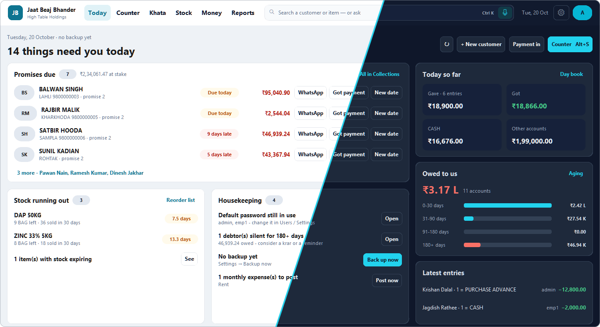

<sub>Every screenshot shows a made-up demo shop: names, phone numbers and amounts are invented.</sub>

</div>

---

## Why it exists

The shop runs on *khata*: farmers take seed and fertiliser now and pay after the harvest.
Each account earns interest, promises to pay (*karar*) have to be chased, and the same
farmer may sell wheat back to the shop. High Table Holdings keeps all of that straight:

- **Every account to the paisa.** 24 % a year as a daily rate, compounded on 31 March, the
  way the shop has always counted. Balances match the old program figure for figure.
- **Knows what needs doing today.** Promises due or late, stock about to run out, a missing
  backup, a monthly expense to post.
- **Fast at the counter.** Several items in one sale, cash paid on the spot, a printed slip,
  and undo for a mistake.
- **Speaks the shop's language.** The whole program switches to Hindi, customer names
  included, and you can ask it questions in Hindi, Hinglish or English, typed or spoken.
- **Safe with the books.** Admin and employee roles, an audit log of every change, screen
  lock, backups and restore, and updates that can be undone.

---

## A tour

### Today: what needs you

The admin's home screen. Every promise that is due or late has its WhatsApp reminder, *Got
payment* and *New date* buttons right there. Next to it: stock that runs out at the current
selling rate, housekeeping, today's money and who owes us, by age.

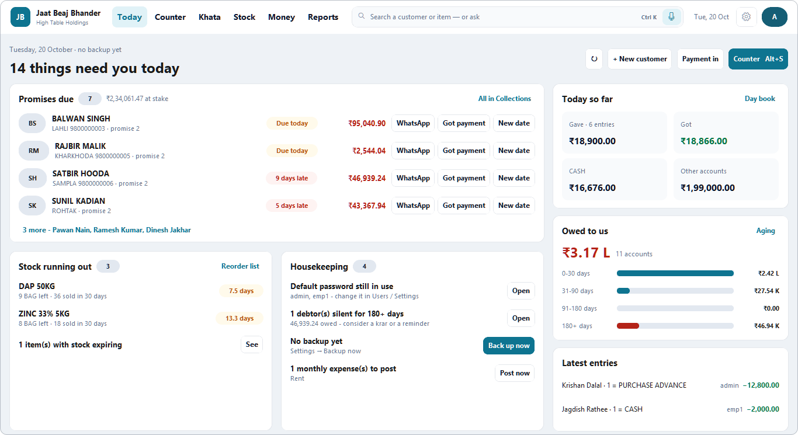

### Counter: every entry, in four tabs

**Sale**, **Purchase**, **Payment in** and **Payment out**, so nobody has to think in debit
and credit (the booking is still shown in small print). Pick the customer and their balance,
interest, promise and last entries appear. Add several lines, take part of the money now in
cash, bank or UPI, and the rest goes on the khata. `Ctrl+Enter` saves.

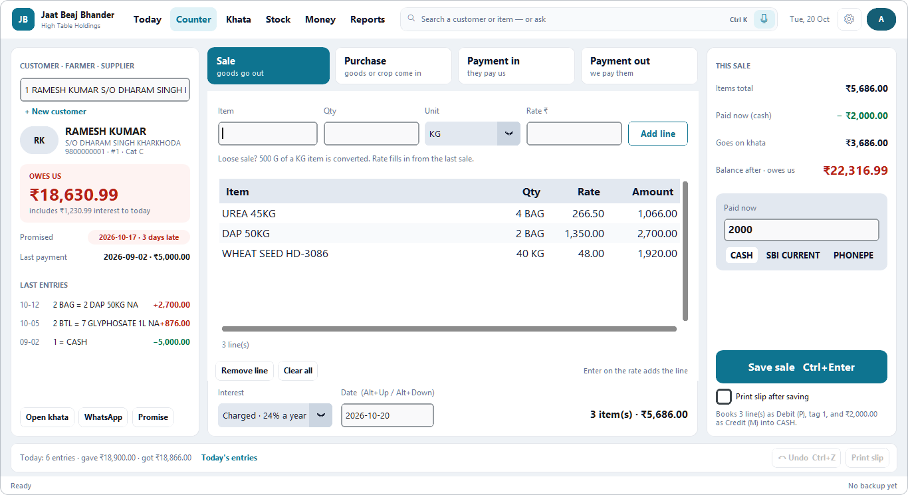

### Khata and Collections

<table>
<tr>
<td width="50%">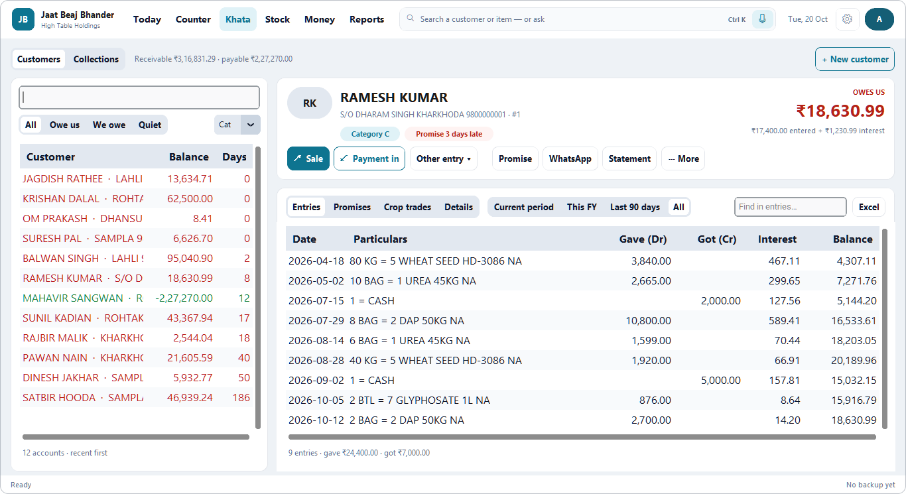</td>
<td width="50%">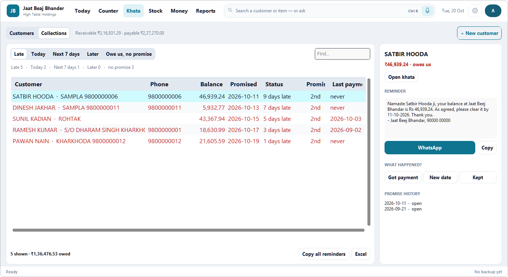</td>
</tr>
<tr>
<td><b>Khata</b>: every account with its balance and days since the last entry. A customer's
page shows what is owed (entered plus interest), the entries by period, promises, crop trades,
a statement and WhatsApp.</td>
<td><b>Collections</b>: promises sorted into Late, Today, Next 7 days and Later, plus people
who owe without a promise. The reminder is written for you; record what happened in one
click.</td>
</tr>
</table>

### Stock and Money

<table>
<tr>
<td width="50%">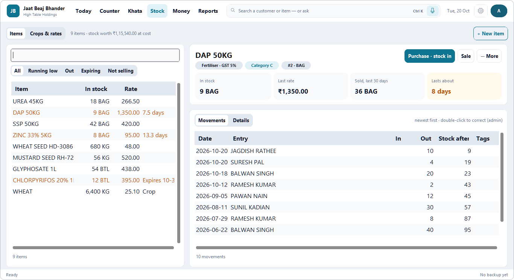</td>
<td width="50%">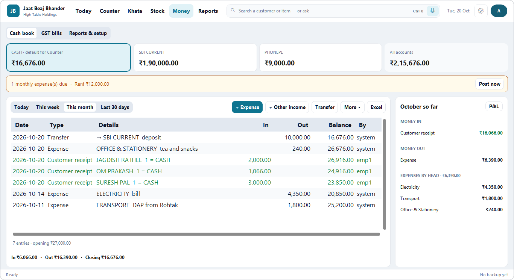</td>
</tr>
<tr>
<td><b>Stock</b>: filter by running low, out, expiring or not selling. Each item shows what is
left, the last rate, what sold in 30 days and <i>how many days it lasts</i>. Crop lots and
market rates sit in their own tab.</td>
<td><b>Money</b>: cash box, bank and UPI balances, the cash book with a running balance,
expenses by head, recurring rent ready to post, GST bills, and profit &amp; loss.</td>
</tr>
</table>

### Reports and Settings

<table>
<tr>
<td width="50%">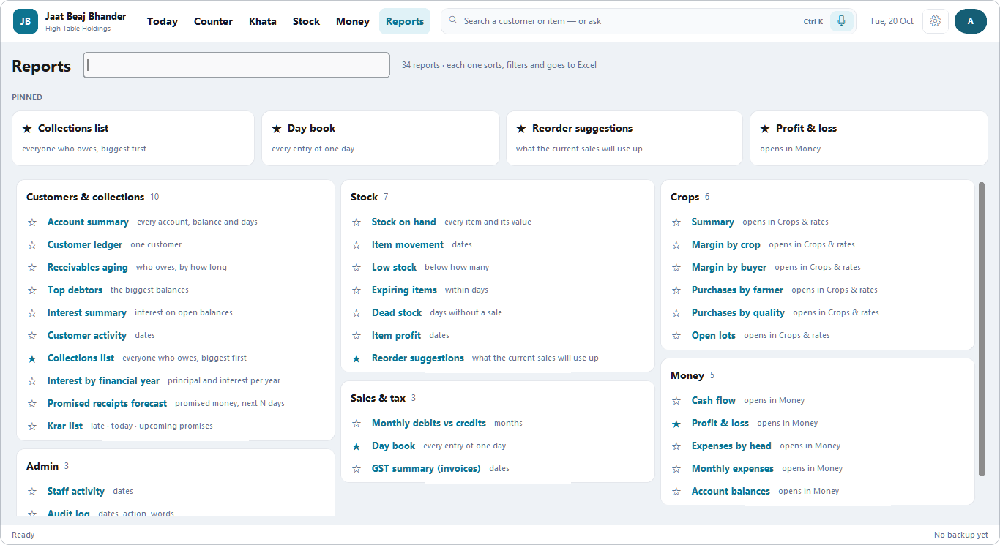</td>
<td width="50%">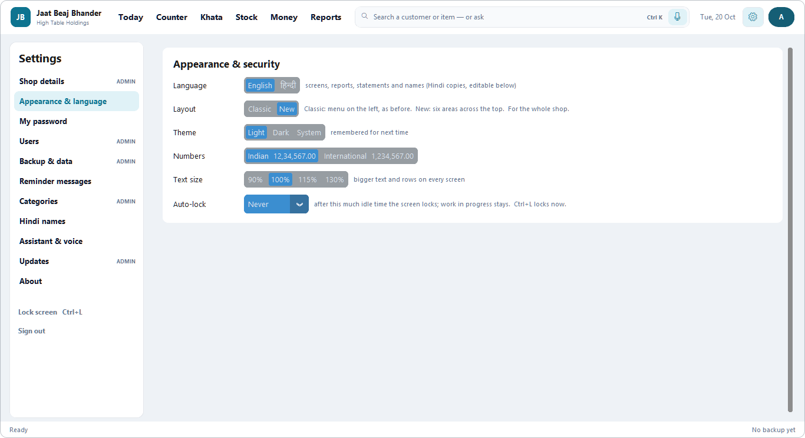</td>
</tr>
<tr>
<td><b>Reports</b>: 34 reports in one searchable catalogue: aging, interest, day book,
reorder, GST, crop margins, cash flow and more. Pin the ones you use. Every report sorts,
filters and goes to Excel.</td>
<td><b>Settings</b>: in sections. Language, layout, theme, Indian or international numbers,
text size and auto-lock, plus users, backups, reminder wording, categories, Hindi names, the
Assistant and updates.</td>
</tr>
</table>

### Ask the shop a question

Type or say it the way you would ask a person. Here, "who owes the most?" in Hinglish
(*sabse bade 5 bakayedar*) comes back in Hindi with the list and a button to the full report.
The Assistant only looks things up and never changes anything. Press **F2** (or 🎤) to ask
by voice. It understands the shop's own customer and item names and runs offline, even on
a Celeron.

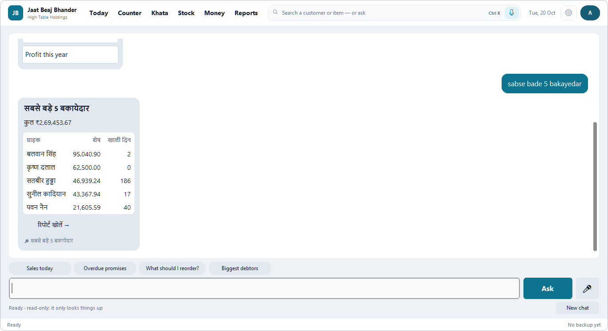

| ask | get |
|---|---|
| *Ramesh ka last month ka hisab btao* | "Which Ramesh?" with each one's village and phone, then that ledger |
| *यूरिया कितना बचा है* · *dap ka bhav* | stock left, or the selling price |
| *kiske karar ki tarikh nikal gayi* | overdue promises with balances |
| *pichle mahine kitni bikri hui*, then *aur is mahine?* | sales for each period |

### पूरा प्रोग्राम हिन्दी में (the whole program in Hindi)

One switch turns every screen, report, statement and slip into Hindi. Each customer and item
also gets a Hindi copy of its name, which you can correct. The books themselves stay in
English, so switching back loses nothing.

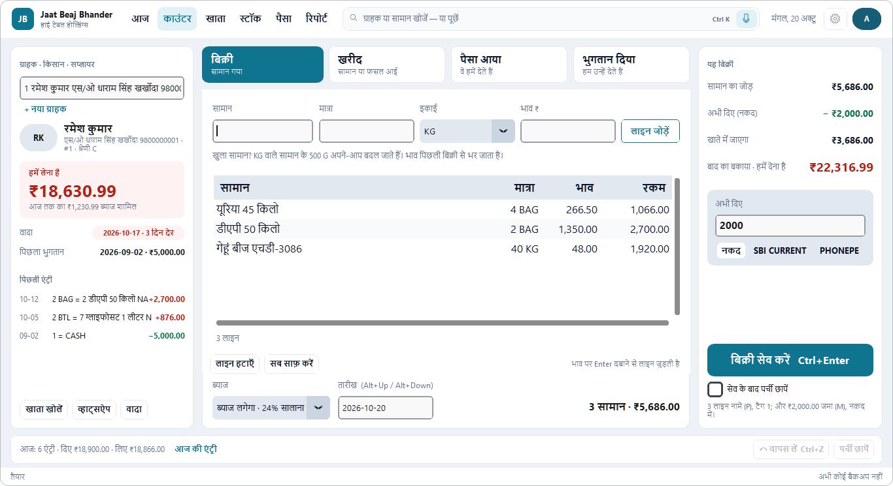

### Dark theme

<table>
<tr>
<td width="50%">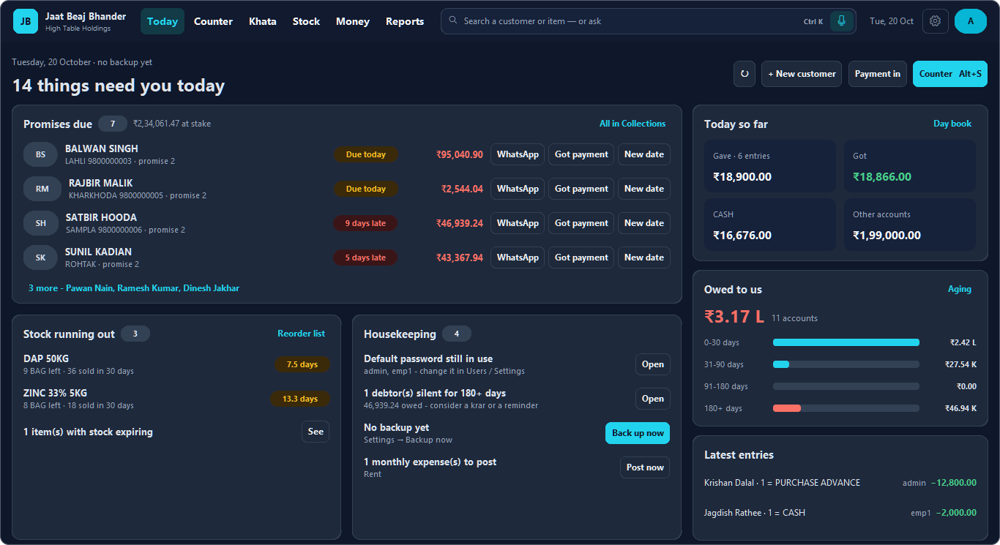</td>
<td width="50%">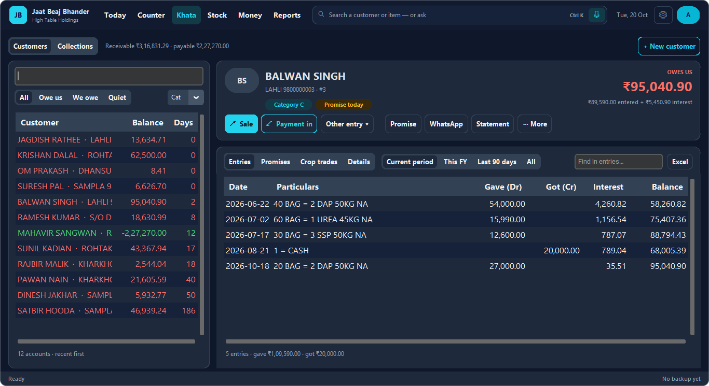</td>
</tr>
</table>

### Two layouts: New and Classic

v5.5 brought the layout above. The earlier sidebar layout, with its dashboard of charts, is
still there for anyone who prefers it. An admin switches the whole shop in Settings, either
way, at any time. Both layouts work on the same books and use the same Alt-key shortcuts.

<table>
<tr>
<td width="50%">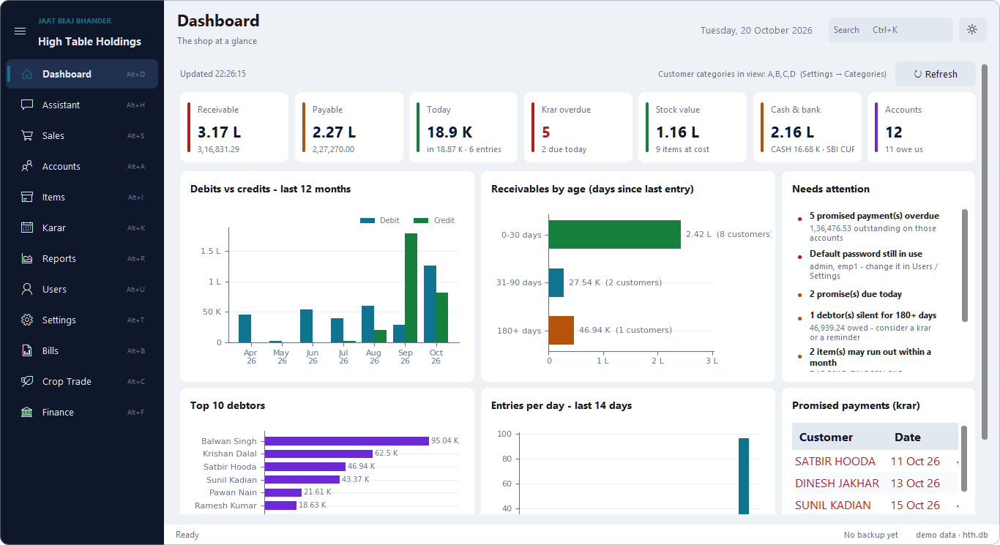</td>
<td width="50%">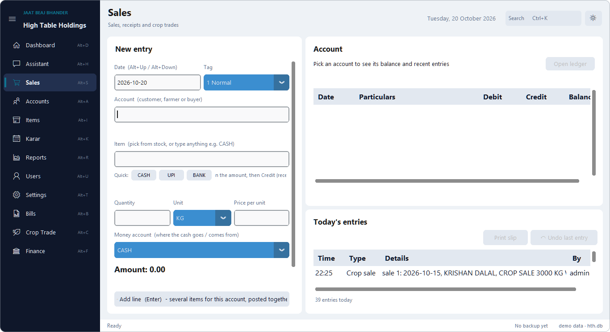</td>
</tr>
</table>

---

## What's inside

| | |
|---|---|
| **Khata** | Customer ledgers with 24 % interest (daily, compounded on 31 March), no-interest entries, settlements with discount, statements, WhatsApp reminders, categories A–E |
| **Promises (karar)** | Due dates per customer, late / today / upcoming lists, reminder templates in English and Hindi, a forecast of promised money |
| **Stock** | Items in their own units (KG ↔ QTL ↔ G, ML ↔ LTR, bags, bottles…), loose sales converted, expiry dates, reorder suggestions, dead stock |
| **Crop trading** | Buy farmers' crops in lots (weight, deduction, quality), sell first-in-first-out with the margin shown before saving, market rates |
| **Money** | Cash, bank and UPI accounts, expenses by head, recurring expenses, transfers, cash flow, profit & loss |
| **GST bills** | Invoices with CGST / SGST, DOCX (and PDF through Word), month batches, merged PDFs |
| **Reports** | 34 reports: sort, filter, Excel export, pin your favourites |
| **Assistant** | Questions in Hindi, Hinglish or English, typed or spoken (Vosk, offline), spoken answers, read-only |
| **People & safety** | Admin and employee roles, audit log, screen lock and login lockout, undo, backup and restore, data check |
| **Upkeep** | Updates itself from this repository (changed files only, hash-checked, can be undone), imports the old v3 data |

### How it is built

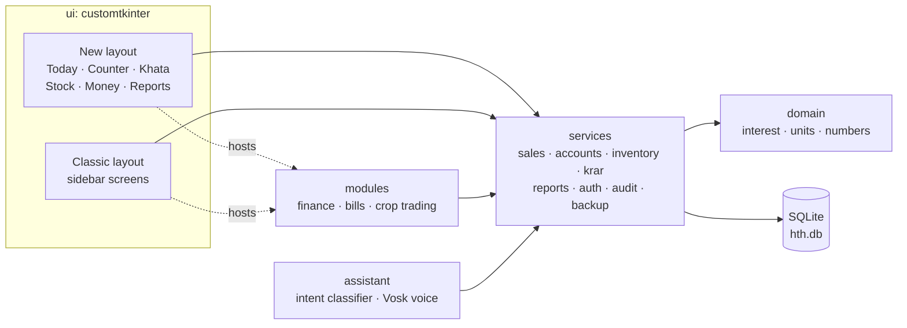

Screens never write SQL and services never touch Tk. Feature modules plug into both layouts
without the core importing them. The interest formula lives in one place and is pinned by
tests against the original program.

---

## Run it

```bash
cd v5
python -m venv .venv
.venv\Scripts\activate            # macOS/Linux: source .venv/bin/activate
pip install -r requirements.txt
python run.py
```

You need Python 3.10 or newer. It is built for Windows and also runs on macOS and Linux. On
the shop PC, double-click `v5/Start High Table Holdings v5.bat`.

The first start creates two users. **Change both passwords straight away**:

| username | password | role |
|---|---|---|
| `admin` | `admin` | Administrator |
| `emp1` | `emp1` | Employee |

The data lives in `C:\JBB\v5` on Windows, or wherever `HTH_DATA_DIR` points.

## Develop

```bash
cd v5
pip install -r requirements-dev.txt
pytest                                     # business rules, fast, in-memory SQLite
HTH_UI_TESTS=1 pytest tests/test_ui_smoke.py tests/test_ui_modern.py   # drives the real window
ruff check hth tests tools && ruff format hth tests tools
python tools/readme_shots.py               # retakes the screenshots on this page (Windows)
```

Branches, code standards, how to add a report or a migration, and the definition of done
are in [CONTRIBUTING.md](CONTRIBUTING.md); the test plan is
[v5/docs/TEST_PLAN.md](v5/docs/TEST_PLAN.md).

## In this repository

| folder | what it is |
|---|---|
| [`v5/`](v5) | **The app today (v5.7).** Start here. Full manual in [`v5/README.md`](v5/README.md), history in [`v5/CHANGELOG.md`](v5/CHANGELOG.md) |
| [`v5/docs/`](v5/docs/README.md) | User guide, admin guide, architecture and decision records, data dictionary, test plan and report, release process |
| [`HighTableHoldings-v4/`](HighTableHoldings-v4) | v4, the previous version: the ground-up rewrite of v3, kept for reference |
| [`sme/`](sme) | The SEM 2026-27 Software Engineering & Management course pack: SRS, DFDs, decision tables, PERT, test cases |
| [`docs/screenshots/`](docs/screenshots) | The images on this page |

More reading: [all documentation](v5/docs/README.md) · [user guide](v5/docs/USER_GUIDE.md) ·
[admin guide](v5/docs/ADMIN_GUIDE.md) · [architecture](v5/docs/ARCHITECTURE.md) ·
[how the Assistant understands questions](v5/docs/AI_CHAT_DESIGN.md) ·
[how voice works](v5/docs/VOICE_DESIGN.md) · [contributing](CONTRIBUTING.md) · [security](SECURITY.md)

## License

MIT, as declared in [`v5/pyproject.toml`](v5/pyproject.toml).
