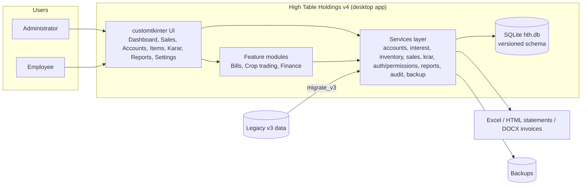

# High Table Holdings v4 — Accounting & Inventory Management for an Agri-Input Shop

**Course:** Software Engineering & Management (SEM 2026-27), BITS Pilani
**Team No.:** <<Team No.>>

| # | Name | BITS ID | Email |
|---|------|---------|-------|
| 1 | <<Member 1>> | <<ID>> | <<email>> |
| 2 | <<Member 2>> | <<ID>> | <<email>> |
| 3 | <<Member 3>> | <<ID>> | <<email>> |
| 4 | <<Member 4>> | <<ID>> | <<email>> |

## Problem

Small agricultural-input shops (seeds, fertiliser, pesticide) in India sell largely on
credit. The owner keeps a *bahi-khata* per customer, charges interest on outstanding
balances, notes promised payment dates (*krar*), buys crops back from the same farmers and
must issue GST invoices. Existing shop software is either generic accounting (no interest
periods, no krar, no crop lots) or a legacy in-house tool with one table per customer, no
users, no tests and hard-coded paths, which is fragile and impossible to extend.

## Proposed software prototype

**High Table Holdings v4 (HTH v4)** is a desktop application (Python 3.10, customtkinter,
SQLite) that re-engineers the legacy tool with the *same business rules* but a clean,
layered, tested architecture. It is a single-file database with role-based multi-user
access, and a plug-in module system for optional features.

## Most important features

1. **Customer ledgers with interest** — debit/credit entries, 24 % p.a. daily interest
   compounded at financial-year end, tag-based interest control, settlement that closes
   a period and starts a new one, print-ready statements.
2. **Inventory** — items with opening stock, unit families (KG/QTL/G, LTR/ML), fractional
   loose sales, stock valuation, low-stock / expiry / dead-stock alerts.
3. **Unified Sales screen** — one entry updates ledger, stock, cash book and audit log
   atomically; keyboard-first workflow.
4. **Krar (promise-to-pay)** — overdue / today / upcoming tracking, WhatsApp and clipboard
   reminders.
5. **Roles & audit** — Administrator vs Employee permission matrix; every write is logged
   with the acting user.
6. **Reports & dashboard** — 15+ sortable reports with Excel export, KPI tiles, aging,
   top debtors, trends; customer/item categories A–E scope every report.
7. **Feature modules** — GST **Bills** (DOCX/PDF), **Crop trading** (purchase lots,
   FIFO-costed sales, market rates), **Finance** (cash book, expenses, P&L, cash flow).
8. **Operations** — one-click and automatic daily backups, legacy-data importer with a
   migration report, data-quality check, first-run wizard, light/dark theme.

## Conceptual diagram

## Engineering approach

Iterative, test-driven development on Git: layered architecture (`ui → services →
db/domain`; views never write SQL), declarative permission matrix, versioned schema
migrations, `pytest` suite (business rules pinned against the legacy implementation,
migration equivalence, UI walkthrough), `ruff` linting, semantic versioning with a
changelog, PyInstaller packaging for the shop PC.

## Expected outcome

A working, installable prototype the shop can use from day one with its existing data,
plus complete SE artefacts: SRS, decision tables, algebraic specifications, DFDs, WBS,
activity network / PERT and a traceable test suite.
