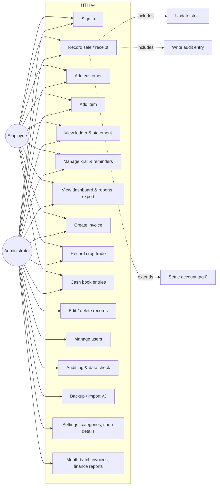
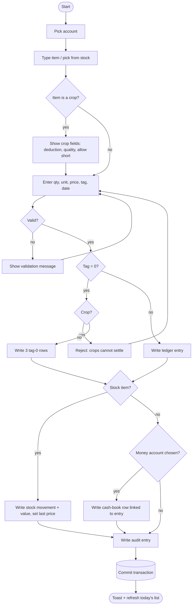
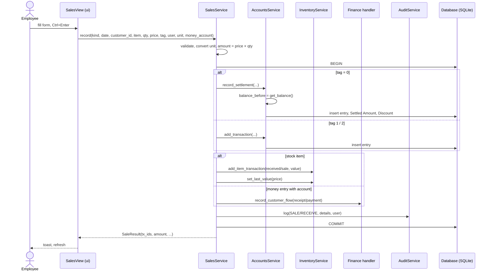
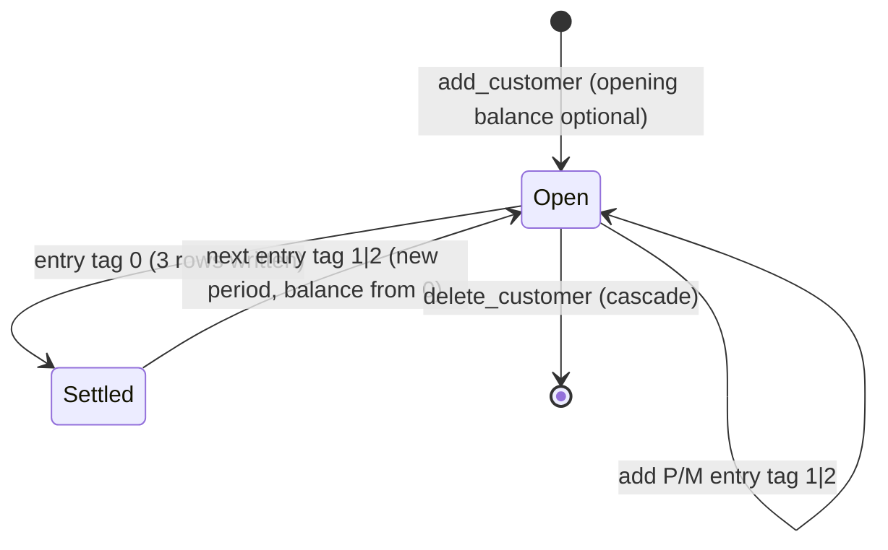
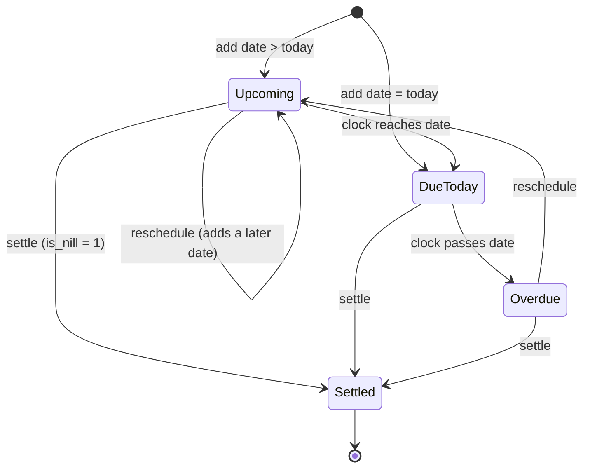
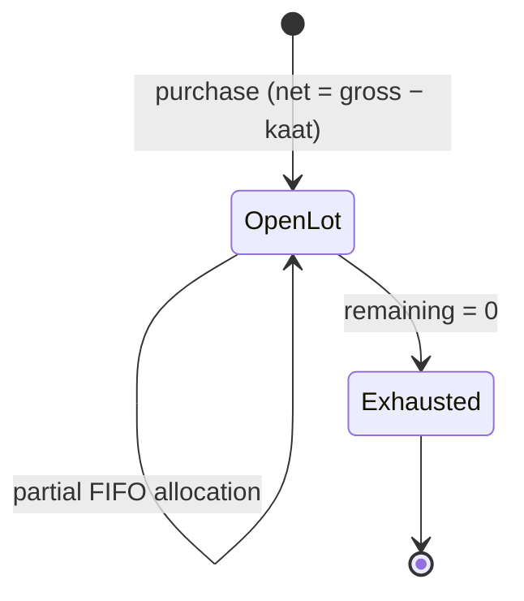

# Chapter 1 — Software Requirements Specification

This chapter moves from **informal** (natural-language user stories and glossary) through
**semi-formal** (use cases, UML activity / sequence / state diagrams) to **formal**
specification (numbered, testable requirements with pre/post-conditions). The decision
tables (Chapter 3) and algebraic specifications (Chapter 4) complete the formal part.

---

## 1.1 Introduction

### 1.1.1 Purpose
This SRS describes the functional and non-functional requirements of **High Table
Holdings v4 (HTH v4)**, a desktop accounting and inventory system for *Jaat Beaj Bhander*,
an agri-input shop. It is written for the development team, the course evaluator and the
shop owner (the customer).

### 1.1.2 Scope
HTH v4 replaces the legacy v3.7.1 tool. It **must reproduce v3's business results
exactly** (same interest, balances, stock figures) while adding multi-user access,
one normalised database, tests and optional feature modules (bills, crop trading,
finance). Out of scope: online/cloud sync, mobile app, payment gateway integration,
automatic market-rate feeds (an interface is provided for later).

### 1.1.3 Definitions, acronyms
| Term | Meaning |
|------|---------|
| Ledger entry / transaction | One row in a customer's account: date, description, amount, type, tag |
| Type `P` / `M` | `P` = debit (customer owes more; a sale or cash paid out); `M` = credit (payment received or goods purchased from the customer) |
| Tag `1` / `2` / `0` | `1` normal (earns interest); `2` no interest; `0` settlement marker |
| Period | Entries after the most recent tag-0 row; the balance is computed over the period only |
| Settlement | A tag-0 sale/receipt that writes three tag-0 rows (entry, *Settled Amount*, *Discount*) and restarts the period at zero |
| Krar / Karar | A customer's promise to pay by a date |
| Kaat | Deduction (quantity) on a crop purchase lot |
| FIFO | First-in-first-out costing of crop sales against open lots |
| Category A–E | Customer/item quality band; E = defaulter / discontinued (manual only) |
| Admin / Employee | The two roles; see the permission matrix |
| FY | Financial year, ends 31 March |
| SRS, DFD, WBS, PERT | Standard SE acronyms |

### 1.1.4 References
* Project Guidelines, SEM 2026-27 (Nalanda).
* IEEE Std 830-1998, *Recommended Practice for SRS*.
* Legacy application `HighTableHoldings-v3.7.1/documentation.md`.
* `HighTableHoldings-v4/README.md`, `CHANGELOG.md`.

### 1.1.5 Overview
§1.2 gives the informal specification, §1.3 the semi-formal models, §1.4 the formal
requirements, §1.5 non-functional requirements, §1.6 interfaces and constraints.

---

## 1.2 Informal specification

### 1.2.1 Product perspective
A stand-alone desktop application on the shop PC (Windows; also runs on macOS/Linux).
One SQLite file holds all data; exports (Excel, HTML statements, DOCX invoices) are
written next to it. There is no server. Two users share the PC: the owner
(Administrator) and a shop assistant (Employee).

### 1.2.2 Stakeholders and user classes
| User class | Characteristics | Needs |
|------------|-----------------|-------|
| Shop owner (Admin) | Non-technical, uses the tool daily, trusts the v3 numbers | Same figures as v3; ability to correct mistakes; control over who can delete; backups |
| Shop assistant (Employee) | Records sales and receipts at the counter | Fast keyboard entry; cannot edit or delete history |
| Customers (farmers) | Indirect users | Correct statements, timely reminders |
| Developer / maintainer | Extends the software | Layered code, tests, module contract |

### 1.2.3 User stories (informal requirements)
**Accounts and ledger**
* US-1 As an employee, I can create a customer account with an optional opening balance so that credit sales can be recorded against it.
* US-2 As a user, I can record a debit (sale / pay-out) or credit (receipt / purchase) against an account, with a date, amount and tag.
* US-3 As a user, I can see a customer's ledger with per-row interest and a running balance, identical to what v3 showed.
* US-4 As a user, I can settle an account (tag 0) so that the balance including interest and any discount is closed and a new period begins.
* US-5 As an admin, I can edit or delete a ledger entry when a mistake was made; the change is audited.
* US-6 As a user, I can print/save a customer statement for a date range with shop header, opening/closing balance and interest column.

**Inventory**
* US-7 As a user, I can add an item with opening stock, unit, batch, expiry, GST rate and type (fertiliser/pesticide/seed/crop/other).
* US-8 As a user, I can sell a fraction of a stock unit (100 g of a kg item, 2.5 quintal of a kg crop) and the stock is reduced correctly.
* US-9 As a user, I can see stock on hand, stock value, low-stock, expiring and dead-stock lists.
* US-10 As an admin, I can change an item's unit and have its whole history converted.

**Sales screen**
* US-11 As a user, one Sales form records a stock sale, a cash receipt, a crop purchase or a crop sale; the ledger, stock, cash book and audit log are updated together or not at all.
* US-12 As a user, choosing an item auto-fills its last price and shows the amount and the customer's current balance before I save.

**Krar**
* US-13 As a user, I can record or reschedule a customer's promised payment date and mark it settled.
* US-14 As a user, I can list overdue / today / upcoming promises and copy or send a WhatsApp reminder.

**Reports and dashboard**
* US-15 As a user, I can open any report, sort by column, export to Excel and double-click a row to jump to the ledger or item.
* US-16 As a user, the dashboard shows receivable, payable, stock value, krar, cash & bank, activity, aging and top debtors.
* US-17 As an admin, I can assign customers/items categories A–E and choose which categories the reports include.

**Users, security, operations**
* US-18 As a user, I sign in with a username and password; the first run forces me to replace the default passwords.
* US-19 As an admin, I can add users, reset passwords, change roles and deactivate users.
* US-20 As an admin, I can see who did what and when (audit log).
* US-21 As an admin, I can take a backup and the app takes one automatically each day.
* US-22 As an admin, I can import the v3 data with IDs preserved and get a report of every value that was skipped or normalised.
* US-23 As an admin, I can run a data check for invalid dates, negative stock, duplicates and other anomalies.

**Modules**
* US-24 As a user, I can create a GST invoice, save it as DOCX/PDF and browse/merge invoices by month; as an admin, I can generate the month batch as v3 did.
* US-25 As a user, I can buy crops from farmers as lots (gross, deduction, net, rate, quality) and sell them to buyers with FIFO cost and margin.
* US-26 As a user, I can keep cash / bank / UPI accounts, record expenses, transfers, drawings and recurring expenses, and see cash flow and profit & loss.

### 1.2.4 Assumptions and dependencies
* Interest rate (24 % p.a.), financial-year end (31 March) and GST rates are constants of the business; changing them is a code change with a test update.
* The PC clock is correct (interest depends on "today").
* Microsoft Word is optional; it is only needed for DOCX→PDF conversion of invoices.

---

## 1.3 Semi-formal specification

### 1.3.1 Use-case diagram

### 1.3.2 Use-case descriptions

**UC-2 Record sale / receipt**

| Field | Description |
|-------|-------------|
| Actors | Employee, Administrator |
| Pre-conditions | User signed in with `record_sale`; at least one customer exists |
| Trigger | User opens *Sales* (Alt+S) |
| Main flow | 1. User picks an account (search by id/name/village). 2. User types an item; a stock item auto-fills unit and last price; the current balance is shown. 3. User enters quantity, unit, price, tag, date. 4. Live amount preview is shown. 5. User presses **Debit** (Ctrl+Enter) or **Credit** (Ctrl+Shift+Enter). 6. System validates, writes the ledger entry, the stock movement (if a stock item), the cash-book row (if a money entry with a money account), sets the item's last price, writes the audit entry — all in one transaction. 7. Toast confirms; today's list refreshes. |
| Alternative flows | 3a. Quantity entered in a compatible unit → converted to the stock unit. 3b. Item is a crop (type C) → crop fields appear; Credit records a purchase lot, Debit a FIFO-costed sale with margin preview (UC-9). 5a. Tag 0 → settlement flow (UC-19): three tag-0 rows are written. |
| Exceptions | Invalid date / non-positive quantity / bad tag / unknown account → validation message, nothing written. Incompatible unit (PKT → KG) → rejected. Crop with tag 0 → rejected. Crop sale exceeding stock without *Allow selling short* → rejected. |
| Post-conditions | Ledger, stock, cash book and audit log are consistent; balance and stock on hand reflect the entry. |

**UC-19 Settle account (tag 0)**

| Field | Description |
|-------|-------------|
| Pre-conditions | As UC-2, tag = 0 |
| Main flow | 1. System computes `balance_before` (principal + interest of the current period). 2. Writes the entry row (tag 0). 3. Writes *Settled Amount* = `balance_before` (type M, tag 0). 4. Writes *Discount* = `balance_before + amount` (if P) or `balance_before − amount` (if M) (type M, tag 0, may be negative). |
| Post-conditions | `balance = 0` for the new period; previous rows remain visible in the ledger with running balance reset. |

**UC-6 Manage krar**

| Field | Description |
|-------|-------------|
| Main flow | Add/reschedule a promised date for a customer (a customer has one open krar with one or more dates); list by bucket (Overdue / Today / Upcoming) using the latest date; settle (`is_nill = 1`); copy or WhatsApp a reminder built from a template (name, amount, date). |
| Exceptions | Reminder via WhatsApp requires a 10-digit mobile number in the account details. |

**UC-14 Import v3 data**

| Field | Description |
|-------|-------------|
| Actors | Administrator |
| Main flow | 1. Backup current DB. 2. Read the v3 folder (per-customer, per-item, per-day tables). 3. Preserve IDs; normalise tags/types/dates. 4. Every skipped or normalised value is listed with source table and row in `migration_report.txt`. 5. Balances for each customer equal v3's for the same date. |

**UC-12 Manage users** — Admin creates a user (username, full name, role), resets a
password, changes role, activates/deactivates. Users cannot deactivate themselves.
Passwords are stored as salted hashes.

### 1.3.3 Activity diagram — Record sale / receipt

### 1.3.4 Sequence diagram — Record sale

### 1.3.5 State diagrams

**Customer account period**

**Krar**

**Crop lot**

---

## 1.4 Formal functional requirements

Each requirement has an id (traced in Chapter 6), a priority (M = must, S = should,
C = could) and, where the behaviour is numeric, a pre/post-condition in predicate form.
Notation: `bal(c, d)` balance of customer `c` on date `d`; `I(a, d1, d2)` interest on
amount `a` from `d1` to `d2` (Chapter 4 defines both algebraically).

### 1.4.1 Authentication and authorisation
| Id | Requirement | Pri |
|----|-------------|-----|
| FR-1.1 | The system shall require a username and password before any screen is shown. Passwords are stored as salted hashes, never in clear. | M |
| FR-1.2 | The system shall seed `admin` (role admin) and `emp1` (role employee) on first launch and the first-run wizard shall refuse to keep the default passwords. | M |
| FR-1.3 | The system shall enforce the role → permission matrix in `services/permissions.py` for every screen and destructive button. Employee ⊂ Admin; only admin has `edit_records, delete_records, view_audit, manage_users, manage_settings, backup, billing_batch, finance_reports`. | M |
| FR-1.4 | Every write shall record the acting username; login and logout shall be audited (code 08). | M |
| FR-1.5 | An inactive user shall not be able to sign in and shall have no permissions. | M |

### 1.4.2 Accounts and ledger
| Id | Requirement | Pri |
|----|-------------|-----|
| FR-2.1 | Create a customer with name, free-text details and optional opening balance; an opening balance creates one `P`/tag-1 entry dated today. | M |
| FR-2.2 | Add a ledger entry with `date ∈ YYYY-MM-DD`, `amount > 0` (negative only for derived settlement rows), `type ∈ {P, M}`, `tag ∈ {0,1,2}`. Invalid input shall raise a validation error and write nothing. | M |
| FR-2.3 | **Balance.** Let `E` be the entries after the last tag-0 row (ordered by date, id). `bal(c,d) = round(Σ_{e∈E} s(e)·v(e,d), 2)` where `s(e)=+1` if `P` else `−1`, and `v(e,d) = amount + I(amount, date_e, d)` if tag 1, else `amount`. | M |
| FR-2.4 | **Interest.** `I(a, d1, d2)` = simple interest at `0.24/365` per day, with accrued interest added to principal on each 31 March between `d1` and `d2`; rounded to 2 dp; `d2` defaults to the *current* date at call time. The value shall equal v3's implementation for the same inputs. | M |
| FR-2.5 | **Settlement.** A tag-0 entry `(amount a, type t)` on date `d` shall write exactly three tag-0 rows: the entry, `Settled Amount = bal(c,d)` (type M) and `Discount = bal(c,d) + a` if `t = P` else `bal(c,d) − a` (type M, may be negative). Post-condition: `bal(c,d) = 0`. | M |
| FR-2.6 | Ledger view shows every entry with its interest to date and a running balance that resets at each settlement. | M |
| FR-2.7 | Admin can edit or delete any entry; deletion of a customer cascades to entries, krar and lots. Both are audited (05/06). | M |
| FR-2.8 | *Days* = days since the newest non-settlement entry; *Score* = `0.6·norm(log amount) + 0.4·norm(log days)` over the customer population (E excluded when the setting is on). | S |
| FR-2.9 | Customer statement for a date range: opening balance, each entry with interest, totals, closing balance, shop header, as print-ready HTML. | S |

### 1.4.3 Inventory and units
| Id | Requirement | Pri |
|----|-------------|-----|
| FR-3.1 | Create an item with name, opening stock, unit, batch, expiry, GST rate, type ∈ {F,P,S,C,O}, pakka/kacha. Opening stock writes one *received* movement. | M |
| FR-3.2 | `stock(i) = Σ received − Σ sale` over the item's movements, in the item's unit; quantities are real numbers (v3 truncated). | M |
| FR-3.3 | Units: mass {G, KG, QTL} (1 QTL = 100 KG = 100 000 G), volume {ML, LTR}, count {PCS, BAG, BOX, PKT, BTL}. Conversion is allowed only within a family; otherwise a validation error. Price is always per stock unit. | M |
| FR-3.4 | A sale/receipt against a stock item writes a movement with its value and sets the item's last price. | M |
| FR-3.5 | Changing an item's unit converts every movement, lot, sale and rate by the family factor (or a user-supplied factor for unrelated units, or relabel only); per-unit prices are divided by the factor; money amounts are unchanged. | S |
| FR-3.6 | Reports: stock on hand, item movement, low stock (threshold), expiring (days), dead stock (days without sale). | M |

### 1.4.4 Sales screen
| Id | Requirement | Pri |
|----|-------------|-----|
| FR-4.1 | One form shall record: stock sale (P), stock purchase/receipt (M), money receipt/payment (item `CASH` or free text), crop purchase (M on type C) and crop sale (P on type C). | M |
| FR-4.2 | The write in FR-4.1 shall be atomic: ledger, stock, cash book and audit rows are all committed or none are. | M |
| FR-4.3 | Selecting an item auto-fills unit and last price; the amount and the account's current balance are previewed before saving. | S |
| FR-4.4 | A crop trade shall not carry tag 0. | M |
| FR-4.5 | A money entry with a money account shall write a cash-book row linked to the ledger entry (Finance module present). | S |

### 1.4.5 Krar
| Id | Requirement | Pri |
|----|-------------|-----|
| FR-5.1 | A customer has at most one open krar (`is_nill = 0`) with one or more promised dates; adding a date to an open krar reschedules it. | M |
| FR-5.2 | Bucket by latest date `L`: Overdue if `L < today`, Today if `L = today`, Upcoming if `L > today`. | M |
| FR-5.3 | Settle sets `is_nill = 1` and is audited (07). | M |
| FR-5.4 | Reminder text is rendered from the template with name, amount and date; WhatsApp link is offered only when a 10-digit mobile number is found in the details. | S |

### 1.4.6 Reports, dashboard, categories
| Id | Requirement | Pri |
|----|-------------|-----|
| FR-6.1 | The report catalogue (account summary, customer ledger, receivables aging, top debtors, interest summary, customer activity, monthly debits vs credits, day book, stock on hand, item movement, low stock, expiring, dead stock, krar list, audit log, data check) shall be declarative (`ReportSpec`); each report is sortable and exportable to Excel. | M |
| FR-6.2 | Dashboard KPIs: receivable, payable, stock value, krar count, cash & bank; charts: 14-day activity, monthly debits vs credits, receivables by age; top 10 debtors; krar list. | M |
| FR-6.3 | Every customer and item carries a category A–E; E is manual only and locked; a manually set category is locked; re-scoring maps score → A–D by thresholds; item auto-categorisation by days since last sale. | S |
| FR-6.4 | Report/dashboard scope is the set of categories chosen in Settings (default A–D) with a per-report *All categories* override. | S |

### 1.4.7 Administration and operations
| Id | Requirement | Pri |
|----|-------------|-----|
| FR-7.1 | Audit log with codes 01–12 (account, item, sale, receive, modify, delete, krar, login, user, crop, rate, finance), searchable by date range, action and text. | M |
| FR-7.2 | Backup now (consistent copy) and automatic daily backup on first start each day, pruned to the last N. | M |
| FR-7.3 | Import v3 data preserving customer/item/krar ids; balances after import equal v3 for the same date; every skipped/normalised value listed in `migration_report.txt`. | M |
| FR-7.4 | Data check reporting invalid/future dates, negative stock, duplicate customers, zero-amount entries, lone settlement rows, open krar with nothing owed, long-inactive debtors. | S |
| FR-7.5 | Settings: theme, shop details, reminder template, categories, backup options, re-run wizard, change password. | S |
| FR-7.6 | Global search (Ctrl+K) across accounts, items and bills. | C |

### 1.4.8 Modules
| Id | Requirement | Pri |
|----|-------------|-----|
| FR-8.1 | **Bills**: invoice with lines, CGST = SGST = 9 % for type P, 2.5 % for F, 0 for S/O; tax rounded to 2 dp; amount in Hindi words; DOCX via template; PDF when Word is available; browse/merge by month; admin month batch identical to v3's random split; bills ≥ ₹20 000 flagged not rendered. | S |
| FR-8.2 | **Crop trading**: crop = item type C; purchase = lot (gross, kaat, net, rate, quality) crediting the farmer (tag 2 default) and adding stock; sale FIFO-costed against open lots storing cost, margin, margin %; selling short refused unless allowed (uncovered part at last purchase rate, flagged); valuation at cost and at latest market rate; CSV rate import; naive trend estimate. | S |
| FR-8.3 | **Finance**: money accounts with opening balances; cash book with running balance; expense/income heads; transfers, capital in, drawings; recurring expenses posted idempotently; reports cash flow, P&L (item margin + crop margin + other income − expenses; accrued interest excluded), expenses by head, monthly expenses, balances. | S |
| FR-8.4 | Modules register through `ModuleSpec` (key, label, view factory, permission, shortcut) and add tables through the versioned migration list; they never import other modules' UI. | M |

---

## 1.5 Non-functional requirements
| Id | Requirement |
|----|-------------|
| NFR-1 Correctness | Business figures identical to v3.7.1 for identical data (pinned by `tests/test_interest.py`, `tests/test_migration.py`). |
| NFR-2 Performance | Any screen or report on a database of 5 000 customers / 200 000 entries renders in < 2 s on the shop PC (indexes on `(customer_id, date, id)` and `(item_id, date, id)`). |
| NFR-3 Reliability | Every multi-table write is one SQLite transaction; foreign keys enforced; daily automatic backup. |
| NFR-4 Usability | Keyboard-first: Alt+letter navigation, Ctrl+Enter / Ctrl+Shift+Enter to post, Ctrl+K search; light/dark theme; toasts instead of console output; forms usable at 1366×768. |
| NFR-5 Security | Salted password hashes; permission check on every action; audit trail with username; no plaintext credentials in logs. |
| NFR-6 Portability | Python 3.10+, Windows/macOS/Linux; data folder per platform or `HTH_DATA_DIR`; single-folder PyInstaller build. |
| NFR-7 Maintainability | Layering `ui → services → db/domain`; views never write SQL; services never import Tk; declarative reports, permissions, modules; `ruff` clean; semantic versioning with changelog. |
| NFR-8 Testability | Business rules testable without a display on an in-memory SQLite; opt-in UI walkthrough test. |
| NFR-9 Data integrity | Versioned schema (`PRAGMA user_version`) with forward-only migrations; import never guesses silently. |

## 1.6 External interfaces and constraints
* **User interface**: customtkinter desktop windows; sidebar navigation; data tables with sortable columns.
* **File interfaces**: `hth.db` (SQLite), `exports/*.xlsx` (openpyxl), `exports/*.html` statements, `bills/*.docx` (docxtpl), `pdfs/`, `merged_pdfs/` (pypdf), `backups/*.db`, `logs/*.log`, `migration_report.txt`, CSV `crop,date,rate`.
* **Software interfaces**: Python 3.10, customtkinter ≥ 5.2, matplotlib ≥ 3.7, openpyxl ≥ 3.1, docxtpl ≥ 0.16, pypdf ≥ 4; optional docx2pdf + Microsoft Word; WhatsApp via `https://wa.me/<number>?text=` URL.
* **Constraints**: no network dependency at runtime; single shop PC; v3 data must remain importable; Hindi amount-in-words for invoices.
