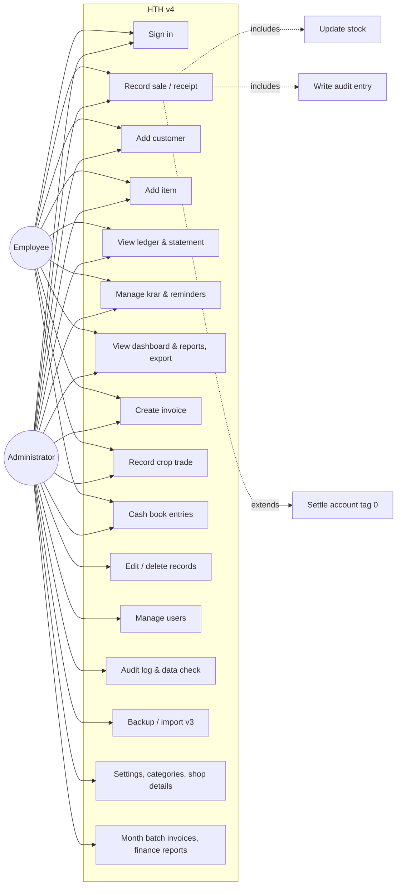
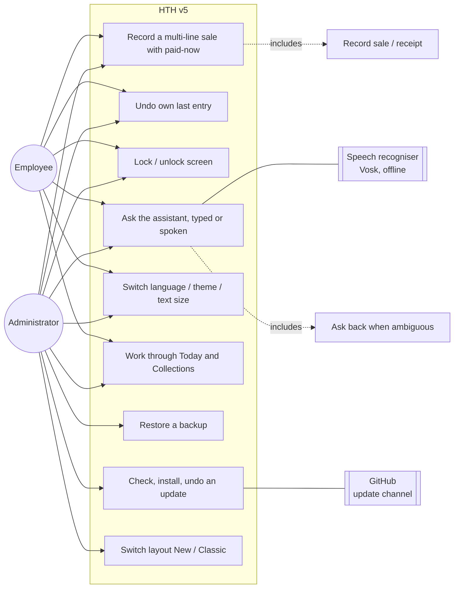
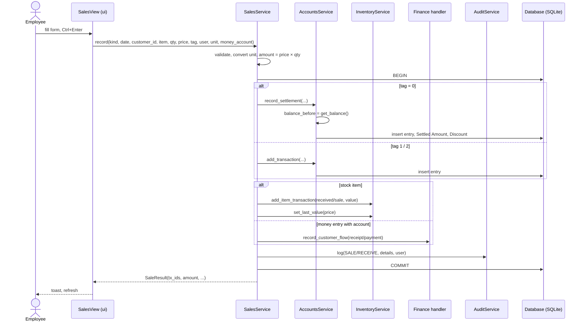
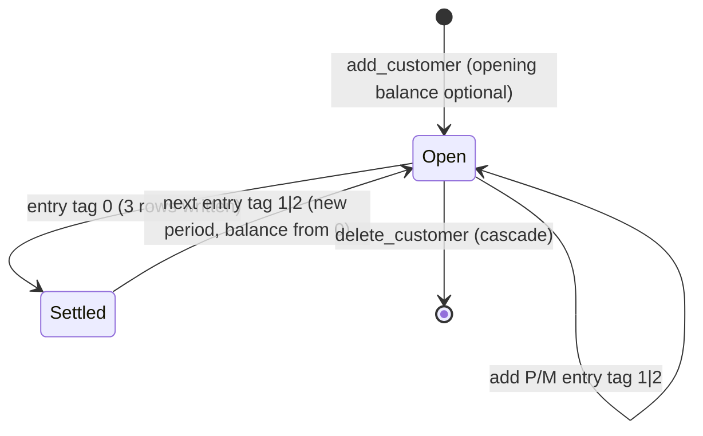
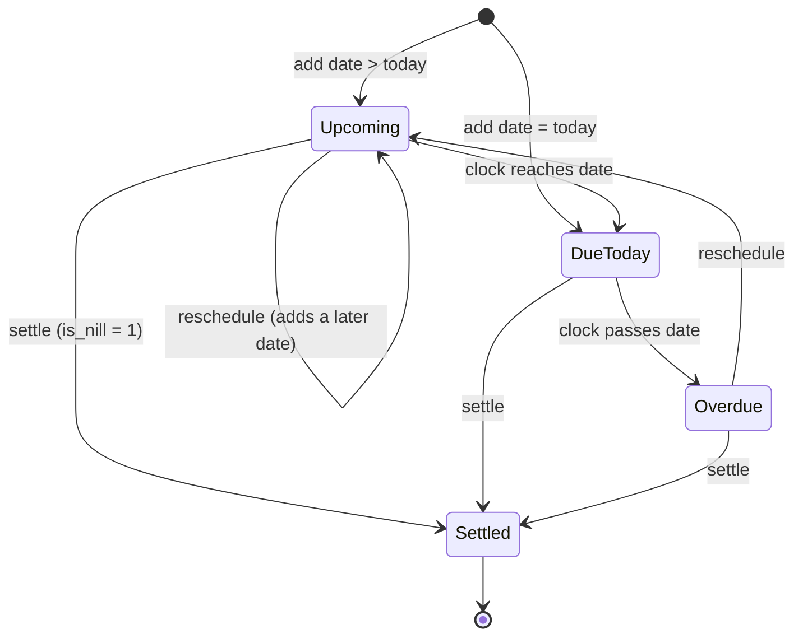
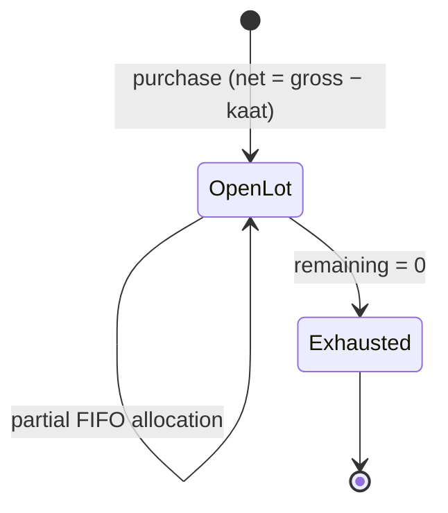
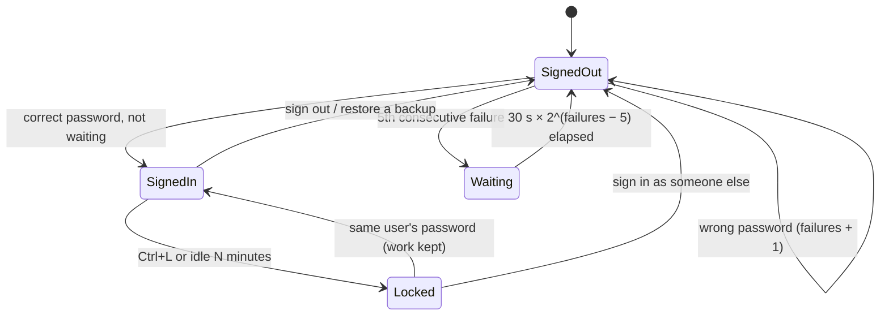
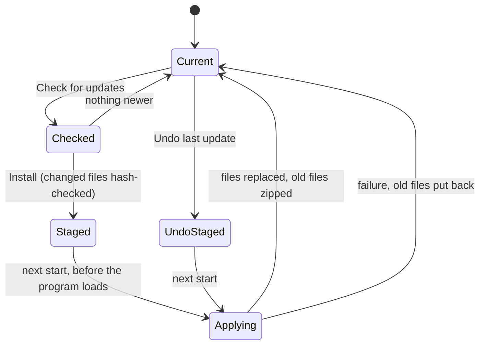
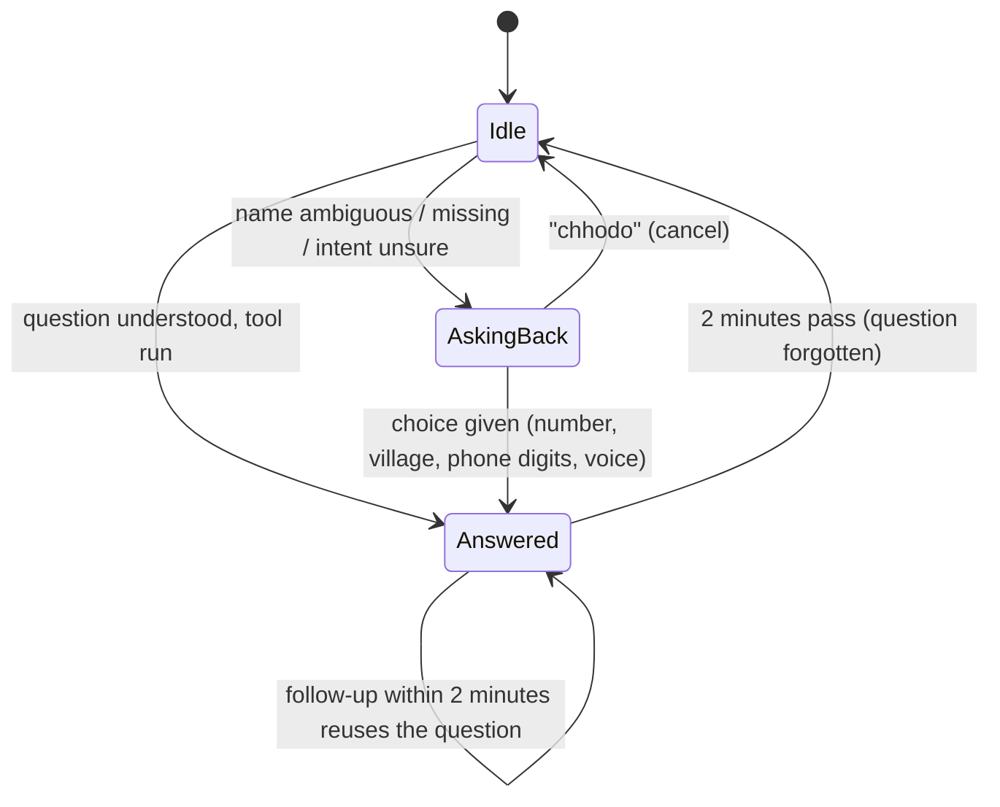
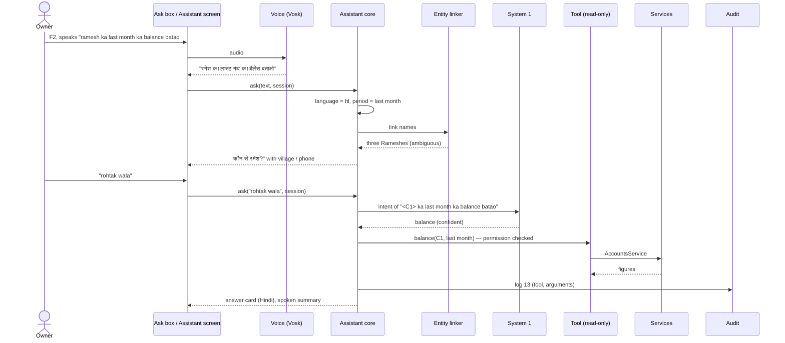

# Chapter 1 — Software Requirements Specification

This chapter moves from **informal** (natural-language user stories and glossary) through
**semi-formal** (use cases, UML activity / sequence / state diagrams) to **formal**
specification (numbered, testable requirements with pre/post-conditions). The decision
tables (Chapter 3) and algebraic specifications (Chapter 4) complete the formal part.

---

## 1.1 Introduction

### 1.1.1 Purpose
This SRS describes the functional and non-functional requirements of **High Table
Holdings (HTH)**, a desktop accounting and inventory system for *Jaat Beaj Bhander*, an
agri-input shop, as built in **version 5.7.0**. It is written for the development team, the
course evaluator and the shop owner (the customer).

### 1.1.2 Scope
HTH was delivered in two increments:

* **v4** (4.0 – 4.7, August 2026) replaced the legacy v3.7.1 tool. It **must reproduce
  v3's business results exactly** (same interest, balances, stock figures) while adding
  multi-user access, one normalised database, tests and optional feature modules (bills,
  crop trading, finance). Requirements FR-1 … FR-8.
* **v5** (5.0 – 5.7, October 2026) keeps v4's rules and numbers byte-for-byte and adds
  safety (screen lock, login lockout, restore, undo, atomic migrations, its own data
  folder), counter speed (several lines, paid-now, slips), a Hindi interface, a read-only
  assistant answering typed or spoken questions offline, in-app updates, a second layout in
  shop words, colour themes and seven new reports. Requirements FR-9 … FR-14.

Out of scope: online/cloud sync, mobile app, payment gateway integration, automatic
market-rate feeds (an interface is provided for later), an assistant that changes data.

### 1.1.3 Definitions, acronyms
| Term | Meaning |
|------|---------|
| Ledger entry / transaction | One row in a customer's account: date, description, amount, type, tag |
| Type `P` / `M` | `P` = debit (customer owes more; a sale or cash paid out); `M` = credit (payment received or goods purchased from the customer) |
| Tag `1` / `2` / `0` | `1` normal (earns interest); `2` no interest; `0` settlement marker |
| Period | Entries after the most recent tag-0 row; the balance is computed over the period only |
| Settlement | A tag-0 sale/receipt that writes three tag-0 rows (entry, *Settled Amount*, *Discount*) and restarts the period at zero |
| Krar / Karar | A customer's promise to pay by a date |
| Kaat | Deduction (quantity) on a crop purchase lot |
| FIFO | First-in-first-out costing of crop sales against open lots |
| Category A–E | Customer/item quality band; E = defaulter / discontinued (manual only) |
| Admin / Employee | The two roles; see the permission matrix |
| FY | Financial year, ends 31 March |
| Khata | The customer's running account (the ledger) |
| Collections | v5's name for the krar screen: everyone who owes, sorted by promise |
| Counter | v5's entry screen: Sale, Purchase, Payment in, Payment out |
| New / Classic layout | The two sets of screens over the same data (v5.5) |
| Assistant, System 1 / System 2 | The read-only question answerer; its built-in classifier / its optional small language model |
| Undo window | 15 minutes in which the user who saved an entry can reverse it |
| Update channel | The `v5` branch of the GitHub repository, which shop PCs install from |
| SRS, DFD, WBS, PERT | Standard SE acronyms |

### 1.1.4 References
* Project Guidelines, SEM 2026-27 (Nalanda).
* IEEE Std 830-1998, *Recommended Practice for SRS*.
* Legacy application `HighTableHoldings-v3.7.1/documentation.md`.
* `HighTableHoldings-v4/README.md`, `CHANGELOG.md` (v4).
* `v5/README.md`, `v5/CHANGELOG.md`, `v5/docs/` (user and admin guides, architecture, data
  dictionary, decision records, test plan) (v5).

### 1.1.5 Overview
§1.2 gives the informal specification, §1.3 the semi-formal models, §1.4 the formal
requirements, §1.5 non-functional requirements, §1.6 interfaces and constraints. The v5
additions are marked **(v5)** in §1.2–1.3 and form §1.4.9 – §1.4.14.

---

## 1.2 Informal specification

### 1.2.1 Product perspective
A stand-alone desktop application on the shop PC (Windows; also runs on macOS/Linux).
One SQLite file holds all data; exports (Excel, HTML statements, DOCX invoices) are
written next to it. There is no server. Two users share the PC: the owner
(Administrator) and a shop assistant (Employee).

### 1.2.2 Stakeholders and user classes
| User class | Characteristics | Needs |
|------------|-----------------|-------|
| Shop owner (Admin) | Non-technical, uses the tool daily, trusts the v3 numbers | Same figures as v3; ability to correct mistakes; control over who can delete; backups |
| Shop assistant (Employee) | Records sales and receipts at the counter | Fast keyboard entry; cannot edit or delete history |
| Customers (farmers) | Indirect users | Correct statements, timely reminders |
| Developer / maintainer | Extends the software | Layered code, tests, module contract |

### 1.2.3 User stories (informal requirements)
**Accounts and ledger**
* US-1 As an employee, I can create a customer account with an optional opening balance so that credit sales can be recorded against it.
* US-2 As a user, I can record a debit (sale / pay-out) or credit (receipt / purchase) against an account, with a date, amount and tag.
* US-3 As a user, I can see a customer's ledger with per-row interest and a running balance, identical to what v3 showed.
* US-4 As a user, I can settle an account (tag 0) so that the balance including interest and any discount is closed and a new period begins.
* US-5 As an admin, I can edit or delete a ledger entry when a mistake was made; the change is audited.
* US-6 As a user, I can print/save a customer statement for a date range with shop header, opening/closing balance and interest column.

**Inventory**
* US-7 As a user, I can add an item with opening stock, unit, batch, expiry, GST rate and type (fertiliser/pesticide/seed/crop/other).
* US-8 As a user, I can sell a fraction of a stock unit (100 g of a kg item, 2.5 quintal of a kg crop) and the stock is reduced correctly.
* US-9 As a user, I can see stock on hand, stock value, low-stock, expiring and dead-stock lists.
* US-10 As an admin, I can change an item's unit and have its whole history converted.

**Sales screen**
* US-11 As a user, one Sales form records a stock sale, a cash receipt, a crop purchase or a crop sale; the ledger, stock, cash book and audit log are updated together or not at all.
* US-12 As a user, choosing an item auto-fills its last price and shows the amount and the customer's current balance before I save.

**Krar**
* US-13 As a user, I can record or reschedule a customer's promised payment date and mark it settled.
* US-14 As a user, I can list overdue / today / upcoming promises and copy or send a WhatsApp reminder.

**Reports and dashboard**
* US-15 As a user, I can open any report, sort by column, export to Excel and double-click a row to jump to the ledger or item.
* US-16 As a user, the dashboard shows receivable, payable, stock value, krar, cash & bank, activity, aging and top debtors.
* US-17 As an admin, I can assign customers/items categories A–E and choose which categories the reports include.

**Users, security, operations**
* US-18 As a user, I sign in with a username and password; the first run forces me to replace the default passwords.
* US-19 As an admin, I can add users, reset passwords, change roles and deactivate users.
* US-20 As an admin, I can see who did what and when (audit log).
* US-21 As an admin, I can take a backup and the app takes one automatically each day.
* US-22 As an admin, I can import the v3 data with IDs preserved and get a report of every value that was skipped or normalised.
* US-23 As an admin, I can run a data check for invalid dates, negative stock, duplicates and other anomalies.

**Modules**
* US-24 As a user, I can create a GST invoice, save it as DOCX/PDF and browse/merge invoices by month; as an admin, I can generate the month batch as v3 did.
* US-25 As a user, I can buy crops from farmers as lots (gross, deduction, net, rate, quality) and sell them to buyers with FIFO cost and margin.
* US-26 As a user, I can keep cash / bank / UPI accounts, record expenses, transfers, drawings and recurring expenses, and see cash flow and profit & loss.

**v5: counter, safety and daily work**
* US-27 As a user, I can put several items on one sale and take part of the money now in cash, bank or UPI, so a counter sale is one save.
* US-28 As a user, I can undo the entry I just saved, within 15 minutes, and everything it wrote goes back.
* US-29 As a user, I can print an 80 mm slip of an entry for the customer.
* US-30 As a user, I can lock the screen when I step away, and the admin can make it lock itself after idle minutes, without losing what I was typing.
* US-31 As the owner, I want repeated wrong passwords to make that username wait, and failed sign-ins to be audited.
* US-32 As an admin, I can restore a backup, and the program checks it and saves the current data first.
* US-33 As the owner, I open one screen (*Today*) that lists what needs doing: promises due, stock running out, a missing backup, expenses to post, default passwords, data problems.
* US-34 As a user, I can see a customer's balance, interest, promise, last payment and last entries while I enter a sale.
* US-35 As a user, I can use reports for collections, interest by financial year, promised receipts, item profit, reorder, GST and staff activity.

**v5: language, assistant, appearance, updates**
* US-36 As a user, I can switch the whole program, customer and item names included, to Hindi, and back, without losing anything.
* US-37 As the owner, I can ask about the shop in Hindi, Hinglish or English, typed or spoken, and get the exact figure; if my question is unclear the program asks me back.
* US-38 As the owner, I want the assistant never to change data and never to send the shop's data anywhere.
* US-39 As an admin, I can install a new version from inside the program, and undo it if it misbehaves.
* US-40 As a user, I can work in screens named in shop words (Sale, Purchase, Payment in, Payment out, Khata, Collections), and the admin can switch the shop back to the old layout.
* US-41 As a user, I can choose a colour theme, light or dark, a text size, and Indian or international number grouping.
* US-42 As the owner, I want v5 to start from v4's data without changing v4's files, so I can go back to v4 if needed.

### 1.2.4 Assumptions and dependencies
* Interest rate (24 % p.a.), financial-year end (31 March) and GST rates are constants of the business; changing them is a code change with a test update.
* The PC clock is correct (interest depends on "today").
* Microsoft Word is optional; it is only needed for DOCX→PDF conversion of invoices.
* (v5) Voice questions need a microphone; spoken answers need Windows' Hindi voice. The
  Hindi recognition model ships with the program.
* (v5) Internet is needed only to check for and download updates.
* (v5) The shop PC is an Intel Celeron with 4 GB RAM; the optional language model needs a
  CPU with AVX.

---

## 1.3 Semi-formal specification

### 1.3.1 Use-case diagram

**(v5) Use cases added in v5**

### 1.3.2 Use-case descriptions

**UC-2 Record sale / receipt**

| Field | Description |
|-------|-------------|
| Actors | Employee, Administrator |
| Pre-conditions | User signed in with `record_sale`; at least one customer exists |
| Trigger | User opens *Sales* (Alt+S) |
| Main flow | 1. User picks an account (search by id/name/village). 2. User types an item; a stock item auto-fills unit and last price; the current balance is shown. 3. User enters quantity, unit, price, tag, date. 4. Live amount preview is shown. 5. User presses **Debit** (Ctrl+Enter) or **Credit** (Ctrl+Shift+Enter). 6. System validates, writes the ledger entry, the stock movement (if a stock item), the cash-book row (if a money entry with a money account), sets the item's last price, writes the audit entry — all in one transaction. 7. Toast confirms; today's list refreshes. |
| Alternative flows | 3a. Quantity entered in a compatible unit → converted to the stock unit. 3b. Item is a crop (type C) → crop fields appear; Credit records a purchase lot, Debit a FIFO-costed sale with margin preview (UC-9). 5a. Tag 0 → settlement flow (UC-19): three tag-0 rows are written. |
| Exceptions | Invalid date / non-positive quantity / bad tag / unknown account → validation message, nothing written. Incompatible unit (PKT → KG) → rejected. Crop with tag 0 → rejected. Crop sale exceeding stock without *Allow selling short* → rejected. |
| Post-conditions | Ledger, stock, cash book and audit log are consistent; balance and stock on hand reflect the entry. |

**UC-19 Settle account (tag 0)**

| Field | Description |
|-------|-------------|
| Pre-conditions | As UC-2, tag = 0 |
| Main flow | 1. System computes `balance_before` (principal + interest of the current period). 2. Writes the entry row (tag 0). 3. Writes *Settled Amount* = `balance_before` (type M, tag 0). 4. Writes *Discount* = `balance_before + amount` (if P) or `balance_before − amount` (if M) (type M, tag 0, may be negative). |
| Post-conditions | `balance = 0` for the new period; previous rows remain visible in the ledger with running balance reset. |

**UC-6 Manage krar**

| Field | Description |
|-------|-------------|
| Main flow | Add/reschedule a promised date for a customer (a customer has one open krar with one or more dates); list by bucket (Overdue / Today / Upcoming) using the latest date; settle (`is_nill = 1`); copy or WhatsApp a reminder built from a template (name, amount, date). |
| Exceptions | Reminder via WhatsApp requires a 10-digit mobile number in the account details. |

**UC-14 Import v3 data**

| Field | Description |
|-------|-------------|
| Actors | Administrator |
| Main flow | 1. Backup current DB. 2. Read the v3 folder (per-customer, per-item, per-day tables). 3. Preserve IDs; normalise tags/types/dates. 4. Every skipped or normalised value is listed with source table and row in `migration_report.txt`. 5. Balances for each customer equal v3's for the same date. |

**UC-12 Manage users** — Admin creates a user (username, full name, role), resets a
password, changes role, activates/deactivates. Users cannot deactivate themselves, and the
last active administrator cannot be deactivated. Passwords are stored as salted hashes.

**UC-20 Record a multi-line sale with paid-now (v5)**

| Field | Description |
|-------|-------------|
| Actors | Employee, Administrator |
| Pre-conditions | Signed in with `record_sale`; Counter › Sale (Alt+S, Alt+1) |
| Main flow | 1. Pick the customer; the snapshot shows balance (entered + interest), promise, last payment, last entries. 2. For each item: item, qty, unit, rate; Enter adds the line. 3. Optionally type *Paid now* and pick cash / bank / UPI. 4. The summary shows items total, paid now, goes on khata, balance after. 5. Save (Ctrl+Enter). 6. The system writes every line (as UC-2) and the payment as one credit with its cash-book row, **in one transaction**, and keeps the results for undo. 7. Optional slip. |
| Exceptions | Any line invalid → nothing is written, the message names the line. A crop item is saved on its own, not as one of several lines. |
| Post-conditions | Ledger, stock, cash book and audit agree; the entry can be undone for 15 minutes (UC-21). |

**UC-21 Undo own last entry (v5)** — Within 15 minutes of saving, the user presses Ctrl+Z.
The system removes every row the entry wrote: ledger rows (all three for a settlement),
stock movements, the cash-book row, a crop lot or sale, and restores the item's last price;
one transaction; audited. After 15 minutes the user is told to ask an admin.

**UC-23 Ask the assistant (v5)**

| Field | Description |
|-------|-------------|
| Actors | Employee, Administrator; speech recogniser (secondary) |
| Pre-conditions | Signed in. For voice: a microphone; the model unpacked (done on first use). |
| Trigger | A question in the Ask box (Ctrl+K) or by voice (F2 / 🎤) |
| Main flow | 1. (Voice) the recogniser, limited to the shop's words, writes the question as heard; it is sent 1.2 s after speech stops. 2. The system finds the language, period and numbers. 3. Names are linked to the shop's customers and items. 4. System 1 picks the intent. 5. The matching read-only tool runs, after a permission check. 6. The answer card appears in the question's language, with a table and a link to the full report; a spoken question is answered aloud in Hindi. 7. The tool and its arguments (not the question) are audited (code 13). |
| Alternative flows | 3a. Several customers match → ask back with village / phone; the user answers by number, village, *dusra*, phone digits, or by voice. 4a. System 1 unsure and System 2 installed → System 2's choice is used only if it is among System 1's top three; else "did you mean …?". 6a. A follow-up within two minutes (*aur is mahine?*) reuses the last question. |
| Exceptions | The user lacks the tool's permission → told so, nothing shown. No sound / no words heard → a message naming the microphone. |
| Post-conditions | No data changed. |

**UC-26 Restore a backup (v5)** — Admin picks a `.db` file. The system checks it opens,
passes `quick_check`, is an HTH database and is not from a newer schema; shows its counts
and last activity; on confirmation saves the current data as `hth_before_restore_<time>.db`,
copies the backup in, migrates it forward, audits (09) and signs everyone out.

**UC-27 Check, install and undo an update (v5)**

| Field | Description |
|-------|-------------|
| Actors | Administrator; GitHub (secondary) |
| Main flow | 1. Check: the system compares the installed version with the update channel and shows the new version and its CHANGELOG notes. 2. Install: only changed files are downloaded, each verified against GitHub's hash, and new packages installed. 3. Restart now. 4. At start-up, before the program loads, every file to be replaced is saved to a zip, the new files are put in; audited (14). |
| Alternative flows | 1a. Nothing newer → said so. Developer copy → `git pull --ff-only`. 5. Undo last update → the zip is staged and applied at the next start. |
| Exceptions | GitHub unreachable → clear message, nothing changed. A file fails the hash → nothing staged. A failure while applying → the old files are put back. |
| Post-conditions | The data folder is unchanged; the new version migrates the database itself (with a backup). |

### 1.3.3 Activity diagram — Record sale / receipt

### 1.3.4 Sequence diagram — Record sale

### 1.3.5 State diagrams

**Customer account period**

**Krar**

**Crop lot**

**Session: sign-in, lockout and screen lock (v5)**

**Update (v5)**

**Assistant conversation (v5)**

### 1.3.6 Sequence diagram — Ask the assistant (v5)

---

## 1.4 Formal functional requirements

Each requirement has an id (traced in Chapter 6), a priority (M = must, S = should,
C = could) and, where the behaviour is numeric, a pre/post-condition in predicate form.
Notation: `bal(c, d)` balance of customer `c` on date `d`; `I(a, d1, d2)` interest on
amount `a` from `d1` to `d2` (Chapter 4 defines both algebraically).

### 1.4.1 Authentication and authorisation
| Id | Requirement | Pri |
|----|-------------|-----|
| FR-1.1 | The system shall require a username and password before any screen is shown. Passwords are stored as salted hashes, never in clear. | M |
| FR-1.2 | The system shall seed `admin` (role admin) and `emp1` (role employee) on first launch and the first-run wizard shall refuse to keep the default passwords. | M |
| FR-1.3 | The system shall enforce the role → permission matrix in `services/permissions.py` for every screen and destructive button. Employee ⊂ Admin; only admin has `edit_records, delete_records, view_audit, manage_users, manage_settings, backup, billing_batch, finance_reports`. | M |
| FR-1.4 | Every write shall record the acting username; login and logout shall be audited (code 08). | M |
| FR-1.5 | An inactive user shall not be able to sign in and shall have no permissions. | M |

### 1.4.2 Accounts and ledger
| Id | Requirement | Pri |
|----|-------------|-----|
| FR-2.1 | Create a customer with name, free-text details and optional opening balance; an opening balance creates one `P`/tag-1 entry dated today. | M |
| FR-2.2 | Add a ledger entry with `date ∈ YYYY-MM-DD`, `amount > 0` (negative only for derived settlement rows), `type ∈ {P, M}`, `tag ∈ {0,1,2}`. Invalid input shall raise a validation error and write nothing. | M |
| FR-2.3 | **Balance.** Let `E` be the entries after the last tag-0 row (ordered by date, id). `bal(c,d) = round(Σ_{e∈E} s(e)·v(e,d), 2)` where `s(e)=+1` if `P` else `−1`, and `v(e,d) = amount + I(amount, date_e, d)` if tag 1, else `amount`. | M |
| FR-2.4 | **Interest.** `I(a, d1, d2)` = simple interest at `0.24/365` per day, with accrued interest added to principal on each 31 March between `d1` and `d2`; rounded to 2 dp; `d2` defaults to the *current* date at call time. The value shall equal v3's implementation for the same inputs. | M |
| FR-2.5 | **Settlement.** A tag-0 entry `(amount a, type t)` on date `d` shall write exactly three tag-0 rows: the entry, `Settled Amount = bal(c,d)` (type M) and `Discount = bal(c,d) + a` if `t = P` else `bal(c,d) − a` (type M, may be negative). Post-condition: `bal(c,d) = 0`. | M |
| FR-2.6 | Ledger view shows every entry with its interest to date and a running balance that resets at each settlement. | M |
| FR-2.7 | Admin can edit or delete any entry; deletion of a customer cascades to entries, krar and lots. Both are audited (05/06). | M |
| FR-2.8 | *Days* = days since the newest non-settlement entry; *Score* = `0.6·norm(log amount) + 0.4·norm(log days)` over the customer population (E excluded when the setting is on). | S |
| FR-2.9 | Customer statement for a date range: opening balance, each entry with interest, totals, closing balance, shop header, as print-ready HTML. | S |

### 1.4.3 Inventory and units
| Id | Requirement | Pri |
|----|-------------|-----|
| FR-3.1 | Create an item with name, opening stock, unit, batch, expiry, GST rate, type ∈ {F,P,S,C,O}, pakka/kacha. Opening stock writes one *received* movement. | M |
| FR-3.2 | `stock(i) = Σ received − Σ sale` over the item's movements, in the item's unit; quantities are real numbers (v3 truncated). | M |
| FR-3.3 | Units: mass {G, KG, QTL} (1 QTL = 100 KG = 100 000 G), volume {ML, LTR}, count {PCS, BAG, BOX, PKT, BTL}. Conversion is allowed only within a family; otherwise a validation error. Price is always per stock unit. | M |
| FR-3.4 | A sale/receipt against a stock item writes a movement with its value and sets the item's last price. | M |
| FR-3.5 | Changing an item's unit converts every movement, lot, sale and rate by the family factor (or a user-supplied factor for unrelated units, or relabel only); per-unit prices are divided by the factor; money amounts are unchanged. | S |
| FR-3.6 | Reports: stock on hand, item movement, low stock (threshold), expiring (days), dead stock (days without sale). | M |

### 1.4.4 Sales screen
| Id | Requirement | Pri |
|----|-------------|-----|
| FR-4.1 | One form shall record: stock sale (P), stock purchase/receipt (M), money receipt/payment (item `CASH` or free text), crop purchase (M on type C) and crop sale (P on type C). | M |
| FR-4.2 | The write in FR-4.1 shall be atomic: ledger, stock, cash book and audit rows are all committed or none are. | M |
| FR-4.3 | Selecting an item auto-fills unit and last price; the amount and the account's current balance are previewed before saving. | S |
| FR-4.4 | A crop trade shall not carry tag 0. | M |
| FR-4.5 | A money entry with a money account shall write a cash-book row linked to the ledger entry (Finance module present). | S |

### 1.4.5 Krar
| Id | Requirement | Pri |
|----|-------------|-----|
| FR-5.1 | A customer has at most one open krar (`is_nill = 0`) with one or more promised dates; adding a date to an open krar reschedules it. | M |
| FR-5.2 | Bucket by latest date `L`: Overdue if `L < today`, Today if `L = today`, Upcoming if `L > today`. | M |
| FR-5.3 | Settle sets `is_nill = 1` and is audited (07). | M |
| FR-5.4 | Reminder text is rendered from the template with name, amount and date; WhatsApp link is offered only when a 10-digit mobile number is found in the details. | S |

### 1.4.6 Reports, dashboard, categories
| Id | Requirement | Pri |
|----|-------------|-----|
| FR-6.1 | The report catalogue (account summary, customer ledger, receivables aging, top debtors, interest summary, customer activity, monthly debits vs credits, day book, stock on hand, item movement, low stock, expiring, dead stock, krar list, audit log, data check; v5 adds FR-9.7) shall be declarative (`ReportSpec`); each report is sortable, filterable and exportable to Excel. With the module reports the catalogue holds 34 reports. | M |
| FR-6.2 | Dashboard KPIs: receivable, payable, stock value, krar count, cash & bank; charts: 14-day activity, monthly debits vs credits, receivables by age; top 10 debtors; krar list. | M |
| FR-6.3 | Every customer and item carries a category A–E; E is manual only and locked; a manually set category is locked; re-scoring maps score → A–D by thresholds; item auto-categorisation by days since last sale. | S |
| FR-6.4 | Report/dashboard scope is the set of categories chosen in Settings (default A–D) with a per-report *All categories* override. | S |

### 1.4.7 Administration and operations
| Id | Requirement | Pri |
|----|-------------|-----|
| FR-7.1 | Audit log with codes 01–14 (account, item, sale, receive, modify, delete, krar, login, user, crop, rate, finance; v5: 13 assistant, 14 update), searchable by date range, action and text. | M |
| FR-7.2 | Backup now (consistent copy) and automatic daily backup on first start each day, pruned to the last N. | M |
| FR-7.3 | Import v3 data preserving customer/item/krar ids; balances after import equal v3 for the same date; every skipped/normalised value listed in `migration_report.txt`. | M |
| FR-7.4 | Data check reporting invalid/future dates, negative stock, duplicate customers, zero-amount entries, lone settlement rows, open krar with nothing owed, long-inactive debtors. | S |
| FR-7.5 | Settings: theme, shop details, reminder template, categories, backup options, re-run wizard, change password. | S |
| FR-7.6 | Global search (Ctrl+K) across accounts, items and bills. | C |

### 1.4.8 Modules
| Id | Requirement | Pri |
|----|-------------|-----|
| FR-8.1 | **Bills**: invoice with lines, CGST = SGST = 9 % for type P, 2.5 % for F, 0 for S/O; tax rounded to 2 dp; amount in Hindi words; DOCX via template; PDF when Word is available; browse/merge by month; admin month batch identical to v3's random split; bills ≥ ₹20 000 flagged not rendered. | S |
| FR-8.2 | **Crop trading**: crop = item type C; purchase = lot (gross, kaat, net, rate, quality) crediting the farmer (tag 2 default) and adding stock; sale FIFO-costed against open lots storing cost, margin, margin %; selling short refused unless allowed (uncovered part at last purchase rate, flagged); valuation at cost and at latest market rate; CSV rate import; naive trend estimate. | S |
| FR-8.3 | **Finance**: money accounts with opening balances; cash book with running balance; expense/income heads; transfers, capital in, drawings; recurring expenses posted idempotently; reports cash flow, P&L (item margin + crop margin + other income − expenses; accrued interest excluded), expenses by head, monthly expenses, balances. | S |
| FR-8.4 | Modules register through `ModuleSpec` (key, label, view factory, permission, shortcut; v5: area, tab, reports) and add tables through the versioned migration list; they never import other modules' UI. | M |

### 1.4.9 Counter and safety (v5)
Notation: `R` = the results of one save; `t(R)` its time; `now` the current time.

| Id | Requirement | Pri |
|----|-------------|-----|
| FR-9.1 | **Several lines.** One save may hold any number of non-crop lines for one account; all lines and any paid-now amount shall be written in one transaction: if any line fails validation, no row of the save is written. | M |
| FR-9.2 | **Paid now.** A sale may carry an amount paid now and a money account; it shall be written as a credit (M) on the same account with a linked cash-book receipt, in the same transaction as the lines. | M |
| FR-9.3 | **Undo.** For `now − t(R) ≤ 15 min`, the user who saved `R` may undo it; undo shall delete exactly the ledger rows, stock movements, cash-book rows, crop lot / sale rows that `R` created and restore the items' previous last price, in one transaction, and audit it. Post-condition: every balance and stock figure equals its value before `R`. | M |
| FR-9.4 | **Lockout.** After 5 consecutive failed sign-ins for a username, further attempts shall be refused for `30 × 2^(n−5)` seconds, `n` = consecutive failures; each failure is audited (08). A correct sign-in resets `n`. | M |
| FR-9.5 | **Screen lock.** Ctrl+L, a button, or `security.lock_minutes` idle minutes (0 = never) shall hide the work behind a password prompt; navigation and shortcuts are disabled while locked; unsaved input is kept. | S |
| FR-9.6 | **Restore.** A backup shall be restored only if it opens, passes `PRAGMA quick_check`, contains the HTH core tables and has `user_version ≤` the program's schema version; the current data shall first be saved as `hth_before_restore_<time>.db`; then the backup is migrated forward, audited (09) and all users signed out. | M |
| FR-9.7 | **New reports:** collections list, interest by financial year, promised receipts forecast, item profit, reorder suggestions, GST summary (invoices), staff activity (admin). Interest by FY shall total to the interest summary. | S |
| FR-9.8 | **Today / Needs attention:** overdue and due-today promises with the amount at stake; debtors silent ≥ 180 days; items that run out within 30 days at the last 30 days' selling rate; expired / expiring stock; data-check errors; future-dated entries; missing or stale backup; default passwords still in use. | S |
| FR-9.9 | **Counter slip:** an 80 mm printable receipt of a saved entry with shop details. | C |
| FR-9.10 | **Own data folder:** v5 shall use `C:\JBB\v5` by default; on its first start, if `C:\JBB\v4\hth.db` exists, it shall copy it through a read-only connection and SQLite's backup API to a temporary file renamed only when complete; v4's files shall not be written. A failed copy shall leave nothing behind. | M |
| FR-9.11 | **Atomic migrations:** each schema migration shall run in one transaction with its `user_version` bump; before migrating an existing database a copy `hth_pre_migration_v<N>_<time>.db` shall be written. | M |
| FR-9.12 | **Cash book follows the ledger:** editing or deleting a ledger receipt / payment that created a cash-book row shall update or delete that row; ledger rows created by a crop lot / sale shall be changed only from crop trading. | M |

### 1.4.10 Hindi (v5)
| Id | Requirement | Pri |
|----|-------------|-----|
| FR-10.1 | A shop-wide language setting `en` / `hi` shall switch every label, button, tab, menu, message, report title and column, statement, slip and Excel export, without restarting. | M |
| FR-10.2 | Translation shall be display-only: values stored or compared by the program stay English; switching back to English loses nothing. | M |
| FR-10.3 | Every customer (name, details) and item (name) shall have a stored Hindi copy generated offline by transliteration; a copy corrected by hand is marked and never regenerated; renaming in English regenerates only automatic copies. | S |
| FR-10.4 | Search boxes shall match English input while the interface is in Hindi. Reminders shall have a separate Hindi template. | S |

### 1.4.11 Assistant (v5)
| Id | Requirement | Pri |
|----|-------------|-----|
| FR-11.1 | The assistant shall answer only through read-only tools (25, covering balances, ledgers, phone, interest, promises, debtors, receivable / payable, sales, day book, stock, price, item sales, low stock, reorder, expiring, profit, expenses, cash and bank, needs attention); it shall never write to the books. | M |
| FR-11.2 | Each tool shall check the user's permission; an employee shall not be shown admin-only figures (e.g. profit). | M |
| FR-11.3 | Names shall be linked only to the shop's own customers and items (English or Devanagari, typos, village, phone digits); when several match equally, the assistant shall ask back and not guess. | M |
| FR-11.4 | The answer shall be in the question's language: Devanagari or Roman Hindi → Hindi, English → English. | S |
| FR-11.5 | System 1 shall work with nothing to install; System 2, when installed, shall run in its own process and its intent shall be used only if it is among System 1's three best; a crash of System 2 shall only disable System 2. | M |
| FR-11.6 | A follow-up within two minutes may reuse the previous question; otherwise an answered question is forgotten. *chhodo* cancels an open ask-back. | S |
| FR-11.7 | Each answer shall be audited (13) with the tool and its arguments, never the question text. No training data shall come from the shop. | M |

### 1.4.12 Voice (v5)
| Id | Requirement | Pri |
|----|-------------|-----|
| FR-12.1 | F2 / 🎤 shall record from the chosen microphone, never from a loopback device; the words shall appear while heard and the question shall be sent 1.2 s after speech stops. | S |
| FR-12.2 | Recognition shall run offline with the bundled Hindi model, restricted to the shop's vocabulary (corpus words, numbers, periods, Hindi copies of customer, village and item names), falling back to the full dictionary when the restricted hearing makes no sense. | S |
| FR-12.3 | Answers to spoken questions shall be spoken in Hindi (amounts in whole rupees in words, dates as day and month) when *Speak answers* is `voice` or `always`. | C |
| FR-12.4 | "No sound from <device>" and "heard a voice but not the words" shall be reported distinctly; *Test microphone* shall show loudness and the words heard. | C |

### 1.4.13 Updates (v5)
| Id | Requirement | Pri |
|----|-------------|-----|
| FR-13.1 | The admin shall be able to check the update channel (repository, branch, folder; configurable) and see the newer version and its CHANGELOG notes; admins are told after sign-in at most once a day. | S |
| FR-13.2 | Install shall download only files whose git blob hash differs, verify each against the hash, stage them in the data folder, and install new requirements; a failed download stages nothing. | M |
| FR-13.3 | A staged update shall be applied at the next start before the program is imported: replaced files are first saved to a zip; on any error the old files are restored. Only relative paths inside the app folder may be written; files removed upstream are deleted. | M |
| FR-13.4 | *Undo last update* shall stage the saved zip and apply it the same way. The data folder shall never be changed by an update. Every step is audited (14) and logged. | M |
| FR-13.5 | A git checkout shall update with `git pull --ff-only` and refuse when it has local changes; a packaged build shall not update itself. | S |

### 1.4.14 Interface (v5)
| Id | Requirement | Pri |
|----|-------------|-----|
| FR-14.1 | Two layouts over the same services: **New** (Today, Counter, Khata, Stock, Money, Reports, Settings; default) and **Classic** (sidebar). An admin shall switch the whole shop; every Alt-letter shortcut shall reach the same screen in both. Admins start on Today, others on the Counter. | M |
| FR-14.2 | The Counter shall offer Sale, Purchase, Payment in, Payment out (Alt+1…4) and show the booking (P/M, tag) in small print; Ctrl+Shift+Enter shall never save a sale. | M |
| FR-14.3 | Seven colour themes, each light and dark; every theme shall meet WCAG contrast 7:1 for body text and 4.5:1 for other text; switching shall not rebuild screens or lose input. | S |
| FR-14.4 | Number style Indian (12,34,567.00, default) or international, used everywhere; text size 90 / 100 / 115 / 130 %. | S |
| FR-14.5 | F1 shall list every shortcut available to the user; Ctrl+K shall focus the Ask / search box; search shall match all words in any order. | S |

---

## 1.5 Non-functional requirements
| Id | Requirement |
|----|-------------|
| NFR-1 Correctness | Business figures identical to v3.7.1 for identical data (pinned by `tests/test_interest.py`, `tests/test_migration.py`); v5 identical to v4 on the shop's data, and every optimisation bit-for-bit identical (`tests/test_speed.py`). |
| NFR-2 Performance | Any screen or report on a database of 5 000 customers / 200 000 entries renders in < 2 s on the shop PC (indexes on `(customer_id, date, id)` and `(item_id, date, id)`). |
| NFR-3 Reliability | Every multi-table write is one SQLite transaction; foreign keys enforced; daily automatic backup. |
| NFR-4 Usability | Keyboard-first: Alt+letter navigation, Ctrl+Enter / Ctrl+Shift+Enter to post, Ctrl+K search, F1 shortcut sheet, F2 voice; shop words on the Counter (v5); light/dark theme; toasts instead of console output; forms usable at 1366×768. |
| NFR-5 Security | Salted PBKDF2-SHA256 password hashes (200,000 rounds); login lockout and screen lock (v5); permission check on every action; audit trail with username; no plaintext credentials in logs; update files verified against GitHub's hashes (v5). |
| NFR-6 Portability | Python 3.10+, Windows/macOS/Linux; data folder per platform (`C:\JBB\v5` on Windows) or `HTH_DATA_DIR`; single-folder PyInstaller build. |
| NFR-7 Maintainability | Layering `ui → services → db/domain`; views never write SQL; services never import Tk; declarative reports, permissions, modules; `ruff` clean; semantic versioning with changelog. |
| NFR-8 Testability | Business rules testable without a display on an in-memory SQLite; opt-in UI walkthrough test. |
| NFR-9 Data integrity | Versioned schema (`PRAGMA user_version`) with forward-only migrations, each atomic and preceded by a backup (v5); import never guesses silently. |
| NFR-10 Recoverability (v5) | No data loss beyond the last daily backup on disk failure when backups are copied off the PC weekly; any update can be undone; any restore can be undone. |
| NFR-11 Localisation (v5) | Every on-screen English string has a Hindi entry; Devanagari in the Nirmala UI font on Windows; Indian digit grouping by default. |
| NFR-12 Accessibility (v5) | WCAG 2.1 contrast in every theme (body text ≥ 7:1, other text ≥ 4.5:1); a high-contrast theme; text size up to 130 %. |
| NFR-13 Privacy (v5) | No telemetry; the assistant and voice run offline; questions are not stored; the only network use is the update check / download and `pip`. |
| NFR-14 Assistant quality (v5) | System 1 ≥ 95 % intent accuracy on phrasings it never saw; on voice, ≥ 95 % of held-out spoken questions answered right with shop-like noise; ~0.2 s per spoken question on a laptop CPU. |
| NFR-15 Measured performance (v5) | On 663 accounts / 6,200 entries: all balances in one pass (dashboard and account list 4.8 s → 0.1 s); returning to an unchanged screen performs no query; start-up imports heavy libraries only when first used. |

## 1.6 External interfaces and constraints
* **User interface**: customtkinter desktop windows; New layout (areas across the top, Ask box) and Classic layout (sidebar); data tables with sortable columns; English or Hindi.
* **File interfaces**: `hth.db` (SQLite, WAL), `exports/*.xlsx` (openpyxl), `exports/*.html` statements, `bills/*.docx` (docxtpl), `pdfs/`, `merged_pdfs/` (pypdf), `backups/*.db`, `logs/hth.log`, `logs/updates.log`, `updates/` (staged files, backup zips), `assistant/` (classifier cache, optional GGUF model), `voice/` (Vosk model), `migration_report.txt`, CSV `crop,date,rate`.
* **Software interfaces**: Python 3.10, customtkinter ≥ 5.2, matplotlib ≥ 3.7, openpyxl ≥ 3.1, docxtpl ≥ 0.16, pypdf ≥ 4, numpy ≥ 1.24, vosk ≥ 0.3.45, sounddevice ≥ 0.4, pywin32 ≥ 304 (Windows SAPI voices), setuptools < 81; optional docx2pdf + Microsoft Word, llama-cpp-python ≥ 0.3 (System 2); WhatsApp via `https://wa.me/<number>?text=` URL.
* **Communication interfaces (v5)**: GitHub REST API and raw file download over HTTPS (anonymous) for updates; nothing else.
* **Constraints**: no network dependency at runtime; single shop PC (Celeron, 4 GB); v3 and v4 data must remain importable; v4's files are never written; Hindi amount-in-words for invoices.
