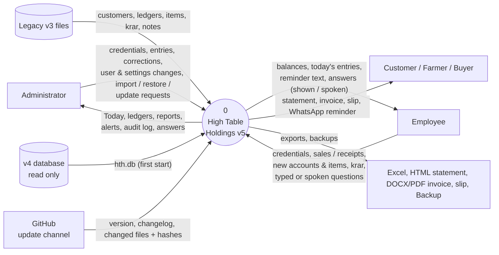
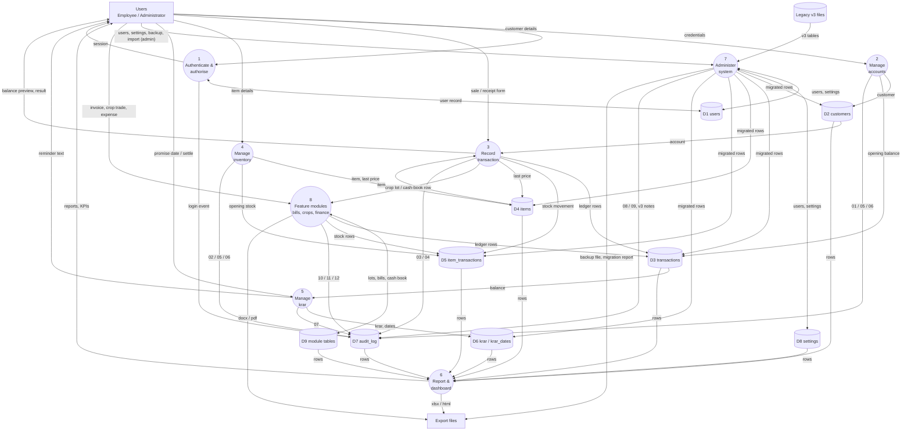
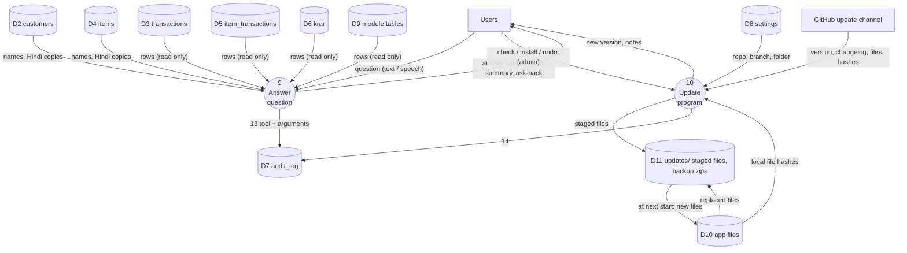
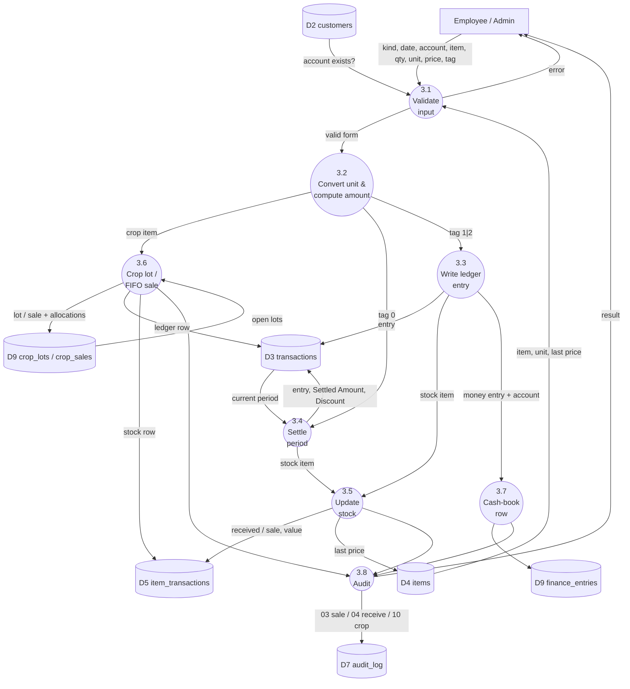
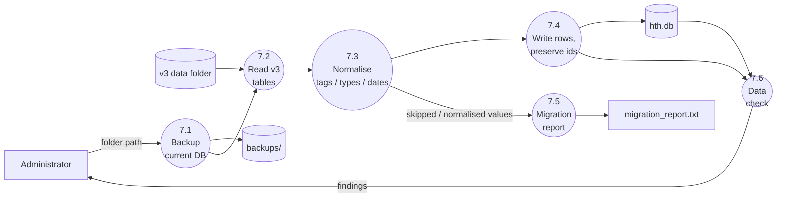
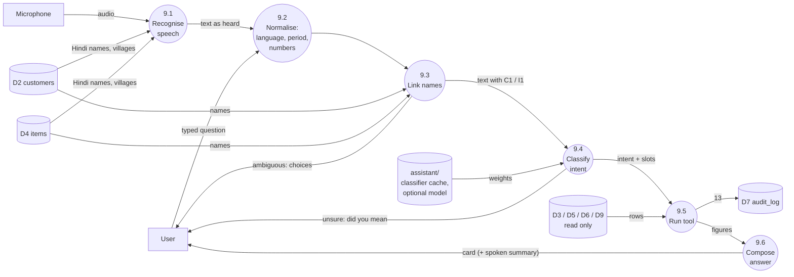
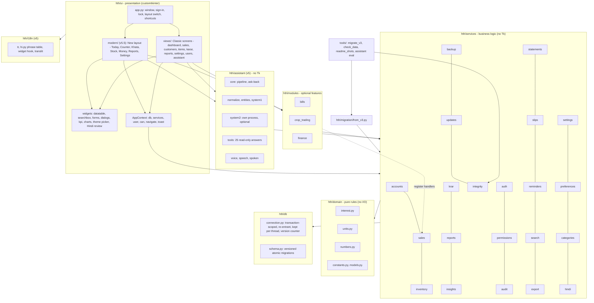
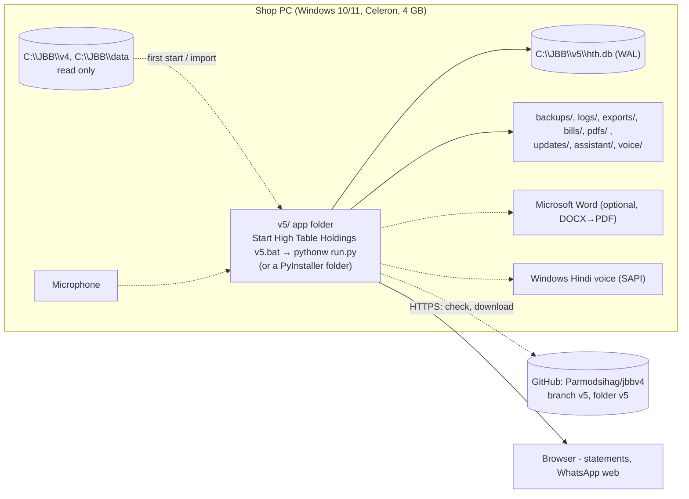

# Chapter 2 — DFD modelling, data model and architecture

Notation (Gane–Sarson mapped to Mermaid): **rectangles** = external entities, **rounded
/ circles** = processes, **cylinders** = data stores, arrows = data flows.

## 2.1 Context diagram (DFD level 0)

The only flow that leaves the PC is the request to GitHub for the version and files; no
shop data is sent.

## 2.2 DFD level 1

Both roles use the same screens, so they are shown as one external entity *Users*;
flows that only an Administrator can trigger are marked **(admin)**. Process 1 checks the
permission matrix for every other process (DT-1); those control flows are omitted from the
diagram to keep the data flows readable.

**(v5) Processes added in v5.** The level-1 diagram above is unchanged; v5 adds two
processes beside it.

## 2.3 DFD level 2 — Process 3 *Record transaction*

## 2.4 DFD level 2 — Process 7 *Administer system* (import path)

## 2.4a DFD level 2 — Process 9 *Answer question* (v5)

## 2.5 Entity-relationship diagram

Schema version 6 (v5). Column names are the real ones in `v5/hth/db/schema.py`; the full
data dictionary with every column is `v5/docs/DATA_DICTIONARY.md`. "(m4)" marks a column
added by migration 4, and so on.

```mermaid
erDiagram
  users {
    int id PK
    text username UK "case-insensitive"
    text full_name
    text role "admin or employee"
    text password_hash "PBKDF2-SHA256"
    text salt
    int is_active
  }
  customers {
    int id PK
    text name
    text other_details
    text category "A-E (m4)"
    int category_locked "(m4)"
    text name_hi "(m6)"
    text details_hi "(m6)"
    int hi_manual "(m6)"
  }
  transactions {
    int id PK
    int customer_id FK
    text date
    text description
    real amount
    text type "P or M"
    text tag "0, 1 or 2"
    int legacy_id
    text created_by
  }
  items {
    int id PK
    text name
    real stock_value "cost per unit"
    real last_value "last price per unit"
    text unit
    text batch
    text expiry_date
    real gst_rate
    text item_type "F P S C O"
    text pakka_kacha
    text category "(m4)"
    text name_hi "(m6)"
  }
  item_transactions {
    int id PK
    int item_id FK
    text date
    real received
    real sale
    real value "(m5)"
    text description
    text created_by
  }
  krar {
    int id PK
    int customer_id FK
    int is_nill
  }
  krar_dates {
    int id PK
    int krar_id FK
    text date
  }
  audit_log {
    int id PK
    text ts
    text date
    text username
    text code "01-14"
    text message
  }
  settings {
    text key PK
    text value
  }
  bills {
    int id PK
    int bill_number UK "FY prefix + serial"
    text date
    int customer_id FK "set null"
    text customer_name
    real taxable
    real cgst
    real sgst
    real grand_total
    text source "manual or batch"
  }
  bill_lines {
    int id PK
    int bill_id FK
    text name
    real rate
    real quantity
    real amount
    real gst_rate
    real cgst
    real sgst
  }
  bill_month_items {
    int id PK
    text month_year
    int item_id
    real quantity
  }
  crop_lots {
    int id PK
    int farmer_id FK "restrict"
    int item_id FK "restrict"
    text date
    real gross_qty
    real deduction_qty "kaat"
    real qty "net"
    real remaining_qty
    real rate
    text quality
    int tx_id
  }
  crop_sales {
    int id PK
    int buyer_id FK "set null"
    int item_id FK "restrict"
    real qty
    real rate
    real cost
    real margin
    real short_qty
    int tx_id
  }
  crop_sale_lots {
    int id PK
    int sale_id FK
    int lot_id FK "set null"
    real qty
    real cost_rate
    real cost
  }
  crop_rates {
    int id PK
    int item_id FK
    text date
    real rate
    text source
  }
  money_accounts {
    int id PK
    text name UK
    text kind "cash bank upi other"
    real opening_balance
    int is_active
  }
  expense_heads {
    int id PK
    text name UK
    text kind "expense or income"
  }
  finance_entries {
    int id PK
    text date
    text kind
    int account_id FK "restrict"
    int counter_account_id FK "restrict"
    int head_id FK "restrict"
    int customer_id FK "set null"
    real amount
    int tx_id "ledger row"
  }
  finance_recurring {
    int id PK
    int head_id FK
    int account_id FK
    real amount
    int day_of_month
    text last_posted
  }

  customers ||--o{ transactions : "ledger"
  customers ||--o{ krar : "promises"
  krar ||--|{ krar_dates : "dates"
  items ||--o{ item_transactions : "moves"
  customers |o--o{ bills : "billed"
  bills ||--|{ bill_lines : "lines"
  items ||--o{ crop_lots : "crop"
  customers ||--o{ crop_lots : "farmer"
  items ||--o{ crop_sales : "crop"
  customers |o--o{ crop_sales : "buyer"
  crop_sales ||--|{ crop_sale_lots : "FIFO"
  crop_lots |o--o{ crop_sale_lots : "allocated"
  items ||--o{ crop_rates : "market"
  money_accounts ||--o{ finance_entries : "book"
  expense_heads |o--o{ finance_entries : "head"
  customers |o--o{ finance_entries : "receipt or payment"
  expense_heads ||--o{ finance_recurring : "template"
  money_accounts ||--o{ finance_recurring : "from"
```

Key integrity rules:

* `CHECK` constraints on `transactions.type`, `transactions.tag`, `users.role`,
  `money_accounts.kind`, `expense_heads.kind`, `finance_entries.kind`.
* Foreign keys are enforced (`PRAGMA foreign_keys = ON`). Deleting a customer **cascades**
  to its ledger rows and promises, deleting an item to its movements and market rates, a
  bill to its lines. Crop lots and sales **restrict** deletion of their farmer and crop (a
  clear message is shown instead), cash-book entries restrict deletion of their money
  account and head, and a bill, crop sale or cash-book entry **sets null** when its
  customer is deleted.
* Plain integer links without a foreign key: `crop_lots.tx_id` / `stock_tx_id`,
  `crop_sales.tx_id` / `stock_tx_id`, `finance_entries.tx_id`, `bill_month_items.item_id`.
* Indexes `ix_tx_customer_date (customer_id, date, id)`, `ix_itx_item_date (item_id, date, id)`,
  `ix_krar_customer (customer_id, is_nill)`, `ix_fin_account_date (account_id, date, id)`
  and others.
* Schema version in `PRAGMA user_version`; migrations 1 (core) → 2 (bills) → 3 (crops)
  → 4 (categories) → 5 (finance) → 6 (Hindi names, v5).

## 2.6 Architecture

**Layering rule**: `ui → services → db/domain`. Views never write SQL; services never
import Tk. Modules depend on services and the shared `AppContext` only, and hook into the
core through registration functions (`register_crop_handler`, `register_money_flow_handler`)
so the Counter behaves identically whether a module is installed or not. The assistant core
has no Tk, so a chat screen, a bot or a voice loop can use it. `services/updates.py` uses
the standard library only because it runs before anything else is imported. The reasons
for each choice are recorded in `v5/docs/adr/`.

## 2.7 Deployment view

