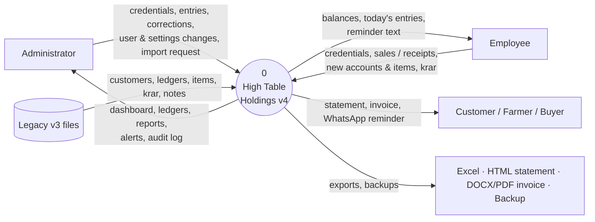
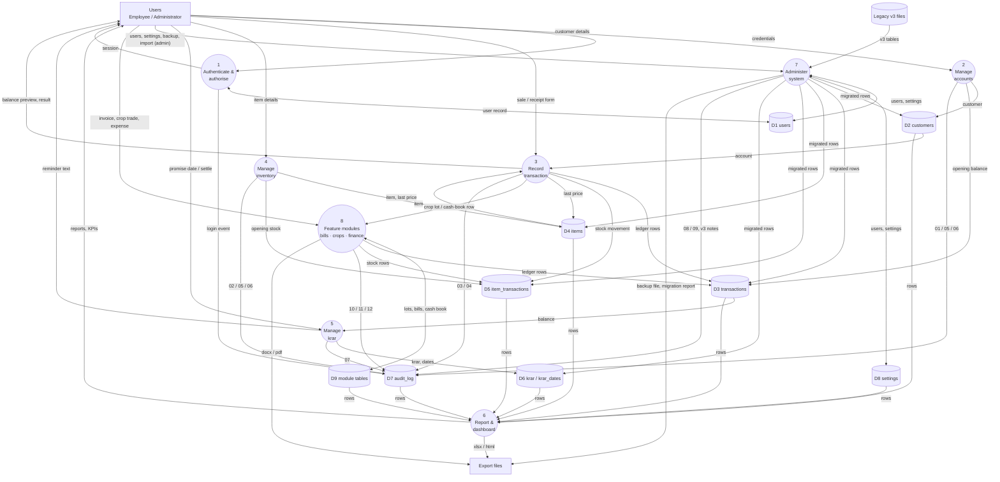
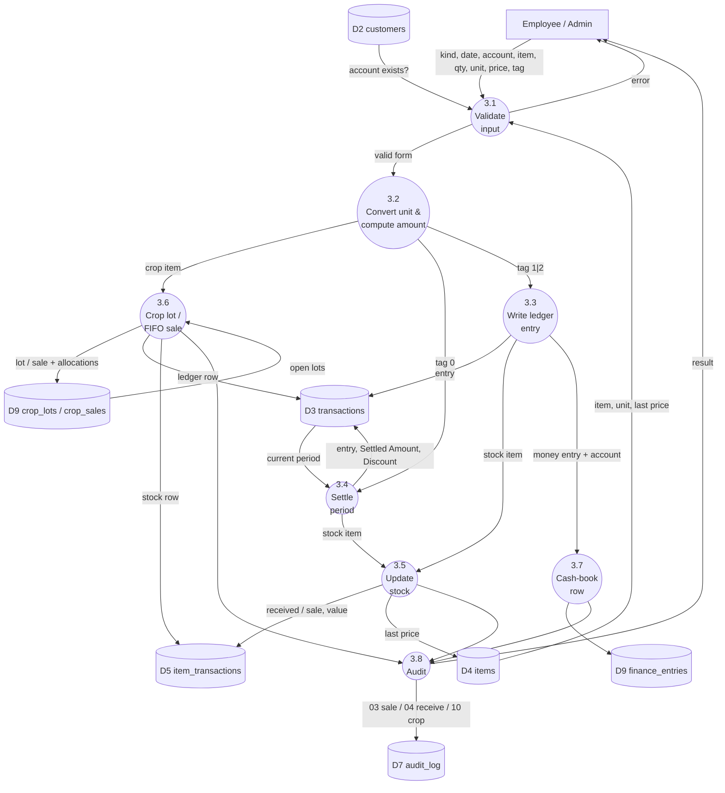
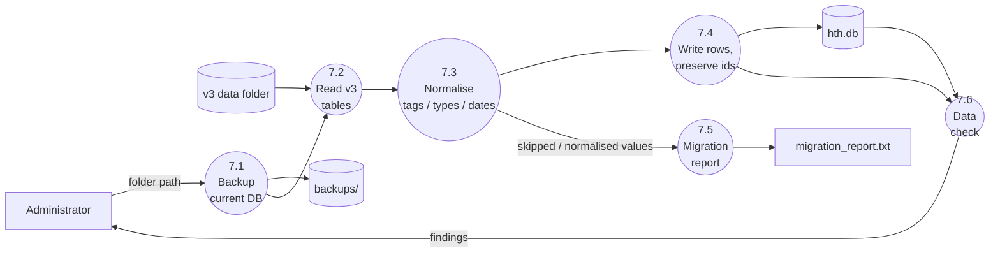
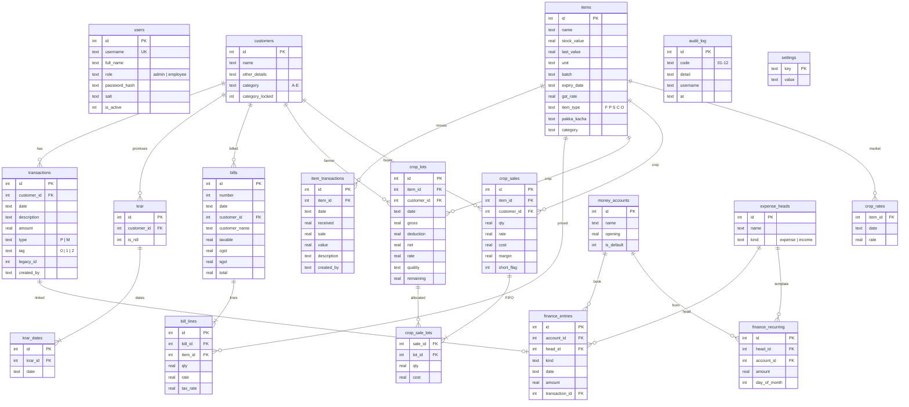
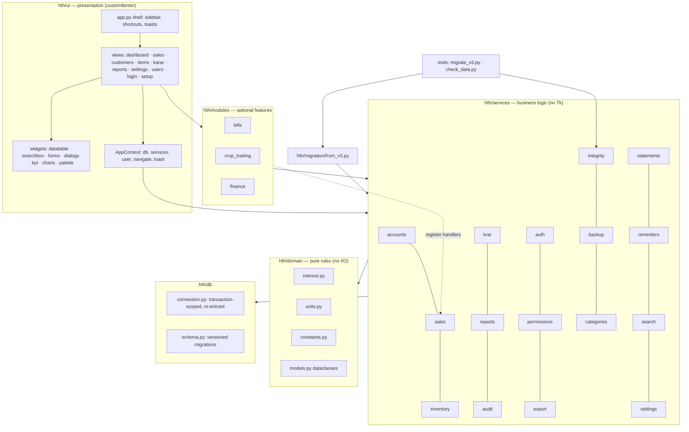
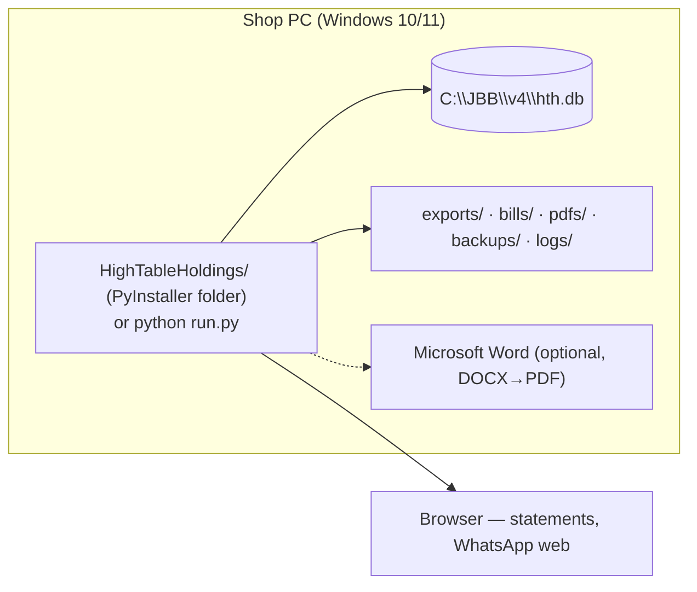

# Chapter 2 — DFD modelling, data model and architecture

Notation (Gane–Sarson mapped to Mermaid): **rectangles** = external entities, **rounded
/ circles** = processes, **cylinders** = data stores, arrows = data flows.

## 2.1 Context diagram (DFD level 0)

## 2.2 DFD level 1

Both roles use the same screens, so they are shown as one external entity *Users*;
flows that only an Administrator can trigger are marked **(admin)**. Process 1 checks the
permission matrix for every other process (DT-1); those control flows are omitted from the
diagram to keep the data flows readable.

## 2.3 DFD level 2 — Process 3 *Record transaction*

## 2.4 DFD level 2 — Process 7 *Administer system* (import path)

## 2.5 Entity-relationship diagram

Key integrity rules: all foreign keys `ON DELETE CASCADE`; `CHECK` constraints on
`type`, `tag`, `role`; indexes `ix_tx_customer_date (customer_id, date, id)`,
`ix_itx_item_date (item_id, date, id)`, `ix_krar_customer (customer_id, is_nill)`;
schema version in `PRAGMA user_version` with migrations 1 (core) → 2 (bills) → 3 (crops)
→ 4 (categories) → 5 (finance).

## 2.6 Architecture

**Layering rule**: `ui → services → db/domain`. Views never write SQL; services never
import Tk. Modules depend on services and the shared `AppContext` only, and hook into the
core through registration functions (`register_crop_handler`, `register_money_flow_handler`)
so the Sales screen behaves identically whether a module is installed or not.

## 2.7 Deployment view

