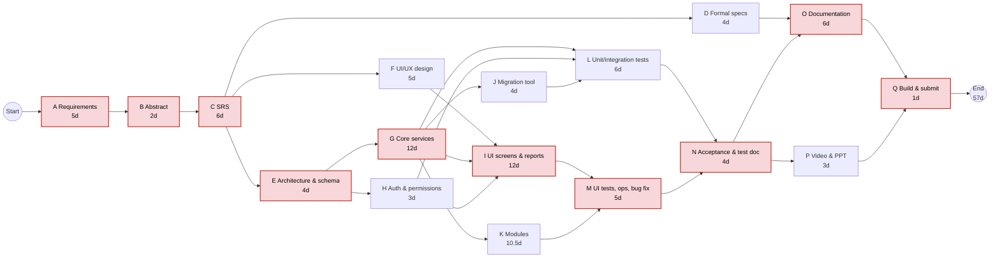
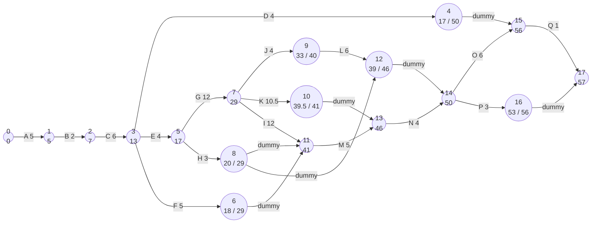
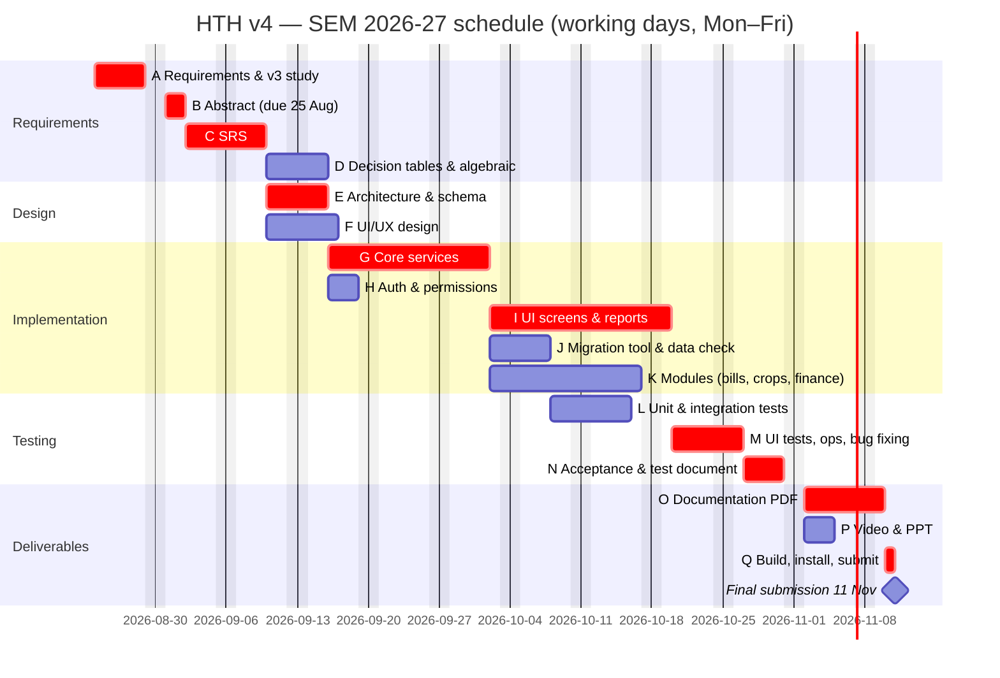
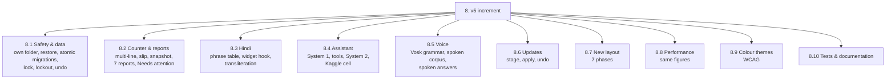
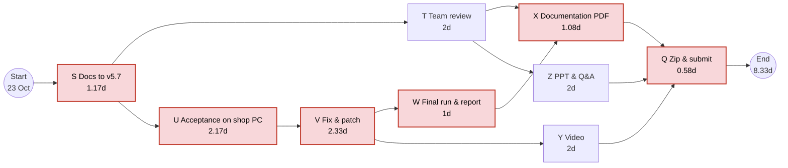
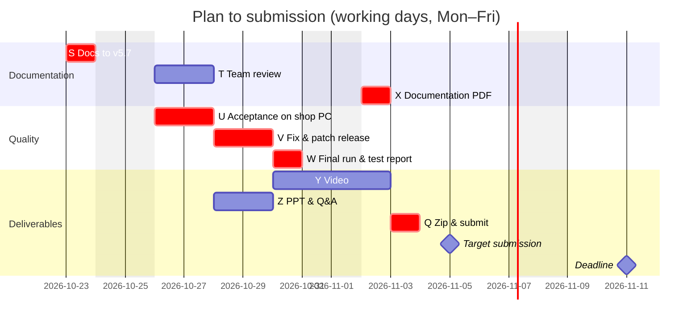

# Chapter 5 — Project planning: WBS, Activity Network, PERT, Gantt

Planning window: **Mon 24 Aug 2026 → Wed 11 Nov 2026** (final submission). Working days
are Mon–Fri; the plan uses **57 working days**, leaving Nov 11 as the submission day.
Team of four; effort figures are calendar working days for the team, not person-days.

## 5.1 Work Breakdown Structure

```mermaid
flowchart TB
  R[High Table Holdings v4]
  R --> W1[1. Project management]
  R --> W2[2. Requirements]
  R --> W3[3. Design]
  R --> W4[4. Implementation]
  R --> W5[5. Testing]
  R --> W6[6. Deployment]
  R --> W7[7. Documentation & deliverables]

  W1 --> W11[1.1 Team setup, Git repo, conventions]
  W1 --> W12[1.2 Planning: WBS, network, PERT]
  W1 --> W13[1.3 Weekly reviews, risk log]

  W2 --> W21[2.1 Study legacy v3 & interview owner]
  W2 --> W22[2.2 Abstract]
  W2 --> W23[2.3 User stories & glossary]
  W2 --> W24[2.4 SRS: FR / NFR]
  W2 --> W25[2.5 Formal: decision tables, algebraic specs]

  W3 --> W31[3.1 Architecture & layering]
  W3 --> W32[3.2 DB schema & migrations]
  W3 --> W33[3.3 DFD / ER / UML models]
  W3 --> W34[3.4 UI/UX: theme, widgets, screens]
  W3 --> W35[3.5 Module extension contract]

  W4 --> W41[4.1 Domain: interest, units, constants]
  W4 --> W42[4.2 Core services: accounts, inventory, sales, krar]
  W4 --> W43[4.3 Auth, permissions, audit]
  W4 --> W44[4.4 UI screens & dashboard]
  W4 --> W45[4.5 Reports & Excel export]
  W4 --> W46[4.6 v3 migration tool & data check]
  W4 --> W47[4.7 Modules: bills, crop trading, finance]
  W4 --> W48[4.8 Ops: backup, wizard, search, statements, reminders]

  W5 --> W51[5.1 Unit tests: business rules]
  W5 --> W52[5.2 Integration tests: sales flow, migration]
  W5 --> W53[5.3 UI walkthrough tests]
  W5 --> W54[5.4 System / acceptance testing with shop data]
  W5 --> W55[5.5 Test-case document & traceability]

  W6 --> W61[6.1 PyInstaller build]
  W6 --> W62[6.2 Install on shop PC, import v3]
  W6 --> W63[6.3 User hand-over]

  W7 --> W71[7.1 README, CHANGELOG]
  W7 --> W72[7.2 Final documentation PDF]
  W7 --> W73[7.3 Screencast video]
  W7 --> W74[7.4 Presentation & Q&A prep]
```

### WBS dictionary (leaf work packages)

| WBS | Work package | Deliverable | Owner |
|-----|--------------|-------------|-------|
| 1.1 | Team setup, Git repo, conventions | Public repo, branch rules, `ruff` config | M4 |
| 1.2 | Planning | This chapter | M4 |
| 2.1 | Study v3, interview owner | Notes on business rules, v3 quirks | M1 |
| 2.2 | Abstract | `TeamNo.pdf` | M1 |
| 2.3–2.4 | User stories, SRS | Chapter 1 | M1 |
| 2.5 | Decision tables, algebraic specs | Chapters 3–4 | M4 |
| 3.1 | Architecture | `hth/` package layout, layering rule | M1 |
| 3.2 | DB schema & migrations | `hth/db/schema.py` | M1 |
| 3.3 | DFD / ER / UML | Chapter 2 | M4 |
| 3.4 | UI/UX | Theme, widgets, wireframes | M2 |
| 3.5 | Module contract | `hth/modules/README.md`, `ModuleSpec` | M3 |
| 4.1 | Domain | `hth/domain/*` | M1 |
| 4.2 | Core services | `hth/services/{accounts,inventory,sales,krar}.py` | M1 |
| 4.3 | Auth, permissions, audit | `hth/services/{auth,permissions,audit}.py` | M1 |
| 4.4 | UI screens | `hth/ui/views/*` | M2 |
| 4.5 | Reports & export | `hth/services/{reports,export}.py`, reports view | M2 |
| 4.6 | Migration & data check | `tools/*.py`, `hth/migration/from_v3.py`, `integrity.py` | M3 |
| 4.7 | Modules | `hth/modules/{bills,crop_trading,finance}` | M3 |
| 4.8 | Ops features | backup, setup wizard, search, statements, reminders | M2/M3 |
| 5.1–5.3 | Automated tests | `tests/` (96 tests) | M4 |
| 5.4 | Acceptance with shop data | Signed-off checklist | M4 + owner |
| 5.5 | Test-case document | Chapter 6 | M4 |
| 6.1–6.3 | Build, install, hand-over | `HighTableHoldings/` folder on shop PC | M3 |
| 7.1–7.4 | Docs, video, PPT | `Documentation.pdf`, video, slides | all |

## 5.2 Activity list with PERT estimates

Three-point estimates in working days: optimistic `o`, most likely `m`, pessimistic `p`;
expected `te = (o + 4m + p) / 6`; variance `σ² = ((p − o) / 6)²`.

| Id | Activity (WBS) | Predecessors | o | m | p | te | σ² |
|----|----------------|--------------|---|---|---|----|----|
| A | Requirements elicitation, study v3 (2.1, 1.1) | — | 3 | 5 | 7 | 5.0 | 0.44 |
| B | Abstract & scope (2.2) | A | 1 | 2 | 3 | 2.0 | 0.11 |
| C | SRS: user stories, FR/NFR, use cases (2.3, 2.4) | B | 4 | 6 | 8 | 6.0 | 0.44 |
| D | Formal specs: decision tables, algebraic (2.5) | C | 3 | 4 | 5 | 4.0 | 0.11 |
| E | Architecture, DB schema, migrations (3.1, 3.2, 3.5) | C | 3 | 4 | 5 | 4.0 | 0.11 |
| F | UI/UX design: theme, widgets, wireframes (3.4) | C | 3 | 5 | 7 | 5.0 | 0.44 |
| G | Domain + core services (4.1, 4.2) | E | 8 | 12 | 16 | 12.0 | 1.78 |
| H | Auth, permissions, audit (4.3) | E | 2 | 3 | 4 | 3.0 | 0.11 |
| I | UI screens, dashboard, reports, export (4.4, 4.5) | F, G, H | 8 | 12 | 16 | 12.0 | 1.78 |
| J | v3 migration tool & data check (4.6) | G | 3 | 4 | 5 | 4.0 | 0.11 |
| K | Modules: bills, crop trading, finance (4.7) | G | 8 | 10 | 15 | 10.5 | 1.36 |
| L | Unit & integration tests (5.1, 5.2) | G, H, J | 4 | 6 | 8 | 6.0 | 0.44 |
| M | UI walkthrough tests, ops features, bug fixing (5.3, 4.8) | I, K | 3 | 5 | 7 | 5.0 | 0.44 |
| N | System / acceptance testing, test-case document (5.4, 5.5) | L, M | 3 | 4 | 5 | 4.0 | 0.11 |
| O | Documentation: DFD, WBS/PERT, compile PDF (3.3, 7.1, 7.2) | D, N | 4 | 6 | 8 | 6.0 | 0.44 |
| P | Video & presentation (7.3, 7.4) | N | 2 | 3 | 4 | 3.0 | 0.11 |
| Q | Build, install on shop PC, final review & submission (6.x) | O, P | 1 | 1 | 1 | 1.0 | 0.00 |

## 5.3 Activity network (activity-on-node)

Red nodes form the **critical path**.

## 5.4 CPM schedule: forward / backward pass

| Id | te | ES | EF | LS | LF | Float | Critical |
|----|----|----|----|----|----|-------|----------|
| A | 5.0 | 0 | 5 | 0 | 5 | 0 | ✓ |
| B | 2.0 | 5 | 7 | 5 | 7 | 0 | ✓ |
| C | 6.0 | 7 | 13 | 7 | 13 | 0 | ✓ |
| D | 4.0 | 13 | 17 | 46 | 50 | 33 | |
| E | 4.0 | 13 | 17 | 13 | 17 | 0 | ✓ |
| F | 5.0 | 13 | 18 | 24 | 29 | 11 | |
| G | 12.0 | 17 | 29 | 17 | 29 | 0 | ✓ |
| H | 3.0 | 17 | 20 | 26 | 29 | 9 | |
| J | 4.0 | 29 | 33 | 36 | 40 | 7 | |
| K | 10.5 | 29 | 39.5 | 30.5 | 41 | 1.5 | |
| I | 12.0 | 29 | 41 | 29 | 41 | 0 | ✓ |
| L | 6.0 | 33 | 39 | 40 | 46 | 7 | |
| M | 5.0 | 41 | 46 | 41 | 46 | 0 | ✓ |
| N | 4.0 | 46 | 50 | 46 | 50 | 0 | ✓ |
| O | 6.0 | 50 | 56 | 50 | 56 | 0 | ✓ |
| P | 3.0 | 50 | 53 | 53 | 56 | 3 | |
| Q | 1.0 | 56 | 57 | 56 | 57 | 0 | ✓ |

**Critical path:** A → B → C → E → G → I → M → N → O → Q, length **57 working days**.

## 5.5 PERT analysis

Variance along the critical path:
`σ² = 0.44 + 0.11 + 0.44 + 0.11 + 1.78 + 1.78 + 0.44 + 0.11 + 0.44 + 0 = 5.67`,
so `σ = 2.38 days`.

| Question | Computation | Result |
|----------|-------------|--------|
| Expected duration | Σ te on critical path | 57 days |
| Probability of finishing within 57 days | z = 0 | 50 % |
| Probability of finishing within 60 days (≈ Nov 13 if we slip past the deadline) | z = (60 − 57)/2.38 = 1.26 | ≈ 90 % |
| Duration with 95 % confidence | 57 + 1.645 × 2.38 | ≈ 61 days |
| Probability of finishing by Nov 10 (56 working days) | z = (56 − 57)/2.38 = −0.42 | ≈ 34 % |

Interpretation and mitigation: the deadline gives 56 working days for a 57-day expected
path, so the plan is tight. Mitigation adopted: (1) G and I, the two largest-variance
activities, are split across two members and started with the domain layer that has the
most tests; (2) D (formal specs) has 33 days of float and P (video) 3 days — they absorb
slack; (3) the acceptance test N is time-boxed; (4) a working prototype is kept on `main`
from the end of G so a partial slip in K (modules, float 1.5) reduces scope, not the
deliverable.

### PERT chart (event-on-arrow view)

Node label = event number, then earliest time (and latest time when different).

## 5.6 Gantt chart

## 5.7 Milestones and risk register

| Milestone | Date |
|-----------|------|
| M0 Abstract submitted | 25 Aug 2026 |
| M1 SRS frozen | 9 Sep 2026 |
| M2 Core services pass business-rule tests | 1 Oct 2026 |
| M3 Feature-complete prototype on `main` | 20 Oct 2026 |
| M4 Acceptance sign-off with shop data | 30 Oct 2026 |
| M5 Documentation, video, zip submitted | 11 Nov 2026 |

| # | Risk | P | I | Mitigation |
|---|------|---|---|------------|
| R1 | v4 numbers differ from v3 | M | H | Pin interest and balance against v3 code in tests; migration equivalence test |
| R2 | customtkinter version differences on shop PC (5.2 vs 6.0) | H | M | CI runs UI walkthrough on both; fallbacks for unsupported kwargs |
| R3 | Scope creep from modules | H | M | Modules are optional and behind `ModuleSpec`; core ships first |
| R4 | Team member unavailable | M | M | Owner per WBS package with a named backup; shared conventions |
| R5 | Laptop-resolution layout bugs | M | L | Scrollable panels, minimum row counts, tested at 1366×768 |
| R6 | Data loss during import | L | H | Automatic backup before import; import never guesses silently |

---

## 5.8 Tracking: baseline plan vs actual

§5.1 – 5.7 are the **baseline** plan made at the start of the course for v4. Actual dates
come from the release history (`CHANGELOG.md`, git log of the public repository).

| Milestone | Baseline | Actual | Variance | Note |
|-----------|----------|--------|----------|------|
| M0 Abstract submitted | 25 Aug | *fill in* | | `01_Abstract.md` is the abstract for the v4 scope |
| M1 SRS frozen | 9 Sep | 30 Aug (course pack committed) | ahead | re-baselined for v5 on 23 Oct (this pack) |
| M2 Core services pass business-rule tests | 1 Oct | 29 Aug (4.0.0) | 23 working days ahead | interest pinned to v3 from the first release |
| M3 Feature-complete prototype on `main` | 20 Oct | 30 Aug (4.7.0, v4 scope) | ahead | all modules, wizard, reminders, backups |
| M3a v5 increment complete (scope change, §5.9) | — | 21 Oct (5.7.0) | — | 12 releases 5.0 – 5.7 |
| M4 Acceptance sign-off with shop data | 30 Oct | planned 28 Oct (§5.10) | on plan | |
| M5 Documentation, video, zip submitted | 11 Nov | planned 5 Nov (§5.10) | 4 working days of buffer | |

Interpretation: implementation finished well ahead of the baseline because the core was
built test-first against v3's code, which removed most of the integration and bug-fixing
time the PERT estimates allowed for (activities G, I, M). The slack was used for a
**change in scope** (the v5 increment) instead of an earlier submission.

## 5.9 Change in scope: the v5 increment

After the shop used v4, the owner asked for: safety (lock, restore, undo), faster counter
work, Hindi, asking questions in plain words and by voice, updates without a technician, and
screens in shop words. The change was accepted on the conditions that v4's rules and numbers
stay byte-for-byte identical and that every release is shippable on its own
(see `11_Project_Management.md` §11.5, change control).

| WBS | Work package | Depends on | Release | Date |
|-----|--------------|------------|---------|------|
| 8.1, 8.2 | Safety, counter, reports | v4 | 5.0.0 | 19 Oct |
| 8.3 | Hindi | 8.1 | 5.1.0 | 20 Oct |
| 8.4 | Assistant | 8.3 (Hindi copies of names) | 5.2.0 | 20 Oct |
| 8.5 | Voice | 8.4 | 5.3.0, 5.3.1 | 20–21 Oct |
| 8.6 | In-app updates; voice model bundled | 8.5 | 5.4.0 | 21 Oct |
| 8.7 | New layout (phases 0–6) | 8.2, 8.4 (Ask bar) | 5.5.0 | 20 Oct |
| 8.8 | Performance | 8.7 | 5.6.0 | 20 Oct |
| 8.9 | Colour themes | 8.7 | 5.7.0 | 21 Oct |
| 8.10 | Tests (96 → 316) and this documentation | all | — | 19–23 Oct |

## 5.10 Plan to submission (re-baselined 23 Oct 2026)

Remaining work from Friday 23 October to the deadline on Wednesday 11 November: **14
working days** including today.

| Id | Activity | Predecessors | o | m | p | te | σ² |
|----|----------|--------------|---|---|---|----|----|
| S | Bring all documentation to v5.7 | — | 1 | 1 | 2 | 1.17 | 0.03 |
| T | Team review of the pack; names, IDs, contributions | S | 1 | 2 | 3 | 2.00 | 0.11 |
| U | Acceptance test on the shop PC with the owner (AT-1 … AT-20) | S | 1 | 2 | 4 | 2.17 | 0.25 |
| V | Fix acceptance defects; patch release | U | 1 | 2 | 5 | 2.33 | 0.44 |
| W | Final regression run and test report | V | 0.5 | 1 | 1.5 | 1.00 | 0.03 |
| X | Build and check `Documentation.pdf` | T, W | 0.5 | 1 | 2 | 1.08 | 0.06 |
| Y | Record and edit the video | V | 1 | 2 | 3 | 2.00 | 0.11 |
| Z | Presentation and Q&A rehearsal | T | 1 | 2 | 3 | 2.00 | 0.11 |
| Q | Zip, upload to Nalanda, verify the public repository | X, Y, Z | 0.5 | 0.5 | 1 | 0.58 | 0.01 |

| Id | te | ES | EF | LS | LF | Float | Critical |
|----|----|----|----|----|----|-------|----------|
| S | 1.17 | 0 | 1.17 | 0 | 1.17 | 0 | ✓ |
| T | 2.00 | 1.17 | 3.17 | 3.75 | 5.75 | 2.58 | |
| U | 2.17 | 1.17 | 3.33 | 1.17 | 3.33 | 0 | ✓ |
| V | 2.33 | 3.33 | 5.67 | 3.33 | 5.67 | 0 | ✓ |
| W | 1.00 | 5.67 | 6.67 | 5.67 | 6.67 | 0 | ✓ |
| Z | 2.00 | 3.17 | 5.17 | 5.75 | 7.75 | 2.58 | |
| Y | 2.00 | 5.67 | 7.67 | 5.75 | 7.75 | 0.08 | |
| X | 1.08 | 6.67 | 7.75 | 6.67 | 7.75 | 0 | ✓ |
| Q | 0.58 | 7.75 | 8.33 | 7.75 | 8.33 | 0 | ✓ |

**Critical path:** S → U → V → W → X → Q, expected **8.33 working days**.
Variance on the path `0.03 + 0.25 + 0.44 + 0.03 + 0.06 + 0.01 = 0.82`, so `σ = 0.91` day.

| Question | Computation | Result |
|----------|-------------|--------|
| Expected finish | 8.33 working days from 23 Oct | Wed 4 Nov |
| P(finish within 10 working days, by Thu 5 Nov) | z = (10 − 8.33) / 0.91 = 1.84 | ≈ 97 % |
| P(finish within 14 working days, by the deadline) | z = (14 − 8.33) / 0.91 = 6.2 | ≈ 100 % |
| Duration at 95 % confidence | 8.33 + 1.645 × 0.91 | ≈ 9.8 days (Thu 5 Nov) |

Decision: **target submission Thursday 5 November**, keeping four working days of buffer
against festival holidays in early November and a slow acceptance round. Y (video) has
almost no float because it should show the final patched version; record it straight after
V.

## 5.11 Risk register (updated 23 Oct 2026)

R1–R6 from §5.7 remain; their status and the risks added for v5 and the remaining work:

| # | Risk | P | I | Status / mitigation |
|---|------|---|---|---------------------|
| R1 | Numbers differ from v3 / v4 | L | H | **Closed for v5.0–5.7**: identical on the shop's data; `test_matches_v3`, `test_speed.py` |
| R2 | customtkinter 5.2 vs 6.0 | M | M | Open: UI suites run on 6.0; acceptance on the shop PC (5.2.2) is activity U |
| R3 | Scope creep | H | M | **Occurred** (v5 increment): handled by change control and shippable releases |
| R4 | Team member unavailable | M | M | Open: each document has an owner and a reviewer (`11_Project_Management.md`) |
| R5 | Laptop-resolution layout bugs | M | L | Open: text size setting; acceptance AT-12 |
| R6 | Data loss during import / upgrade | L | H | Mitigated: backup before import, migration, restore; atomic migrations |
| R7 | A bad update reaches the shop PC | L | H | Release checklist, hash checks, Undo last update, branch protection on `v5` |
| R8 | Voice accuracy in the real shop below the measured 95 % | M | M | Owner records test questions; ask-back; typed questions always work |
| R9 | Acceptance finds a defect late | M | M | Acceptance moved to the start (U), with V and buffer after it |
| R10 | Festival holidays in early November | M | M | Target 5 Nov, four days before the deadline |
| R11 | Documentation drifts from the code | M | M | Docs checked against code on 23 Oct; DoD requires doc updates (`CONTRIBUTING.md`) |
