# High Table Holdings v4 — Project Documentation

**Course:** Software Engineering & Management (SEM 2026-27), BITS Pilani
**Team No.:** <<Team No.>>
**Git repository (public):** <https://github.com/Parmodsihag/jbbv4>
**Application version documented:** 4.7.0 (see `HighTableHoldings-v4/CHANGELOG.md`)

## Team members and contributions

> Edit the table so it reflects the actual split. Grading is team-based, but the
> guidelines require each member's contribution to be listed on this page.

| # | Name | BITS ID | Contribution |
|---|------|---------|--------------|
| 1 | <<Member 1>> | <<ID>> | Requirements elicitation from the shop owner and study of legacy v3; SRS (informal, semi-formal, formal); domain layer — interest formula, constants, unit conversion; `accounts` and `sales` services; SQLite schema and migrations. |
| 2 | <<Member 2>> | <<ID>> | UI/UX — customtkinter app shell, theme, reusable widgets (data table, search box, dialogs, KPI tiles, charts); Dashboard, Sales, Accounts, Items, Karar, Reports and Settings screens; keyboard shortcuts; global search; first-run wizard. |
| 3 | <<Member 3>> | <<ID>> | Feature modules — Bills (GST invoice, DOCX/PDF, month batch), Crop trading (lots, FIFO costing, rates), Finance (cash book, P&L, cash flow); module extension contract; v3 → v4 migration tool and migration report; data-quality check. |
| 4 | <<Member 4>> | <<ID>> | Quality & management — `pytest` suite (96 tests: business rules, migration equivalence, modules, UI walkthrough), decision tables, algebraic specifications, DFDs, WBS / activity network / PERT, test-case design and traceability, packaging with PyInstaller, video and presentation. |

## Document map

| Chapter | Content |
|---------|---------|
| 1 | Software Requirements Specification — informal, semi-formal and formal |
| 2 | DFD modelling, ER diagram, architecture |
| 3 | Decision tables |
| 4 | Algebraic specifications |
| 5 | Work Breakdown Structure, Activity Network, PERT chart, Gantt |
| 6 | Test cases and traceability matrix |

## How to build and run (summary)

```bash
git clone https://github.com/Parmodsihag/jbbv4.git
cd jbbv4/HighTableHoldings-v4
python -m venv .venv && source .venv/bin/activate     # Windows: .venv\Scripts\activate
pip install -r requirements.txt
python run.py                                         # default users admin/admin, emp1/emp1
pip install -r requirements-dev.txt && pytest         # 94 passed, 2 skipped (UI tests need a display)
pyinstaller --noconfirm --windowed --name HighTableHoldings run.py   # shop-PC build
```


\newpage

# Chapter 1 — Software Requirements Specification

This chapter moves from **informal** (natural-language user stories and glossary) through
**semi-formal** (use cases, UML activity / sequence / state diagrams) to **formal**
specification (numbered, testable requirements with pre/post-conditions). The decision
tables (Chapter 3) and algebraic specifications (Chapter 4) complete the formal part.

---

## 1.1 Introduction

### 1.1.1 Purpose
This SRS describes the functional and non-functional requirements of **High Table
Holdings v4 (HTH v4)**, a desktop accounting and inventory system for *Jaat Beaj Bhander*,
an agri-input shop. It is written for the development team, the course evaluator and the
shop owner (the customer).

### 1.1.2 Scope
HTH v4 replaces the legacy v3.7.1 tool. It **must reproduce v3's business results
exactly** (same interest, balances, stock figures) while adding multi-user access,
one normalised database, tests and optional feature modules (bills, crop trading,
finance). Out of scope: online/cloud sync, mobile app, payment gateway integration,
automatic market-rate feeds (an interface is provided for later).

### 1.1.3 Definitions, acronyms
| Term | Meaning |
|------|---------|
| Ledger entry / transaction | One row in a customer's account: date, description, amount, type, tag |
| Type `P` / `M` | `P` = debit (customer owes more; a sale or cash paid out); `M` = credit (payment received or goods purchased from the customer) |
| Tag `1` / `2` / `0` | `1` normal (earns interest); `2` no interest; `0` settlement marker |
| Period | Entries after the most recent tag-0 row; the balance is computed over the period only |
| Settlement | A tag-0 sale/receipt that writes three tag-0 rows (entry, *Settled Amount*, *Discount*) and restarts the period at zero |
| Krar / Karar | A customer's promise to pay by a date |
| Kaat | Deduction (quantity) on a crop purchase lot |
| FIFO | First-in-first-out costing of crop sales against open lots |
| Category A–E | Customer/item quality band; E = defaulter / discontinued (manual only) |
| Admin / Employee | The two roles; see the permission matrix |
| FY | Financial year, ends 31 March |
| SRS, DFD, WBS, PERT | Standard SE acronyms |

### 1.1.4 References
* Project Guidelines, SEM 2026-27 (Nalanda).
* IEEE Std 830-1998, *Recommended Practice for SRS*.
* Legacy application `HighTableHoldings-v3.7.1/documentation.md`.
* `HighTableHoldings-v4/README.md`, `CHANGELOG.md`.

### 1.1.5 Overview
§1.2 gives the informal specification, §1.3 the semi-formal models, §1.4 the formal
requirements, §1.5 non-functional requirements, §1.6 interfaces and constraints.

---

## 1.2 Informal specification

### 1.2.1 Product perspective
A stand-alone desktop application on the shop PC (Windows; also runs on macOS/Linux).
One SQLite file holds all data; exports (Excel, HTML statements, DOCX invoices) are
written next to it. There is no server. Two users share the PC: the owner
(Administrator) and a shop assistant (Employee).

### 1.2.2 Stakeholders and user classes
| User class | Characteristics | Needs |
|------------|-----------------|-------|
| Shop owner (Admin) | Non-technical, uses the tool daily, trusts the v3 numbers | Same figures as v3; ability to correct mistakes; control over who can delete; backups |
| Shop assistant (Employee) | Records sales and receipts at the counter | Fast keyboard entry; cannot edit or delete history |
| Customers (farmers) | Indirect users | Correct statements, timely reminders |
| Developer / maintainer | Extends the software | Layered code, tests, module contract |

### 1.2.3 User stories (informal requirements)
**Accounts and ledger**
* US-1 As an employee, I can create a customer account with an optional opening balance so that credit sales can be recorded against it.
* US-2 As a user, I can record a debit (sale / pay-out) or credit (receipt / purchase) against an account, with a date, amount and tag.
* US-3 As a user, I can see a customer's ledger with per-row interest and a running balance, identical to what v3 showed.
* US-4 As a user, I can settle an account (tag 0) so that the balance including interest and any discount is closed and a new period begins.
* US-5 As an admin, I can edit or delete a ledger entry when a mistake was made; the change is audited.
* US-6 As a user, I can print/save a customer statement for a date range with shop header, opening/closing balance and interest column.

**Inventory**
* US-7 As a user, I can add an item with opening stock, unit, batch, expiry, GST rate and type (fertiliser/pesticide/seed/crop/other).
* US-8 As a user, I can sell a fraction of a stock unit (100 g of a kg item, 2.5 quintal of a kg crop) and the stock is reduced correctly.
* US-9 As a user, I can see stock on hand, stock value, low-stock, expiring and dead-stock lists.
* US-10 As an admin, I can change an item's unit and have its whole history converted.

**Sales screen**
* US-11 As a user, one Sales form records a stock sale, a cash receipt, a crop purchase or a crop sale; the ledger, stock, cash book and audit log are updated together or not at all.
* US-12 As a user, choosing an item auto-fills its last price and shows the amount and the customer's current balance before I save.

**Krar**
* US-13 As a user, I can record or reschedule a customer's promised payment date and mark it settled.
* US-14 As a user, I can list overdue / today / upcoming promises and copy or send a WhatsApp reminder.

**Reports and dashboard**
* US-15 As a user, I can open any report, sort by column, export to Excel and double-click a row to jump to the ledger or item.
* US-16 As a user, the dashboard shows receivable, payable, stock value, krar, cash & bank, activity, aging and top debtors.
* US-17 As an admin, I can assign customers/items categories A–E and choose which categories the reports include.

**Users, security, operations**
* US-18 As a user, I sign in with a username and password; the first run forces me to replace the default passwords.
* US-19 As an admin, I can add users, reset passwords, change roles and deactivate users.
* US-20 As an admin, I can see who did what and when (audit log).
* US-21 As an admin, I can take a backup and the app takes one automatically each day.
* US-22 As an admin, I can import the v3 data with IDs preserved and get a report of every value that was skipped or normalised.
* US-23 As an admin, I can run a data check for invalid dates, negative stock, duplicates and other anomalies.

**Modules**
* US-24 As a user, I can create a GST invoice, save it as DOCX/PDF and browse/merge invoices by month; as an admin, I can generate the month batch as v3 did.
* US-25 As a user, I can buy crops from farmers as lots (gross, deduction, net, rate, quality) and sell them to buyers with FIFO cost and margin.
* US-26 As a user, I can keep cash / bank / UPI accounts, record expenses, transfers, drawings and recurring expenses, and see cash flow and profit & loss.

### 1.2.4 Assumptions and dependencies
* Interest rate (24 % p.a.), financial-year end (31 March) and GST rates are constants of the business; changing them is a code change with a test update.
* The PC clock is correct (interest depends on "today").
* Microsoft Word is optional; it is only needed for DOCX→PDF conversion of invoices.

---

## 1.3 Semi-formal specification

### 1.3.1 Use-case diagram

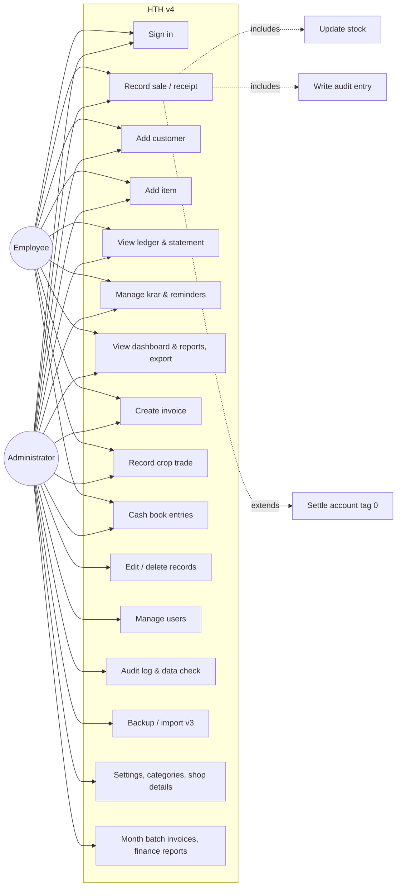

### 1.3.2 Use-case descriptions

**UC-2 Record sale / receipt**

| Field | Description |
|-------|-------------|
| Actors | Employee, Administrator |
| Pre-conditions | User signed in with `record_sale`; at least one customer exists |
| Trigger | User opens *Sales* (Alt+S) |
| Main flow | 1. User picks an account (search by id/name/village). 2. User types an item; a stock item auto-fills unit and last price; the current balance is shown. 3. User enters quantity, unit, price, tag, date. 4. Live amount preview is shown. 5. User presses **Debit** (Ctrl+Enter) or **Credit** (Ctrl+Shift+Enter). 6. System validates, writes the ledger entry, the stock movement (if a stock item), the cash-book row (if a money entry with a money account), sets the item's last price, writes the audit entry — all in one transaction. 7. Toast confirms; today's list refreshes. |
| Alternative flows | 3a. Quantity entered in a compatible unit → converted to the stock unit. 3b. Item is a crop (type C) → crop fields appear; Credit records a purchase lot, Debit a FIFO-costed sale with margin preview (UC-9). 5a. Tag 0 → settlement flow (UC-19): three tag-0 rows are written. |
| Exceptions | Invalid date / non-positive quantity / bad tag / unknown account → validation message, nothing written. Incompatible unit (PKT → KG) → rejected. Crop with tag 0 → rejected. Crop sale exceeding stock without *Allow selling short* → rejected. |
| Post-conditions | Ledger, stock, cash book and audit log are consistent; balance and stock on hand reflect the entry. |

**UC-19 Settle account (tag 0)**

| Field | Description |
|-------|-------------|
| Pre-conditions | As UC-2, tag = 0 |
| Main flow | 1. System computes `balance_before` (principal + interest of the current period). 2. Writes the entry row (tag 0). 3. Writes *Settled Amount* = `balance_before` (type M, tag 0). 4. Writes *Discount* = `balance_before + amount` (if P) or `balance_before − amount` (if M) (type M, tag 0, may be negative). |
| Post-conditions | `balance = 0` for the new period; previous rows remain visible in the ledger with running balance reset. |

**UC-6 Manage krar**

| Field | Description |
|-------|-------------|
| Main flow | Add/reschedule a promised date for a customer (a customer has one open krar with one or more dates); list by bucket (Overdue / Today / Upcoming) using the latest date; settle (`is_nill = 1`); copy or WhatsApp a reminder built from a template (name, amount, date). |
| Exceptions | Reminder via WhatsApp requires a 10-digit mobile number in the account details. |

**UC-14 Import v3 data**

| Field | Description |
|-------|-------------|
| Actors | Administrator |
| Main flow | 1. Backup current DB. 2. Read the v3 folder (per-customer, per-item, per-day tables). 3. Preserve IDs; normalise tags/types/dates. 4. Every skipped or normalised value is listed with source table and row in `migration_report.txt`. 5. Balances for each customer equal v3's for the same date. |

**UC-12 Manage users** — Admin creates a user (username, full name, role), resets a
password, changes role, activates/deactivates. Users cannot deactivate themselves.
Passwords are stored as salted hashes.

### 1.3.3 Activity diagram — Record sale / receipt


### 1.3.4 Sequence diagram — Record sale

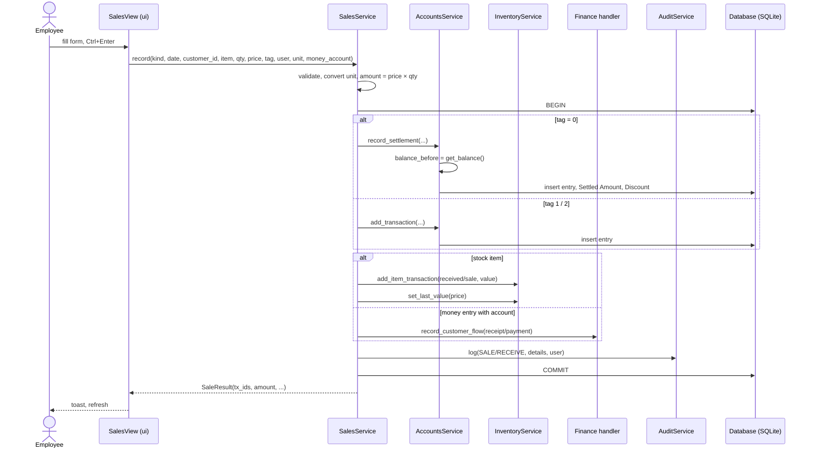

### 1.3.5 State diagrams

**Customer account period**

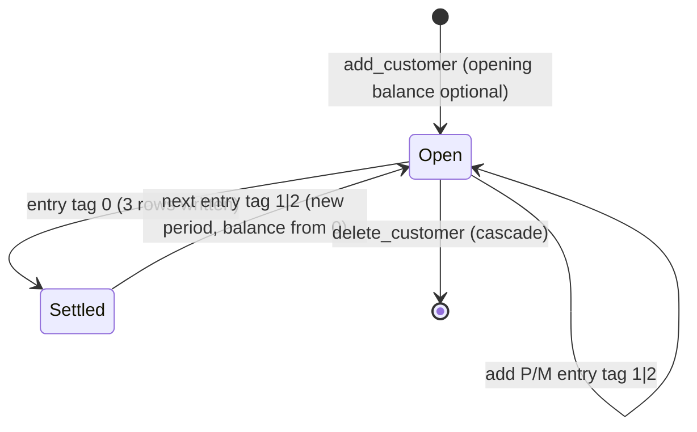

**Krar**

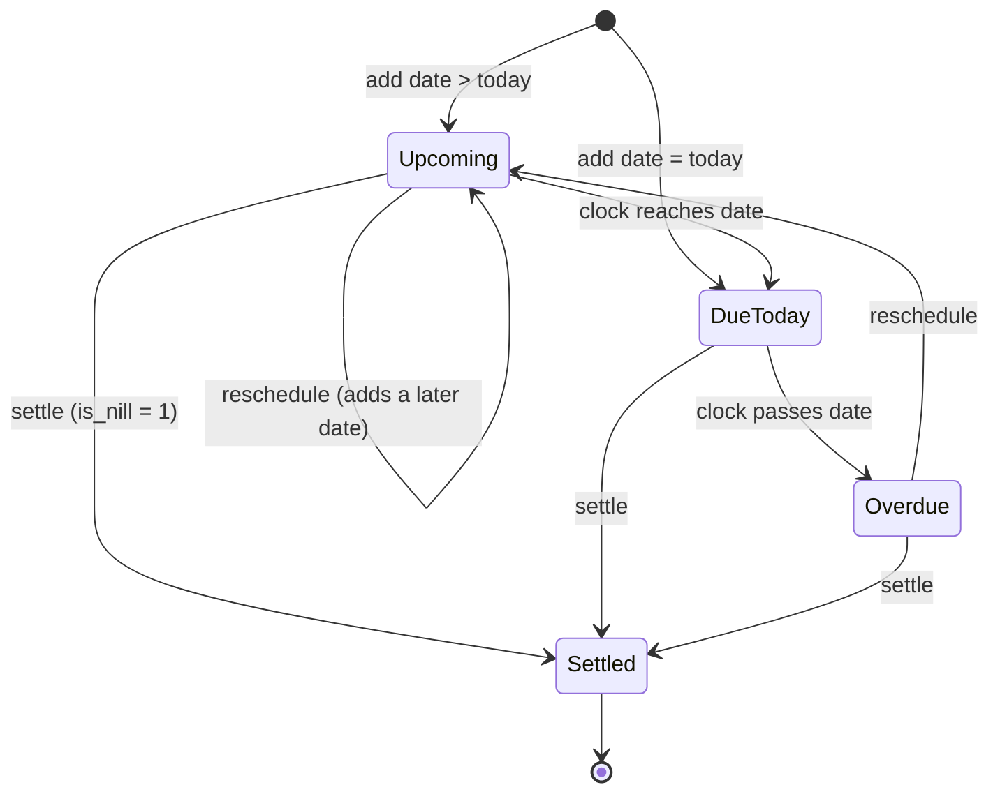

**Crop lot**

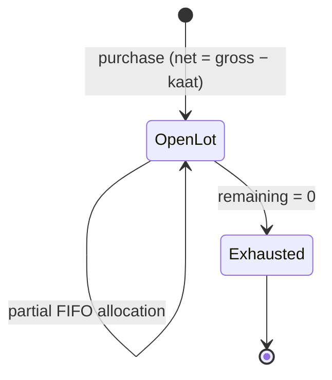

---

## 1.4 Formal functional requirements

Each requirement has an id (traced in Chapter 6), a priority (M = must, S = should,
C = could) and, where the behaviour is numeric, a pre/post-condition in predicate form.
Notation: `bal(c, d)` balance of customer `c` on date `d`; `I(a, d1, d2)` interest on
amount `a` from `d1` to `d2` (Chapter 4 defines both algebraically).

### 1.4.1 Authentication and authorisation
| Id | Requirement | Pri |
|----|-------------|-----|
| FR-1.1 | The system shall require a username and password before any screen is shown. Passwords are stored as salted hashes, never in clear. | M |
| FR-1.2 | The system shall seed `admin` (role admin) and `emp1` (role employee) on first launch and the first-run wizard shall refuse to keep the default passwords. | M |
| FR-1.3 | The system shall enforce the role → permission matrix in `services/permissions.py` for every screen and destructive button. Employee ⊂ Admin; only admin has `edit_records, delete_records, view_audit, manage_users, manage_settings, backup, billing_batch, finance_reports`. | M |
| FR-1.4 | Every write shall record the acting username; login and logout shall be audited (code 08). | M |
| FR-1.5 | An inactive user shall not be able to sign in and shall have no permissions. | M |

### 1.4.2 Accounts and ledger
| Id | Requirement | Pri |
|----|-------------|-----|
| FR-2.1 | Create a customer with name, free-text details and optional opening balance; an opening balance creates one `P`/tag-1 entry dated today. | M |
| FR-2.2 | Add a ledger entry with `date ∈ YYYY-MM-DD`, `amount > 0` (negative only for derived settlement rows), `type ∈ {P, M}`, `tag ∈ {0,1,2}`. Invalid input shall raise a validation error and write nothing. | M |
| FR-2.3 | **Balance.** Let `E` be the entries after the last tag-0 row (ordered by date, id). `bal(c,d) = round(Σ_{e∈E} s(e)·v(e,d), 2)` where `s(e)=+1` if `P` else `−1`, and `v(e,d) = amount + I(amount, date_e, d)` if tag 1, else `amount`. | M |
| FR-2.4 | **Interest.** `I(a, d1, d2)` = simple interest at `0.24/365` per day, with accrued interest added to principal on each 31 March between `d1` and `d2`; rounded to 2 dp; `d2` defaults to the *current* date at call time. The value shall equal v3's implementation for the same inputs. | M |
| FR-2.5 | **Settlement.** A tag-0 entry `(amount a, type t)` on date `d` shall write exactly three tag-0 rows: the entry, `Settled Amount = bal(c,d)` (type M) and `Discount = bal(c,d) + a` if `t = P` else `bal(c,d) − a` (type M, may be negative). Post-condition: `bal(c,d) = 0`. | M |
| FR-2.6 | Ledger view shows every entry with its interest to date and a running balance that resets at each settlement. | M |
| FR-2.7 | Admin can edit or delete any entry; deletion of a customer cascades to entries, krar and lots. Both are audited (05/06). | M |
| FR-2.8 | *Days* = days since the newest non-settlement entry; *Score* = `0.6·norm(log amount) + 0.4·norm(log days)` over the customer population (E excluded when the setting is on). | S |
| FR-2.9 | Customer statement for a date range: opening balance, each entry with interest, totals, closing balance, shop header, as print-ready HTML. | S |

### 1.4.3 Inventory and units
| Id | Requirement | Pri |
|----|-------------|-----|
| FR-3.1 | Create an item with name, opening stock, unit, batch, expiry, GST rate, type ∈ {F,P,S,C,O}, pakka/kacha. Opening stock writes one *received* movement. | M |
| FR-3.2 | `stock(i) = Σ received − Σ sale` over the item's movements, in the item's unit; quantities are real numbers (v3 truncated). | M |
| FR-3.3 | Units: mass {G, KG, QTL} (1 QTL = 100 KG = 100 000 G), volume {ML, LTR}, count {PCS, BAG, BOX, PKT, BTL}. Conversion is allowed only within a family; otherwise a validation error. Price is always per stock unit. | M |
| FR-3.4 | A sale/receipt against a stock item writes a movement with its value and sets the item's last price. | M |
| FR-3.5 | Changing an item's unit converts every movement, lot, sale and rate by the family factor (or a user-supplied factor for unrelated units, or relabel only); per-unit prices are divided by the factor; money amounts are unchanged. | S |
| FR-3.6 | Reports: stock on hand, item movement, low stock (threshold), expiring (days), dead stock (days without sale). | M |

### 1.4.4 Sales screen
| Id | Requirement | Pri |
|----|-------------|-----|
| FR-4.1 | One form shall record: stock sale (P), stock purchase/receipt (M), money receipt/payment (item `CASH` or free text), crop purchase (M on type C) and crop sale (P on type C). | M |
| FR-4.2 | The write in FR-4.1 shall be atomic: ledger, stock, cash book and audit rows are all committed or none are. | M |
| FR-4.3 | Selecting an item auto-fills unit and last price; the amount and the account's current balance are previewed before saving. | S |
| FR-4.4 | A crop trade shall not carry tag 0. | M |
| FR-4.5 | A money entry with a money account shall write a cash-book row linked to the ledger entry (Finance module present). | S |

### 1.4.5 Krar
| Id | Requirement | Pri |
|----|-------------|-----|
| FR-5.1 | A customer has at most one open krar (`is_nill = 0`) with one or more promised dates; adding a date to an open krar reschedules it. | M |
| FR-5.2 | Bucket by latest date `L`: Overdue if `L < today`, Today if `L = today`, Upcoming if `L > today`. | M |
| FR-5.3 | Settle sets `is_nill = 1` and is audited (07). | M |
| FR-5.4 | Reminder text is rendered from the template with name, amount and date; WhatsApp link is offered only when a 10-digit mobile number is found in the details. | S |

### 1.4.6 Reports, dashboard, categories
| Id | Requirement | Pri |
|----|-------------|-----|
| FR-6.1 | The report catalogue (account summary, customer ledger, receivables aging, top debtors, interest summary, customer activity, monthly debits vs credits, day book, stock on hand, item movement, low stock, expiring, dead stock, krar list, audit log, data check) shall be declarative (`ReportSpec`); each report is sortable and exportable to Excel. | M |
| FR-6.2 | Dashboard KPIs: receivable, payable, stock value, krar count, cash & bank; charts: 14-day activity, monthly debits vs credits, receivables by age; top 10 debtors; krar list. | M |
| FR-6.3 | Every customer and item carries a category A–E; E is manual only and locked; a manually set category is locked; re-scoring maps score → A–D by thresholds; item auto-categorisation by days since last sale. | S |
| FR-6.4 | Report/dashboard scope is the set of categories chosen in Settings (default A–D) with a per-report *All categories* override. | S |

### 1.4.7 Administration and operations
| Id | Requirement | Pri |
|----|-------------|-----|
| FR-7.1 | Audit log with codes 01–12 (account, item, sale, receive, modify, delete, krar, login, user, crop, rate, finance), searchable by date range, action and text. | M |
| FR-7.2 | Backup now (consistent copy) and automatic daily backup on first start each day, pruned to the last N. | M |
| FR-7.3 | Import v3 data preserving customer/item/krar ids; balances after import equal v3 for the same date; every skipped/normalised value listed in `migration_report.txt`. | M |
| FR-7.4 | Data check reporting invalid/future dates, negative stock, duplicate customers, zero-amount entries, lone settlement rows, open krar with nothing owed, long-inactive debtors. | S |
| FR-7.5 | Settings: theme, shop details, reminder template, categories, backup options, re-run wizard, change password. | S |
| FR-7.6 | Global search (Ctrl+K) across accounts, items and bills. | C |

### 1.4.8 Modules
| Id | Requirement | Pri |
|----|-------------|-----|
| FR-8.1 | **Bills**: invoice with lines, CGST = SGST = 9 % for type P, 2.5 % for F, 0 for S/O; tax rounded to 2 dp; amount in Hindi words; DOCX via template; PDF when Word is available; browse/merge by month; admin month batch identical to v3's random split; bills ≥ ₹20 000 flagged not rendered. | S |
| FR-8.2 | **Crop trading**: crop = item type C; purchase = lot (gross, kaat, net, rate, quality) crediting the farmer (tag 2 default) and adding stock; sale FIFO-costed against open lots storing cost, margin, margin %; selling short refused unless allowed (uncovered part at last purchase rate, flagged); valuation at cost and at latest market rate; CSV rate import; naive trend estimate. | S |
| FR-8.3 | **Finance**: money accounts with opening balances; cash book with running balance; expense/income heads; transfers, capital in, drawings; recurring expenses posted idempotently; reports cash flow, P&L (item margin + crop margin + other income − expenses; accrued interest excluded), expenses by head, monthly expenses, balances. | S |
| FR-8.4 | Modules register through `ModuleSpec` (key, label, view factory, permission, shortcut) and add tables through the versioned migration list; they never import other modules' UI. | M |

---

## 1.5 Non-functional requirements
| Id | Requirement |
|----|-------------|
| NFR-1 Correctness | Business figures identical to v3.7.1 for identical data (pinned by `tests/test_interest.py`, `tests/test_migration.py`). |
| NFR-2 Performance | Any screen or report on a database of 5 000 customers / 200 000 entries renders in < 2 s on the shop PC (indexes on `(customer_id, date, id)` and `(item_id, date, id)`). |
| NFR-3 Reliability | Every multi-table write is one SQLite transaction; foreign keys enforced; daily automatic backup. |
| NFR-4 Usability | Keyboard-first: Alt+letter navigation, Ctrl+Enter / Ctrl+Shift+Enter to post, Ctrl+K search; light/dark theme; toasts instead of console output; forms usable at 1366×768. |
| NFR-5 Security | Salted password hashes; permission check on every action; audit trail with username; no plaintext credentials in logs. |
| NFR-6 Portability | Python 3.10+, Windows/macOS/Linux; data folder per platform or `HTH_DATA_DIR`; single-folder PyInstaller build. |
| NFR-7 Maintainability | Layering `ui → services → db/domain`; views never write SQL; services never import Tk; declarative reports, permissions, modules; `ruff` clean; semantic versioning with changelog. |
| NFR-8 Testability | Business rules testable without a display on an in-memory SQLite; opt-in UI walkthrough test. |
| NFR-9 Data integrity | Versioned schema (`PRAGMA user_version`) with forward-only migrations; import never guesses silently. |

## 1.6 External interfaces and constraints
* **User interface**: customtkinter desktop windows; sidebar navigation; data tables with sortable columns.
* **File interfaces**: `hth.db` (SQLite), `exports/*.xlsx` (openpyxl), `exports/*.html` statements, `bills/*.docx` (docxtpl), `pdfs/`, `merged_pdfs/` (pypdf), `backups/*.db`, `logs/*.log`, `migration_report.txt`, CSV `crop,date,rate`.
* **Software interfaces**: Python 3.10, customtkinter ≥ 5.2, matplotlib ≥ 3.7, openpyxl ≥ 3.1, docxtpl ≥ 0.16, pypdf ≥ 4; optional docx2pdf + Microsoft Word; WhatsApp via `https://wa.me/<number>?text=` URL.
* **Constraints**: no network dependency at runtime; single shop PC; v3 data must remain importable; Hindi amount-in-words for invoices.


\newpage

# Chapter 2 — DFD modelling, data model and architecture

Notation (Gane–Sarson mapped to Mermaid): **rectangles** = external entities, **rounded
/ circles** = processes, **cylinders** = data stores, arrows = data flows.

## 2.1 Context diagram (DFD level 0)

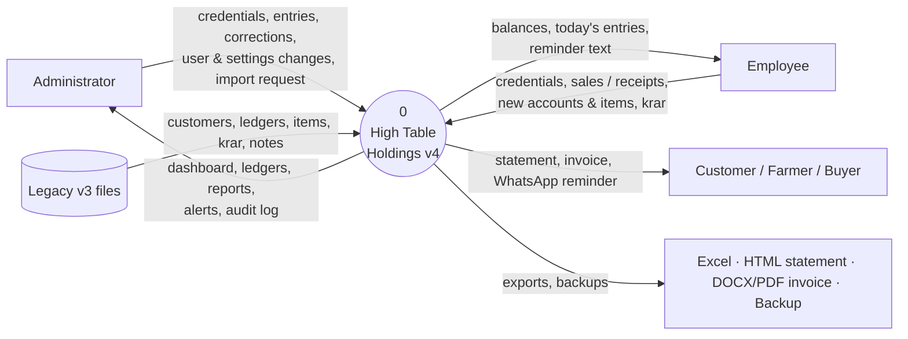

## 2.2 DFD level 1

Both roles use the same screens, so they are shown as one external entity *Users*;
flows that only an Administrator can trigger are marked **(admin)**. Process 1 checks the
permission matrix for every other process (DT-1); those control flows are omitted from the
diagram to keep the data flows readable.

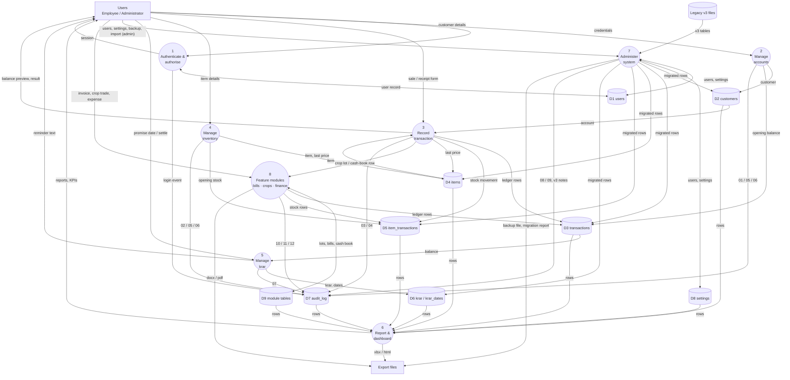

## 2.3 DFD level 2 — Process 3 *Record transaction*

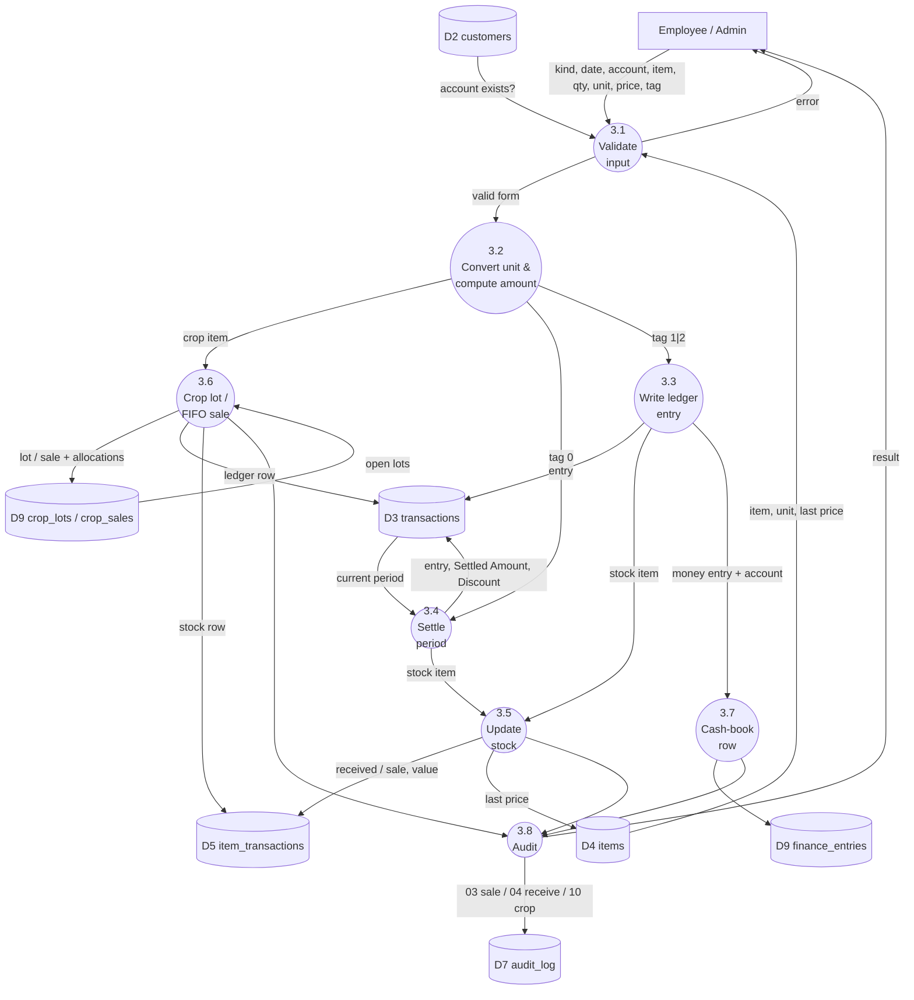

## 2.4 DFD level 2 — Process 7 *Administer system* (import path)

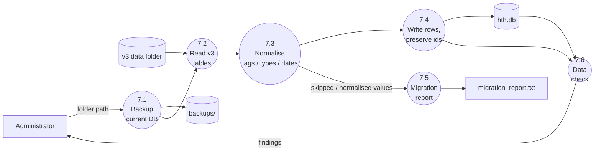

## 2.5 Entity-relationship diagram

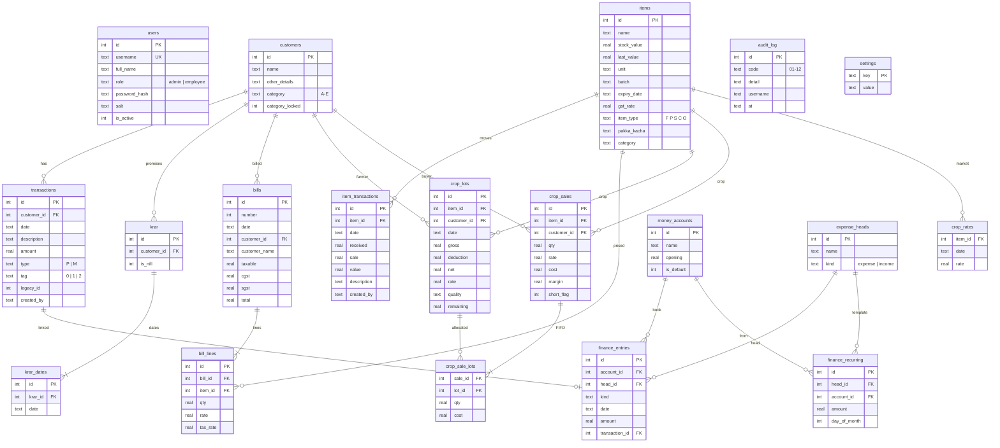

Key integrity rules: all foreign keys `ON DELETE CASCADE`; `CHECK` constraints on
`type`, `tag`, `role`; indexes `ix_tx_customer_date (customer_id, date, id)`,
`ix_itx_item_date (item_id, date, id)`, `ix_krar_customer (customer_id, is_nill)`;
schema version in `PRAGMA user_version` with migrations 1 (core) → 2 (bills) → 3 (crops)
→ 4 (categories) → 5 (finance).

## 2.6 Architecture

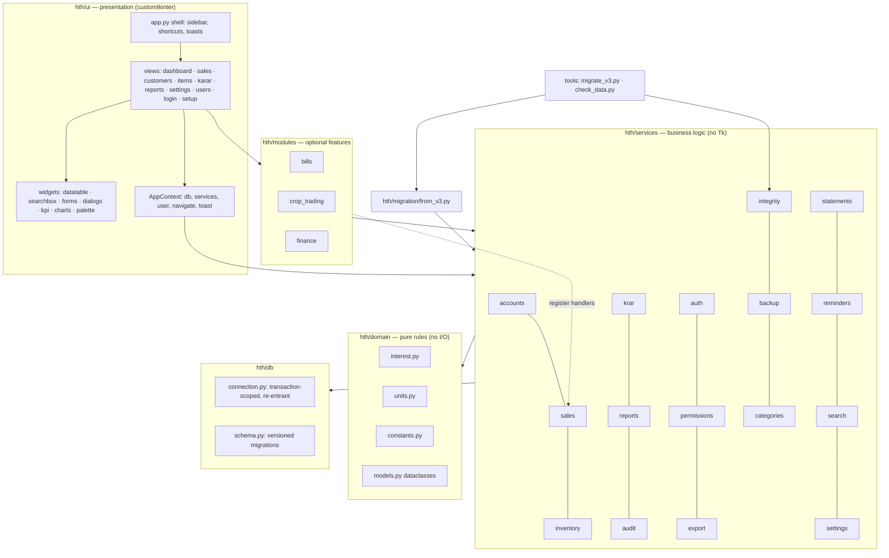

**Layering rule**: `ui → services → db/domain`. Views never write SQL; services never
import Tk. Modules depend on services and the shared `AppContext` only, and hook into the
core through registration functions (`register_crop_handler`, `register_money_flow_handler`)
so the Sales screen behaves identically whether a module is installed or not.

## 2.7 Deployment view

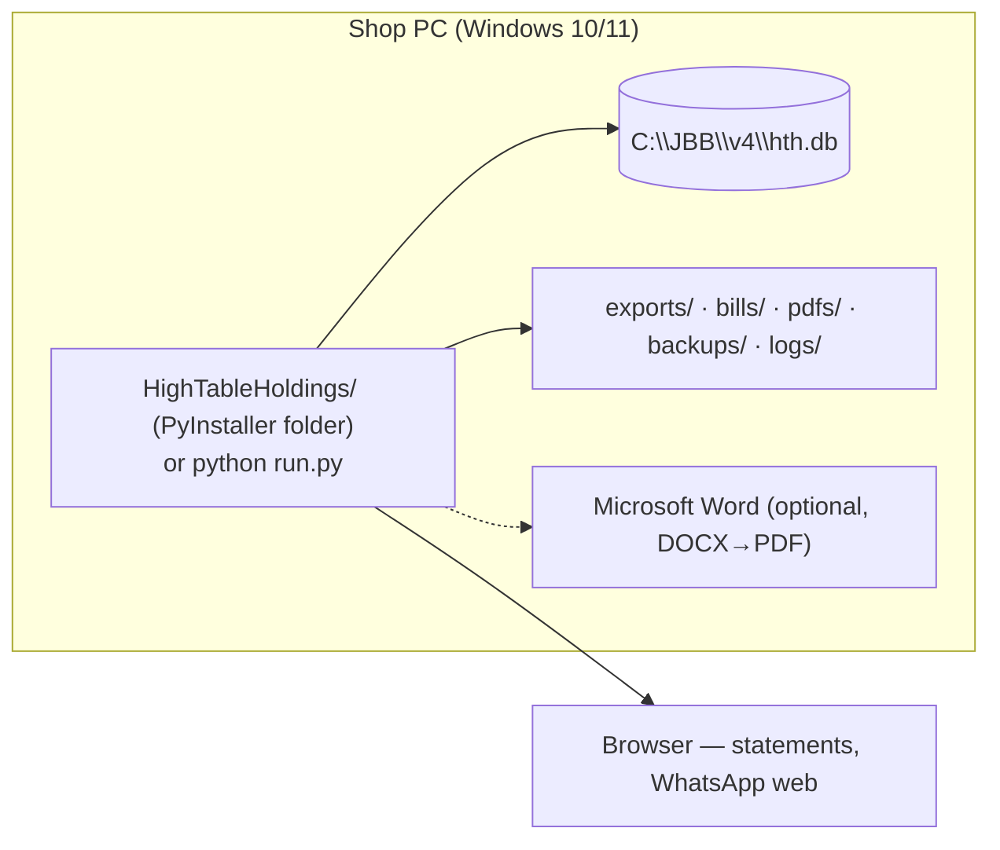


\newpage

# Chapter 3 — Decision tables (formal specification)

Decision tables specify the branching business rules of the prototype. Each table is
complete (every combination of conditions is covered) and the rules are mutually
exclusive. `—` means *don't care*.

## 3.1 DT-1 Authorisation of an action

Conditions: the user's state and role; the action's required permission.

| Condition | R1 | R2 | R3 | R4 | R5 |
|-----------|----|----|----|----|----|
| User signed in | N | Y | Y | Y | Y |
| User is active | — | N | Y | Y | Y |
| Role | — | — | admin | employee | employee |
| Permission ∈ employee set* | — | — | — | Y | N |
| **Actions** | | | | | |
| Show login screen | X | X | | | |
| Allow action | | | X | X | |
| Hide / disable control, refuse service call | | | | | X |

\* employee set = {view_dashboard, record_sale, add_customer, add_item, manage_krar,
view_reports, export, billing, crop_trading, finance}. Admin holds every permission.

## 3.2 DT-2 Validating a Sales-screen entry

| Condition | R1 | R2 | R3 | R4 | R5 | R6 | R7 | R8 |
|-----------|----|----|----|----|----|----|----|----|
| kind ∈ {P, M} | N | Y | Y | Y | Y | Y | Y | Y |
| date is `YYYY-MM-DD` | — | N | Y | Y | Y | Y | Y | Y |
| account exists | — | — | N | Y | Y | Y | Y | Y |
| item text non-empty | — | — | — | N | Y | Y | Y | Y |
| quantity > 0 | — | — | — | — | N | Y | Y | Y |
| tag ∈ {0,1,2} | — | — | — | — | — | N | Y | Y |
| entry unit compatible with item unit (or no item) | — | — | — | — | — | — | N | Y |
| **Actions** | | | | | | | | |
| Raise "Kind must be P or M" | X | | | | | | | |
| Raise "Invalid date" | | X | | | | | | |
| Raise "Select a valid account" | | | X | | | | | |
| Raise "Item is required" | | | | X | | | | |
| Raise "Quantity must be greater than zero" | | | | | X | | | |
| Raise "Tag must be 0, 1 or 2" | | | | | | X | | |
| Raise "Enter the quantity in <unit> or a compatible unit" | | | | | | | X | |
| Proceed to DT-3 | | | | | | | | X |

## 3.3 DT-3 What a valid Sales-screen entry writes

| Condition | R1 | R2 | R3 | R4 | R5 | R6 | R7 |
|-----------|----|----|----|----|----|----|----|
| Item is a crop (type C) | Y | Y | N | N | N | N | N |
| tag = 0 | Y | N | Y | Y | N | N | N |
| Item is a stock item | — | — | Y | N | Y | N | N |
| Money account chosen | — | — | — | — | — | Y | N |
| **Actions** | | | | | | | |
| Reject: crops cannot carry tag 0 | X | | | | | | |
| Crop purchase lot (M) or FIFO sale (P) → DT-4 | | X | | | | | |
| Write 3 tag-0 rows (entry, Settled Amount, Discount) | | | X | X | | | |
| Write 1 ledger row with given tag | | | | | X | X | X |
| Write stock movement (received if M, sale if P) with value; set last price | | | X | | X | | |
| Write cash-book row linked to the ledger row | | | | | | X | |
| Write audit row 03 (P) / 04 (M) | | X | X | X | X | X | X |
| Commit as one transaction | | X | X | X | X | X | X |

## 3.4 DT-4 Crop sale (Debit on a crop item)

| Condition | R1 | R2 | R3 |
|-----------|----|----|----|
| qty ≤ open-lot stock | Y | N | N |
| *Allow selling short* ticked | — | N | Y |
| **Actions** | | | |
| Reject: not enough stock | | X | |
| Allocate FIFO from oldest open lots; cost = Σ alloc × lot rate | X | | X |
| Uncovered part costed at last purchase rate; flag `short` | | | X |
| Store cost, margin = revenue − cost, margin % | X | | X |
| Debit buyer (or cash sale: no ledger row); reduce stock; audit 10 | X | | X |

## 3.5 DT-5 Contribution of a ledger row to the balance `bal(c, d)`

| Condition | R1 | R2 | R3 | R4 | R5 |
|-----------|----|----|----|----|----|
| Row is after the last tag-0 row (in current period) | N | Y | Y | Y | Y |
| tag | — | 1 | 1 | 2 | 2 |
| type | — | P | M | P | M |
| **Actions** | | | | | |
| Ignore row | X | | | | |
| Add `amount + I(amount, date, d)` | | X | | | |
| Subtract `amount + I(amount, date, d)` | | | X | | |
| Add `amount` | | | | X | |
| Subtract `amount` | | | | | X |

(Tag-0 rows are by definition not after the last tag-0 row, so they never contribute.)

## 3.6 DT-6 Settlement discount row

| Condition | R1 | R2 |
|-----------|----|----|
| Settlement entry type | P | M |
| **Actions** | | |
| Discount = balance_before + amount | X | |
| Discount = balance_before − amount | | X |
| Write *Settled Amount* = balance_before (M, tag 0) | X | X |
| Write *Discount* (M, tag 0), negative allowed | X | X |

## 3.7 DT-7 Interest accrual over a period `[start, end)`

| Condition | R1 | R2 | R3 |
|-----------|----|----|----|
| start < end | N | Y | Y |
| a 31 March lies in `[start, end)` | — | N | Y |
| **Actions** | | | |
| Interest = 0 | X | | |
| Interest = principal × days × 0.24/365 | | X | |
| Interest to 31 March added to principal; recurse from 1 April | | | X |
| Round result to 2 dp | X | X | X |

## 3.8 DT-8 Krar bucket (latest promised date `L`, today `T`)

| Condition | R1 | R2 | R3 | R4 |
|-----------|----|----|----|----|
| krar settled (`is_nill = 1`) | Y | N | N | N |
| L < T | — | Y | N | N |
| L = T | — | — | Y | N |
| **Actions** | | | | |
| Not listed | X | | | |
| Bucket *Overdue* | | X | | |
| Bucket *Today* | | | X | |
| Bucket *Upcoming* | | | | X |

## 3.9 DT-9 Unit conversion of an entered quantity

| Condition | R1 | R2 | R3 | R4 |
|-----------|----|----|----|----|
| Entry unit given | N | Y | Y | Y |
| Entry unit = stock unit | — | Y | N | N |
| Same family (mass / volume) | — | — | Y | N |
| **Actions** | | | | |
| Use quantity as is | X | X | | |
| Multiply by family factor (G→KG ÷1000, QTL→KG ×100, ML→LTR ÷1000) | | | X | |
| Reject: incompatible unit | | | | X |

## 3.10 DT-10 Changing an item's unit (admin)

| Condition | R1 | R2 | R3 | R4 |
|-----------|----|----|----|----|
| New unit same family as old | Y | N | N | N |
| Factor supplied by user | — | Y | N | N |
| "Relabel only" chosen | — | — | Y | N |
| **Actions** | | | | |
| Factor = family factor | X | | | |
| Factor = user's | | X | | |
| Factor = 1 (labels change, numbers don't) | | | X | |
| Ask "how many <new> is 1 <old>?" | | | | X |
| Multiply quantities, divide per-unit prices, leave money unchanged (movements, lots, sales, allocations, rates) | X | X | X | |

## 3.11 DT-11 Customer re-scoring to a category

Thresholds `t1 < t2 < t3` from Settings; `s` = account score ∈ [0, 1].

| Condition | R1 | R2 | R3 | R4 | R5 | R6 | R7 |
|-----------|----|----|----|----|----|----|----|
| Category is E | Y | N | N | N | N | N | N |
| Category locked (set by hand) | — | Y | N | N | N | N | N |
| Nothing outstanding (balance ≤ 0) | — | — | Y | N | N | N | N |
| s < t1 | — | — | — | Y | N | N | N |
| s < t2 | — | — | — | — | Y | N | N |
| s < t3 | — | — | — | — | — | Y | N |
| **Actions** | | | | | | | |
| Skip (unchanged) | X | X | | | | | |
| Set A | | | X | X | | | |
| Set B | | | | | X | | |
| Set C | | | | | | X | |
| Set D | | | | | | | X |

## 3.12 DT-12 GST on an invoice line (Bills module)

| Condition | R1 | R2 | R3 |
|-----------|----|----|----|
| Item type | P | F | S or O |
| **Actions** | | | |
| CGST = SGST = 9 % of taxable | X | | |
| CGST = SGST = 2.5 % of taxable | | X | |
| CGST = SGST = 0 | | | X |
| Round each tax to 2 dp; total = taxable + CGST + SGST | X | X | X |

## 3.13 DT-13 Month-batch invoice rendering (admin)

| Condition | R1 | R2 |
|-----------|----|----|
| Bill total ≥ ₹20 000 | Y | N |
| **Actions** | | |
| Create bill row, flag, do **not** render | X | |
| Create bill row and render DOCX | | X |

## 3.14 DT-14 Automatic daily backup at start-up

| Condition | R1 | R2 | R3 |
|-----------|----|----|----|
| Auto-backup enabled | N | Y | Y |
| A backup `hth_auto_<today>.db` already exists | — | Y | N |
| **Actions** | | | |
| Do nothing | X | X | |
| Write `hth_auto_YYYYMMDD.db`; delete oldest beyond N | | | X |


\newpage

# Chapter 4 — Algebraic specifications (formal specification)

Each abstract data type is given as **sorts**, **operations** (signature) and
**axioms** (equations that hold for all values of the variables). Operations are split
into *constructors* (build values) and *observers/derived* (inspect values). Where the
implementation rounds, the axiom is stated on exact reals and rounding to 2 dp is a final
observer `round2`. Auxiliary sorts: `Real`, `Nat`, `Bool`, `Date` (totally ordered, with
`succ`, `daysBetween`, `fyEnd : Date → Date` giving the next 31 March on or after a date).

---

## 4.1 Interest

```
spec INTEREST
  uses  Real, Date, Bool
  consts
    r      : Real            -- daily rate = 0.24 / 365
  ops
    fyEnd  : Date → Date
    I      : Real × Date × Date → Real        -- I(principal, from, to)
  axioms  ∀ p : Real, d1 d2 : Date
    [I1] fyEnd(d) = (31 March of year(d))          if month(d) ≤ 3
    [I2] fyEnd(d) = (31 March of year(d) + 1)      if month(d) > 3
    [I3] I(p, d1, d2) = 0                          if ¬(d1 < d2)
    [I4] I(p, d1, d2) = p · daysBetween(d1, d2) · r
                                                   if d1 < d2 ∧ d2 ≤ fyEnd(d1)
    [I5] I(p, d1, d2) = p · daysBetween(d1, fyEnd(d1)) · r
                        + I(p + p · daysBetween(d1, fyEnd(d1)) · r,
                            succ(fyEnd(d1)), d2)   if d1 < d2 ∧ d2 > fyEnd(d1)
  observers
    interest(p, d1, d2) = round2(I(p, d1, d2))
end
```
Properties derivable from the axioms (checked in `tests/test_interest.py`):
`interest(1000, 2024-04-01, 2025-03-31) = 240.00` (one FY, simple);
`interest(p, d, d) = 0`; `I` is monotone in `d2`; compounding occurs only at `fyEnd`.

---

## 4.2 Ledger (customer account)

```
spec LEDGER
  uses  INTEREST, Real, Date, Bool, Nat
  sorts Ledger, Entry, Type = {P, M}, Tag = {0, 1, 2}
  ops
    -- constructors
    empty   : → Ledger
    add     : Ledger × Date × Real × Type × Tag → Ledger      -- append one row
    -- observers / derived
    sign    : Type → Real
    value   : Entry × Date → Real
    period  : Ledger → Ledger        -- rows after the last tag-0 row
    bal     : Ledger × Date → Real
    settle  : Ledger × Date × Real × Type → Ledger
    size    : Ledger → Nat
  axioms  ∀ L : Ledger, d t : Date, a b : Real, ty : Type, tg : Tag
    [L1] sign(P) = +1
    [L2] sign(M) = −1
    [L3] value(entry(d, a, ty, 1), t) = a + I(a, d, t)
    [L4] value(entry(d, a, ty, 2), t) = a
    [L5] value(entry(d, a, ty, 0), t) = 0
    [L6] period(empty) = empty
    [L7] period(add(L, d, a, ty, 0)) = empty                      -- settlement closes the period
    [L8] period(add(L, d, a, ty, tg)) = add(period(L), d, a, ty, tg)   if tg ≠ 0
    [L9] bal(empty, t) = 0
    [L10] bal(add(L, d, a, ty, tg), t) = bal(period(L), t) + sign(ty) · value(entry(d, a, ty, tg), t)
                                                                  if tg ≠ 0
    [L11] bal(add(L, d, a, ty, 0), t) = 0
    [L12] settle(L, d, a, P) = add(add(add(L, d, a, P, 0), d, bal(L, d), M, 0), d, bal(L, d) + a, M, 0)
    [L13] settle(L, d, a, M) = add(add(add(L, d, a, M, 0), d, bal(L, d), M, 0), d, bal(L, d) − a, M, 0)
    [L14] size(empty) = 0
    [L15] size(add(L, d, a, ty, tg)) = size(L) + 1
  observers
    balance(L, t) = round2(bal(L, t))
  invariants
    ∀ L d a ty : bal(settle(L, d, a, ty), d) = 0                  -- from L11
    ∀ L d a ty : size(settle(L, d, a, ty)) = size(L) + 3          -- three tag-0 rows
    a > 0 for every user-entered row; derived rows (Settled Amount, Discount) may be < 0
end
```
Note on ordering: rows are ordered by `(date, id)`; `add` appends with the next id, so
`period` is well defined even when several rows share a date.

---

## 4.3 Stock (inventory of one item)

```
spec STOCK
  uses  Real, Date, Bool
  sorts Stock, Unit, Family = {mass, volume, count}
  ops
    new      : Real × Unit → Stock              -- opening quantity in stock unit
    receive  : Stock × Date × Real × Unit → Stock
    sell     : Stock × Date × Real × Unit → Stock
    qty      : Stock → Real
    unit     : Stock → Unit
    lastPrice: Stock → Real
    setPrice : Stock × Real → Stock
    fam      : Unit → Family
    factor   : Unit × Unit → Real               -- partial: defined iff fam(u) = fam(v) ∧ fam ≠ count or u = v
    conv     : Real × Unit × Unit → Real
  axioms  ∀ S : Stock, q p : Real, u v : Unit, d : Date
    [S1] factor(u, u) = 1
    [S2] factor(G, KG) = 1/1000;  factor(KG, QTL) = 1/100;  factor(ML, LTR) = 1/1000
    [S3] factor(u, v) = 1 / factor(v, u)
    [S4] factor(u, w) = factor(u, v) · factor(v, w)            (same family)
    [S5] conv(q, u, v) = q · factor(u, v)                      if defined(factor(u, v))
    [S6] conv(q, u, v) = ⊥ (UnitError)                          otherwise
    [S7] unit(new(q, u)) = u
    [S8] unit(receive(S, d, q, u)) = unit(S);   unit(sell(S, d, q, u)) = unit(S)
    [S9] qty(new(q, u)) = q
    [S10] qty(receive(S, d, q, u)) = qty(S) + conv(q, u, unit(S))
    [S11] qty(sell(S, d, q, u)) = qty(S) − conv(q, u, unit(S))
    [S12] lastPrice(setPrice(S, p)) = p
    [S13] qty(setPrice(S, p)) = qty(S)
  invariant
    qty(S) = Σ received − Σ sold (all expressed in unit(S)); no truncation to integers.
end
```

**Unit change** (admin): `rescale(S, v, f)` with factor `f = factor(unit(S), v)` (or user
supplied) satisfies `qty(rescale(S, v, f)) = qty(S) · f`, `lastPrice(rescale(S, v, f)) =
lastPrice(S) / f` and `value = qty · price` is preserved.

---

## 4.4 Crop lots and FIFO costing

```
spec CROPFIFO
  uses  Real, Date, Bool, list
  sorts Lot, Lots, Sale
  ops
    lot       : Date × Real × Real × Real → Lot       -- (date, gross, kaat, rate); net = gross − kaat
    remaining : Lot → Real
    none      : → Lots
    push      : Lots × Lot → Lots                     -- lots kept in date order (oldest first)
    open      : Lots → Real                            -- Σ remaining
    alloc     : Lots × Real → (Lots × Real)            -- (lots after allocation, cost)
    sale      : Lots × Real × Real × Bool → Sale       -- (lots, qty, sellRate, allowShort)
    lastRate  : Lots → Real
  axioms  ∀ Ls : Lots, l : Lot, q r : Real, short : Bool
    [F1] remaining(lot(d, g, k, r)) = g − k
    [F2] open(none) = 0
    [F3] open(push(Ls, l)) = open(Ls) + remaining(l)
    [F4] alloc(Ls, 0) = (Ls, 0)
    [F5] alloc(push(Ls, l), q) with l the OLDEST open lot:
           if q ≤ remaining(l):  (lots with remaining(l) − q,  q · rate(l))
           else:                 let (Ls', c) = alloc(Ls without l, q − remaining(l))
                                 in (Ls', remaining(l) · rate(l) + c)
    [F6] sale(Ls, q, r, short) = ⊥ (rejected)                 if q > open(Ls) ∧ ¬short
    [F7] cost(sale(Ls, q, r, short)) = snd(alloc(Ls, min(q, open(Ls))))
                                        + max(0, q − open(Ls)) · lastRate(Ls)
    [F8] margin(sale(Ls, q, r, _)) = q · r − cost(sale(Ls, q, r, _))
    [F9] flagged(sale(Ls, q, r, true)) = (q > open(Ls))
    [F10] open(after(sale(Ls, q, r, _))) = max(0, open(Ls) − q)
  invariant   Σ_lots remaining ≥ 0;  every allocation row references an existing lot.
end
```

---

## 4.5 Krar (promise to pay)

```
spec KRAR
  uses  Date, Bool, set
  sorts Krar, Bucket = {overdue, today, upcoming, none}
  ops
    open      : Date → Krar
    promise   : Krar × Date → Krar        -- reschedule = add a date
    settleK   : Krar → Krar
    latest    : Krar → Date
    isOpen    : Krar → Bool
    bucket    : Krar × Date → Bucket      -- (krar, today)
  axioms  ∀ K : Krar, d t : Date
    [K1] isOpen(open(d)) = true
    [K2] isOpen(promise(K, d)) = isOpen(K)
    [K3] isOpen(settleK(K)) = false
    [K4] latest(open(d)) = d
    [K5] latest(promise(K, d)) = max(latest(K), d)
    [K6] bucket(K, t) = none        if ¬isOpen(K)
    [K7] bucket(K, t) = overdue     if isOpen(K) ∧ latest(K) < t
    [K8] bucket(K, t) = today       if isOpen(K) ∧ latest(K) = t
    [K9] bucket(K, t) = upcoming    if isOpen(K) ∧ latest(K) > t
  invariant   a customer has at most one K with isOpen(K) = true.
end
```

---

## 4.6 Permissions

```
spec PERMISSIONS
  uses  Bool, set
  sorts Role = {admin, employee}, Perm, User
  ops
    perms   : Role → Set(Perm)
    allowed : User × Perm → Bool
    role, active : User → Role, Bool
  axioms  ∀ u : User, p : Perm
    [P1] perms(admin) = ALL
    [P2] perms(employee) = {view_dashboard, record_sale, add_customer, add_item, manage_krar,
                            view_reports, export, billing, crop_trading, finance}
    [P3] perms(employee) ⊂ perms(admin)
    [P4] allowed(u, p) = active(u) ∧ p ∈ perms(role(u))
end
```

---

## 4.7 Audit log

```
spec AUDIT
  uses  Nat, Date, string, list
  sorts Log, Code = {01..12}
  ops
    emptyLog : → Log
    log      : Log × Code × string × string × Date → Log      -- (log, code, detail, user, at)
    count    : Log → Nat
    byUser   : Log × string → Log
  axioms
    [A1] count(emptyLog) = 0
    [A2] count(log(G, c, s, u, t)) = count(G) + 1
    [A3] byUser(emptyLog, u) = emptyLog
    [A4] byUser(log(G, c, s, u', t), u) = if u = u' then log(byUser(G, u), c, s, u, t) else byUser(G, u)
  invariant   Log is append-only: no operation removes an entry.
end
```

---

## 4.8 Money accounts (Finance module)

```
spec CASHBOOK
  uses  Real, Date
  sorts Book, Kind = {receipt, payment, expense, income, transfer_in, transfer_out, capital, drawings}
  ops
    openBook : Real → Book                    -- opening balance
    post     : Book × Date × Kind × Real → Book
    balance  : Book → Real
    inflow   : Kind → Bool
  axioms  ∀ B : Book, o a : Real, d : Date, k : Kind
    [C1] inflow(k) = k ∈ {receipt, income, transfer_in, capital}
    [C2] balance(openBook(o)) = o
    [C3] balance(post(B, d, k, a)) = balance(B) + a       if inflow(k)
    [C4] balance(post(B, d, k, a)) = balance(B) − a       if ¬inflow(k)
    [C5] transfer(B1, B2, a) = (post(B1, d, transfer_out, a), post(B2, d, transfer_in, a))
  invariant   Σ over all books of balance = Σ opening + Σ inflows − Σ outflows
              (transfers cancel); balances are never stored, always derived.
end
```

## 4.9 Consistency with the implementation

| Spec | Implementation | Pinning test |
|------|----------------|--------------|
| INTEREST | `hth/domain/interest.py` | `tests/test_interest.py` |
| LEDGER | `AccountsService.get_balance / ledger / record_settlement` | `tests/test_accounts.py` |
| STOCK | `InventoryService`, `hth/domain/units.py` | `tests/test_inventory_sales.py`, `tests/test_units.py`, `tests/test_unit_change.py` |
| CROPFIFO | `hth/modules/crop_trading/service.py` | `tests/modules/test_crops.py`, `tests/test_sales_crops.py` |
| KRAR | `KrarService` | `tests/test_krar_reports_auth.py` |
| PERMISSIONS | `hth/services/permissions.py` | `tests/test_krar_reports_auth.py::test_permissions` |
| AUDIT | `AuditService` | asserted throughout |
| CASHBOOK | `hth/modules/finance/service.py` | `tests/modules/test_finance.py` |


\newpage

# Chapter 5 — Project planning: WBS, Activity Network, PERT, Gantt

Planning window: **Mon 24 Aug 2026 → Wed 11 Nov 2026** (final submission). Working days
are Mon–Fri; the plan uses **57 working days**, leaving Nov 11 as the submission day.
Team of four; effort figures are calendar working days for the team, not person-days.

## 5.1 Work Breakdown Structure

```mermaid
flowchart TB
  R[High Table Holdings v4]
  R --> W1[1. Project management]
  R --> W2[2. Requirements]
  R --> W3[3. Design]
  R --> W4[4. Implementation]
  R --> W5[5. Testing]
  R --> W6[6. Deployment]
  R --> W7[7. Documentation & deliverables]

  W1 --> W11[1.1 Team setup, Git repo, conventions]
  W1 --> W12[1.2 Planning: WBS, network, PERT]
  W1 --> W13[1.3 Weekly reviews, risk log]

  W2 --> W21[2.1 Study legacy v3 & interview owner]
  W2 --> W22[2.2 Abstract]
  W2 --> W23[2.3 User stories & glossary]
  W2 --> W24[2.4 SRS: FR / NFR]
  W2 --> W25[2.5 Formal: decision tables, algebraic specs]

  W3 --> W31[3.1 Architecture & layering]
  W3 --> W32[3.2 DB schema & migrations]
  W3 --> W33[3.3 DFD / ER / UML models]
  W3 --> W34[3.4 UI/UX: theme, widgets, screens]
  W3 --> W35[3.5 Module extension contract]

  W4 --> W41[4.1 Domain: interest, units, constants]
  W4 --> W42[4.2 Core services: accounts, inventory, sales, krar]
  W4 --> W43[4.3 Auth, permissions, audit]
  W4 --> W44[4.4 UI screens & dashboard]
  W4 --> W45[4.5 Reports & Excel export]
  W4 --> W46[4.6 v3 migration tool & data check]
  W4 --> W47[4.7 Modules: bills, crop trading, finance]
  W4 --> W48[4.8 Ops: backup, wizard, search, statements, reminders]

  W5 --> W51[5.1 Unit tests: business rules]
  W5 --> W52[5.2 Integration tests: sales flow, migration]
  W5 --> W53[5.3 UI walkthrough tests]
  W5 --> W54[5.4 System / acceptance testing with shop data]
  W5 --> W55[5.5 Test-case document & traceability]

  W6 --> W61[6.1 PyInstaller build]
  W6 --> W62[6.2 Install on shop PC, import v3]
  W6 --> W63[6.3 User hand-over]

  W7 --> W71[7.1 README, CHANGELOG]
  W7 --> W72[7.2 Final documentation PDF]
  W7 --> W73[7.3 Screencast video]
  W7 --> W74[7.4 Presentation & Q&A prep]
```

### WBS dictionary (leaf work packages)

| WBS | Work package | Deliverable | Owner |
|-----|--------------|-------------|-------|
| 1.1 | Team setup, Git repo, conventions | Public repo, branch rules, `ruff` config | M4 |
| 1.2 | Planning | This chapter | M4 |
| 2.1 | Study v3, interview owner | Notes on business rules, v3 quirks | M1 |
| 2.2 | Abstract | `TeamNo.pdf` | M1 |
| 2.3–2.4 | User stories, SRS | Chapter 1 | M1 |
| 2.5 | Decision tables, algebraic specs | Chapters 3–4 | M4 |
| 3.1 | Architecture | `hth/` package layout, layering rule | M1 |
| 3.2 | DB schema & migrations | `hth/db/schema.py` | M1 |
| 3.3 | DFD / ER / UML | Chapter 2 | M4 |
| 3.4 | UI/UX | Theme, widgets, wireframes | M2 |
| 3.5 | Module contract | `hth/modules/README.md`, `ModuleSpec` | M3 |
| 4.1 | Domain | `hth/domain/*` | M1 |
| 4.2 | Core services | `hth/services/{accounts,inventory,sales,krar}.py` | M1 |
| 4.3 | Auth, permissions, audit | `hth/services/{auth,permissions,audit}.py` | M1 |
| 4.4 | UI screens | `hth/ui/views/*` | M2 |
| 4.5 | Reports & export | `hth/services/{reports,export}.py`, reports view | M2 |
| 4.6 | Migration & data check | `tools/*.py`, `hth/migration/from_v3.py`, `integrity.py` | M3 |
| 4.7 | Modules | `hth/modules/{bills,crop_trading,finance}` | M3 |
| 4.8 | Ops features | backup, setup wizard, search, statements, reminders | M2/M3 |
| 5.1–5.3 | Automated tests | `tests/` (96 tests) | M4 |
| 5.4 | Acceptance with shop data | Signed-off checklist | M4 + owner |
| 5.5 | Test-case document | Chapter 6 | M4 |
| 6.1–6.3 | Build, install, hand-over | `HighTableHoldings/` folder on shop PC | M3 |
| 7.1–7.4 | Docs, video, PPT | `Documentation.pdf`, video, slides | all |

## 5.2 Activity list with PERT estimates

Three-point estimates in working days: optimistic `o`, most likely `m`, pessimistic `p`;
expected `te = (o + 4m + p) / 6`; variance `σ² = ((p − o) / 6)²`.

| Id | Activity (WBS) | Predecessors | o | m | p | te | σ² |
|----|----------------|--------------|---|---|---|----|----|
| A | Requirements elicitation, study v3 (2.1, 1.1) | — | 3 | 5 | 7 | 5.0 | 0.44 |
| B | Abstract & scope (2.2) | A | 1 | 2 | 3 | 2.0 | 0.11 |
| C | SRS: user stories, FR/NFR, use cases (2.3, 2.4) | B | 4 | 6 | 8 | 6.0 | 0.44 |
| D | Formal specs: decision tables, algebraic (2.5) | C | 3 | 4 | 5 | 4.0 | 0.11 |
| E | Architecture, DB schema, migrations (3.1, 3.2, 3.5) | C | 3 | 4 | 5 | 4.0 | 0.11 |
| F | UI/UX design: theme, widgets, wireframes (3.4) | C | 3 | 5 | 7 | 5.0 | 0.44 |
| G | Domain + core services (4.1, 4.2) | E | 8 | 12 | 16 | 12.0 | 1.78 |
| H | Auth, permissions, audit (4.3) | E | 2 | 3 | 4 | 3.0 | 0.11 |
| I | UI screens, dashboard, reports, export (4.4, 4.5) | F, G, H | 8 | 12 | 16 | 12.0 | 1.78 |
| J | v3 migration tool & data check (4.6) | G | 3 | 4 | 5 | 4.0 | 0.11 |
| K | Modules: bills, crop trading, finance (4.7) | G | 8 | 10 | 15 | 10.5 | 1.36 |
| L | Unit & integration tests (5.1, 5.2) | G, H, J | 4 | 6 | 8 | 6.0 | 0.44 |
| M | UI walkthrough tests, ops features, bug fixing (5.3, 4.8) | I, K | 3 | 5 | 7 | 5.0 | 0.44 |
| N | System / acceptance testing, test-case document (5.4, 5.5) | L, M | 3 | 4 | 5 | 4.0 | 0.11 |
| O | Documentation: DFD, WBS/PERT, compile PDF (3.3, 7.1, 7.2) | D, N | 4 | 6 | 8 | 6.0 | 0.44 |
| P | Video & presentation (7.3, 7.4) | N | 2 | 3 | 4 | 3.0 | 0.11 |
| Q | Build, install on shop PC, final review & submission (6.x) | O, P | 1 | 1 | 1 | 1.0 | 0.00 |

## 5.3 Activity network (activity-on-node)

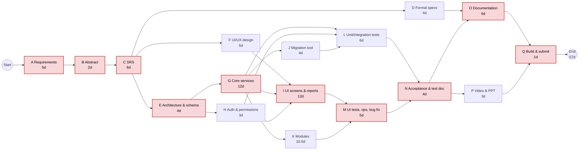

Red nodes form the **critical path**.

## 5.4 CPM schedule: forward / backward pass

| Id | te | ES | EF | LS | LF | Float | Critical |
|----|----|----|----|----|----|-------|----------|
| A | 5.0 | 0 | 5 | 0 | 5 | 0 | ✓ |
| B | 2.0 | 5 | 7 | 5 | 7 | 0 | ✓ |
| C | 6.0 | 7 | 13 | 7 | 13 | 0 | ✓ |
| D | 4.0 | 13 | 17 | 46 | 50 | 33 | |
| E | 4.0 | 13 | 17 | 13 | 17 | 0 | ✓ |
| F | 5.0 | 13 | 18 | 24 | 29 | 11 | |
| G | 12.0 | 17 | 29 | 17 | 29 | 0 | ✓ |
| H | 3.0 | 17 | 20 | 26 | 29 | 9 | |
| J | 4.0 | 29 | 33 | 36 | 40 | 7 | |
| K | 10.5 | 29 | 39.5 | 30.5 | 41 | 1.5 | |
| I | 12.0 | 29 | 41 | 29 | 41 | 0 | ✓ |
| L | 6.0 | 33 | 39 | 40 | 46 | 7 | |
| M | 5.0 | 41 | 46 | 41 | 46 | 0 | ✓ |
| N | 4.0 | 46 | 50 | 46 | 50 | 0 | ✓ |
| O | 6.0 | 50 | 56 | 50 | 56 | 0 | ✓ |
| P | 3.0 | 50 | 53 | 53 | 56 | 3 | |
| Q | 1.0 | 56 | 57 | 56 | 57 | 0 | ✓ |

**Critical path:** A → B → C → E → G → I → M → N → O → Q, length **57 working days**.

## 5.5 PERT analysis

Variance along the critical path:
`σ² = 0.44 + 0.11 + 0.44 + 0.11 + 1.78 + 1.78 + 0.44 + 0.11 + 0.44 + 0 = 5.67`,
so `σ = 2.38 days`.

| Question | Computation | Result |
|----------|-------------|--------|
| Expected duration | Σ te on critical path | 57 days |
| Probability of finishing within 57 days | z = 0 | 50 % |
| Probability of finishing within 60 days (≈ Nov 13 if we slip past the deadline) | z = (60 − 57)/2.38 = 1.26 | ≈ 90 % |
| Duration with 95 % confidence | 57 + 1.645 × 2.38 | ≈ 61 days |
| Probability of finishing by Nov 10 (56 working days) | z = (56 − 57)/2.38 = −0.42 | ≈ 34 % |

Interpretation and mitigation: the deadline gives 56 working days for a 57-day expected
path, so the plan is tight. Mitigation adopted: (1) G and I, the two largest-variance
activities, are split across two members and started with the domain layer that has the
most tests; (2) D (formal specs) has 33 days of float and P (video) 3 days — they absorb
slack; (3) the acceptance test N is time-boxed; (4) a working prototype is kept on `main`
from the end of G so a partial slip in K (modules, float 1.5) reduces scope, not the
deliverable.

### PERT chart (event-on-arrow view)

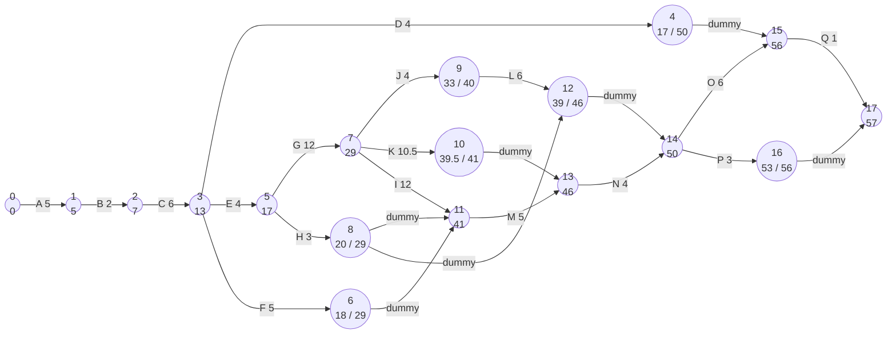
Node label = event number, then earliest time (and latest time when different).

## 5.6 Gantt chart

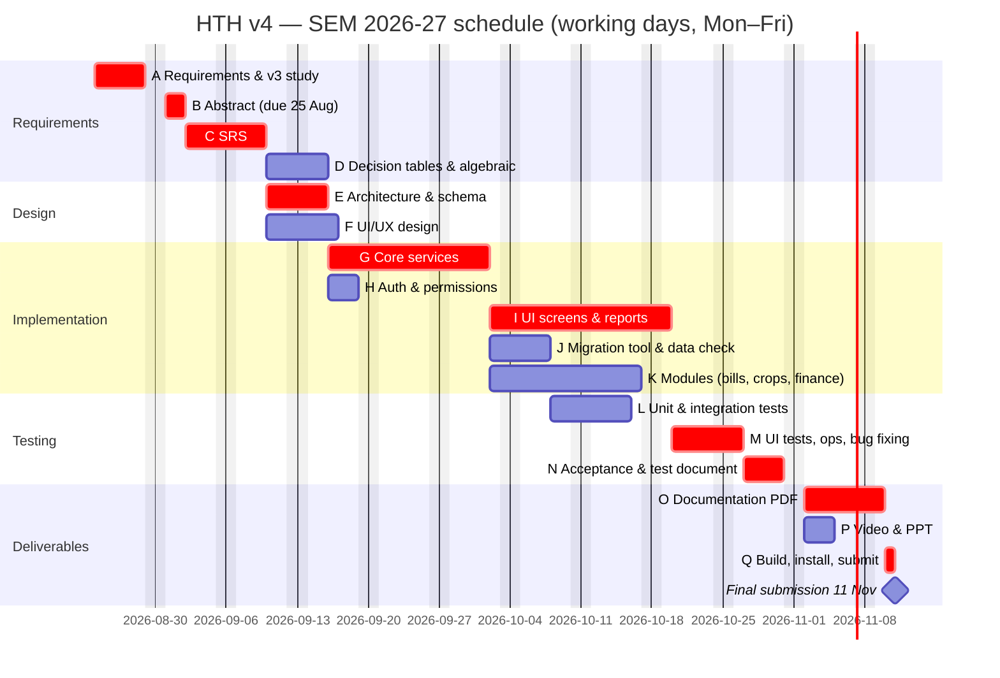

## 5.7 Milestones and risk register

| Milestone | Date |
|-----------|------|
| M0 Abstract submitted | 25 Aug 2026 |
| M1 SRS frozen | 9 Sep 2026 |
| M2 Core services pass business-rule tests | 1 Oct 2026 |
| M3 Feature-complete prototype on `main` | 20 Oct 2026 |
| M4 Acceptance sign-off with shop data | 30 Oct 2026 |
| M5 Documentation, video, zip submitted | 11 Nov 2026 |

| # | Risk | P | I | Mitigation |
|---|------|---|---|------------|
| R1 | v4 numbers differ from v3 | M | H | Pin interest and balance against v3 code in tests; migration equivalence test |
| R2 | customtkinter version differences on shop PC (5.2 vs 6.0) | H | M | CI runs UI walkthrough on both; fallbacks for unsupported kwargs |
| R3 | Scope creep from modules | H | M | Modules are optional and behind `ModuleSpec`; core ships first |
| R4 | Team member unavailable | M | M | Owner per WBS package with a named backup; shared conventions |
| R5 | Laptop-resolution layout bugs | M | L | Scrollable panels, minimum row counts, tested at 1366×768 |
| R6 | Data loss during import | L | H | Automatic backup before import; import never guesses silently |


\newpage

# Chapter 6 — Test cases for the working prototype

## 6.1 Test strategy

| Level | What | How | Where |
|-------|------|-----|-------|
| Unit | Domain rules: interest, units, scores, Hindi words, GST | `pytest`, pure functions, pinned against v3 | `tests/test_interest.py`, `test_units.py`, `modules/test_bills.py` |
| Integration | Services on an in-memory SQLite: accounts, sales, inventory, krar, auth, categories, statements, modules | `pytest` fixtures build a fresh DB per test | `tests/test_*.py`, `tests/modules/*` |
| Migration | v3 → v4 equivalence: ids preserved, balances identical, report of normalised values | `pytest` with a synthetic v3 folder | `tests/test_migration.py` |
| UI | Full admin + employee walkthrough and first-run wizard on the real window | `HTH_UI_TESTS=1 pytest tests/test_ui_smoke.py` | `tests/test_ui_smoke.py` |
| Acceptance | Manual checklist with the shop's real data on the shop PC | Owner + tester | §6.4 |

Current automated status (`pytest -q`, Python 3.10, customtkinter 6.0):
**94 passed, 2 skipped** (the two UI tests skip unless a display is available and
`HTH_UI_TESTS=1` is set). Lint: `ruff check hth tests tools` clean.

Test-case fields: **Id**, requirement traced, precondition, steps / input, expected
result, and the automated test that implements it (or *manual*).

## 6.2 Automated test cases

### Interest (FR-2.4)
| Id | Precondition | Input / steps | Expected | Automated by |
|----|--------------|---------------|----------|--------------|
| TC-01 | — | `calculate_interest(1000, 2024-04-01, 2025-03-31)` | 240.00 (one FY, simple) | `test_one_year_is_24_percent_before_compounding` |
| TC-02 | — | 1000 from 2024-04-01 to 2026-03-31 | 240 for FY1, then 24 % on 1240 for FY2 = 537.60 total (compound at 31 Mar) | `test_compounds_at_financial_year_end` |
| TC-03 | — | Random (amount, from, to) triples vs v3's function | Results identical to 2 dp | `test_matches_v3` |
| TC-04 | Clock moved past midnight | `calculate_interest(p, d)` with no `to_date` | Uses *today at call time*, not import time | `test_default_to_date_is_today` |
| TC-05 | — | `financial_year_end(2024-02-10)`, `(2024-06-10)` | 2024-03-31, 2025-03-31 | `test_financial_year_end` |
| TC-06 | — | Dates as `str` and `date` objects | Same result | `test_accepts_date_objects_and_strings` |

### Accounts and ledger (FR-2.x)
| Id | Precondition | Input / steps | Expected | Automated by |
|----|--------------|---------------|----------|--------------|
| TC-07 | Empty DB | Add customer with opening balance 500 | One `P`/tag-1 row dated today; balance 500 | `test_add_customer_creates_opening_transaction` |
| TC-08 | Empty DB | Add customer without opening balance | No transaction rows | `test_add_customer_without_opening_balance_has_no_transaction` |
| TC-09 | Customer exists | Amount −5, date `31/12/2024`, type `X`, tag `7` | `ValidationError`, nothing written | `test_validation` |
| TC-10 | Customer with P 1000 (tag 1, 100 days ago) and M 300 (tag 2) | `get_balance()` | 1000 + I(1000,100d) − 300, rounded 2 dp | `test_balance_debit_minus_credit_with_interest` |
| TC-11 | Customer with balance B | Settlement receipt of amount B (tag 0) | Balance 0; next tag-1 entry starts a new period from 0 | `test_settlement_resets_period` |
| TC-12 | Balance 1200 | Settlement receipt 1000 (M, tag 0) | Three tag-0 rows: entry 1000, *Settled Amount* 1200, *Discount* 200 | `test_record_settlement_writes_three_tag0_rows` |
| TC-13 | Balance 1000 | Settlement receipt 1100 | *Discount* = −100 (negative allowed, as v3) | `test_settlement_overpayment_writes_negative_discount` |
| TC-14 | Customer in credit (−400) | Settlement | Rows written with negative Settled Amount; balance 0 | `test_settlement_on_credit_balance` |
| TC-15 | Ledger with a settlement in the middle | `ledger()` | Running balance resets to 0 after the tag-0 group; per-row interest shown | `test_ledger_running_balance_and_reset` |
| TC-16 | Ledger never settled | `ledger()` | Running balance accumulates across all rows | `test_ledger_no_settlement_running_balance` |
| TC-17 | Several customers with entries | `summaries()`, `days_since_last_activity()` | Days = days since newest non-settlement row; summary balances match `get_balance` | `test_days_and_summaries` |
| TC-18 | Pairs (amount, days) | `account_scores(pairs)` | `0.6·norm(log amount)+0.4·norm(log days)`; single element → 0 | `test_account_scores_formula` |
| TC-19 | Customer with rows, krar | Update name; delete customer | Name changed; rows and krar cascade-deleted; audit 05/06 written | `test_update_and_delete_cascade` |

### Inventory, units and sales (FR-3.x, FR-4.x)
| Id | Precondition | Input / steps | Expected | Automated by |
|----|--------------|---------------|----------|--------------|
| TC-20 | Empty DB | Add item, opening stock 50 KG | One *received* movement 50; `quantity()` = 50 | `test_add_item_writes_opening_stock` |
| TC-21 | Items with movements, expiry dates | `summaries()`, `low_stock(5)`, `expiring(60)` | Correct stock, value, alert lists | `test_summaries_and_alerts` |
| TC-22 | Customer + item (last price 10) | Sale: 3 units @ 12, tag 1 | Ledger P 36; movement sale 3; last price 12; audit 03 | `test_sale_updates_ledger_stock_price_and_audit` |
| TC-23 | As above | Receive: 5 units @ 9 | Ledger M 45; movement received 5; audit 04 | `test_receive_adds_stock_and_credits` |
| TC-24 | Customer | Sale with free-text item `CASH` | Ledger row only; no stock movement | `test_sale_without_item_only_touches_ledger` |
| TC-25 | Customer with balance | Sale with tag 0 | Three tag-0 rows + stock movement, balance 0 | `test_settlement_sale_flow` |
| TC-26 | Stock movement forced to fail | `record()` | Ledger row rolled back — no partial write | `test_sale_is_atomic` |
| TC-27 | — | qty 0 / bad date / unknown customer / tag 9 | `ValidationError` each time | `test_sale_validation` |
| TC-28 | Item unit KG | Sell 100 G @ ₹50/KG | Stock −0.1 KG; amount ₹5; detail "100 G (0.1 KG) = item" | `test_loose_sale_in_grams_converts_to_stock_unit` |
| TC-29 | Crop kept in KG | Sell 2.5 QTL @ ₹22.5/KG | Stock −250; amount 5625; fractional price accepted | `test_sale_in_quintals_and_fractional_price` |
| TC-30 | Item unit PKT | Sell 1 KG | Rejected: incompatible unit | `test_incompatible_unit_rejected` |
| TC-31 | — | `normalize("kg")`, `("Kgs")`, `("quintal")` | KG, KG, QTL | `test_normalize_aliases` |
| TC-32 | — | families / `compatible(KG, G)`, `(KG, LTR)` | True / False | `test_families_and_compatibility` |
| TC-33 | — | `convert(1, QTL, KG)`, `(500, G, KG)`, `(1, LTR, ML)` | 100, 0.5, 1000 | `test_convert` |
| TC-34 | — | `convert(1, PKT, KG)` | `UnitError` | `test_convert_incompatible` |
| TC-35 | — | `format_qty(2.5)`, `(3.0)` | "2.5", "3" | `test_format_qty` |
| TC-36 | Item KG with movements, prices | Change unit to QTL | Quantities ÷100, prices ×100, values unchanged | `test_same_family_conversion` |
| TC-37 | Item PKT | Change unit to KG without factor | Needs factor (`None` returned / asks); with factor 25 → qty ×25, price ÷25 | `test_unrelated_units_need_a_factor` |
| TC-38 | Crop with lots, sales, rates | Change unit | Lots, allocations, sales and rates converted consistently | `test_crop_history_converted` |

### Crop trades from the Sales screen (FR-4.1, FR-4.4, FR-8.2)
| Id | Precondition | Input / steps | Expected | Automated by |
|----|--------------|---------------|----------|--------------|
| TC-39 | Crop item (type C), farmer account | Credit 1000 KG gross, kaat 20, @ ₹20 | Lot net 980; farmer credited 19 600 (tag 2); stock +980 | `test_credit_on_crop_item_creates_a_lot` |
| TC-40 | Two lots @ 20 (500) and @ 22 (500) | Debit sale 700 KG @ 25 to buyer | Cost = 500·20 + 200·22 = 14 400; margin 3 100; buyer debited 17 500; lots 0 / 300 left | `test_debit_on_crop_item_is_fifo_costed` |
| TC-41 | Crop item | Any crop trade with tag 0 | Rejected | `test_crop_trade_rejects_settlement_tag` |
| TC-42 | Non-crop item | Sale | Behaves as TC-22 (no crop handler involved) | `test_plain_items_unaffected` |
| TC-43 | Crop trade with induced failure | `record()` | Nothing written (lot, ledger, stock all rolled back) | `test_crop_trade_is_atomic` |
| TC-44 | Open stock 300 | Sale 400 without *allow short* / with it | Rejected / accepted, uncovered 100 at last rate, flagged | `test_sale_fifo_margin_and_ledger` |
| TC-45 | Lots, sales, payments | Pay farmer, receive from buyer; Summary, margin by crop/buyer, purchases by farmer/quality, open lots | Ledger balances and report totals reconcile | `test_payments_and_reports` |
| TC-46 | Rates on several dates | Valuation at cost & market; `estimate_rate()` | Unrealised gain = (market − avg cost) × qty; naive linear trend | `test_rates_valuation_and_estimate` |
| TC-47 | CSV `crop,date,rate` | `CsvRateProvider.fetch()` | Quotes parsed, bad rows skipped | `test_csv_rate_provider` |
| TC-48 | — | `add_crop()` | Item type C, unit KG | `test_add_crop_is_item_type_c` |

### Krar, reports, auth, permissions (FR-5.x, FR-6.1, FR-1.x)
| Id | Precondition | Input / steps | Expected | Automated by |
|----|--------------|---------------|----------|--------------|
| TC-49 | Customer | Add date yesterday → bucket; reschedule to tomorrow; settle | past → future; settled not listed; audit 07 | `test_krar_lifecycle` |
| TC-50 | Seeded data | Every `ReportSpec` query | Each returns rows with the declared columns; aging buckets sum to receivable | `test_reports` |
| TC-51 | Fresh DB | Login `admin/admin`, `emp1/emp1`, wrong password | Success, success, `AuthError`; audit 08 | `test_default_users_and_login` |
| TC-52 | Admin | Add user, reset password, change role, deactivate; deactivated login | All succeed; deactivated user cannot log in | `test_user_management` |
| TC-53 | Users of both roles | `has_permission()` for every permission | Admin all True; employee only its set; inactive → all False | `test_permissions` |

### Categories and scope (FR-6.3, FR-6.4)
| Id | Precondition | Input / steps | Expected | Automated by |
|----|--------------|---------------|----------|--------------|
| TC-54 | Fresh DB | Read settings | Default category C, scope A–D, thresholds present | `test_defaults_and_settings` |
| TC-55 | — | Add customer | Category = default | `test_new_customer_gets_default_category` |
| TC-56 | Customer | Set B by hand; re-score; set E | Locked, unchanged by re-score; E only manual, never removed by re-score | `test_manual_category_locks_and_e_is_manual_only` |
| TC-57 | Customers incl. one E with huge balance | Re-score with *keep E out* on | E excluded from min/max; others' scores unaffected | `test_defaulters_kept_out_of_score_population` |
| TC-58 | Customers in A–E | Reports with scope *per settings* vs *all* | E rows appear only in *all* | `test_report_scope` |
| TC-59 | Items with last-sale dates 10/60/120/400 days ago | Auto-categorise | A/B/C/D; manual category locked | `test_item_categories` |

### Statements, reminders, backup, search, integrity, migration (FR-2.9, FR-5.4, FR-7.x)
| Id | Precondition | Input / steps | Expected | Automated by |
|----|--------------|---------------|----------|--------------|
| TC-60 | Ledger with rows before/in/after range | `statement(customer, from, to)` | Opening balance, rows in range with interest, totals, closing = ledger running balance | `test_statement_rows_and_balances` |
| TC-61 | Shop details saved | Company profile, FY label | Values round-trip; FY "2026-27" | `test_company_profile_and_fy` |
| TC-62 | Details "vill. X, 98765 43210" | `extract_phone()` | "9876543210"; none when absent | `test_extract_phone` |
| TC-63 | Overdue krar | `reminder_text()` | Template filled with name, amount, date; bucket label correct | `test_reminder_text_and_bucket` |
| TC-64 | Auto-backup on, N = 3 | Start app four times on different days | One `hth_auto_<date>.db` per day, oldest pruned; same day → no duplicate | `test_daily_backup` |
| TC-65 | Accounts, items, bills | `search("ram")` | Hits across the three entity types with navigation targets | `test_search_across_entities` |
| TC-66 | DB with planted anomalies | `integrity.findings()` | Each anomaly type reported once (invalid date, negative stock, duplicate, zero amount, lone tag-0, open krar with 0 owed, inactive debtor) | `test_findings` |
| TC-67 | Clean DB | `integrity.findings()` | No errors | `test_clean_database_has_no_errors` |
| TC-68 | Synthetic v3 folder | `migrate_v3` | Customer/item/krar ids preserved; every balance equals v3's for the same date; notes → audit rows | `test_migrate_preserves_ids_and_balances` |
| TC-69 | Non-existent folder | `migrate_v3` | Clear error, nothing written | `test_missing_folder` |
| TC-70 | v3 rows with blank tag, type `X`, date `1/2/24` | `migrate_v3` | Values normalised or skipped and each listed in `migration_report.txt` with table + row id | `test_migration_reports_normalised_values` |

### Bills and Finance modules (FR-8.1, FR-8.3)
| Id | Precondition | Input / steps | Expected | Automated by |
|----|--------------|---------------|----------|--------------|
| TC-71 | — | Tax for types P / F / S / O on 1000 | 90+90 / 25+25 / 0 / 0 | `test_tax_rates_by_type` |
| TC-72 | — | 1 234.50 in Hindi words | Correct rupees/paise string | `test_hindi_words` |
| TC-73 | Items | Create two bills | Numbers consecutive; DOCX rendered from template; totals = taxable + CGST + SGST | `test_create_bill_numbering_and_render` |
| TC-74 | Month items with totals | Month batch, n bills from start number | Σ line quantities per item = entered total; dates within month; random names, address Dhansu | `test_month_items_and_batch` |
| TC-75 | Batch producing a bill ≥ 20 000 | Month batch | Bill row flagged, not rendered | `test_batch_flags_large_bills` |
| TC-76 | Fresh DB | Finance defaults | Cash account default; standard expense/income heads | `test_defaults` |
| TC-77 | Accounts with openings | Expense, income, transfer, capital, drawings | Running balances and totals per account correct; transfers cancel | `test_accounts_balances_and_cash_book` |
| TC-78 | Customer, money account | Sales-screen receipt (CASH, M) and payment (P) | Cash-book rows linked to ledger rows; stock entries never touch the cash book | `test_sales_screen_money_flow` |
| TC-79 | Recurring rent, day 5 | *Post due now* twice | Entries created once per month, second run idempotent | `test_recurring` |
| TC-80 | Sales with values, crop margin, expenses | Cash flow, P&L | In/out by source and head; P&L = item margin + crop margin + other income − expenses, interest excluded | `test_cash_flow_and_pnl` |

### UI walkthrough (opt-in)
| Id | Precondition | Input / steps | Expected | Automated by |
|----|--------------|---------------|----------|--------------|
| TC-81 | Display, `HTH_UI_TESTS=1` | Log in as admin; visit every screen; record sale, receipt, krar; open reports; log out; log in as employee; verify edit/delete controls absent | No exception; widgets present per permission matrix; krar table with hidden columns renders | `test_admin_and_employee_walkthrough` |
| TC-82 | Fresh data dir | First run | Wizard appears; default password refused; shop details saved; skip works | `test_first_run_wizard` |

## 6.3 Traceability matrix (requirement → test cases)

| Requirement | Test cases |
|-------------|-----------|
| FR-1.1–1.5 Auth & permissions | TC-51, 52, 53, 81, 82 |
| FR-2.1–2.2 Accounts, entries | TC-07, 08, 09, 19 |
| FR-2.3–2.4 Balance, interest | TC-01–06, 10 |
| FR-2.5–2.6 Settlement, ledger | TC-11–16, 25 |
| FR-2.8 Days / score | TC-17, 18 |
| FR-2.9 Statement | TC-60, 61 |
| FR-3.1–3.4 Items, stock, units | TC-20–35 |
| FR-3.5 Unit change | TC-36–38 |
| FR-3.6 Stock reports | TC-21, 50 |
| FR-4.1–4.5 Sales screen | TC-22–30, 39–43, 78 |
| FR-5.1–5.4 Krar, reminders | TC-49, 62, 63 |
| FR-6.1–6.2 Reports, dashboard | TC-50, 81 |
| FR-6.3–6.4 Categories, scope | TC-54–59 |
| FR-7.1 Audit | TC-19, 22, 23, 49, 51 |
| FR-7.2 Backup | TC-64 |
| FR-7.3 Migration | TC-68–70 |
| FR-7.4 Data check | TC-66, 67 |
| FR-7.5–7.6 Settings, search | TC-61, 65, 82 |
| FR-8.1 Bills | TC-71–75 |
| FR-8.2 Crop trading | TC-39–48 |
| FR-8.3 Finance | TC-76–80 |
| NFR-1 Correctness vs v3 | TC-03, 68 |
| NFR-3 Atomic writes | TC-26, 43 |

## 6.4 Manual acceptance checklist (shop PC)

| Id | Step | Pass criterion |
|----|------|----------------|
| AT-1 | Install the PyInstaller folder, double-click `HighTableHoldings.exe` | Login screen appears within 5 s |
| AT-2 | First-run wizard: shop details, new passwords, point to `C:/JBB/data` | Import completes; `migration_report.txt` opens; backup exists in `backups/` |
| AT-3 | Open five customers the owner knows well; compare balance with v3 for today | Identical to the paisa |
| AT-4 | Record a loose sale (250 G of a KG item) as employee | Stock decreases by 0.25; amount = price × 0.25; audit shows `emp1` |
| AT-5 | As employee, try to delete a ledger row | No delete button; service refuses |
| AT-6 | Settle a customer with a discount | Three tag-0 rows; balance 0; statement prints with shop header |
| AT-7 | Add krar for tomorrow, then WhatsApp reminder | Chat opens with the template text |
| AT-8 | Buy a crop lot, sell part of it | Margin preview equals stored margin; open lots report shows remainder |
| AT-9 | Create a GST invoice and open the DOCX | Amounts, Hindi words and GST match a v3 invoice |
| AT-10 | Reports → Data check | Only known legacy anomalies listed |
| AT-11 | Close, change PC date to tomorrow, reopen | New `hth_auto_<date>.db`; interest uses the new date |
| AT-12 | Resize to 1366×768 | Every button reachable; no overlap |

## 6.5 How to run

```bash
cd HighTableHoldings-v4
pip install -r requirements-dev.txt
pytest -q                                   # 94 passed, 2 skipped
HTH_UI_TESTS=1 pytest tests/test_ui_smoke.py  # opt-in UI walkthrough (needs a display)
ruff check hth tests tools
```


\newpage

