# High Table Holdings — Project Documentation

**Course:** Software Engineering & Management (SEM 2026-27), BITS Pilani
**Team No.:** <<Team No.>>
**Git repository (public):** <https://github.com/Parmodsihag/jbbv4>
**Application version documented:** 5.7.0 (folder `v5/`; history in `v5/CHANGELOG.md`).
v4 (4.7.0, folder `HighTableHoldings-v4/`) is the first increment and is kept for reference.

## Team members and contributions

> **Edit this table before submitting** so it shows who actually did what. Grading is
> team-based, but the guidelines require each member's contribution on this page. The rows
> below are a starting split by area of the code and documents.

| # | Name | BITS ID | Contribution |
|---|------|---------|--------------|
| 1 | <<Member 1>> | <<ID>> | Requirements elicitation with the shop owner and study of legacy v3; SRS (informal, semi-formal, formal) for v4 and the v5 increment; domain layer: interest formula, constants, units, Indian number grouping; `accounts` and `sales` services incl. multi-line entries, paid-now and undo; SQLite schema and migrations. |
| 2 | <<Member 2>> | <<ID>> | UI/UX: customtkinter shell, themes and the seven colour themes, reusable widgets; Classic screens and the New layout (Today, Counter, Khata, Stock, Money, Reports, Settings); keyboard shortcuts; Hindi interface (phrase table, widget hook, transliteration); user guide. |
| 3 | <<Member 3>> | <<ID>> | Feature modules (bills, crop trading, finance); v3 importer and data check; v5 safety (own data folder, restore, atomic migrations, lock, lockout); in-app updates; the assistant (System 1, tools, System 2 training cell) and voice; admin guide. |
| 4 | <<Member 4>> | <<ID>> | Quality & management: test plan, `pytest` suite (96 tests in v4, 316 in v5.7), test cases and traceability, test report; decision tables, algebraic specifications, DFDs; WBS / activity network / PERT and tracking; project management plan; architecture and decision records; video and presentation. |

## Document map

| Chapter | Content |
|---------|---------|
| 1 | Software Requirements Specification: informal, semi-formal and formal (v4 FR-1 – FR-8, v5 FR-9 – FR-14) |
| 2 | DFD modelling (levels 0, 1, 2), ER diagram, architecture, deployment |
| 3 | Decision tables DT-1 – DT-22 |
| 4 | Algebraic specifications (interest, ledger, stock, FIFO, krar, permissions, audit, cash book, entry and undo, lockout, update) |
| 5 | Work Breakdown Structure, activity network, CPM, PERT, Gantt; plan vs actual; re-baselined plan to submission; risk register |
| 6 | Test cases TC-1 – TC-166, traceability matrix, acceptance checklist |
| 7 | Project management plan: process, roles, communication, configuration and change management, quality, metrics, lessons learned |

Engineering documents kept with the code (`v5/docs/`): user guide, admin and operations
guide, architecture (arc42), 13 architecture decision records, data dictionary, test plan,
test report 5.7.0, release process; `CONTRIBUTING.md` and `SECURITY.md` at the repository
root.

## How to build and run (summary)

```bash
git clone https://github.com/Parmodsihag/jbbv4.git
cd jbbv4/v5
python -m venv .venv && .venv\Scripts\activate          # macOS/Linux: source .venv/bin/activate
python -m pip install --upgrade pip
pip install -r requirements.txt
python run.py                                          # first start: admin/admin, emp1/emp1 (change them)

pip install -r requirements-dev.txt
pytest -rs                                             # 282 passed, 34 skipped (UI and real-voice tests)
HTH_UI_TESTS=1 pytest tests/test_ui_smoke.py tests/test_ui_modern.py   # the 33 UI tests

pyinstaller --noconfirm --windowed --name HighTableHoldings --add-data "bundled;bundled" --collect-all vosk run.py
```

On the shop PC the program is started with `Start High Table Holdings v5.bat` and updates
itself from the repository's `v5` branch (Settings › Updates).


\newpage

# Chapter 1 — Software Requirements Specification

This chapter moves from **informal** (natural-language user stories and glossary) through
**semi-formal** (use cases, UML activity / sequence / state diagrams) to **formal**
specification (numbered, testable requirements with pre/post-conditions). The decision
tables (Chapter 3) and algebraic specifications (Chapter 4) complete the formal part.

---

## 1.1 Introduction

### 1.1.1 Purpose
This SRS describes the functional and non-functional requirements of **High Table
Holdings (HTH)**, a desktop accounting and inventory system for *Jaat Beaj Bhander*, an
agri-input shop, as built in **version 5.7.0**. It is written for the development team, the
course evaluator and the shop owner (the customer).

### 1.1.2 Scope
HTH was delivered in two increments:

* **v4** (4.0 – 4.7, August 2026) replaced the legacy v3.7.1 tool. It **must reproduce
  v3's business results exactly** (same interest, balances, stock figures) while adding
  multi-user access, one normalised database, tests and optional feature modules (bills,
  crop trading, finance). Requirements FR-1 … FR-8.
* **v5** (5.0 – 5.7, October 2026) keeps v4's rules and numbers byte-for-byte and adds
  safety (screen lock, login lockout, restore, undo, atomic migrations, its own data
  folder), counter speed (several lines, paid-now, slips), a Hindi interface, a read-only
  assistant answering typed or spoken questions offline, in-app updates, a second layout in
  shop words, colour themes and seven new reports. Requirements FR-9 … FR-14.

Out of scope: online/cloud sync, mobile app, payment gateway integration, automatic
market-rate feeds (an interface is provided for later), an assistant that changes data.

### 1.1.3 Definitions, acronyms
| Term | Meaning |
|------|---------|
| Ledger entry / transaction | One row in a customer's account: date, description, amount, type, tag |
| Type `P` / `M` | `P` = debit (customer owes more; a sale or cash paid out); `M` = credit (payment received or goods purchased from the customer) |
| Tag `1` / `2` / `0` | `1` normal (earns interest); `2` no interest; `0` settlement marker |
| Period | Entries after the most recent tag-0 row; the balance is computed over the period only |
| Settlement | A tag-0 sale/receipt that writes three tag-0 rows (entry, *Settled Amount*, *Discount*) and restarts the period at zero |
| Krar / Karar | A customer's promise to pay by a date |
| Kaat | Deduction (quantity) on a crop purchase lot |
| FIFO | First-in-first-out costing of crop sales against open lots |
| Category A–E | Customer/item quality band; E = defaulter / discontinued (manual only) |
| Admin / Employee | The two roles; see the permission matrix |
| FY | Financial year, ends 31 March |
| Khata | The customer's running account (the ledger) |
| Collections | v5's name for the krar screen: everyone who owes, sorted by promise |
| Counter | v5's entry screen: Sale, Purchase, Payment in, Payment out |
| New / Classic layout | The two sets of screens over the same data (v5.5) |
| Assistant, System 1 / System 2 | The read-only question answerer; its built-in classifier / its optional small language model |
| Undo window | 15 minutes in which the user who saved an entry can reverse it |
| Update channel | The `v5` branch of the GitHub repository, which shop PCs install from |
| SRS, DFD, WBS, PERT | Standard SE acronyms |

### 1.1.4 References
* Project Guidelines, SEM 2026-27 (Nalanda).
* IEEE Std 830-1998, *Recommended Practice for SRS*.
* Legacy application `HighTableHoldings-v3.7.1/documentation.md`.
* `HighTableHoldings-v4/README.md`, `CHANGELOG.md` (v4).
* `v5/README.md`, `v5/CHANGELOG.md`, `v5/docs/` (user and admin guides, architecture, data
  dictionary, decision records, test plan) (v5).

### 1.1.5 Overview
§1.2 gives the informal specification, §1.3 the semi-formal models, §1.4 the formal
requirements, §1.5 non-functional requirements, §1.6 interfaces and constraints. The v5
additions are marked **(v5)** in §1.2–1.3 and form §1.4.9 – §1.4.14.

---

## 1.2 Informal specification

### 1.2.1 Product perspective
A stand-alone desktop application on the shop PC (Windows; also runs on macOS/Linux).
One SQLite file holds all data; exports (Excel, HTML statements, DOCX invoices) are
written next to it. There is no server. Two users share the PC: the owner
(Administrator) and a shop assistant (Employee).

### 1.2.2 Stakeholders and user classes
| User class | Characteristics | Needs |
|------------|-----------------|-------|
| Shop owner (Admin) | Non-technical, uses the tool daily, trusts the v3 numbers | Same figures as v3; ability to correct mistakes; control over who can delete; backups |
| Shop assistant (Employee) | Records sales and receipts at the counter | Fast keyboard entry; cannot edit or delete history |
| Customers (farmers) | Indirect users | Correct statements, timely reminders |
| Developer / maintainer | Extends the software | Layered code, tests, module contract |

### 1.2.3 User stories (informal requirements)
**Accounts and ledger**
* US-1 As an employee, I can create a customer account with an optional opening balance so that credit sales can be recorded against it.
* US-2 As a user, I can record a debit (sale / pay-out) or credit (receipt / purchase) against an account, with a date, amount and tag.
* US-3 As a user, I can see a customer's ledger with per-row interest and a running balance, identical to what v3 showed.
* US-4 As a user, I can settle an account (tag 0) so that the balance including interest and any discount is closed and a new period begins.
* US-5 As an admin, I can edit or delete a ledger entry when a mistake was made; the change is audited.
* US-6 As a user, I can print/save a customer statement for a date range with shop header, opening/closing balance and interest column.

**Inventory**
* US-7 As a user, I can add an item with opening stock, unit, batch, expiry, GST rate and type (fertiliser/pesticide/seed/crop/other).
* US-8 As a user, I can sell a fraction of a stock unit (100 g of a kg item, 2.5 quintal of a kg crop) and the stock is reduced correctly.
* US-9 As a user, I can see stock on hand, stock value, low-stock, expiring and dead-stock lists.
* US-10 As an admin, I can change an item's unit and have its whole history converted.

**Sales screen**
* US-11 As a user, one Sales form records a stock sale, a cash receipt, a crop purchase or a crop sale; the ledger, stock, cash book and audit log are updated together or not at all.
* US-12 As a user, choosing an item auto-fills its last price and shows the amount and the customer's current balance before I save.

**Krar**
* US-13 As a user, I can record or reschedule a customer's promised payment date and mark it settled.
* US-14 As a user, I can list overdue / today / upcoming promises and copy or send a WhatsApp reminder.

**Reports and dashboard**
* US-15 As a user, I can open any report, sort by column, export to Excel and double-click a row to jump to the ledger or item.
* US-16 As a user, the dashboard shows receivable, payable, stock value, krar, cash & bank, activity, aging and top debtors.
* US-17 As an admin, I can assign customers/items categories A–E and choose which categories the reports include.

**Users, security, operations**
* US-18 As a user, I sign in with a username and password; the first run forces me to replace the default passwords.
* US-19 As an admin, I can add users, reset passwords, change roles and deactivate users.
* US-20 As an admin, I can see who did what and when (audit log).
* US-21 As an admin, I can take a backup and the app takes one automatically each day.
* US-22 As an admin, I can import the v3 data with IDs preserved and get a report of every value that was skipped or normalised.
* US-23 As an admin, I can run a data check for invalid dates, negative stock, duplicates and other anomalies.

**Modules**
* US-24 As a user, I can create a GST invoice, save it as DOCX/PDF and browse/merge invoices by month; as an admin, I can generate the month batch as v3 did.
* US-25 As a user, I can buy crops from farmers as lots (gross, deduction, net, rate, quality) and sell them to buyers with FIFO cost and margin.
* US-26 As a user, I can keep cash / bank / UPI accounts, record expenses, transfers, drawings and recurring expenses, and see cash flow and profit & loss.

**v5: counter, safety and daily work**
* US-27 As a user, I can put several items on one sale and take part of the money now in cash, bank or UPI, so a counter sale is one save.
* US-28 As a user, I can undo the entry I just saved, within 15 minutes, and everything it wrote goes back.
* US-29 As a user, I can print an 80 mm slip of an entry for the customer.
* US-30 As a user, I can lock the screen when I step away, and the admin can make it lock itself after idle minutes, without losing what I was typing.
* US-31 As the owner, I want repeated wrong passwords to make that username wait, and failed sign-ins to be audited.
* US-32 As an admin, I can restore a backup, and the program checks it and saves the current data first.
* US-33 As the owner, I open one screen (*Today*) that lists what needs doing: promises due, stock running out, a missing backup, expenses to post, default passwords, data problems.
* US-34 As a user, I can see a customer's balance, interest, promise, last payment and last entries while I enter a sale.
* US-35 As a user, I can use reports for collections, interest by financial year, promised receipts, item profit, reorder, GST and staff activity.

**v5: language, assistant, appearance, updates**
* US-36 As a user, I can switch the whole program, customer and item names included, to Hindi, and back, without losing anything.
* US-37 As the owner, I can ask about the shop in Hindi, Hinglish or English, typed or spoken, and get the exact figure; if my question is unclear the program asks me back.
* US-38 As the owner, I want the assistant never to change data and never to send the shop's data anywhere.
* US-39 As an admin, I can install a new version from inside the program, and undo it if it misbehaves.
* US-40 As a user, I can work in screens named in shop words (Sale, Purchase, Payment in, Payment out, Khata, Collections), and the admin can switch the shop back to the old layout.
* US-41 As a user, I can choose a colour theme, light or dark, a text size, and Indian or international number grouping.
* US-42 As the owner, I want v5 to start from v4's data without changing v4's files, so I can go back to v4 if needed.

### 1.2.4 Assumptions and dependencies
* Interest rate (24 % p.a.), financial-year end (31 March) and GST rates are constants of the business; changing them is a code change with a test update.
* The PC clock is correct (interest depends on "today").
* Microsoft Word is optional; it is only needed for DOCX→PDF conversion of invoices.
* (v5) Voice questions need a microphone; spoken answers need Windows' Hindi voice. The
  Hindi recognition model ships with the program.
* (v5) Internet is needed only to check for and download updates.
* (v5) The shop PC is an Intel Celeron with 4 GB RAM; the optional language model needs a
  CPU with AVX.

---

## 1.3 Semi-formal specification

### 1.3.1 Use-case diagram

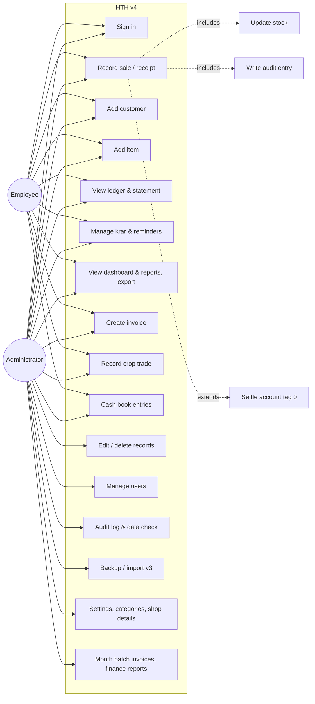

**(v5) Use cases added in v5**

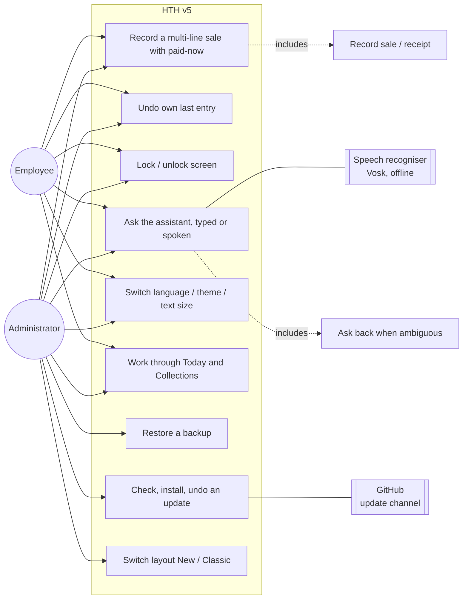

### 1.3.2 Use-case descriptions

**UC-2 Record sale / receipt**

| Field | Description |
|-------|-------------|
| Actors | Employee, Administrator |
| Pre-conditions | User signed in with `record_sale`; at least one customer exists |
| Trigger | User opens *Sales* (Alt+S) |
| Main flow | 1. User picks an account (search by id/name/village). 2. User types an item; a stock item auto-fills unit and last price; the current balance is shown. 3. User enters quantity, unit, price, tag, date. 4. Live amount preview is shown. 5. User presses **Debit** (Ctrl+Enter) or **Credit** (Ctrl+Shift+Enter). 6. System validates, writes the ledger entry, the stock movement (if a stock item), the cash-book row (if a money entry with a money account), sets the item's last price, writes the audit entry — all in one transaction. 7. Toast confirms; today's list refreshes. |
| Alternative flows | 3a. Quantity entered in a compatible unit → converted to the stock unit. 3b. Item is a crop (type C) → crop fields appear; Credit records a purchase lot, Debit a FIFO-costed sale with margin preview (UC-9). 5a. Tag 0 → settlement flow (UC-19): three tag-0 rows are written. |
| Exceptions | Invalid date / non-positive quantity / bad tag / unknown account → validation message, nothing written. Incompatible unit (PKT → KG) → rejected. Crop with tag 0 → rejected. Crop sale exceeding stock without *Allow selling short* → rejected. |
| Post-conditions | Ledger, stock, cash book and audit log are consistent; balance and stock on hand reflect the entry. |

**UC-19 Settle account (tag 0)**

| Field | Description |
|-------|-------------|
| Pre-conditions | As UC-2, tag = 0 |
| Main flow | 1. System computes `balance_before` (principal + interest of the current period). 2. Writes the entry row (tag 0). 3. Writes *Settled Amount* = `balance_before` (type M, tag 0). 4. Writes *Discount* = `balance_before + amount` (if P) or `balance_before − amount` (if M) (type M, tag 0, may be negative). |
| Post-conditions | `balance = 0` for the new period; previous rows remain visible in the ledger with running balance reset. |

**UC-6 Manage krar**

| Field | Description |
|-------|-------------|
| Main flow | Add/reschedule a promised date for a customer (a customer has one open krar with one or more dates); list by bucket (Overdue / Today / Upcoming) using the latest date; settle (`is_nill = 1`); copy or WhatsApp a reminder built from a template (name, amount, date). |
| Exceptions | Reminder via WhatsApp requires a 10-digit mobile number in the account details. |

**UC-14 Import v3 data**

| Field | Description |
|-------|-------------|
| Actors | Administrator |
| Main flow | 1. Backup current DB. 2. Read the v3 folder (per-customer, per-item, per-day tables). 3. Preserve IDs; normalise tags/types/dates. 4. Every skipped or normalised value is listed with source table and row in `migration_report.txt`. 5. Balances for each customer equal v3's for the same date. |

**UC-12 Manage users** — Admin creates a user (username, full name, role), resets a
password, changes role, activates/deactivates. Users cannot deactivate themselves, and the
last active administrator cannot be deactivated. Passwords are stored as salted hashes.

**UC-20 Record a multi-line sale with paid-now (v5)**

| Field | Description |
|-------|-------------|
| Actors | Employee, Administrator |
| Pre-conditions | Signed in with `record_sale`; Counter › Sale (Alt+S, Alt+1) |
| Main flow | 1. Pick the customer; the snapshot shows balance (entered + interest), promise, last payment, last entries. 2. For each item: item, qty, unit, rate; Enter adds the line. 3. Optionally type *Paid now* and pick cash / bank / UPI. 4. The summary shows items total, paid now, goes on khata, balance after. 5. Save (Ctrl+Enter). 6. The system writes every line (as UC-2) and the payment as one credit with its cash-book row, **in one transaction**, and keeps the results for undo. 7. Optional slip. |
| Exceptions | Any line invalid → nothing is written, the message names the line. A crop item is saved on its own, not as one of several lines. |
| Post-conditions | Ledger, stock, cash book and audit agree; the entry can be undone for 15 minutes (UC-21). |

**UC-21 Undo own last entry (v5)** — Within 15 minutes of saving, the user presses Ctrl+Z.
The system removes every row the entry wrote: ledger rows (all three for a settlement),
stock movements, the cash-book row, a crop lot or sale, and restores the item's last price;
one transaction; audited. After 15 minutes the user is told to ask an admin.

**UC-23 Ask the assistant (v5)**

| Field | Description |
|-------|-------------|
| Actors | Employee, Administrator; speech recogniser (secondary) |
| Pre-conditions | Signed in. For voice: a microphone; the model unpacked (done on first use). |
| Trigger | A question in the Ask box (Ctrl+K) or by voice (F2 / 🎤) |
| Main flow | 1. (Voice) the recogniser, limited to the shop's words, writes the question as heard; it is sent 1.2 s after speech stops. 2. The system finds the language, period and numbers. 3. Names are linked to the shop's customers and items. 4. System 1 picks the intent. 5. The matching read-only tool runs, after a permission check. 6. The answer card appears in the question's language, with a table and a link to the full report; a spoken question is answered aloud in Hindi. 7. The tool and its arguments (not the question) are audited (code 13). |
| Alternative flows | 3a. Several customers match → ask back with village / phone; the user answers by number, village, *dusra*, phone digits, or by voice. 4a. System 1 unsure and System 2 installed → System 2's choice is used only if it is among System 1's top three; else "did you mean …?". 6a. A follow-up within two minutes (*aur is mahine?*) reuses the last question. |
| Exceptions | The user lacks the tool's permission → told so, nothing shown. No sound / no words heard → a message naming the microphone. |
| Post-conditions | No data changed. |

**UC-26 Restore a backup (v5)** — Admin picks a `.db` file. The system checks it opens,
passes `quick_check`, is an HTH database and is not from a newer schema; shows its counts
and last activity; on confirmation saves the current data as `hth_before_restore_<time>.db`,
copies the backup in, migrates it forward, audits (09) and signs everyone out.

**UC-27 Check, install and undo an update (v5)**

| Field | Description |
|-------|-------------|
| Actors | Administrator; GitHub (secondary) |
| Main flow | 1. Check: the system compares the installed version with the update channel and shows the new version and its CHANGELOG notes. 2. Install: only changed files are downloaded, each verified against GitHub's hash, and new packages installed. 3. Restart now. 4. At start-up, before the program loads, every file to be replaced is saved to a zip, the new files are put in; audited (14). |
| Alternative flows | 1a. Nothing newer → said so. Developer copy → `git pull --ff-only`. 5. Undo last update → the zip is staged and applied at the next start. |
| Exceptions | GitHub unreachable → clear message, nothing changed. A file fails the hash → nothing staged. A failure while applying → the old files are put back. |
| Post-conditions | The data folder is unchanged; the new version migrates the database itself (with a backup). |

### 1.3.3 Activity diagram — Record sale / receipt

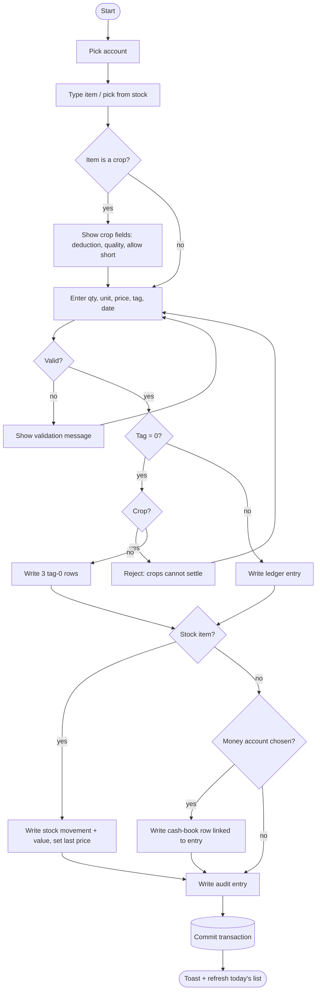

### 1.3.4 Sequence diagram — Record sale

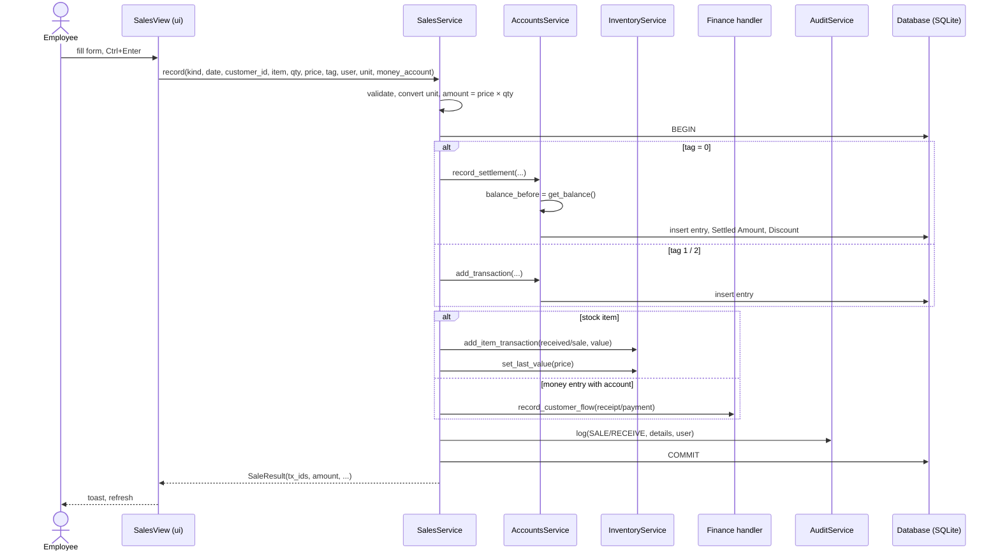

### 1.3.5 State diagrams

**Customer account period**

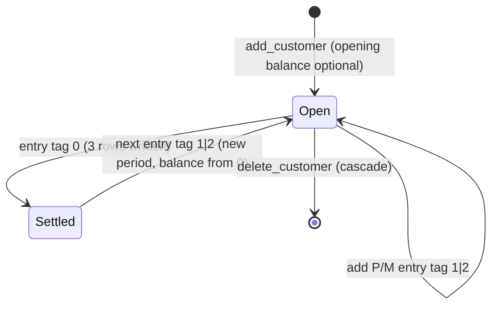

**Krar**

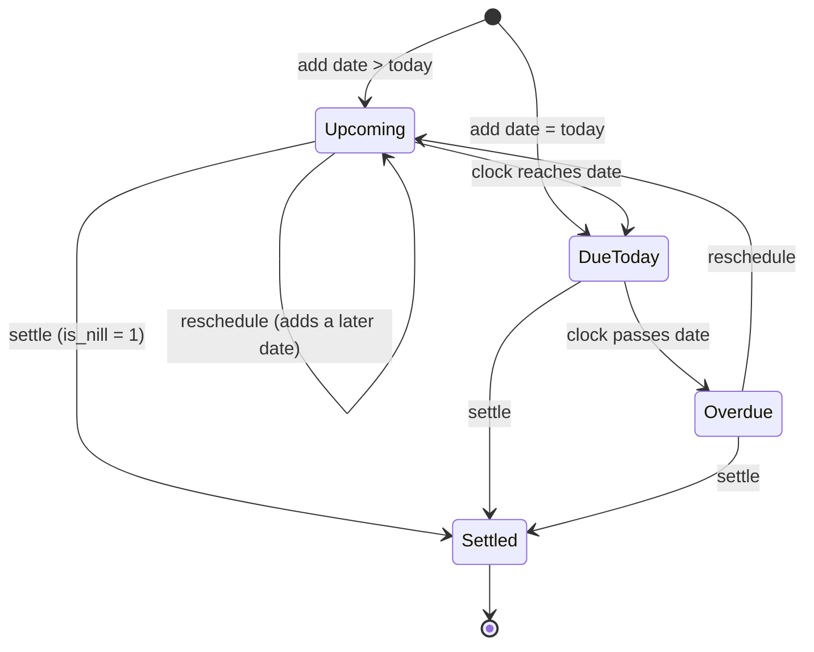

**Crop lot**

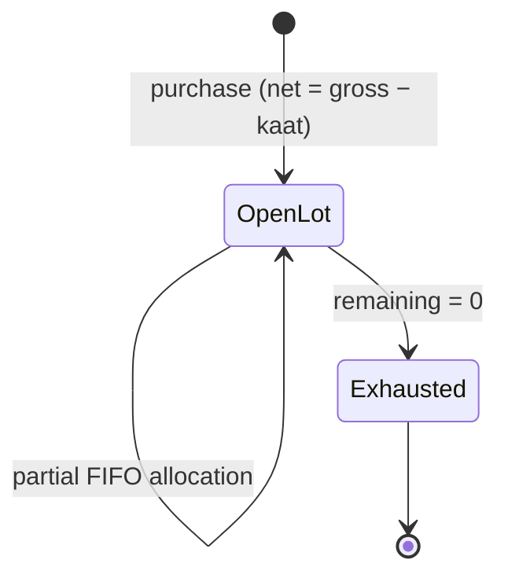

**Session: sign-in, lockout and screen lock (v5)**

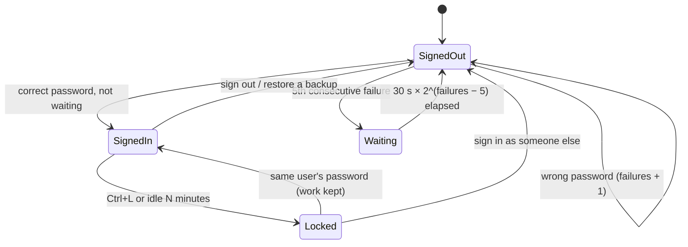

**Update (v5)**

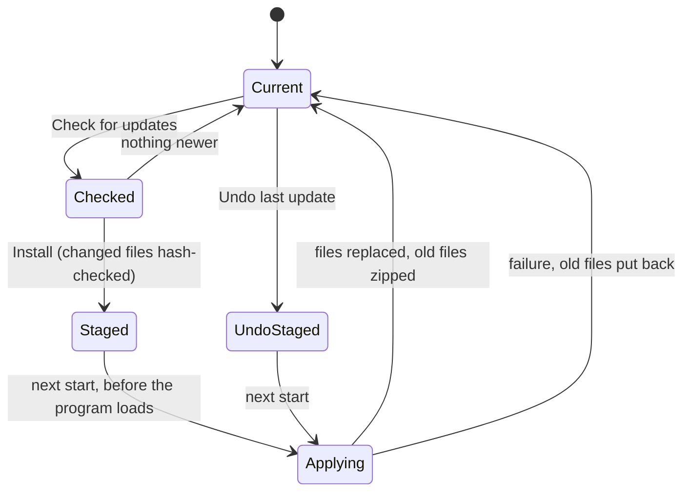

**Assistant conversation (v5)**

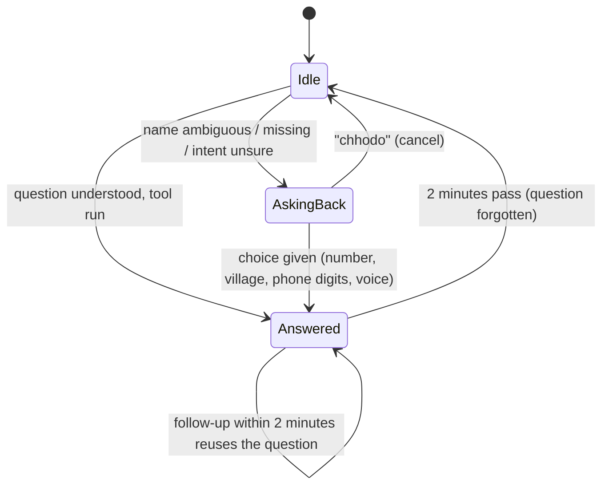

### 1.3.6 Sequence diagram — Ask the assistant (v5)

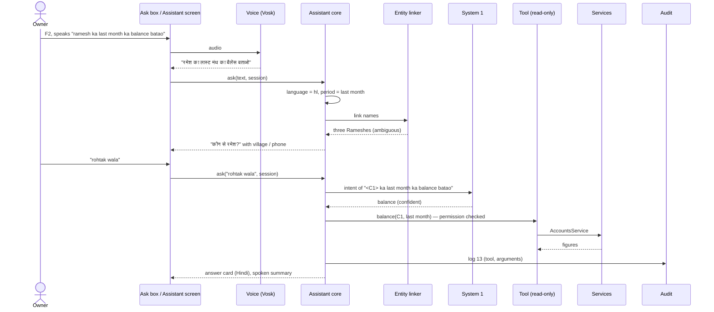

---

## 1.4 Formal functional requirements

Each requirement has an id (traced in Chapter 6), a priority (M = must, S = should,
C = could) and, where the behaviour is numeric, a pre/post-condition in predicate form.
Notation: `bal(c, d)` balance of customer `c` on date `d`; `I(a, d1, d2)` interest on
amount `a` from `d1` to `d2` (Chapter 4 defines both algebraically).

### 1.4.1 Authentication and authorisation
| Id | Requirement | Pri |
|----|-------------|-----|
| FR-1.1 | The system shall require a username and password before any screen is shown. Passwords are stored as salted hashes, never in clear. | M |
| FR-1.2 | The system shall seed `admin` (role admin) and `emp1` (role employee) on first launch and the first-run wizard shall refuse to keep the default passwords. | M |
| FR-1.3 | The system shall enforce the role → permission matrix in `services/permissions.py` for every screen and destructive button. Employee ⊂ Admin; only admin has `edit_records, delete_records, view_audit, manage_users, manage_settings, backup, billing_batch, finance_reports`. | M |
| FR-1.4 | Every write shall record the acting username; login and logout shall be audited (code 08). | M |
| FR-1.5 | An inactive user shall not be able to sign in and shall have no permissions. | M |

### 1.4.2 Accounts and ledger
| Id | Requirement | Pri |
|----|-------------|-----|
| FR-2.1 | Create a customer with name, free-text details and optional opening balance; an opening balance creates one `P`/tag-1 entry dated today. | M |
| FR-2.2 | Add a ledger entry with `date ∈ YYYY-MM-DD`, `amount > 0` (negative only for derived settlement rows), `type ∈ {P, M}`, `tag ∈ {0,1,2}`. Invalid input shall raise a validation error and write nothing. | M |
| FR-2.3 | **Balance.** Let `E` be the entries after the last tag-0 row (ordered by date, id). `bal(c,d) = round(Σ_{e∈E} s(e)·v(e,d), 2)` where `s(e)=+1` if `P` else `−1`, and `v(e,d) = amount + I(amount, date_e, d)` if tag 1, else `amount`. | M |
| FR-2.4 | **Interest.** `I(a, d1, d2)` = simple interest at `0.24/365` per day, with accrued interest added to principal on each 31 March between `d1` and `d2`; rounded to 2 dp; `d2` defaults to the *current* date at call time. The value shall equal v3's implementation for the same inputs. | M |
| FR-2.5 | **Settlement.** A tag-0 entry `(amount a, type t)` on date `d` shall write exactly three tag-0 rows: the entry, `Settled Amount = bal(c,d)` (type M) and `Discount = bal(c,d) + a` if `t = P` else `bal(c,d) − a` (type M, may be negative). Post-condition: `bal(c,d) = 0`. | M |
| FR-2.6 | Ledger view shows every entry with its interest to date and a running balance that resets at each settlement. | M |
| FR-2.7 | Admin can edit or delete any entry; deletion of a customer cascades to entries, krar and lots. Both are audited (05/06). | M |
| FR-2.8 | *Days* = days since the newest non-settlement entry; *Score* = `0.6·norm(log amount) + 0.4·norm(log days)` over the customer population (E excluded when the setting is on). | S |
| FR-2.9 | Customer statement for a date range: opening balance, each entry with interest, totals, closing balance, shop header, as print-ready HTML. | S |

### 1.4.3 Inventory and units
| Id | Requirement | Pri |
|----|-------------|-----|
| FR-3.1 | Create an item with name, opening stock, unit, batch, expiry, GST rate, type ∈ {F,P,S,C,O}, pakka/kacha. Opening stock writes one *received* movement. | M |
| FR-3.2 | `stock(i) = Σ received − Σ sale` over the item's movements, in the item's unit; quantities are real numbers (v3 truncated). | M |
| FR-3.3 | Units: mass {G, KG, QTL} (1 QTL = 100 KG = 100 000 G), volume {ML, LTR}, count {PCS, BAG, BOX, PKT, BTL}. Conversion is allowed only within a family; otherwise a validation error. Price is always per stock unit. | M |
| FR-3.4 | A sale/receipt against a stock item writes a movement with its value and sets the item's last price. | M |
| FR-3.5 | Changing an item's unit converts every movement, lot, sale and rate by the family factor (or a user-supplied factor for unrelated units, or relabel only); per-unit prices are divided by the factor; money amounts are unchanged. | S |
| FR-3.6 | Reports: stock on hand, item movement, low stock (threshold), expiring (days), dead stock (days without sale). | M |

### 1.4.4 Sales screen
| Id | Requirement | Pri |
|----|-------------|-----|
| FR-4.1 | One form shall record: stock sale (P), stock purchase/receipt (M), money receipt/payment (item `CASH` or free text), crop purchase (M on type C) and crop sale (P on type C). | M |
| FR-4.2 | The write in FR-4.1 shall be atomic: ledger, stock, cash book and audit rows are all committed or none are. | M |
| FR-4.3 | Selecting an item auto-fills unit and last price; the amount and the account's current balance are previewed before saving. | S |
| FR-4.4 | A crop trade shall not carry tag 0. | M |
| FR-4.5 | A money entry with a money account shall write a cash-book row linked to the ledger entry (Finance module present). | S |

### 1.4.5 Krar
| Id | Requirement | Pri |
|----|-------------|-----|
| FR-5.1 | A customer has at most one open krar (`is_nill = 0`) with one or more promised dates; adding a date to an open krar reschedules it. | M |
| FR-5.2 | Bucket by latest date `L`: Overdue if `L < today`, Today if `L = today`, Upcoming if `L > today`. | M |
| FR-5.3 | Settle sets `is_nill = 1` and is audited (07). | M |
| FR-5.4 | Reminder text is rendered from the template with name, amount and date; WhatsApp link is offered only when a 10-digit mobile number is found in the details. | S |

### 1.4.6 Reports, dashboard, categories
| Id | Requirement | Pri |
|----|-------------|-----|
| FR-6.1 | The report catalogue (account summary, customer ledger, receivables aging, top debtors, interest summary, customer activity, monthly debits vs credits, day book, stock on hand, item movement, low stock, expiring, dead stock, krar list, audit log, data check; v5 adds FR-9.7) shall be declarative (`ReportSpec`); each report is sortable, filterable and exportable to Excel. With the module reports the catalogue holds 34 reports. | M |
| FR-6.2 | Dashboard KPIs: receivable, payable, stock value, krar count, cash & bank; charts: 14-day activity, monthly debits vs credits, receivables by age; top 10 debtors; krar list. | M |
| FR-6.3 | Every customer and item carries a category A–E; E is manual only and locked; a manually set category is locked; re-scoring maps score → A–D by thresholds; item auto-categorisation by days since last sale. | S |
| FR-6.4 | Report/dashboard scope is the set of categories chosen in Settings (default A–D) with a per-report *All categories* override. | S |

### 1.4.7 Administration and operations
| Id | Requirement | Pri |
|----|-------------|-----|
| FR-7.1 | Audit log with codes 01–14 (account, item, sale, receive, modify, delete, krar, login, user, crop, rate, finance; v5: 13 assistant, 14 update), searchable by date range, action and text. | M |
| FR-7.2 | Backup now (consistent copy) and automatic daily backup on first start each day, pruned to the last N. | M |
| FR-7.3 | Import v3 data preserving customer/item/krar ids; balances after import equal v3 for the same date; every skipped/normalised value listed in `migration_report.txt`. | M |
| FR-7.4 | Data check reporting invalid/future dates, negative stock, duplicate customers, zero-amount entries, lone settlement rows, open krar with nothing owed, long-inactive debtors. | S |
| FR-7.5 | Settings: theme, shop details, reminder template, categories, backup options, re-run wizard, change password. | S |
| FR-7.6 | Global search (Ctrl+K) across accounts, items and bills. | C |

### 1.4.8 Modules
| Id | Requirement | Pri |
|----|-------------|-----|
| FR-8.1 | **Bills**: invoice with lines, CGST = SGST = 9 % for type P, 2.5 % for F, 0 for S/O; tax rounded to 2 dp; amount in Hindi words; DOCX via template; PDF when Word is available; browse/merge by month; admin month batch identical to v3's random split; bills ≥ ₹20 000 flagged not rendered. | S |
| FR-8.2 | **Crop trading**: crop = item type C; purchase = lot (gross, kaat, net, rate, quality) crediting the farmer (tag 2 default) and adding stock; sale FIFO-costed against open lots storing cost, margin, margin %; selling short refused unless allowed (uncovered part at last purchase rate, flagged); valuation at cost and at latest market rate; CSV rate import; naive trend estimate. | S |
| FR-8.3 | **Finance**: money accounts with opening balances; cash book with running balance; expense/income heads; transfers, capital in, drawings; recurring expenses posted idempotently; reports cash flow, P&L (item margin + crop margin + other income − expenses; accrued interest excluded), expenses by head, monthly expenses, balances. | S |
| FR-8.4 | Modules register through `ModuleSpec` (key, label, view factory, permission, shortcut; v5: area, tab, reports) and add tables through the versioned migration list; they never import other modules' UI. | M |

### 1.4.9 Counter and safety (v5)
Notation: `R` = the results of one save; `t(R)` its time; `now` the current time.

| Id | Requirement | Pri |
|----|-------------|-----|
| FR-9.1 | **Several lines.** One save may hold any number of non-crop lines for one account; all lines and any paid-now amount shall be written in one transaction: if any line fails validation, no row of the save is written. | M |
| FR-9.2 | **Paid now.** A sale may carry an amount paid now and a money account; it shall be written as a credit (M) on the same account with a linked cash-book receipt, in the same transaction as the lines. | M |
| FR-9.3 | **Undo.** For `now − t(R) ≤ 15 min`, the user who saved `R` may undo it; undo shall delete exactly the ledger rows, stock movements, cash-book rows, crop lot / sale rows that `R` created and restore the items' previous last price, in one transaction, and audit it. Post-condition: every balance and stock figure equals its value before `R`. | M |
| FR-9.4 | **Lockout.** After 5 consecutive failed sign-ins for a username, further attempts shall be refused for `30 × 2^(n−5)` seconds, `n` = consecutive failures; each failure is audited (08). A correct sign-in resets `n`. | M |
| FR-9.5 | **Screen lock.** Ctrl+L, a button, or `security.lock_minutes` idle minutes (0 = never) shall hide the work behind a password prompt; navigation and shortcuts are disabled while locked; unsaved input is kept. | S |
| FR-9.6 | **Restore.** A backup shall be restored only if it opens, passes `PRAGMA quick_check`, contains the HTH core tables and has `user_version ≤` the program's schema version; the current data shall first be saved as `hth_before_restore_<time>.db`; then the backup is migrated forward, audited (09) and all users signed out. | M |
| FR-9.7 | **New reports:** collections list, interest by financial year, promised receipts forecast, item profit, reorder suggestions, GST summary (invoices), staff activity (admin). Interest by FY shall total to the interest summary. | S |
| FR-9.8 | **Today / Needs attention:** overdue and due-today promises with the amount at stake; debtors silent ≥ 180 days; items that run out within 30 days at the last 30 days' selling rate; expired / expiring stock; data-check errors; future-dated entries; missing or stale backup; default passwords still in use. | S |
| FR-9.9 | **Counter slip:** an 80 mm printable receipt of a saved entry with shop details. | C |
| FR-9.10 | **Own data folder:** v5 shall use `C:\JBB\v5` by default; on its first start, if `C:\JBB\v4\hth.db` exists, it shall copy it through a read-only connection and SQLite's backup API to a temporary file renamed only when complete; v4's files shall not be written. A failed copy shall leave nothing behind. | M |
| FR-9.11 | **Atomic migrations:** each schema migration shall run in one transaction with its `user_version` bump; before migrating an existing database a copy `hth_pre_migration_v<N>_<time>.db` shall be written. | M |
| FR-9.12 | **Cash book follows the ledger:** editing or deleting a ledger receipt / payment that created a cash-book row shall update or delete that row; ledger rows created by a crop lot / sale shall be changed only from crop trading. | M |

### 1.4.10 Hindi (v5)
| Id | Requirement | Pri |
|----|-------------|-----|
| FR-10.1 | A shop-wide language setting `en` / `hi` shall switch every label, button, tab, menu, message, report title and column, statement, slip and Excel export, without restarting. | M |
| FR-10.2 | Translation shall be display-only: values stored or compared by the program stay English; switching back to English loses nothing. | M |
| FR-10.3 | Every customer (name, details) and item (name) shall have a stored Hindi copy generated offline by transliteration; a copy corrected by hand is marked and never regenerated; renaming in English regenerates only automatic copies. | S |
| FR-10.4 | Search boxes shall match English input while the interface is in Hindi. Reminders shall have a separate Hindi template. | S |

### 1.4.11 Assistant (v5)
| Id | Requirement | Pri |
|----|-------------|-----|
| FR-11.1 | The assistant shall answer only through read-only tools (25, covering balances, ledgers, phone, interest, promises, debtors, receivable / payable, sales, day book, stock, price, item sales, low stock, reorder, expiring, profit, expenses, cash and bank, needs attention); it shall never write to the books. | M |
| FR-11.2 | Each tool shall check the user's permission; an employee shall not be shown admin-only figures (e.g. profit). | M |
| FR-11.3 | Names shall be linked only to the shop's own customers and items (English or Devanagari, typos, village, phone digits); when several match equally, the assistant shall ask back and not guess. | M |
| FR-11.4 | The answer shall be in the question's language: Devanagari or Roman Hindi → Hindi, English → English. | S |
| FR-11.5 | System 1 shall work with nothing to install; System 2, when installed, shall run in its own process and its intent shall be used only if it is among System 1's three best; a crash of System 2 shall only disable System 2. | M |
| FR-11.6 | A follow-up within two minutes may reuse the previous question; otherwise an answered question is forgotten. *chhodo* cancels an open ask-back. | S |
| FR-11.7 | Each answer shall be audited (13) with the tool and its arguments, never the question text. No training data shall come from the shop. | M |

### 1.4.12 Voice (v5)
| Id | Requirement | Pri |
|----|-------------|-----|
| FR-12.1 | F2 / 🎤 shall record from the chosen microphone, never from a loopback device; the words shall appear while heard and the question shall be sent 1.2 s after speech stops. | S |
| FR-12.2 | Recognition shall run offline with the bundled Hindi model, restricted to the shop's vocabulary (corpus words, numbers, periods, Hindi copies of customer, village and item names), falling back to the full dictionary when the restricted hearing makes no sense. | S |
| FR-12.3 | Answers to spoken questions shall be spoken in Hindi (amounts in whole rupees in words, dates as day and month) when *Speak answers* is `voice` or `always`. | C |
| FR-12.4 | "No sound from <device>" and "heard a voice but not the words" shall be reported distinctly; *Test microphone* shall show loudness and the words heard. | C |

### 1.4.13 Updates (v5)
| Id | Requirement | Pri |
|----|-------------|-----|
| FR-13.1 | The admin shall be able to check the update channel (repository, branch, folder; configurable) and see the newer version and its CHANGELOG notes; admins are told after sign-in at most once a day. | S |
| FR-13.2 | Install shall download only files whose git blob hash differs, verify each against the hash, stage them in the data folder, and install new requirements; a failed download stages nothing. | M |
| FR-13.3 | A staged update shall be applied at the next start before the program is imported: replaced files are first saved to a zip; on any error the old files are restored. Only relative paths inside the app folder may be written; files removed upstream are deleted. | M |
| FR-13.4 | *Undo last update* shall stage the saved zip and apply it the same way. The data folder shall never be changed by an update. Every step is audited (14) and logged. | M |
| FR-13.5 | A git checkout shall update with `git pull --ff-only` and refuse when it has local changes; a packaged build shall not update itself. | S |

### 1.4.14 Interface (v5)
| Id | Requirement | Pri |
|----|-------------|-----|
| FR-14.1 | Two layouts over the same services: **New** (Today, Counter, Khata, Stock, Money, Reports, Settings; default) and **Classic** (sidebar). An admin shall switch the whole shop; every Alt-letter shortcut shall reach the same screen in both. Admins start on Today, others on the Counter. | M |
| FR-14.2 | The Counter shall offer Sale, Purchase, Payment in, Payment out (Alt+1…4) and show the booking (P/M, tag) in small print; Ctrl+Shift+Enter shall never save a sale. | M |
| FR-14.3 | Seven colour themes, each light and dark; every theme shall meet WCAG contrast 7:1 for body text and 4.5:1 for other text; switching shall not rebuild screens or lose input. | S |
| FR-14.4 | Number style Indian (12,34,567.00, default) or international, used everywhere; text size 90 / 100 / 115 / 130 %. | S |
| FR-14.5 | F1 shall list every shortcut available to the user; Ctrl+K shall focus the Ask / search box; search shall match all words in any order. | S |

---

## 1.5 Non-functional requirements
| Id | Requirement |
|----|-------------|
| NFR-1 Correctness | Business figures identical to v3.7.1 for identical data (pinned by `tests/test_interest.py`, `tests/test_migration.py`); v5 identical to v4 on the shop's data, and every optimisation bit-for-bit identical (`tests/test_speed.py`). |
| NFR-2 Performance | Any screen or report on a database of 5 000 customers / 200 000 entries renders in < 2 s on the shop PC (indexes on `(customer_id, date, id)` and `(item_id, date, id)`). |
| NFR-3 Reliability | Every multi-table write is one SQLite transaction; foreign keys enforced; daily automatic backup. |
| NFR-4 Usability | Keyboard-first: Alt+letter navigation, Ctrl+Enter / Ctrl+Shift+Enter to post, Ctrl+K search, F1 shortcut sheet, F2 voice; shop words on the Counter (v5); light/dark theme; toasts instead of console output; forms usable at 1366×768. |
| NFR-5 Security | Salted PBKDF2-SHA256 password hashes (200,000 rounds); login lockout and screen lock (v5); permission check on every action; audit trail with username; no plaintext credentials in logs; update files verified against GitHub's hashes (v5). |
| NFR-6 Portability | Python 3.10+, Windows/macOS/Linux; data folder per platform (`C:\JBB\v5` on Windows) or `HTH_DATA_DIR`; single-folder PyInstaller build. |
| NFR-7 Maintainability | Layering `ui → services → db/domain`; views never write SQL; services never import Tk; declarative reports, permissions, modules; `ruff` clean; semantic versioning with changelog. |
| NFR-8 Testability | Business rules testable without a display on an in-memory SQLite; opt-in UI walkthrough test. |
| NFR-9 Data integrity | Versioned schema (`PRAGMA user_version`) with forward-only migrations, each atomic and preceded by a backup (v5); import never guesses silently. |
| NFR-10 Recoverability (v5) | No data loss beyond the last daily backup on disk failure when backups are copied off the PC weekly; any update can be undone; any restore can be undone. |
| NFR-11 Localisation (v5) | Every on-screen English string has a Hindi entry; Devanagari in the Nirmala UI font on Windows; Indian digit grouping by default. |
| NFR-12 Accessibility (v5) | WCAG 2.1 contrast in every theme (body text ≥ 7:1, other text ≥ 4.5:1); a high-contrast theme; text size up to 130 %. |
| NFR-13 Privacy (v5) | No telemetry; the assistant and voice run offline; questions are not stored; the only network use is the update check / download and `pip`. |
| NFR-14 Assistant quality (v5) | System 1 ≥ 95 % intent accuracy on phrasings it never saw; on voice, ≥ 95 % of held-out spoken questions answered right with shop-like noise; ~0.2 s per spoken question on a laptop CPU. |
| NFR-15 Measured performance (v5) | On 663 accounts / 6,200 entries: all balances in one pass (dashboard and account list 4.8 s → 0.1 s); returning to an unchanged screen performs no query; start-up imports heavy libraries only when first used. |

## 1.6 External interfaces and constraints
* **User interface**: customtkinter desktop windows; New layout (areas across the top, Ask box) and Classic layout (sidebar); data tables with sortable columns; English or Hindi.
* **File interfaces**: `hth.db` (SQLite, WAL), `exports/*.xlsx` (openpyxl), `exports/*.html` statements, `bills/*.docx` (docxtpl), `pdfs/`, `merged_pdfs/` (pypdf), `backups/*.db`, `logs/hth.log`, `logs/updates.log`, `updates/` (staged files, backup zips), `assistant/` (classifier cache, optional GGUF model), `voice/` (Vosk model), `migration_report.txt`, CSV `crop,date,rate`.
* **Software interfaces**: Python 3.10, customtkinter ≥ 5.2, matplotlib ≥ 3.7, openpyxl ≥ 3.1, docxtpl ≥ 0.16, pypdf ≥ 4, numpy ≥ 1.24, vosk ≥ 0.3.45, sounddevice ≥ 0.4, pywin32 ≥ 304 (Windows SAPI voices), setuptools < 81; optional docx2pdf + Microsoft Word, llama-cpp-python ≥ 0.3 (System 2); WhatsApp via `https://wa.me/<number>?text=` URL.
* **Communication interfaces (v5)**: GitHub REST API and raw file download over HTTPS (anonymous) for updates; nothing else.
* **Constraints**: no network dependency at runtime; single shop PC (Celeron, 4 GB); v3 and v4 data must remain importable; v4's files are never written; Hindi amount-in-words for invoices.


\newpage

# Chapter 2 — DFD modelling, data model and architecture

Notation (Gane–Sarson mapped to Mermaid): **rectangles** = external entities, **rounded
/ circles** = processes, **cylinders** = data stores, arrows = data flows.

## 2.1 Context diagram (DFD level 0)

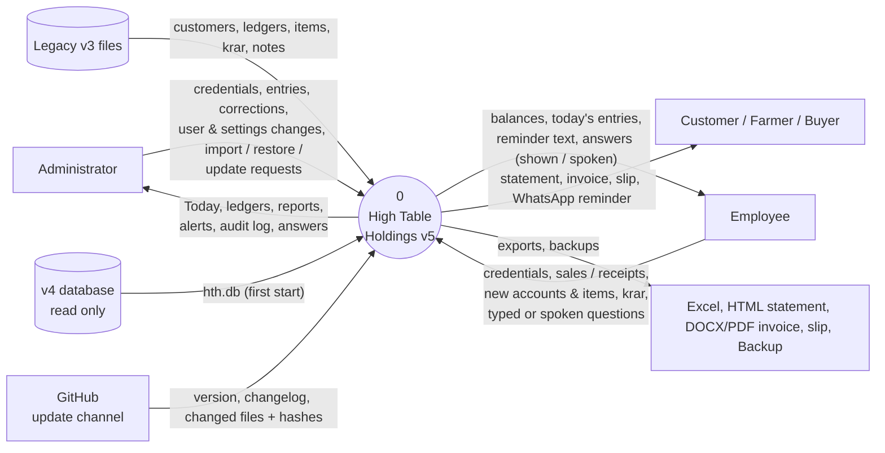

The only flow that leaves the PC is the request to GitHub for the version and files; no
shop data is sent.

## 2.2 DFD level 1

Both roles use the same screens, so they are shown as one external entity *Users*;
flows that only an Administrator can trigger are marked **(admin)**. Process 1 checks the
permission matrix for every other process (DT-1); those control flows are omitted from the
diagram to keep the data flows readable.

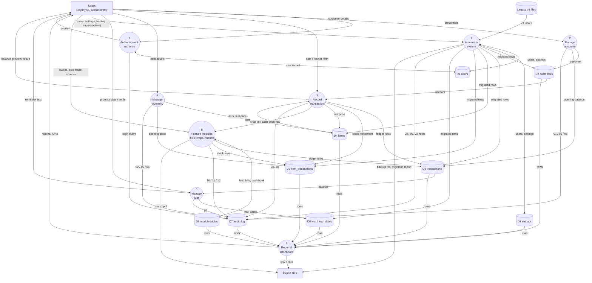

**(v5) Processes added in v5.** The level-1 diagram above is unchanged; v5 adds two
processes beside it.

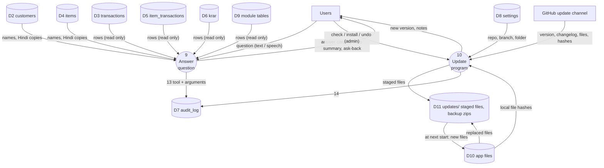

## 2.3 DFD level 2 — Process 3 *Record transaction*

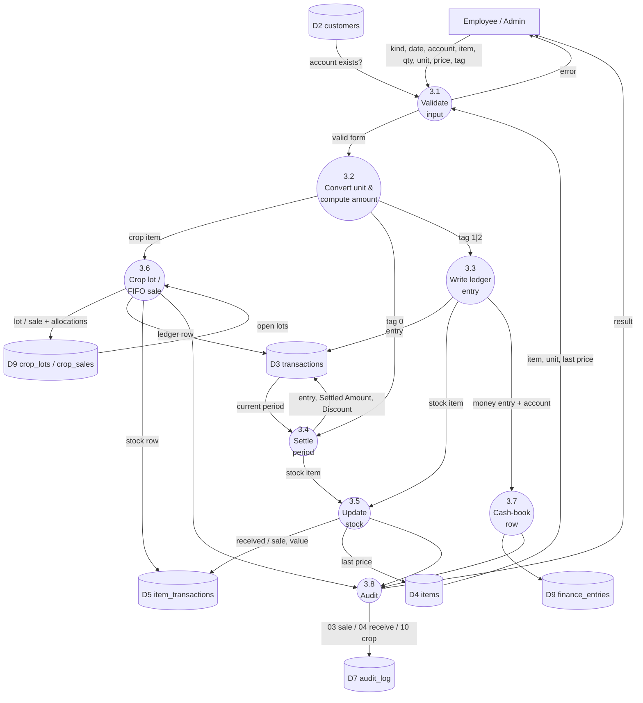

## 2.4 DFD level 2 — Process 7 *Administer system* (import path)

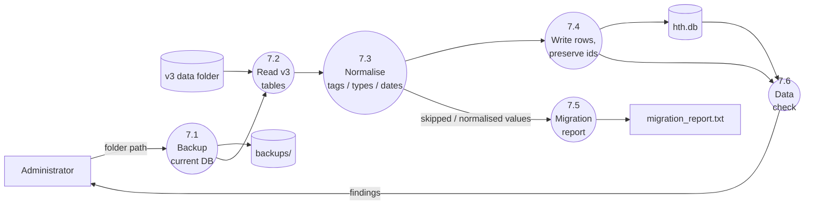

## 2.4a DFD level 2 — Process 9 *Answer question* (v5)

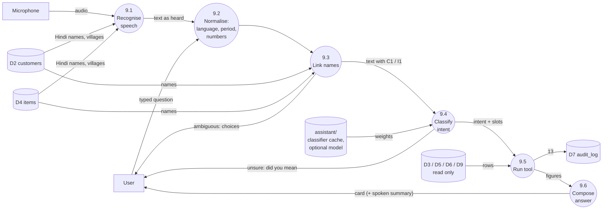

## 2.5 Entity-relationship diagram

Schema version 6 (v5). Column names are the real ones in `v5/hth/db/schema.py`; the full
data dictionary with every column is `v5/docs/DATA_DICTIONARY.md`. "(m4)" marks a column
added by migration 4, and so on.

```mermaid
erDiagram
  users {
    int id PK
    text username UK "case-insensitive"
    text full_name
    text role "admin or employee"
    text password_hash "PBKDF2-SHA256"
    text salt
    int is_active
  }
  customers {
    int id PK
    text name
    text other_details
    text category "A-E (m4)"
    int category_locked "(m4)"
    text name_hi "(m6)"
    text details_hi "(m6)"
    int hi_manual "(m6)"
  }
  transactions {
    int id PK
    int customer_id FK
    text date
    text description
    real amount
    text type "P or M"
    text tag "0, 1 or 2"
    int legacy_id
    text created_by
  }
  items {
    int id PK
    text name
    real stock_value "cost per unit"
    real last_value "last price per unit"
    text unit
    text batch
    text expiry_date
    real gst_rate
    text item_type "F P S C O"
    text pakka_kacha
    text category "(m4)"
    text name_hi "(m6)"
  }
  item_transactions {
    int id PK
    int item_id FK
    text date
    real received
    real sale
    real value "(m5)"
    text description
    text created_by
  }
  krar {
    int id PK
    int customer_id FK
    int is_nill
  }
  krar_dates {
    int id PK
    int krar_id FK
    text date
  }
  audit_log {
    int id PK
    text ts
    text date
    text username
    text code "01-14"
    text message
  }
  settings {
    text key PK
    text value
  }
  bills {
    int id PK
    int bill_number UK "FY prefix + serial"
    text date
    int customer_id FK "set null"
    text customer_name
    real taxable
    real cgst
    real sgst
    real grand_total
    text source "manual or batch"
  }
  bill_lines {
    int id PK
    int bill_id FK
    text name
    real rate
    real quantity
    real amount
    real gst_rate
    real cgst
    real sgst
  }
  bill_month_items {
    int id PK
    text month_year
    int item_id
    real quantity
  }
  crop_lots {
    int id PK
    int farmer_id FK "restrict"
    int item_id FK "restrict"
    text date
    real gross_qty
    real deduction_qty "kaat"
    real qty "net"
    real remaining_qty
    real rate
    text quality
    int tx_id
  }
  crop_sales {
    int id PK
    int buyer_id FK "set null"
    int item_id FK "restrict"
    real qty
    real rate
    real cost
    real margin
    real short_qty
    int tx_id
  }
  crop_sale_lots {
    int id PK
    int sale_id FK
    int lot_id FK "set null"
    real qty
    real cost_rate
    real cost
  }
  crop_rates {
    int id PK
    int item_id FK
    text date
    real rate
    text source
  }
  money_accounts {
    int id PK
    text name UK
    text kind "cash bank upi other"
    real opening_balance
    int is_active
  }
  expense_heads {
    int id PK
    text name UK
    text kind "expense or income"
  }
  finance_entries {
    int id PK
    text date
    text kind
    int account_id FK "restrict"
    int counter_account_id FK "restrict"
    int head_id FK "restrict"
    int customer_id FK "set null"
    real amount
    int tx_id "ledger row"
  }
  finance_recurring {
    int id PK
    int head_id FK
    int account_id FK
    real amount
    int day_of_month
    text last_posted
  }

  customers ||--o{ transactions : "ledger"
  customers ||--o{ krar : "promises"
  krar ||--|{ krar_dates : "dates"
  items ||--o{ item_transactions : "moves"
  customers |o--o{ bills : "billed"
  bills ||--|{ bill_lines : "lines"
  items ||--o{ crop_lots : "crop"
  customers ||--o{ crop_lots : "farmer"
  items ||--o{ crop_sales : "crop"
  customers |o--o{ crop_sales : "buyer"
  crop_sales ||--|{ crop_sale_lots : "FIFO"
  crop_lots |o--o{ crop_sale_lots : "allocated"
  items ||--o{ crop_rates : "market"
  money_accounts ||--o{ finance_entries : "book"
  expense_heads |o--o{ finance_entries : "head"
  customers |o--o{ finance_entries : "receipt or payment"
  expense_heads ||--o{ finance_recurring : "template"
  money_accounts ||--o{ finance_recurring : "from"
```

Key integrity rules:

* `CHECK` constraints on `transactions.type`, `transactions.tag`, `users.role`,
  `money_accounts.kind`, `expense_heads.kind`, `finance_entries.kind`.
* Foreign keys are enforced (`PRAGMA foreign_keys = ON`). Deleting a customer **cascades**
  to its ledger rows and promises, deleting an item to its movements and market rates, a
  bill to its lines. Crop lots and sales **restrict** deletion of their farmer and crop (a
  clear message is shown instead), cash-book entries restrict deletion of their money
  account and head, and a bill, crop sale or cash-book entry **sets null** when its
  customer is deleted.
* Plain integer links without a foreign key: `crop_lots.tx_id` / `stock_tx_id`,
  `crop_sales.tx_id` / `stock_tx_id`, `finance_entries.tx_id`, `bill_month_items.item_id`.
* Indexes `ix_tx_customer_date (customer_id, date, id)`, `ix_itx_item_date (item_id, date, id)`,
  `ix_krar_customer (customer_id, is_nill)`, `ix_fin_account_date (account_id, date, id)`
  and others.
* Schema version in `PRAGMA user_version`; migrations 1 (core) → 2 (bills) → 3 (crops)
  → 4 (categories) → 5 (finance) → 6 (Hindi names, v5).

## 2.6 Architecture

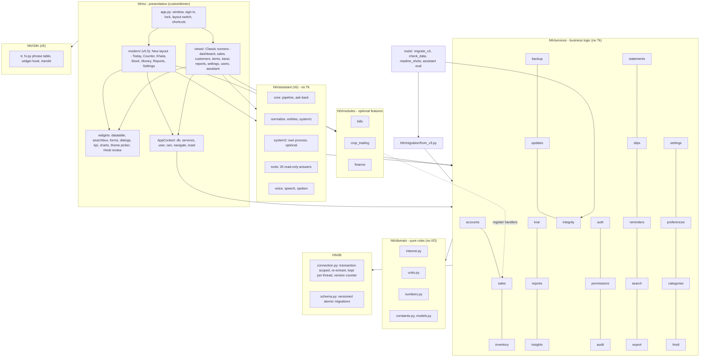

**Layering rule**: `ui → services → db/domain`. Views never write SQL; services never
import Tk. Modules depend on services and the shared `AppContext` only, and hook into the
core through registration functions (`register_crop_handler`, `register_money_flow_handler`)
so the Counter behaves identically whether a module is installed or not. The assistant core
has no Tk, so a chat screen, a bot or a voice loop can use it. `services/updates.py` uses
the standard library only because it runs before anything else is imported. The reasons
for each choice are recorded in `v5/docs/adr/`.

## 2.7 Deployment view

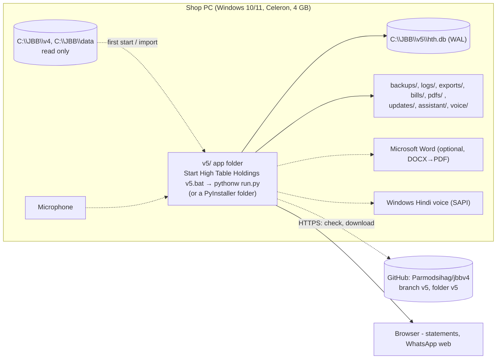


\newpage

# Chapter 3 — Decision tables (formal specification)

Decision tables specify the branching business rules of the prototype. Each table is
complete (every combination of conditions is covered) and the rules are mutually
exclusive. `—` means *don't care*.

## 3.1 DT-1 Authorisation of an action

Conditions: the user's state and role; the action's required permission.

| Condition | R1 | R2 | R3 | R4 | R5 |
|-----------|----|----|----|----|----|
| User signed in | N | Y | Y | Y | Y |
| User is active | — | N | Y | Y | Y |
| Role | — | — | admin | employee | employee |
| Permission ∈ employee set* | — | — | — | Y | N |
| **Actions** | | | | | |
| Show login screen | X | X | | | |
| Allow action | | | X | X | |
| Hide / disable control, refuse service call | | | | | X |

\* employee set = {view_dashboard, record_sale, add_customer, add_item, manage_krar,
view_reports, export, billing, crop_trading, finance}. Admin holds every permission.

## 3.2 DT-2 Validating a Sales-screen entry

| Condition | R1 | R2 | R3 | R4 | R5 | R6 | R7 | R8 |
|-----------|----|----|----|----|----|----|----|----|
| kind ∈ {P, M} | N | Y | Y | Y | Y | Y | Y | Y |
| date is `YYYY-MM-DD` | — | N | Y | Y | Y | Y | Y | Y |
| account exists | — | — | N | Y | Y | Y | Y | Y |
| item text non-empty | — | — | — | N | Y | Y | Y | Y |
| quantity > 0 | — | — | — | — | N | Y | Y | Y |
| tag ∈ {0,1,2} | — | — | — | — | — | N | Y | Y |
| entry unit compatible with item unit (or no item) | — | — | — | — | — | — | N | Y |
| **Actions** | | | | | | | | |
| Raise "Kind must be P or M" | X | | | | | | | |
| Raise "Invalid date" | | X | | | | | | |
| Raise "Select a valid account" | | | X | | | | | |
| Raise "Item is required" | | | | X | | | | |
| Raise "Quantity must be greater than zero" | | | | | X | | | |
| Raise "Tag must be 0, 1 or 2" | | | | | | X | | |
| Raise "Enter the quantity in <unit> or a compatible unit" | | | | | | | X | |
| Proceed to DT-3 | | | | | | | | X |

## 3.3 DT-3 What a valid Sales-screen entry writes

| Condition | R1 | R2 | R3 | R4 | R5 | R6 | R7 |
|-----------|----|----|----|----|----|----|----|
| Item is a crop (type C) | Y | Y | N | N | N | N | N |
| tag = 0 | Y | N | Y | Y | N | N | N |
| Item is a stock item | — | — | Y | N | Y | N | N |
| Money account chosen | — | — | — | — | — | Y | N |
| **Actions** | | | | | | | |
| Reject: crops cannot carry tag 0 | X | | | | | | |
| Crop purchase lot (M) or FIFO sale (P) → DT-4 | | X | | | | | |
| Write 3 tag-0 rows (entry, Settled Amount, Discount) | | | X | X | | | |
| Write 1 ledger row with given tag | | | | | X | X | X |
| Write stock movement (received if M, sale if P) with value; set last price | | | X | | X | | |
| Write cash-book row linked to the ledger row | | | | | | X | |
| Write audit row 03 (P) / 04 (M) | | X | X | X | X | X | X |
| Commit as one transaction | | X | X | X | X | X | X |

## 3.4 DT-4 Crop sale (Debit on a crop item)

| Condition | R1 | R2 | R3 |
|-----------|----|----|----|
| qty ≤ open-lot stock | Y | N | N |
| *Allow selling short* ticked | — | N | Y |
| **Actions** | | | |
| Reject: not enough stock | | X | |
| Allocate FIFO from oldest open lots; cost = Σ alloc × lot rate | X | | X |
| Uncovered part costed at last purchase rate; flag `short` | | | X |
| Store cost, margin = revenue − cost, margin % | X | | X |
| Debit buyer (or cash sale: no ledger row); reduce stock; audit 10 | X | | X |

## 3.5 DT-5 Contribution of a ledger row to the balance `bal(c, d)`

| Condition | R1 | R2 | R3 | R4 | R5 |
|-----------|----|----|----|----|----|
| Row is after the last tag-0 row (in current period) | N | Y | Y | Y | Y |
| tag | — | 1 | 1 | 2 | 2 |
| type | — | P | M | P | M |
| **Actions** | | | | | |
| Ignore row | X | | | | |
| Add `amount + I(amount, date, d)` | | X | | | |
| Subtract `amount + I(amount, date, d)` | | | X | | |
| Add `amount` | | | | X | |
| Subtract `amount` | | | | | X |

(Tag-0 rows are by definition not after the last tag-0 row, so they never contribute.)

## 3.6 DT-6 Settlement discount row

| Condition | R1 | R2 |
|-----------|----|----|
| Settlement entry type | P | M |
| **Actions** | | |
| Discount = balance_before + amount | X | |
| Discount = balance_before − amount | | X |
| Write *Settled Amount* = balance_before (M, tag 0) | X | X |
| Write *Discount* (M, tag 0), negative allowed | X | X |

## 3.7 DT-7 Interest accrual over a period `[start, end)`

| Condition | R1 | R2 | R3 |
|-----------|----|----|----|
| start < end | N | Y | Y |
| a 31 March lies in `[start, end)` | — | N | Y |
| **Actions** | | | |
| Interest = 0 | X | | |
| Interest = principal × days × 0.24/365 | | X | |
| Interest to 31 March added to principal; recurse from 1 April | | | X |
| Round result to 2 dp | X | X | X |

## 3.8 DT-8 Krar bucket (latest promised date `L`, today `T`)

| Condition | R1 | R2 | R3 | R4 |
|-----------|----|----|----|----|
| krar settled (`is_nill = 1`) | Y | N | N | N |
| L < T | — | Y | N | N |
| L = T | — | — | Y | N |
| **Actions** | | | | |
| Not listed | X | | | |
| Bucket *Overdue* | | X | | |
| Bucket *Today* | | | X | |
| Bucket *Upcoming* | | | | X |

## 3.9 DT-9 Unit conversion of an entered quantity

| Condition | R1 | R2 | R3 | R4 |
|-----------|----|----|----|----|
| Entry unit given | N | Y | Y | Y |
| Entry unit = stock unit | — | Y | N | N |
| Same family (mass / volume) | — | — | Y | N |
| **Actions** | | | | |
| Use quantity as is | X | X | | |
| Multiply by family factor (G→KG ÷1000, QTL→KG ×100, ML→LTR ÷1000) | | | X | |
| Reject: incompatible unit | | | | X |

## 3.10 DT-10 Changing an item's unit (admin)

| Condition | R1 | R2 | R3 | R4 |
|-----------|----|----|----|----|
| New unit same family as old | Y | N | N | N |
| Factor supplied by user | — | Y | N | N |
| "Relabel only" chosen | — | — | Y | N |
| **Actions** | | | | |
| Factor = family factor | X | | | |
| Factor = user's | | X | | |
| Factor = 1 (labels change, numbers don't) | | | X | |
| Ask "how many <new> is 1 <old>?" | | | | X |
| Multiply quantities, divide per-unit prices, leave money unchanged (movements, lots, sales, allocations, rates) | X | X | X | |

## 3.11 DT-11 Customer re-scoring to a category

Thresholds `t1 < t2 < t3` from Settings; `s` = account score ∈ [0, 1].

| Condition | R1 | R2 | R3 | R4 | R5 | R6 | R7 |
|-----------|----|----|----|----|----|----|----|
| Category is E | Y | N | N | N | N | N | N |
| Category locked (set by hand) | — | Y | N | N | N | N | N |
| Nothing outstanding (balance ≤ 0) | — | — | Y | N | N | N | N |
| s < t1 | — | — | — | Y | N | N | N |
| s < t2 | — | — | — | — | Y | N | N |
| s < t3 | — | — | — | — | — | Y | N |
| **Actions** | | | | | | | |
| Skip (unchanged) | X | X | | | | | |
| Set A | | | X | X | | | |
| Set B | | | | | X | | |
| Set C | | | | | | X | |
| Set D | | | | | | | X |

## 3.12 DT-12 GST on an invoice line (Bills module)

| Condition | R1 | R2 | R3 |
|-----------|----|----|----|
| Item type | P | F | S or O |
| **Actions** | | | |
| CGST = SGST = 9 % of taxable | X | | |
| CGST = SGST = 2.5 % of taxable | | X | |
| CGST = SGST = 0 | | | X |
| Round each tax to 2 dp; total = taxable + CGST + SGST | X | X | X |

## 3.13 DT-13 Month-batch invoice rendering (admin)

| Condition | R1 | R2 |
|-----------|----|----|
| Bill total ≥ ₹20 000 | Y | N |
| **Actions** | | |
| Create bill row, flag, do **not** render | X | |
| Create bill row and render DOCX | | X |

## 3.14 DT-14 Automatic daily backup at start-up

| Condition | R1 | R2 | R3 |
|-----------|----|----|----|
| Auto-backup enabled | N | Y | Y |
| A backup `hth_auto_<today>.db` already exists | — | Y | N |
| **Actions** | | | |
| Do nothing | X | X | |
| Write `hth_auto_YYYYMMDD.db`; delete oldest beyond N | | | X |

---

**Decision tables added in v5** (DT-15 – DT-22).

## 3.15 DT-15 Sign-in attempt (login lockout)

`n` = consecutive failed attempts for the username before this one; `w` = seconds left in
its wait.

| Condition | R1 | R2 | R3 | R4 |
|-----------|----|----|----|----|
| w > 0 (username is waiting) | Y | N | N | N |
| Password correct and user active | — | Y | N | N |
| n + 1 ≥ 5 | — | — | N | Y |
| **Actions** | | | | |
| Refuse: "try again in w s"; nothing audited | X | | | |
| Sign in; n := 0; audit 08 *login* | | X | | |
| n := n + 1; audit 08 *failed login*; refuse | | | X | X |
| Start a wait of 30 × 2^(n + 1 − 5) s | | | | X |

## 3.16 DT-16 Undo the last entry

`t` = minutes since the entry was saved.

| Condition | R1 | R2 | R3 | R4 |
|-----------|----|----|----|----|
| An entry was saved in this session at the Counter | N | Y | Y | Y |
| t ≤ 15 | — | N | Y | Y |
| All rows the entry wrote still exist | — | — | N | Y |
| **Actions** | | | | |
| Nothing to undo | X | | | |
| Refuse: "ask an admin to edit the ledger" | | X | | |
| Refuse with the reason; nothing changed | | | X | |
| Delete its ledger rows (three for a settlement), stock movements, cash-book row, crop lot / sale; restore last price; audit; one transaction | | | | X |

## 3.17 DT-17 Which answer the assistant gives

`p` = System 1's probability for its best intent; `top3` = its three best intents;
threshold 0.55.

| Condition | R1 | R2 | R3 | R4 | R5 | R6 |
|-----------|----|----|----|----|----|----|
| A named customer / item matches several records equally | Y | N | N | N | N | N |
| A required name or slot is missing | — | Y | N | N | N | N |
| p ≥ 0.55 | — | — | Y | N | N | N |
| System 2 installed and running | — | — | — | Y | Y | N |
| System 2's intent ∈ top3 | — | — | — | Y | N | — |
| **Actions** | | | | | | |
| Ask back: which one (village / phone shown) | X | | | | | |
| Ask for the missing name or slot | | X | | | | |
| Run System 1's intent | | | X | | | |
| Run System 2's intent | | | | X | | |
| Ask "did you mean …?" with top3 | | | | | X | X |
| Check the tool's permission before running; audit 13 | | | X | X | | |

## 3.18 DT-18 Restoring a backup

| Condition | R1 | R2 | R3 | R4 | R5 | R6 |
|-----------|----|----|----|----|----|----|
| File exists and opens as SQLite | N | Y | Y | Y | Y | Y |
| `PRAGMA quick_check` = ok | — | N | Y | Y | Y | Y |
| Has customers, transactions, items, users tables | — | — | N | Y | Y | Y |
| user_version ≤ program's schema version | — | — | — | N | Y | Y |
| Admin confirms after seeing counts and last activity | — | — | — | — | N | Y |
| **Actions** | | | | | | |
| Refuse: "not a database" / "cannot open" | X | | | | | |
| Refuse: "damaged" | | X | | | | |
| Refuse: "not a High Table Holdings database" | | | X | | | |
| Refuse: "made by a newer version" | | | | X | | |
| Nothing changed | | | | | X | |
| Save current data as `hth_before_restore_<time>.db`; copy backup in; migrate forward; audit 09; sign everyone out | | | | | | X |

## 3.19 DT-19 Start-up with a staged update

| Condition | R1 | R2 | R3 | R4 |
|-----------|----|----|----|----|
| `updates/staged` holds a manifest | N | Y | Y | Y |
| Kind | — | update | update | undo |
| Every file copied without error | — | Y | N | — |
| **Actions** | | | | |
| Start normally | X | | | |
| Zip every file about to be replaced (`before-…zip`) | | X | X | |
| Put new files in; delete files dropped upstream; write manifest | | X | | |
| Put the old files back from the zip | | | X | |
| Put the zipped files of the last update back | | | | X |
| Write `last.json`, `updates.log`; clear staging; restart | | X | X | X |

Only relative paths inside the app folder are ever written (no `..`, no drive, no root, no
`.git` or `__pycache__`).

## 3.20 DT-20 First start of v5 (copy of v4's data)

| Condition | R1 | R2 | R3 | R4 | R5 |
|-----------|----|----|----|----|----|
| `HTH_DATA_DIR` set, or not Windows | Y | N | N | N | N |
| `C:\JBB\v5\hth.db` exists | — | Y | N | N | N |
| `C:\JBB\v4\hth.db` exists | — | — | N | Y | Y |
| Copy succeeds | — | — | — | Y | N |
| **Actions** | | | | | |
| Use the folder as it is (new database if empty) | X | X | X | | |
| Copy read-only via backup API to a temp file, rename to `hth.db`, notice after sign-in | | | | X | |
| Delete the temp file; show the error; exit (next start retries) | | | | | X |

## 3.21 DT-21 Speaking the answer

| Condition | R1 | R2 | R3 | R4 |
|-----------|----|----|----|----|
| *Speak answers* setting | never | voice | voice | always |
| The question was spoken | — | N | Y | — |
| **Actions** | | | | |
| Show the answer only | X | X | | |
| Show it and speak a short Hindi summary | | | X | X |

## 3.22 DT-22 How an update is installed

| Condition | R1 | R2 | R3 | R4 |
|-----------|----|----|----|----|
| Running as a packaged (PyInstaller) build | Y | N | N | N |
| The app folder is a git checkout | — | Y | Y | N |
| The checkout has uncommitted changes | — | Y | N | — |
| **Actions** | | | | |
| Refuse: a packaged build cannot update itself | X | | | |
| Refuse: commit or discard local changes first | | X | | |
| `git pull --ff-only` | | | X | |
| Download changed files, verify hashes, stage for the next start (DT-19) | | | | X |


\newpage

# Chapter 4 — Algebraic specifications (formal specification)

Each abstract data type is given as **sorts**, **operations** (signature) and
**axioms** (equations that hold for all values of the variables). Operations are split
into *constructors* (build values) and *observers/derived* (inspect values). Where the
implementation rounds, the axiom is stated on exact reals and rounding to 2 dp is a final
observer `round2`. Auxiliary sorts: `Real`, `Nat`, `Bool`, `Date` (totally ordered, with
`succ`, `daysBetween`, `fyEnd : Date → Date` giving the next 31 March on or after a date).

---

## 4.1 Interest

```
spec INTEREST
  uses  Real, Date, Bool
  consts
    r      : Real            -- daily rate = 0.24 / 365
  ops
    fyEnd  : Date → Date
    I      : Real × Date × Date → Real        -- I(principal, from, to)
  axioms  ∀ p : Real, d1 d2 : Date
    [I1] fyEnd(d) = (31 March of year(d))          if month(d) ≤ 3
    [I2] fyEnd(d) = (31 March of year(d) + 1)      if month(d) > 3
    [I3] I(p, d1, d2) = 0                          if ¬(d1 < d2)
    [I4] I(p, d1, d2) = p · daysBetween(d1, d2) · r
                                                   if d1 < d2 ∧ d2 ≤ fyEnd(d1)
    [I5] I(p, d1, d2) = p · daysBetween(d1, fyEnd(d1)) · r
                        + I(p + p · daysBetween(d1, fyEnd(d1)) · r,
                            succ(fyEnd(d1)), d2)   if d1 < d2 ∧ d2 > fyEnd(d1)
  observers
    interest(p, d1, d2) = round2(I(p, d1, d2))
end
```
Properties derivable from the axioms (checked in `tests/test_interest.py`):
`interest(1000, 2024-04-01, 2025-03-31) = 240.00` (one FY, simple);
`interest(p, d, d) = 0`; `I` is monotone in `d2`; compounding occurs only at `fyEnd`.

---

## 4.2 Ledger (customer account)

```
spec LEDGER
  uses  INTEREST, Real, Date, Bool, Nat
  sorts Ledger, Entry, Type = {P, M}, Tag = {0, 1, 2}
  ops
    -- constructors
    empty   : → Ledger
    add     : Ledger × Date × Real × Type × Tag → Ledger      -- append one row
    -- observers / derived
    sign    : Type → Real
    value   : Entry × Date → Real
    period  : Ledger → Ledger        -- rows after the last tag-0 row
    bal     : Ledger × Date → Real
    settle  : Ledger × Date × Real × Type → Ledger
    size    : Ledger → Nat
  axioms  ∀ L : Ledger, d t : Date, a b : Real, ty : Type, tg : Tag
    [L1] sign(P) = +1
    [L2] sign(M) = −1
    [L3] value(entry(d, a, ty, 1), t) = a + I(a, d, t)
    [L4] value(entry(d, a, ty, 2), t) = a
    [L5] value(entry(d, a, ty, 0), t) = 0
    [L6] period(empty) = empty
    [L7] period(add(L, d, a, ty, 0)) = empty                      -- settlement closes the period
    [L8] period(add(L, d, a, ty, tg)) = add(period(L), d, a, ty, tg)   if tg ≠ 0
    [L9] bal(empty, t) = 0
    [L10] bal(add(L, d, a, ty, tg), t) = bal(period(L), t) + sign(ty) · value(entry(d, a, ty, tg), t)
                                                                  if tg ≠ 0
    [L11] bal(add(L, d, a, ty, 0), t) = 0
    [L12] settle(L, d, a, P) = add(add(add(L, d, a, P, 0), d, bal(L, d), M, 0), d, bal(L, d) + a, M, 0)
    [L13] settle(L, d, a, M) = add(add(add(L, d, a, M, 0), d, bal(L, d), M, 0), d, bal(L, d) − a, M, 0)
    [L14] size(empty) = 0
    [L15] size(add(L, d, a, ty, tg)) = size(L) + 1
  observers
    balance(L, t) = round2(bal(L, t))
  invariants
    ∀ L d a ty : bal(settle(L, d, a, ty), d) = 0                  -- from L11
    ∀ L d a ty : size(settle(L, d, a, ty)) = size(L) + 3          -- three tag-0 rows
    a > 0 for every user-entered row; derived rows (Settled Amount, Discount) may be < 0
end
```
Note on ordering: rows are ordered by `(date, id)`; `add` appends with the next id, so
`period` is well defined even when several rows share a date.

---

## 4.3 Stock (inventory of one item)

```
spec STOCK
  uses  Real, Date, Bool
  sorts Stock, Unit, Family = {mass, volume, count}
  ops
    new      : Real × Unit → Stock              -- opening quantity in stock unit
    receive  : Stock × Date × Real × Unit → Stock
    sell     : Stock × Date × Real × Unit → Stock
    qty      : Stock → Real
    unit     : Stock → Unit
    lastPrice: Stock → Real
    setPrice : Stock × Real → Stock
    fam      : Unit → Family
    factor   : Unit × Unit → Real               -- partial: defined iff fam(u) = fam(v) ∧ fam ≠ count or u = v
    conv     : Real × Unit × Unit → Real
  axioms  ∀ S : Stock, q p : Real, u v : Unit, d : Date
    [S1] factor(u, u) = 1
    [S2] factor(G, KG) = 1/1000;  factor(KG, QTL) = 1/100;  factor(ML, LTR) = 1/1000
    [S3] factor(u, v) = 1 / factor(v, u)
    [S4] factor(u, w) = factor(u, v) · factor(v, w)            (same family)
    [S5] conv(q, u, v) = q · factor(u, v)                      if defined(factor(u, v))
    [S6] conv(q, u, v) = ⊥ (UnitError)                          otherwise
    [S7] unit(new(q, u)) = u
    [S8] unit(receive(S, d, q, u)) = unit(S);   unit(sell(S, d, q, u)) = unit(S)
    [S9] qty(new(q, u)) = q
    [S10] qty(receive(S, d, q, u)) = qty(S) + conv(q, u, unit(S))
    [S11] qty(sell(S, d, q, u)) = qty(S) − conv(q, u, unit(S))
    [S12] lastPrice(setPrice(S, p)) = p
    [S13] qty(setPrice(S, p)) = qty(S)
  invariant
    qty(S) = Σ received − Σ sold (all expressed in unit(S)); no truncation to integers.
end
```

**Unit change** (admin): `rescale(S, v, f)` with factor `f = factor(unit(S), v)` (or user
supplied) satisfies `qty(rescale(S, v, f)) = qty(S) · f`, `lastPrice(rescale(S, v, f)) =
lastPrice(S) / f` and `value = qty · price` is preserved.

---

## 4.4 Crop lots and FIFO costing

```
spec CROPFIFO
  uses  Real, Date, Bool, list
  sorts Lot, Lots, Sale
  ops
    lot       : Date × Real × Real × Real → Lot       -- (date, gross, kaat, rate); net = gross − kaat
    remaining : Lot → Real
    none      : → Lots
    push      : Lots × Lot → Lots                     -- lots kept in date order (oldest first)
    open      : Lots → Real                            -- Σ remaining
    alloc     : Lots × Real → (Lots × Real)            -- (lots after allocation, cost)
    sale      : Lots × Real × Real × Bool → Sale       -- (lots, qty, sellRate, allowShort)
    lastRate  : Lots → Real
  axioms  ∀ Ls : Lots, l : Lot, q r : Real, short : Bool
    [F1] remaining(lot(d, g, k, r)) = g − k
    [F2] open(none) = 0
    [F3] open(push(Ls, l)) = open(Ls) + remaining(l)
    [F4] alloc(Ls, 0) = (Ls, 0)
    [F5] alloc(push(Ls, l), q) with l the OLDEST open lot:
           if q ≤ remaining(l):  (lots with remaining(l) − q,  q · rate(l))
           else:                 let (Ls', c) = alloc(Ls without l, q − remaining(l))
                                 in (Ls', remaining(l) · rate(l) + c)
    [F6] sale(Ls, q, r, short) = ⊥ (rejected)                 if q > open(Ls) ∧ ¬short
    [F7] cost(sale(Ls, q, r, short)) = snd(alloc(Ls, min(q, open(Ls))))
                                        + max(0, q − open(Ls)) · lastRate(Ls)
    [F8] margin(sale(Ls, q, r, _)) = q · r − cost(sale(Ls, q, r, _))
    [F9] flagged(sale(Ls, q, r, true)) = (q > open(Ls))
    [F10] open(after(sale(Ls, q, r, _))) = max(0, open(Ls) − q)
  invariant   Σ_lots remaining ≥ 0;  every allocation row references an existing lot.
end
```

---

## 4.5 Krar (promise to pay)

```
spec KRAR
  uses  Date, Bool, set
  sorts Krar, Bucket = {overdue, today, upcoming, none}
  ops
    open      : Date → Krar
    promise   : Krar × Date → Krar        -- reschedule = add a date
    settleK   : Krar → Krar
    latest    : Krar → Date
    isOpen    : Krar → Bool
    bucket    : Krar × Date → Bucket      -- (krar, today)
  axioms  ∀ K : Krar, d t : Date
    [K1] isOpen(open(d)) = true
    [K2] isOpen(promise(K, d)) = isOpen(K)
    [K3] isOpen(settleK(K)) = false
    [K4] latest(open(d)) = d
    [K5] latest(promise(K, d)) = max(latest(K), d)
    [K6] bucket(K, t) = none        if ¬isOpen(K)
    [K7] bucket(K, t) = overdue     if isOpen(K) ∧ latest(K) < t
    [K8] bucket(K, t) = today       if isOpen(K) ∧ latest(K) = t
    [K9] bucket(K, t) = upcoming    if isOpen(K) ∧ latest(K) > t
  invariant   a customer has at most one K with isOpen(K) = true.
end
```

---

## 4.6 Permissions

```
spec PERMISSIONS
  uses  Bool, set
  sorts Role = {admin, employee}, Perm, User
  ops
    perms   : Role → Set(Perm)
    allowed : User × Perm → Bool
    role, active : User → Role, Bool
  axioms  ∀ u : User, p : Perm
    [P1] perms(admin) = ALL
    [P2] perms(employee) = {view_dashboard, record_sale, add_customer, add_item, manage_krar,
                            view_reports, export, billing, crop_trading, finance}
    [P3] perms(employee) ⊂ perms(admin)
    [P4] allowed(u, p) = active(u) ∧ p ∈ perms(role(u))
end
```

---

## 4.7 Audit log

```
spec AUDIT
  uses  Nat, Date, string, list
  sorts Log, Code = {01..14}
  ops
    emptyLog : → Log
    log      : Log × Code × string × string × Date → Log      -- (log, code, detail, user, at)
    count    : Log → Nat
    byUser   : Log × string → Log
  axioms
    [A1] count(emptyLog) = 0
    [A2] count(log(G, c, s, u, t)) = count(G) + 1
    [A3] byUser(emptyLog, u) = emptyLog
    [A4] byUser(log(G, c, s, u', t), u) = if u = u' then log(byUser(G, u), c, s, u, t) else byUser(G, u)
  invariant   Log is append-only: no operation removes an entry.
end
```

---

## 4.8 Money accounts (Finance module)

```
spec CASHBOOK
  uses  Real, Date
  sorts Book, Kind = {receipt, payment, expense, income, transfer_in, transfer_out, capital, drawings}
  ops
    openBook : Real → Book                    -- opening balance
    post     : Book × Date × Kind × Real → Book
    balance  : Book → Real
    inflow   : Kind → Bool
  axioms  ∀ B : Book, o a : Real, d : Date, k : Kind
    [C1] inflow(k) = k ∈ {receipt, income, transfer_in, capital}
    [C2] balance(openBook(o)) = o
    [C3] balance(post(B, d, k, a)) = balance(B) + a       if inflow(k)
    [C4] balance(post(B, d, k, a)) = balance(B) − a       if ¬inflow(k)
    [C5] transfer(B1, B2, a) = (post(B1, d, transfer_out, a), post(B2, d, transfer_in, a))
  invariant   Σ over all books of balance = Σ opening + Σ inflows − Σ outflows
              (transfers cancel); balances are never stored, always derived.
end
```

---

## 4.10 Counter entry and undo (v5)

The *books* are the tuple of the ledgers, stocks, cash books and crop lots. A counter save
takes a list of lines and an optional paid-now amount; it either applies all of them or
none.

```
spec ENTRY
  uses  LEDGER, STOCK, CASHBOOK, CROPFIFO, Real, Date, Nat, Bool, list
  sorts Books, Line, Save, Result
  ops
    valid    : Books × Line → Bool
    apply    : Books × Line → Books                        -- as UC-2 for one line
    pay      : Books × Real → Books                        -- credit M + cash-book receipt
    record   : Books × list(Line) × Real → Books + ⊥
    rows     : Books → set(Row)                            -- every stored row
    result   : Books × list(Line) × Real → set(Row)        -- rows(record(..)) − rows(B)
    undo     : Books × set(Row) × Nat → Books + ⊥          -- (books, rows written, minutes since)
  axioms  ∀ B : Books, l : Line, ls : list(Line), a : Real, m : Nat
    [E1] record(B, [], 0) = B
    [E2] record(B, ls, a) = ⊥   and the stored books stay B          if ∃ l ∈ ls : ¬valid(B, l)
    [E3] record(B, l :: ls, a) = record(apply(B, l), ls, a)          if ∀ l' ∈ l :: ls : valid(B, l')
    [E4] record(B, [], a) = pay(B, a)                                if a > 0
    [E5] undo(B', R, m) = ⊥                                          if m > 15
    [E6] undo(record(B, ls, a), result(B, ls, a), m) = B              if m ≤ 15
  invariants
    from E2: a save never leaves part of its lines written (atomicity);
    from E6: undo restores every balance, stock quantity, cash-book balance, open-lot
             quantity and last price to its value before the save;
    for every Ledger L in B: bal is computed from rows only, so E6 needs no stored totals.
end
```

---

## 4.11 Sign-in lockout (v5)

```
spec LOCKOUT
  uses  Nat, Real, Bool, string
  sorts State, Outcome = {ok, refused, waiting}
  consts
    k = 5      -- failures before a wait
    w = 30     -- first wait in seconds
  ops
    init     : → State
    fails    : State × string → Nat
    until    : State × string → Real                     -- time the wait ends (0 = none)
    attempt  : State × string × Bool × Real → State      -- (state, user, password correct, now)
    outcome  : State × string × Bool × Real → Outcome
  axioms  ∀ S : State, u : string, c : Bool, t : Real
    [O1] fails(init, u) = 0;   until(init, u) = 0
    [O2] outcome(S, u, c, t) = waiting                        if t < until(S, u)
    [O3] attempt(S, u, c, t) = S                               if t < until(S, u)
    [O4] outcome(S, u, true, t) = ok;  fails(attempt(S, u, true, t), u) = 0
                                                               if t ≥ until(S, u)
    [O5] outcome(S, u, false, t) = refused;
         fails(attempt(S, u, false, t), u) = fails(S, u) + 1  if t ≥ until(S, u)
    [O6] until(attempt(S, u, false, t), u) = t + w · 2^(n − k)
                                    where n = fails(S, u) + 1, if n ≥ k ∧ t ≥ until(S, u)
    [O7] fails(attempt(S, u, c, t), v) = fails(S, v)           if v ≠ u      -- per username
  invariant   every refused attempt is appended to AUDIT with code 08.
end
```

---

## 4.12 Program update (v5)

The app folder is a finite map from relative paths to file contents. A manifest names the
files to write and the files to remove.

```
spec UPDATE
  uses  Bool, string, map
  sorts Folder = map(Path, Bytes), Manifest, Zip
  ops
    safe     : Path → Bool        -- relative, no "..", no drive, no root, not .git / __pycache__
    backup   : Folder × Manifest → Zip           -- the current contents of every touched path
    apply    : Folder × Manifest → Folder
    ok       : Folder × Manifest → Bool          -- every copy succeeded
    restore  : Folder × Zip → Folder
    data     : Folder → DataFolder               -- the shop's data (a separate store)
  axioms  ∀ F : Folder, M : Manifest, p : Path
    [U1] apply(F, M)(p) = new(M)(p)          if p ∈ files(M) ∧ safe(p) ∧ ok(F, M)
    [U2] p ∉ dom(apply(F, M))                if p ∈ removed(M) ∧ safe(p) ∧ ok(F, M)
    [U3] apply(F, M)(p) = F(p)               if ¬safe(p) ∨ p ∉ files(M) ∪ removed(M)
    [U4] apply(F, M) = F                     if ¬ok(F, M)              -- rolled back
    [U5] restore(apply(F, M), backup(F, M)) = F                         -- undo
    [U6] data(apply(F, M)) = data(F)                                    -- data untouched
  invariant   a staged file is accepted only if its git blob hash equals the hash GitHub
              reports for that path; otherwise nothing is staged.
end
```

---

## 4.13 Consistency with the implementation

| Spec | Implementation | Pinning test |
|------|----------------|--------------|
| INTEREST | `hth/domain/interest.py` | `tests/test_interest.py` |
| LEDGER | `AccountsService.get_balance / ledger / record_settlement` | `tests/test_accounts.py` |
| STOCK | `InventoryService`, `hth/domain/units.py` | `tests/test_inventory_sales.py`, `tests/test_units.py`, `tests/test_unit_change.py` |
| CROPFIFO | `hth/modules/crop_trading/service.py` | `tests/modules/test_crops.py`, `tests/test_sales_crops.py` |
| KRAR | `KrarService` | `tests/test_krar_reports_auth.py` |
| PERMISSIONS | `hth/services/permissions.py` | `tests/test_krar_reports_auth.py::test_permissions` |
| AUDIT | `AuditService` | asserted throughout |
| CASHBOOK | `hth/modules/finance/service.py` | `tests/modules/test_finance.py` |
| ENTRY (v5) | `SalesService.record_lines / record_sale_with_payment / undo` | `test_record_lines_is_atomic_and_undo_reverses_everything`, `test_undo_money_entry_removes_cash_book_line`, `test_undo_settlement_and_crop_purchase`, `test_counter_sale_with_lines_and_paid_now` |
| LOCKOUT (v5) | `AuthService.authenticate`, `MAX_FAILED_ATTEMPTS`, `LOCKOUT_SECONDS` | `test_login_lockout_after_repeated_failures` |
| UPDATE (v5) | `hth/services/updates.py` (`apply_pending`, `_safe`, `_restore`, `stage_undo`) | `tests/test_updates.py` |


\newpage

# Chapter 5 — Project planning: WBS, Activity Network, PERT, Gantt

Planning window: **Mon 24 Aug 2026 → Wed 11 Nov 2026** (final submission). Working days
are Mon–Fri; the plan uses **57 working days**, leaving Nov 11 as the submission day.
Team of four; effort figures are calendar working days for the team, not person-days.

## 5.1 Work Breakdown Structure

```mermaid
flowchart TB
  R[High Table Holdings v4]
  R --> W1[1. Project management]
  R --> W2[2. Requirements]
  R --> W3[3. Design]
  R --> W4[4. Implementation]
  R --> W5[5. Testing]
  R --> W6[6. Deployment]
  R --> W7[7. Documentation & deliverables]

  W1 --> W11[1.1 Team setup, Git repo, conventions]
  W1 --> W12[1.2 Planning: WBS, network, PERT]
  W1 --> W13[1.3 Weekly reviews, risk log]

  W2 --> W21[2.1 Study legacy v3 & interview owner]
  W2 --> W22[2.2 Abstract]
  W2 --> W23[2.3 User stories & glossary]
  W2 --> W24[2.4 SRS: FR / NFR]
  W2 --> W25[2.5 Formal: decision tables, algebraic specs]

  W3 --> W31[3.1 Architecture & layering]
  W3 --> W32[3.2 DB schema & migrations]
  W3 --> W33[3.3 DFD / ER / UML models]
  W3 --> W34[3.4 UI/UX: theme, widgets, screens]
  W3 --> W35[3.5 Module extension contract]

  W4 --> W41[4.1 Domain: interest, units, constants]
  W4 --> W42[4.2 Core services: accounts, inventory, sales, krar]
  W4 --> W43[4.3 Auth, permissions, audit]
  W4 --> W44[4.4 UI screens & dashboard]
  W4 --> W45[4.5 Reports & Excel export]
  W4 --> W46[4.6 v3 migration tool & data check]
  W4 --> W47[4.7 Modules: bills, crop trading, finance]
  W4 --> W48[4.8 Ops: backup, wizard, search, statements, reminders]

  W5 --> W51[5.1 Unit tests: business rules]
  W5 --> W52[5.2 Integration tests: sales flow, migration]
  W5 --> W53[5.3 UI walkthrough tests]
  W5 --> W54[5.4 System / acceptance testing with shop data]
  W5 --> W55[5.5 Test-case document & traceability]

  W6 --> W61[6.1 PyInstaller build]
  W6 --> W62[6.2 Install on shop PC, import v3]
  W6 --> W63[6.3 User hand-over]

  W7 --> W71[7.1 README, CHANGELOG]
  W7 --> W72[7.2 Final documentation PDF]
  W7 --> W73[7.3 Screencast video]
  W7 --> W74[7.4 Presentation & Q&A prep]
```

### WBS dictionary (leaf work packages)

| WBS | Work package | Deliverable | Owner |
|-----|--------------|-------------|-------|
| 1.1 | Team setup, Git repo, conventions | Public repo, branch rules, `ruff` config | M4 |
| 1.2 | Planning | This chapter | M4 |
| 2.1 | Study v3, interview owner | Notes on business rules, v3 quirks | M1 |
| 2.2 | Abstract | `TeamNo.pdf` | M1 |
| 2.3–2.4 | User stories, SRS | Chapter 1 | M1 |
| 2.5 | Decision tables, algebraic specs | Chapters 3–4 | M4 |
| 3.1 | Architecture | `hth/` package layout, layering rule | M1 |
| 3.2 | DB schema & migrations | `hth/db/schema.py` | M1 |
| 3.3 | DFD / ER / UML | Chapter 2 | M4 |
| 3.4 | UI/UX | Theme, widgets, wireframes | M2 |
| 3.5 | Module contract | `hth/modules/README.md`, `ModuleSpec` | M3 |
| 4.1 | Domain | `hth/domain/*` | M1 |
| 4.2 | Core services | `hth/services/{accounts,inventory,sales,krar}.py` | M1 |
| 4.3 | Auth, permissions, audit | `hth/services/{auth,permissions,audit}.py` | M1 |
| 4.4 | UI screens | `hth/ui/views/*` | M2 |
| 4.5 | Reports & export | `hth/services/{reports,export}.py`, reports view | M2 |
| 4.6 | Migration & data check | `tools/*.py`, `hth/migration/from_v3.py`, `integrity.py` | M3 |
| 4.7 | Modules | `hth/modules/{bills,crop_trading,finance}` | M3 |
| 4.8 | Ops features | backup, setup wizard, search, statements, reminders | M2/M3 |
| 5.1–5.3 | Automated tests | `tests/` (96 tests) | M4 |
| 5.4 | Acceptance with shop data | Signed-off checklist | M4 + owner |
| 5.5 | Test-case document | Chapter 6 | M4 |
| 6.1–6.3 | Build, install, hand-over | `HighTableHoldings/` folder on shop PC | M3 |
| 7.1–7.4 | Docs, video, PPT | `Documentation.pdf`, video, slides | all |

## 5.2 Activity list with PERT estimates

Three-point estimates in working days: optimistic `o`, most likely `m`, pessimistic `p`;
expected `te = (o + 4m + p) / 6`; variance `σ² = ((p − o) / 6)²`.

| Id | Activity (WBS) | Predecessors | o | m | p | te | σ² |
|----|----------------|--------------|---|---|---|----|----|
| A | Requirements elicitation, study v3 (2.1, 1.1) | — | 3 | 5 | 7 | 5.0 | 0.44 |
| B | Abstract & scope (2.2) | A | 1 | 2 | 3 | 2.0 | 0.11 |
| C | SRS: user stories, FR/NFR, use cases (2.3, 2.4) | B | 4 | 6 | 8 | 6.0 | 0.44 |
| D | Formal specs: decision tables, algebraic (2.5) | C | 3 | 4 | 5 | 4.0 | 0.11 |
| E | Architecture, DB schema, migrations (3.1, 3.2, 3.5) | C | 3 | 4 | 5 | 4.0 | 0.11 |
| F | UI/UX design: theme, widgets, wireframes (3.4) | C | 3 | 5 | 7 | 5.0 | 0.44 |
| G | Domain + core services (4.1, 4.2) | E | 8 | 12 | 16 | 12.0 | 1.78 |
| H | Auth, permissions, audit (4.3) | E | 2 | 3 | 4 | 3.0 | 0.11 |
| I | UI screens, dashboard, reports, export (4.4, 4.5) | F, G, H | 8 | 12 | 16 | 12.0 | 1.78 |
| J | v3 migration tool & data check (4.6) | G | 3 | 4 | 5 | 4.0 | 0.11 |
| K | Modules: bills, crop trading, finance (4.7) | G | 8 | 10 | 15 | 10.5 | 1.36 |
| L | Unit & integration tests (5.1, 5.2) | G, H, J | 4 | 6 | 8 | 6.0 | 0.44 |
| M | UI walkthrough tests, ops features, bug fixing (5.3, 4.8) | I, K | 3 | 5 | 7 | 5.0 | 0.44 |
| N | System / acceptance testing, test-case document (5.4, 5.5) | L, M | 3 | 4 | 5 | 4.0 | 0.11 |
| O | Documentation: DFD, WBS/PERT, compile PDF (3.3, 7.1, 7.2) | D, N | 4 | 6 | 8 | 6.0 | 0.44 |
| P | Video & presentation (7.3, 7.4) | N | 2 | 3 | 4 | 3.0 | 0.11 |
| Q | Build, install on shop PC, final review & submission (6.x) | O, P | 1 | 1 | 1 | 1.0 | 0.00 |

## 5.3 Activity network (activity-on-node)

```mermaid
flowchart LR
  S((Start)) --> A
  A["A  Requirements<br/>5d"] --> B["B  Abstract<br/>2d"]
  B --> C["C  SRS<br/>6d"]
  C --> D["D  Formal specs<br/>4d"]
  C --> E["E  Architecture & schema<br/>4d"]
  C --> F["F  UI/UX design<br/>5d"]
  E --> G["G  Core services<br/>12d"]
  E --> H["H  Auth & permissions<br/>3d"]
  F --> I
  G --> I["I  UI screens & reports<br/>12d"]
  H --> I
  G --> J["J  Migration tool<br/>4d"]
  G --> K["K  Modules<br/>10.5d"]
  G --> L
  H --> L["L  Unit/integration tests<br/>6d"]
  J --> L
  I --> M["M  UI tests, ops, bug fix<br/>5d"]
  K --> M
  L --> N["N  Acceptance & test doc<br/>4d"]
  M --> N
  D --> O["O  Documentation<br/>6d"]
  N --> O
  N --> P["P  Video & PPT<br/>3d"]
  O --> Q["Q  Build & submit<br/>1d"]
  P --> Q
  Q --> X((End<br/>57d))

  classDef crit fill:#f8d7da,stroke:#c0392b,stroke-width:2px,color:#000;
  class A,B,C,E,G,I,M,N,O,Q crit;
```

Red nodes form the **critical path**.

## 5.4 CPM schedule: forward / backward pass

| Id | te | ES | EF | LS | LF | Float | Critical |
|----|----|----|----|----|----|-------|----------|
| A | 5.0 | 0 | 5 | 0 | 5 | 0 | ✓ |
| B | 2.0 | 5 | 7 | 5 | 7 | 0 | ✓ |
| C | 6.0 | 7 | 13 | 7 | 13 | 0 | ✓ |
| D | 4.0 | 13 | 17 | 46 | 50 | 33 | |
| E | 4.0 | 13 | 17 | 13 | 17 | 0 | ✓ |
| F | 5.0 | 13 | 18 | 24 | 29 | 11 | |
| G | 12.0 | 17 | 29 | 17 | 29 | 0 | ✓ |
| H | 3.0 | 17 | 20 | 26 | 29 | 9 | |
| J | 4.0 | 29 | 33 | 36 | 40 | 7 | |
| K | 10.5 | 29 | 39.5 | 30.5 | 41 | 1.5 | |
| I | 12.0 | 29 | 41 | 29 | 41 | 0 | ✓ |
| L | 6.0 | 33 | 39 | 40 | 46 | 7 | |
| M | 5.0 | 41 | 46 | 41 | 46 | 0 | ✓ |
| N | 4.0 | 46 | 50 | 46 | 50 | 0 | ✓ |
| O | 6.0 | 50 | 56 | 50 | 56 | 0 | ✓ |
| P | 3.0 | 50 | 53 | 53 | 56 | 3 | |
| Q | 1.0 | 56 | 57 | 56 | 57 | 0 | ✓ |

**Critical path:** A → B → C → E → G → I → M → N → O → Q, length **57 working days**.

## 5.5 PERT analysis

Variance along the critical path:
`σ² = 0.44 + 0.11 + 0.44 + 0.11 + 1.78 + 1.78 + 0.44 + 0.11 + 0.44 + 0 = 5.67`,
so `σ = 2.38 days`.

| Question | Computation | Result |
|----------|-------------|--------|
| Expected duration | Σ te on critical path | 57 days |
| Probability of finishing within 57 days | z = 0 | 50 % |
| Probability of finishing within 60 days (≈ Nov 13 if we slip past the deadline) | z = (60 − 57)/2.38 = 1.26 | ≈ 90 % |
| Duration with 95 % confidence | 57 + 1.645 × 2.38 | ≈ 61 days |
| Probability of finishing by Nov 10 (56 working days) | z = (56 − 57)/2.38 = −0.42 | ≈ 34 % |

Interpretation and mitigation: the deadline gives 56 working days for a 57-day expected
path, so the plan is tight. Mitigation adopted: (1) G and I, the two largest-variance
activities, are split across two members and started with the domain layer that has the
most tests; (2) D (formal specs) has 33 days of float and P (video) 3 days — they absorb
slack; (3) the acceptance test N is time-boxed; (4) a working prototype is kept on `main`
from the end of G so a partial slip in K (modules, float 1.5) reduces scope, not the
deliverable.

### PERT chart (event-on-arrow view)

```mermaid
flowchart LR
  n0((0<br/>0)) -- "A 5" --> n1((1<br/>5))
  n1 -- "B 2" --> n2((2<br/>7))
  n2 -- "C 6" --> n3((3<br/>13))
  n3 -- "D 4" --> n4((4<br/>17 / 50))
  n3 -- "E 4" --> n5((5<br/>17))
  n3 -- "F 5" --> n6((6<br/>18 / 29))
  n5 -- "G 12" --> n7((7<br/>29))
  n5 -- "H 3" --> n8((8<br/>20 / 29))
  n7 -- "J 4" --> n9((9<br/>33 / 40))
  n7 -- "K 10.5" --> n10((10<br/>39.5 / 41))
  n6 -- dummy --> n11
  n8 -- dummy --> n11
  n7 -- "I 12" --> n11((11<br/>41))
  n8 -- dummy --> n12
  n9 -- "L 6" --> n12((12<br/>39 / 46))
  n10 -- dummy --> n13
  n11 -- "M 5" --> n13((13<br/>46))
  n12 -- dummy --> n14
  n13 -- "N 4" --> n14((14<br/>50))
  n4 -- dummy --> n15
  n14 -- "O 6" --> n15((15<br/>56))
  n14 -- "P 3" --> n16((16<br/>53 / 56))
  n15 -- "Q 1" --> n17((17<br/>57))
  n16 -- dummy --> n17
```
Node label = event number, then earliest time (and latest time when different).

## 5.6 Gantt chart

```mermaid
gantt
  title HTH v4 — SEM 2026-27 schedule (working days, Mon–Fri)
  dateFormat  YYYY-MM-DD
  excludes    weekends
  section Requirements
  A Requirements & v3 study        :crit, a, 2026-08-24, 5d
  B Abstract (due 25 Aug)          :crit, b, after a, 2d
  C SRS                            :crit, c, after b, 6d
  D Decision tables & algebraic    :d, after c, 4d
  section Design
  E Architecture & schema          :crit, e, after c, 4d
  F UI/UX design                   :f, after c, 5d
  section Implementation
  G Core services                  :crit, g, after e, 12d
  H Auth & permissions             :h, after e, 3d
  I UI screens & reports           :crit, i, after g, 12d
  J Migration tool & data check    :j, after g, 4d
  K Modules (bills, crops, finance):k, after g, 11d
  section Testing
  L Unit & integration tests       :l, after j, 6d
  M UI tests, ops, bug fixing      :crit, m, after i, 5d
  N Acceptance & test document     :crit, n, after m, 4d
  section Deliverables
  O Documentation PDF              :crit, o, after n, 6d
  P Video & PPT                    :p, after n, 3d
  Q Build, install, submit         :crit, q, after o, 1d
  Final submission 11 Nov          :milestone, 2026-11-11, 0d
```

## 5.7 Milestones and risk register

| Milestone | Date |
|-----------|------|
| M0 Abstract submitted | 25 Aug 2026 |
| M1 SRS frozen | 9 Sep 2026 |
| M2 Core services pass business-rule tests | 1 Oct 2026 |
| M3 Feature-complete prototype on `main` | 20 Oct 2026 |
| M4 Acceptance sign-off with shop data | 30 Oct 2026 |
| M5 Documentation, video, zip submitted | 11 Nov 2026 |

| # | Risk | P | I | Mitigation |
|---|------|---|---|------------|
| R1 | v4 numbers differ from v3 | M | H | Pin interest and balance against v3 code in tests; migration equivalence test |
| R2 | customtkinter version differences on shop PC (5.2 vs 6.0) | H | M | CI runs UI walkthrough on both; fallbacks for unsupported kwargs |
| R3 | Scope creep from modules | H | M | Modules are optional and behind `ModuleSpec`; core ships first |
| R4 | Team member unavailable | M | M | Owner per WBS package with a named backup; shared conventions |
| R5 | Laptop-resolution layout bugs | M | L | Scrollable panels, minimum row counts, tested at 1366×768 |
| R6 | Data loss during import | L | H | Automatic backup before import; import never guesses silently |

---

## 5.8 Tracking: baseline plan vs actual

§5.1 – 5.7 are the **baseline** plan made at the start of the course for v4. Actual dates
come from the release history (`CHANGELOG.md`, git log of the public repository).

| Milestone | Baseline | Actual | Variance | Note |
|-----------|----------|--------|----------|------|
| M0 Abstract submitted | 25 Aug | *fill in* | | `01_Abstract.md` is the abstract for the v4 scope |
| M1 SRS frozen | 9 Sep | 30 Aug (course pack committed) | ahead | re-baselined for v5 on 23 Oct (this pack) |
| M2 Core services pass business-rule tests | 1 Oct | 29 Aug (4.0.0) | 23 working days ahead | interest pinned to v3 from the first release |
| M3 Feature-complete prototype on `main` | 20 Oct | 30 Aug (4.7.0, v4 scope) | ahead | all modules, wizard, reminders, backups |
| M3a v5 increment complete (scope change, §5.9) | — | 21 Oct (5.7.0) | — | 12 releases 5.0 – 5.7 |
| M4 Acceptance sign-off with shop data | 30 Oct | planned 28 Oct (§5.10) | on plan | |
| M5 Documentation, video, zip submitted | 11 Nov | planned 5 Nov (§5.10) | 4 working days of buffer | |

Interpretation: implementation finished well ahead of the baseline because the core was
built test-first against v3's code, which removed most of the integration and bug-fixing
time the PERT estimates allowed for (activities G, I, M). The slack was used for a
**change in scope** (the v5 increment) instead of an earlier submission.

## 5.9 Change in scope: the v5 increment

After the shop used v4, the owner asked for: safety (lock, restore, undo), faster counter
work, Hindi, asking questions in plain words and by voice, updates without a technician, and
screens in shop words. The change was accepted on the conditions that v4's rules and numbers
stay byte-for-byte identical and that every release is shippable on its own
(see `11_Project_Management.md` §11.5, change control).

```mermaid
flowchart TB
  R8[8. v5 increment]
  R8 --> W81[8.1 Safety & data<br/>own folder, restore, atomic migrations,<br/>lock, lockout, undo]
  R8 --> W82[8.2 Counter & reports<br/>multi-line, slip, snapshot,<br/>7 reports, Needs attention]
  R8 --> W83[8.3 Hindi<br/>phrase table, widget hook,<br/>transliteration]
  R8 --> W84[8.4 Assistant<br/>System 1, tools, System 2,<br/>Kaggle cell]
  R8 --> W85[8.5 Voice<br/>Vosk grammar, spoken corpus,<br/>spoken answers]
  R8 --> W86[8.6 Updates<br/>stage, apply, undo]
  R8 --> W87[8.7 New layout<br/>7 phases]
  R8 --> W88[8.8 Performance<br/>same figures]
  R8 --> W89[8.9 Colour themes<br/>WCAG]
  R8 --> W810[8.10 Tests & documentation]
```

| WBS | Work package | Depends on | Release | Date |
|-----|--------------|------------|---------|------|
| 8.1, 8.2 | Safety, counter, reports | v4 | 5.0.0 | 19 Oct |
| 8.3 | Hindi | 8.1 | 5.1.0 | 20 Oct |
| 8.4 | Assistant | 8.3 (Hindi copies of names) | 5.2.0 | 20 Oct |
| 8.5 | Voice | 8.4 | 5.3.0, 5.3.1 | 20–21 Oct |
| 8.6 | In-app updates; voice model bundled | 8.5 | 5.4.0 | 21 Oct |
| 8.7 | New layout (phases 0–6) | 8.2, 8.4 (Ask bar) | 5.5.0 | 20 Oct |
| 8.8 | Performance | 8.7 | 5.6.0 | 20 Oct |
| 8.9 | Colour themes | 8.7 | 5.7.0 | 21 Oct |
| 8.10 | Tests (96 → 316) and this documentation | all | — | 19–23 Oct |

## 5.10 Plan to submission (re-baselined 23 Oct 2026)

Remaining work from Friday 23 October to the deadline on Wednesday 11 November: **14
working days** including today.

| Id | Activity | Predecessors | o | m | p | te | σ² |
|----|----------|--------------|---|---|---|----|----|
| S | Bring all documentation to v5.7 | — | 1 | 1 | 2 | 1.17 | 0.03 |
| T | Team review of the pack; names, IDs, contributions | S | 1 | 2 | 3 | 2.00 | 0.11 |
| U | Acceptance test on the shop PC with the owner (AT-1 … AT-20) | S | 1 | 2 | 4 | 2.17 | 0.25 |
| V | Fix acceptance defects; patch release | U | 1 | 2 | 5 | 2.33 | 0.44 |
| W | Final regression run and test report | V | 0.5 | 1 | 1.5 | 1.00 | 0.03 |
| X | Build and check `Documentation.pdf` | T, W | 0.5 | 1 | 2 | 1.08 | 0.06 |
| Y | Record and edit the video | V | 1 | 2 | 3 | 2.00 | 0.11 |
| Z | Presentation and Q&A rehearsal | T | 1 | 2 | 3 | 2.00 | 0.11 |
| Q | Zip, upload to Nalanda, verify the public repository | X, Y, Z | 0.5 | 0.5 | 1 | 0.58 | 0.01 |

```mermaid
flowchart LR
  St((Start<br/>23 Oct)) --> S["S  Docs to v5.7<br/>1.17d"]
  S --> T["T  Team review<br/>2d"]
  S --> U["U  Acceptance on shop PC<br/>2.17d"]
  U --> V["V  Fix & patch<br/>2.33d"]
  V --> W["W  Final run & report<br/>1d"]
  T --> X
  W --> X["X  Documentation PDF<br/>1.08d"]
  V --> Y["Y  Video<br/>2d"]
  T --> Z["Z  PPT & Q&A<br/>2d"]
  X --> Q["Q  Zip & submit<br/>0.58d"]
  Y --> Q
  Z --> Q
  Q --> En((End<br/>8.33d))
  classDef crit fill:#f8d7da,stroke:#c0392b,stroke-width:2px,color:#000;
  class S,U,V,W,X,Q crit;
```

| Id | te | ES | EF | LS | LF | Float | Critical |
|----|----|----|----|----|----|-------|----------|
| S | 1.17 | 0 | 1.17 | 0 | 1.17 | 0 | ✓ |
| T | 2.00 | 1.17 | 3.17 | 3.75 | 5.75 | 2.58 | |
| U | 2.17 | 1.17 | 3.33 | 1.17 | 3.33 | 0 | ✓ |
| V | 2.33 | 3.33 | 5.67 | 3.33 | 5.67 | 0 | ✓ |
| W | 1.00 | 5.67 | 6.67 | 5.67 | 6.67 | 0 | ✓ |
| Z | 2.00 | 3.17 | 5.17 | 5.75 | 7.75 | 2.58 | |
| Y | 2.00 | 5.67 | 7.67 | 5.75 | 7.75 | 0.08 | |
| X | 1.08 | 6.67 | 7.75 | 6.67 | 7.75 | 0 | ✓ |
| Q | 0.58 | 7.75 | 8.33 | 7.75 | 8.33 | 0 | ✓ |

**Critical path:** S → U → V → W → X → Q, expected **8.33 working days**.
Variance on the path `0.03 + 0.25 + 0.44 + 0.03 + 0.06 + 0.01 = 0.82`, so `σ = 0.91` day.

| Question | Computation | Result |
|----------|-------------|--------|
| Expected finish | 8.33 working days from 23 Oct | Wed 4 Nov |
| P(finish within 10 working days, by Thu 5 Nov) | z = (10 − 8.33) / 0.91 = 1.84 | ≈ 97 % |
| P(finish within 14 working days, by the deadline) | z = (14 − 8.33) / 0.91 = 6.2 | ≈ 100 % |
| Duration at 95 % confidence | 8.33 + 1.645 × 0.91 | ≈ 9.8 days (Thu 5 Nov) |

Decision: **target submission Thursday 5 November**, keeping four working days of buffer
against festival holidays in early November and a slow acceptance round. Y (video) has
almost no float because it should show the final patched version; record it straight after
V.

```mermaid
gantt
  title Plan to submission (working days, Mon–Fri)
  dateFormat  YYYY-MM-DD
  excludes    weekends
  section Documentation
  S Docs to v5.7                 :crit, s, 2026-10-23, 1d
  T Team review                  :t, after s, 2d
  X Documentation PDF            :crit, x, after w, 1d
  section Quality
  U Acceptance on shop PC        :crit, u, after s, 2d
  V Fix & patch release          :crit, v, after u, 2d
  W Final run & test report      :crit, w, after v, 1d
  section Deliverables
  Y Video                        :y, after v, 2d
  Z PPT & Q&A                    :z, after t, 2d
  Q Zip & submit                 :crit, q, after x, 1d
  Target submission              :milestone, 2026-11-05, 0d
  Deadline                       :milestone, 2026-11-11, 0d
```

## 5.11 Risk register (updated 23 Oct 2026)

R1–R6 from §5.7 remain; their status and the risks added for v5 and the remaining work:

| # | Risk | P | I | Status / mitigation |
|---|------|---|---|---------------------|
| R1 | Numbers differ from v3 / v4 | L | H | **Closed for v5.0–5.7**: identical on the shop's data; `test_matches_v3`, `test_speed.py` |
| R2 | customtkinter 5.2 vs 6.0 | M | M | Open: UI suites run on 6.0; acceptance on the shop PC (5.2.2) is activity U |
| R3 | Scope creep | H | M | **Occurred** (v5 increment): handled by change control and shippable releases |
| R4 | Team member unavailable | M | M | Open: each document has an owner and a reviewer (`11_Project_Management.md`) |
| R5 | Laptop-resolution layout bugs | M | L | Open: text size setting; acceptance AT-12 |
| R6 | Data loss during import / upgrade | L | H | Mitigated: backup before import, migration, restore; atomic migrations |
| R7 | A bad update reaches the shop PC | L | H | Release checklist, hash checks, Undo last update, branch protection on `v5` |
| R8 | Voice accuracy in the real shop below the measured 95 % | M | M | Owner records test questions; ask-back; typed questions always work |
| R9 | Acceptance finds a defect late | M | M | Acceptance moved to the start (U), with V and buffer after it |
| R10 | Festival holidays in early November | M | M | Target 5 Nov, four days before the deadline |
| R11 | Documentation drifts from the code | M | M | Docs checked against code on 23 Oct; DoD requires doc updates (`CONTRIBUTING.md`) |


\newpage

# Chapter 6 — Test cases for the working prototype

## 6.1 Test strategy

The full test plan (risks, techniques, entry / exit criteria, defect management) is
`v5/docs/TEST_PLAN.md`; the latest results are in `v5/docs/TEST_REPORT_5.7.0.md`.

| Level | What | How | Where (`v5/tests/`) |
|-------|------|-----|-------|
| Unit | Domain rules: interest, units, numbers, Hindi words, GST, transliteration, question normalisation | `pytest`, pure functions, pinned against v3 | `test_interest.py`, `test_units.py`, `test_hindi.py`, `modules/test_bills.py`, parts of `test_assistant.py` |
| Integration | Services on an in-memory SQLite: accounts, sales, inventory, krar, auth, categories, statements, modules, assistant tools, updates | `pytest` fixtures build a fresh DB per test; fakes for GitHub and the microphone | `test_*.py`, `modules/*` |
| Migration / data | v3 → v4 equivalence; v4 → v5 first-start copy; atomic migrations; restore | synthetic legacy data, injected failures | `test_migration.py`, `test_v5_fixes.py`, `test_v5_features.py` |
| Regression | one test per fixed defect | reproduce, then fix | `test_v5_fixes.py` and named tests |
| Non-functional | speed without changing figures; WCAG contrast; assistant and voice accuracy | metamorphic (cached = uncached), contrast formula, held-out evaluation | `test_speed.py`, `test_themes.py`, `test_assistant.py`, `test_voice.py` |
| System (UI) | Classic and New layouts, both roles, first-run wizard, Hindi, assistant, voice, updates, on the real window | `HTH_UI_TESTS=1 pytest tests/test_ui_smoke.py tests/test_ui_modern.py` | `test_ui_smoke.py`, `test_ui_modern.py` |
| Acceptance | Manual checklist with the shop's real data on the shop PC | Owner + tester | §6.4 |

Current automated status (5.7.0, 23 Oct 2026; Windows 11, Python 3.10.4, customtkinter
6.0.0): **316 tests, 316 passed** — 282 in the plain run (34 skipped) and the 34 skipped
ones in a second run with `HTH_UI_TESTS=1` and `HTH_VOICE_MODEL` set. Lint and formatting
(`ruff`) clean. v4 had 96 tests; v5 added 220.

Test-case fields: **Id**, requirement traced, precondition, steps / input, expected
result, and the automated test that implements it (or *manual*). TC-01 – TC-82 were
designed for v4 and still run unchanged in v5; TC-83 – TC-166 cover the v5 requirements.

## 6.2 Automated test cases

### Interest (FR-2.4)
| Id | Precondition | Input / steps | Expected | Automated by |
|----|--------------|---------------|----------|--------------|
| TC-01 | — | `calculate_interest(1000, 2024-04-01, 2025-03-31)` | 240.00 (one FY, simple) | `test_one_year_is_24_percent_before_compounding` |
| TC-02 | — | 1000 from 2024-04-01 to 2026-03-31 | 240 for FY1, then 24 % on 1240 for FY2 = 537.60 total (compound at 31 Mar) | `test_compounds_at_financial_year_end` |
| TC-03 | — | Random (amount, from, to) triples vs v3's function | Results identical to 2 dp | `test_matches_v3` |
| TC-04 | Clock moved past midnight | `calculate_interest(p, d)` with no `to_date` | Uses *today at call time*, not import time | `test_default_to_date_is_today` |
| TC-05 | — | `financial_year_end(2024-02-10)`, `(2024-06-10)` | 2024-03-31, 2025-03-31 | `test_financial_year_end` |
| TC-06 | — | Dates as `str` and `date` objects | Same result | `test_accepts_date_objects_and_strings` |

### Accounts and ledger (FR-2.x)
| Id | Precondition | Input / steps | Expected | Automated by |
|----|--------------|---------------|----------|--------------|
| TC-07 | Empty DB | Add customer with opening balance 500 | One `P`/tag-1 row dated today; balance 500 | `test_add_customer_creates_opening_transaction` |
| TC-08 | Empty DB | Add customer without opening balance | No transaction rows | `test_add_customer_without_opening_balance_has_no_transaction` |
| TC-09 | Customer exists | Amount −5, date `31/12/2024`, type `X`, tag `7` | `ValidationError`, nothing written | `test_validation` |
| TC-10 | Customer with P 1000 (tag 1, 100 days ago) and M 300 (tag 2) | `get_balance()` | 1000 + I(1000,100d) − 300, rounded 2 dp | `test_balance_debit_minus_credit_with_interest` |
| TC-11 | Customer with balance B | Settlement receipt of amount B (tag 0) | Balance 0; next tag-1 entry starts a new period from 0 | `test_settlement_resets_period` |
| TC-12 | Balance 1200 | Settlement receipt 1000 (M, tag 0) | Three tag-0 rows: entry 1000, *Settled Amount* 1200, *Discount* 200 | `test_record_settlement_writes_three_tag0_rows` |
| TC-13 | Balance 1000 | Settlement receipt 1100 | *Discount* = −100 (negative allowed, as v3) | `test_settlement_overpayment_writes_negative_discount` |
| TC-14 | Customer in credit (−400) | Settlement | Rows written with negative Settled Amount; balance 0 | `test_settlement_on_credit_balance` |
| TC-15 | Ledger with a settlement in the middle | `ledger()` | Running balance resets to 0 after the tag-0 group; per-row interest shown | `test_ledger_running_balance_and_reset` |
| TC-16 | Ledger never settled | `ledger()` | Running balance accumulates across all rows | `test_ledger_no_settlement_running_balance` |
| TC-17 | Several customers with entries | `summaries()`, `days_since_last_activity()` | Days = days since newest non-settlement row; summary balances match `get_balance` | `test_days_and_summaries` |
| TC-18 | Pairs (amount, days) | `account_scores(pairs)` | `0.6·norm(log amount)+0.4·norm(log days)`; single element → 0 | `test_account_scores_formula` |
| TC-19 | Customer with rows, krar | Update name; delete customer | Name changed; rows and krar cascade-deleted; audit 05/06 written | `test_update_and_delete_cascade` |

### Inventory, units and sales (FR-3.x, FR-4.x)
| Id | Precondition | Input / steps | Expected | Automated by |
|----|--------------|---------------|----------|--------------|
| TC-20 | Empty DB | Add item, opening stock 50 KG | One *received* movement 50; `quantity()` = 50 | `test_add_item_writes_opening_stock` |
| TC-21 | Items with movements, expiry dates | `summaries()`, `low_stock(5)`, `expiring(60)` | Correct stock, value, alert lists | `test_summaries_and_alerts` |
| TC-22 | Customer + item (last price 10) | Sale: 3 units @ 12, tag 1 | Ledger P 36; movement sale 3; last price 12; audit 03 | `test_sale_updates_ledger_stock_price_and_audit` |
| TC-23 | As above | Receive: 5 units @ 9 | Ledger M 45; movement received 5; audit 04 | `test_receive_adds_stock_and_credits` |
| TC-24 | Customer | Sale with free-text item `CASH` | Ledger row only; no stock movement | `test_sale_without_item_only_touches_ledger` |
| TC-25 | Customer with balance | Sale with tag 0 | Three tag-0 rows + stock movement, balance 0 | `test_settlement_sale_flow` |
| TC-26 | Stock movement forced to fail | `record()` | Ledger row rolled back — no partial write | `test_sale_is_atomic` |
| TC-27 | — | qty 0 / bad date / unknown customer / tag 9 | `ValidationError` each time | `test_sale_validation` |
| TC-28 | Item unit KG | Sell 100 G @ ₹50/KG | Stock −0.1 KG; amount ₹5; detail "100 G (0.1 KG) = item" | `test_loose_sale_in_grams_converts_to_stock_unit` |
| TC-29 | Crop kept in KG | Sell 2.5 QTL @ ₹22.5/KG | Stock −250; amount 5625; fractional price accepted | `test_sale_in_quintals_and_fractional_price` |
| TC-30 | Item unit PKT | Sell 1 KG | Rejected: incompatible unit | `test_incompatible_unit_rejected` |
| TC-31 | — | `normalize("kg")`, `("Kgs")`, `("quintal")` | KG, KG, QTL | `test_normalize_aliases` |
| TC-32 | — | families / `compatible(KG, G)`, `(KG, LTR)` | True / False | `test_families_and_compatibility` |
| TC-33 | — | `convert(1, QTL, KG)`, `(500, G, KG)`, `(1, LTR, ML)` | 100, 0.5, 1000 | `test_convert` |
| TC-34 | — | `convert(1, PKT, KG)` | `UnitError` | `test_convert_incompatible` |
| TC-35 | — | `format_qty(2.5)`, `(3.0)` | "2.5", "3" | `test_format_qty` |
| TC-36 | Item KG with movements, prices | Change unit to QTL | Quantities ÷100, prices ×100, values unchanged | `test_same_family_conversion` |
| TC-37 | Item PKT | Change unit to KG without factor | Needs factor (`None` returned / asks); with factor 25 → qty ×25, price ÷25 | `test_unrelated_units_need_a_factor` |
| TC-38 | Crop with lots, sales, rates | Change unit | Lots, allocations, sales and rates converted consistently | `test_crop_history_converted` |

### Crop trades from the Sales screen (FR-4.1, FR-4.4, FR-8.2)
| Id | Precondition | Input / steps | Expected | Automated by |
|----|--------------|---------------|----------|--------------|
| TC-39 | Crop item (type C), farmer account | Credit 1000 KG gross, kaat 20, @ ₹20 | Lot net 980; farmer credited 19 600 (tag 2); stock +980 | `test_credit_on_crop_item_creates_a_lot` |
| TC-40 | Two lots @ 20 (500) and @ 22 (500) | Debit sale 700 KG @ 25 to buyer | Cost = 500·20 + 200·22 = 14 400; margin 3 100; buyer debited 17 500; lots 0 / 300 left | `test_debit_on_crop_item_is_fifo_costed` |
| TC-41 | Crop item | Any crop trade with tag 0 | Rejected | `test_crop_trade_rejects_settlement_tag` |
| TC-42 | Non-crop item | Sale | Behaves as TC-22 (no crop handler involved) | `test_plain_items_unaffected` |
| TC-43 | Crop trade with induced failure | `record()` | Nothing written (lot, ledger, stock all rolled back) | `test_crop_trade_is_atomic` |
| TC-44 | Open stock 300 | Sale 400 without *allow short* / with it | Rejected / accepted, uncovered 100 at last rate, flagged | `test_sale_fifo_margin_and_ledger` |
| TC-45 | Lots, sales, payments | Pay farmer, receive from buyer; Summary, margin by crop/buyer, purchases by farmer/quality, open lots | Ledger balances and report totals reconcile | `test_payments_and_reports` |
| TC-46 | Rates on several dates | Valuation at cost & market; `estimate_rate()` | Unrealised gain = (market − avg cost) × qty; naive linear trend | `test_rates_valuation_and_estimate` |
| TC-47 | CSV `crop,date,rate` | `CsvRateProvider.fetch()` | Quotes parsed, bad rows skipped | `test_csv_rate_provider` |
| TC-48 | — | `add_crop()` | Item type C, unit KG | `test_add_crop_is_item_type_c` |

### Krar, reports, auth, permissions (FR-5.x, FR-6.1, FR-1.x)
| Id | Precondition | Input / steps | Expected | Automated by |
|----|--------------|---------------|----------|--------------|
| TC-49 | Customer | Add date yesterday → bucket; reschedule to tomorrow; settle | past → future; settled not listed; audit 07 | `test_krar_lifecycle` |
| TC-50 | Seeded data | Every `ReportSpec` query | Each returns rows with the declared columns; aging buckets sum to receivable | `test_reports` |
| TC-51 | Fresh DB | Login `admin/admin`, `emp1/emp1`, wrong password | Success, success, `AuthError`; audit 08 | `test_default_users_and_login` |
| TC-52 | Admin | Add user, reset password, change role, deactivate; deactivated login | All succeed; deactivated user cannot log in | `test_user_management` |
| TC-53 | Users of both roles | `has_permission()` for every permission | Admin all True; employee only its set; inactive → all False | `test_permissions` |

### Categories and scope (FR-6.3, FR-6.4)
| Id | Precondition | Input / steps | Expected | Automated by |
|----|--------------|---------------|----------|--------------|
| TC-54 | Fresh DB | Read settings | Default category C, scope A–D, thresholds present | `test_defaults_and_settings` |
| TC-55 | — | Add customer | Category = default | `test_new_customer_gets_default_category` |
| TC-56 | Customer | Set B by hand; re-score; set E | Locked, unchanged by re-score; E only manual, never removed by re-score | `test_manual_category_locks_and_e_is_manual_only` |
| TC-57 | Customers incl. one E with huge balance | Re-score with *keep E out* on | E excluded from min/max; others' scores unaffected | `test_defaulters_kept_out_of_score_population` |
| TC-58 | Customers in A–E | Reports with scope *per settings* vs *all* | E rows appear only in *all* | `test_report_scope` |
| TC-59 | Items with last-sale dates 10/60/120/400 days ago | Auto-categorise | A/B/C/D; manual category locked | `test_item_categories` |

### Statements, reminders, backup, search, integrity, migration (FR-2.9, FR-5.4, FR-7.x)
| Id | Precondition | Input / steps | Expected | Automated by |
|----|--------------|---------------|----------|--------------|
| TC-60 | Ledger with rows before/in/after range | `statement(customer, from, to)` | Opening balance, rows in range with interest, totals, closing = ledger running balance | `test_statement_rows_and_balances` |
| TC-61 | Shop details saved | Company profile, FY label | Values round-trip; FY "2026-27" | `test_company_profile_and_fy` |
| TC-62 | Details "vill. X, 98765 43210" | `extract_phone()` | "9876543210"; none when absent | `test_extract_phone` |
| TC-63 | Overdue krar | `reminder_text()` | Template filled with name, amount, date; bucket label correct | `test_reminder_text_and_bucket` |
| TC-64 | Auto-backup on, N = 3 | Start app four times on different days | One `hth_auto_<date>.db` per day, oldest pruned; same day → no duplicate | `test_daily_backup` |
| TC-65 | Accounts, items, bills | `search("ram")` | Hits across the three entity types with navigation targets | `test_search_across_entities` |
| TC-66 | DB with planted anomalies | `integrity.findings()` | Each anomaly type reported once (invalid date, negative stock, duplicate, zero amount, lone tag-0, open krar with 0 owed, inactive debtor) | `test_findings` |
| TC-67 | Clean DB | `integrity.findings()` | No errors | `test_clean_database_has_no_errors` |
| TC-68 | Synthetic v3 folder | `migrate_v3` | Customer/item/krar ids preserved; every balance equals v3's for the same date; notes → audit rows | `test_migrate_preserves_ids_and_balances` |
| TC-69 | Non-existent folder | `migrate_v3` | Clear error, nothing written | `test_missing_folder` |
| TC-70 | v3 rows with blank tag, type `X`, date `1/2/24` | `migrate_v3` | Values normalised or skipped and each listed in `migration_report.txt` with table + row id | `test_migration_reports_normalised_values` |

### Bills and Finance modules (FR-8.1, FR-8.3)
| Id | Precondition | Input / steps | Expected | Automated by |
|----|--------------|---------------|----------|--------------|
| TC-71 | — | Tax for types P / F / S / O on 1000 | 90+90 / 25+25 / 0 / 0 | `test_tax_rates_by_type` |
| TC-72 | — | 1 234.50 in Hindi words | Correct rupees/paise string | `test_hindi_words` |
| TC-73 | Items | Create two bills | Numbers consecutive; DOCX rendered from template; totals = taxable + CGST + SGST | `test_create_bill_numbering_and_render` |
| TC-74 | Month items with totals | Month batch, n bills from start number | Σ line quantities per item = entered total; dates within month; random names, address Dhansu | `test_month_items_and_batch` |
| TC-75 | Batch producing a bill ≥ 20 000 | Month batch | Bill row flagged, not rendered | `test_batch_flags_large_bills` |
| TC-76 | Fresh DB | Finance defaults | Cash account default; standard expense/income heads | `test_defaults` |
| TC-77 | Accounts with openings | Expense, income, transfer, capital, drawings | Running balances and totals per account correct; transfers cancel | `test_accounts_balances_and_cash_book` |
| TC-78 | Customer, money account | Sales-screen receipt (CASH, M) and payment (P) | Cash-book rows linked to ledger rows; stock entries never touch the cash book | `test_sales_screen_money_flow` |
| TC-79 | Recurring rent, day 5 | *Post due now* twice | Entries created once per month, second run idempotent | `test_recurring` |
| TC-80 | Sales with values, crop margin, expenses | Cash flow, P&L | In/out by source and head; P&L = item margin + crop margin + other income − expenses, interest excluded | `test_cash_flow_and_pnl` |

### UI walkthrough (opt-in)
| Id | Precondition | Input / steps | Expected | Automated by |
|----|--------------|---------------|----------|--------------|
| TC-81 | Display, `HTH_UI_TESTS=1` | Log in as admin; visit every screen; record sale, receipt, krar; open reports; log out; log in as employee; verify edit/delete controls absent | No exception; widgets present per permission matrix; krar table with hidden columns renders | `test_admin_and_employee_walkthrough` |
| TC-82 | Fresh data dir | First run | Wizard appears; default password refused; shop details saved; skip works | `test_first_run_wizard` |

### v5: counter, safety and data (FR-9.x)
| Id | Precondition | Input / steps | Expected | Automated by |
|----|--------------|---------------|----------|--------------|
| TC-83 | Customer, two items | Save three lines where the third is invalid; then three valid lines; then undo | First save writes nothing; second writes all lines; undo removes every row and restores last prices | `test_record_lines_is_atomic_and_undo_reverses_everything` |
| TC-84 | New layout, customer | Counter › Sale with three lines and *Paid now* 2000 CASH; Ctrl+Enter | Three debits, one credit 2000 with a cash-book receipt; balance after = before + items − 2000 | `test_counter_sale_with_lines_and_paid_now` (UI) |
| TC-85 | CASH receipt saved at the counter | Undo | Ledger row and its cash-book line both removed | `test_undo_money_entry_removes_cash_book_line` |
| TC-86 | A settlement; a crop purchase | Undo each | All three tag-0 rows removed; the lot, ledger credit and stock movement removed | `test_undo_settlement_and_crop_purchase` |
| TC-87 | User `admin` | 5 wrong passwords; the right one; wait 31 s; the right one | Right password refused while waiting; accepted after (username case-insensitive), counter reset; 5 failures audited 08; `verify()` writes no audit | `test_login_lockout_after_repeated_failures` |
| TC-88 | Signed in | Change own password | No *login* audit row written | `test_change_own_password_does_not_log_a_login` |
| TC-89 | Classic Sales screen | Lines, undo, Ctrl+L lock and unlock, date rolls past midnight | Undo works; typed text survives the lock; date fields move to the new day | `test_v5_sales_lines_undo_lock_and_day_change` (UI) |
| TC-90 | Data, a backup | Restore the backup | Checks pass; `hth_before_restore_*` written; data equals the backup; audit 09 | `test_restore_backup_round_trip_with_safety_copy` |
| TC-91 | Debtors with promises and payments | Collections list | Everyone who owes, biggest first, with phone, last payment, promise, status | `test_collections_list` |
| TC-92 | Balances across FYs | Interest by FY | Principal and interest per FY; total equals the interest summary | `test_interest_by_fy_matches_interest_summary` |
| TC-93 | Promises over several weeks | Promised receipts forecast | Overdue first, then by week, with a running total | `test_krar_forecast_buckets` |
| TC-94 | Sales with values; stock | Item profit; reorder suggestions | Margin = sales − cost at today's cost; items whose recent sales use up stock, with days left | `test_item_profit_and_reorder` |
| TC-95 | Bills; entries by two users | GST summary; staff activity | Taxable / CGST / SGST by month and rate; per user days active, sales, receipts, edits, deletes | `test_gst_summary_and_staff_activity` |
| TC-96 | Default passwords; overdue promise | Insights (Needs attention / Today) | Both flagged with the amount at stake | `test_insights_flag_default_passwords_and_overdue` |
| TC-97 | A saved two-bag sale | Counter slip; slip of nothing | Slip shows SALE, the customer, the line, 600.00 and the account balance; an empty slip is refused | `test_counter_slip` |
| TC-98 | v4 folder with `hth.db`, empty v5 folder | First start; second start | v4 data copied through a read-only connection; v4 file byte-for-byte unchanged; nothing copied once v5 has its own database | `test_first_start_copies_v4_database_read_only` |
| TC-99 | Copy forced to fail | First start | No `hth.db`, no temp file left; error shown | `test_failed_copy_of_v4_creates_nothing` |
| TC-100 | Database at an older version; failing migration | Initialize | Database unchanged; pre-migration backup exists; a fresh database takes no backup | `test_failed_migration_leaves_database_untouched`, `test_fresh_database_takes_no_pre_migration_backup` |
| TC-101 | Counter receipt in the cash book | Edit, then delete the ledger row | Cash-book line follows the edit, then is removed | `test_ledger_edits_keep_the_cash_book_in_step` |
| TC-102 | Ledger rows from a crop lot | Edit / delete from the ledger | Refused with a pointer to crop trading | `test_crop_ledger_rows_are_changed_in_crop_trade_only` |
| TC-103 | Farmer and crop with lots | Delete either | Clear refusal instead of a foreign-key error | `test_deleting_a_farmer_or_crop_with_lots_is_refused_cleanly` |
| TC-104 | Settlement with negative rows | Admin edits *Discount* | Accepted | `test_negative_settlement_rows_can_be_edited` |
| TC-105 | A day with a settlement | Day totals | The settlement counted once | `test_day_totals_counts_a_settlement_once` |
| TC-106 | Entries over several FYs | Interest schedule | Sum of the schedule = `calculate_interest` | `test_interest_schedule_adds_up_to_calculate_interest` |
| TC-107 | Accounts owing, in credit, settled | Balance message | Correct wording for each; no "pay Rs −1,000" | `test_balance_message_for_every_kind_of_balance` |

### v5: Hindi (FR-10.x)
| Id | Precondition | Input / steps | Expected | Automated by |
|----|--------------|---------------|----------|--------------|
| TC-108 | Language English | `tr()` on any text | Returned unchanged | `test_english_is_untouched` |
| TC-109 | Language Hindi | Phrases, `{}` patterns, composite texts | Every pattern fills; composites translate piece by piece | `test_phrases_patterns_and_segments`, `test_every_pattern_fills` |
| TC-110 | — | Transliterate customer and item names | Expected Devanagari (compound names split, units and brands from the word list) | `test_transliterate_names`, `test_transliterate_items`, `test_names_and_cells` |
| TC-111 | Customer with an automatic and one with a corrected Hindi name | Rename both in English; *Fill missing* | Automatic copy follows; corrected one kept; fill touches only empty copies | `test_hindi_copies_follow_renames_unless_corrected`, `test_fill_missing_only_touches_empty_copies` |
| TC-112 | Language Hindi | Statement, slip, reminder; a date | Hindi names and template; Hindi month and day names | `test_hindi_documents_and_reminders`, `test_hindi_dates` |
| TC-113 | Signed in | Switch to हिन्दी and back | Screens rebuilt in Hindi, then English; no data changed | `test_v5_hindi_switch` (UI) |

### v5: assistant (FR-11.x)
| Id | Precondition | Input / steps | Expected | Automated by |
|----|--------------|---------------|----------|--------------|
| TC-114 | — | Questions in Devanagari, Roman Hindi, English | Answer language hi, hi, en | `test_language_follows_the_question` |
| TC-115 | Fixed today | *pichle mahine*, *इस हफ्ते*, *15 tarikh*, *last 30 days*; "may I know" | Correct date ranges; "may" is not a month there | `test_periods`, `test_last_month_dates`, `test_may_is_not_a_month_in_may_i_know` |
| TC-116 | Three customers named Ramesh | *Ramesh ka balance*; answer *rohtak wala* / *2* | Asks back with village / phone; answers for the chosen one; question then forgotten | `test_three_rameshes_are_ambiguous_and_a_village_settles_it`, `test_ask_back_with_names_then_answer_and_forget`, `test_pick_by_number_and_english_answer` |
| TC-117 | — | *chhodo* during an ask-back; question with no name | Cancelled; the missing name is asked for | `test_cancel_clears_the_open_question`, `test_missing_customer_is_asked_for` |
| TC-118 | An answer given | *aur pichle mahine?* within 2 minutes | Same question for the new period | `test_follow_ups_reuse_the_last_question` |
| TC-119 | Employee | Ask for profit | Refused (needs finance reports) | `test_employee_sees_only_what_their_role_allows` |
| TC-120 | — | Ask every kind of question | No row of the books changed; audit 13 has the tool and arguments, not the question text | `test_answers_are_read_only_and_audited_without_the_question` |
| TC-121 | Held-out phrasings (generated, never trained on); typos | Classify; route | Intent accuracy ≥ 88 %, routed answer ≥ 90 %; typos still name the concept | `test_system1_accuracy_on_unseen_phrasings`, `test_typos_still_name_the_concept` |
| TC-122 | Fake System 2 | System 1 unsure; System 2 inside / outside top three | Inside: System 2's intent used; outside: "did you mean" | `test_system2_is_used_only_when_system1_is_unsure`, `test_system2_outside_system1s_top_three_is_asked_back` |
| TC-123 | Model process crashes / model broken | Ask | Only System 2 switched off; System 1 answers | `test_model_runs_in_its_own_process`, `test_a_crashing_model_process_only_switches_system2_off`, `test_broken_model_falls_back_quietly` |
| TC-124 | Model zips with extra files / for another prompt | Install | Only model files taken; wrong-prompt model refused | `test_install_zip_takes_only_model_files`, `test_install_zip_refuses_a_model_for_another_prompt` |
| TC-125 | — | Every tool, both languages | Each answers in English and Hindi | `test_every_tool_answers_in_both_languages` |
| TC-126 | Signed in | Assistant screen: ambiguous question, then a choice | Ask-back card, then the answer card | `test_v5_assistant_chat_asks_back_and_answers` (UI) |

### v5: voice (FR-12.x)
| Id | Precondition | Input / steps | Expected | Automated by |
|----|--------------|---------------|----------|--------------|
| TC-127 | Corpus | Spoken forms of Hinglish templates | Every template word has a spoken form; spoken questions classified right | `test_every_hinglish_template_word_has_a_spoken_form`, `test_to_spoken_writes_hinglish_as_a_recogniser_does`, `test_spoken_hinglish_intents` |
| TC-128 | Fake recogniser | Restricted hearing makes no sense | Same audio decoded with the open dictionary | `test_grammar_keeps_known_words_and_unk`, `test_restricted_hearing_falls_back_to_the_open_one` |
| TC-129 | Device list with Stereo Mix; a silent device | Pick automatically; record | Never a loopback device; silence reported with its level | `test_the_microphone_is_never_a_loopback_like_stereo_mix`, `test_a_silent_device_is_reported_with_its_level` |
| TC-130 | Answer cards | Speak | Amounts in Hindi words; ask-back with villages, not phone numbers | `test_answers_are_spoken_in_hindi_words`, `test_ask_back_is_spoken_with_villages_not_phone_numbers` |
| TC-131 | A zip with `../` paths | Install voice model | Nothing written outside the voice folder | `test_install_voice_zip_is_confined_to_the_voice_folder` |
| TC-132 | Real Vosk model, Windows Hindi voice | Synthesise "रमेश का लास्ट मंथ का बैलेंस बताओ", recognise | Heard exactly | `test_real_voice_round_trip` |
| TC-133 | Signed in, fake microphone | F2, speak | Text appears, question sent, answer spoken | `test_v5_assistant_voice_question_is_sent_and_spoken_back` (UI) |

### v5: updates (FR-13.x)
| Id | Precondition | Input / steps | Expected | Automated by |
|----|--------------|---------------|----------|--------------|
| TC-134 | — | Compare 5.10.0 with 5.9.3; read a version; hash a blob | 5.10.0 is newer (numeric, not text); version parsed; git blob hash as git computes it | `test_versions_compare_as_numbers` |
| TC-135 | Fake GitHub with two changed files | Check | Only the two listed with the CHANGELOG notes; CRLF copies not re-downloaded; nothing newer → nothing to do | `test_check_lists_only_changed_files_and_the_notes`, `test_crlf_copies_are_not_downloaded_again`, `test_nothing_newer_means_nothing_to_do` |
| TC-136 | Staged update | Start-up | Files replaced, backup zip written, `last.json` ok | `test_stage_then_apply_at_the_next_start` |
| TC-137 | A file with a wrong hash | Install | Nothing staged | `test_a_bad_download_stages_nothing` |
| TC-138 | Copy fails half-way | Apply | Every file back as before | `test_a_failure_while_applying_rolls_everything_back` |
| TC-139 | Applied update | Undo last update, restart | Previous files back | `test_undo_puts_the_old_files_back` |
| TC-140 | Paths `../evil.py`, `/abs.py`, `C:/x.py`, `a/../../b.py`, `.git/config`; a file dropped upstream | Apply | Unsafe paths never written; dropped file removed | `test_unsafe_paths_are_never_written`, `test_files_dropped_upstream_are_removed_on_the_next_update` |
| TC-141 | A git checkout | Update | `git pull --ff-only` | `test_a_git_checkout_is_updated_with_git` |
| TC-142 | No network | Check | Clear error, nothing changed | `test_github_unreachable_is_a_clear_error` |
| TC-143 | Bundled voice zip | First Assistant open; zip changes; manual model present | Unpacked once; refreshed when changed; manual model left alone; repository ships the zip | `test_the_bundled_voice_model_is_set_up_once_and_refreshed_when_it_changes`, `test_a_model_installed_in_settings_is_left_alone`, `test_the_repository_ships_the_voice_model` |
| TC-144 | Signed in as admin, fake GitHub | Settings › Updates › Check, Install | Version and notes shown; files staged | `test_v5_settings_updates_check_and_download` (UI) |

### v5: interface (FR-14.x)
| Id | Precondition | Input / steps | Expected | Automated by |
|----|--------------|---------------|----------|--------------|
| TC-145 | Fresh database | Read layout; list areas | Default *new*, shop-wide; New holds every classic screen; module reports named as their screens | `test_layout_preference_is_shop_wide_and_defaults_to_new`, `test_new_layout_areas_hold_every_classic_screen`, `test_module_report_names_match_their_screens` |
| TC-146 | New layout | Sign in as admin / employee; old Alt keys | Admin on Today, employee on Counter; no admin screens for the employee; every key finds its area | `test_admin_lands_on_today_and_old_keys_find_their_area`, `test_employee_lands_on_counter_and_sees_no_admin_screens` |
| TC-147 | Signed in | Switch New → Classic → New; sign out and in | Works both ways; layout kept | `test_switch_both_ways_while_signed_in`, `test_signing_out_and_in_keeps_the_shop_layout` |
| TC-148 | Customer owing 1000 with an open promise | Counter › Payment in 400 (promise *kept* ticked); then 500 with *Settle*; then Ctrl+Shift+Enter on Sale | Balance 600 and promise kept; then balance 0 (three tag-0 rows); the sale shortcut saves nothing | `test_counter_payment_in_keeps_the_promise_and_settles` |
| TC-149 | Crop item | Counter › Purchase with gross / kaat / quality | Lot created; farmer credited | `test_counter_crop_purchase_makes_a_lot` |
| TC-150 | Customers, promises | Khata page; delete an entry; Collections chips; as employee | New balance stated before delete; buckets right; no admin actions for the employee | `test_khata_customer_page_and_a_careful_delete`, `test_khata_collections_buckets_and_side_panel`, `test_khata_for_an_employee` |
| TC-151 | Overdue promise, low stock, no backup | Today | Each listed with its button | `test_today_lists_what_needs_doing` |
| TC-152 | Data | Stock, Money, Reports, Settings areas, both roles | Items page, crops hosted; cash book, bills; catalogue with pins; sections per role | `test_stock_items_page_and_crops_hosted`, `test_money_cash_book_bills_and_reports`, `test_money_for_an_employee`, `test_reports_catalogue_pins_and_opening`, `test_reports_for_an_employee`, `test_settings_sections` |
| TC-153 | Seven themes | Check every token and contrast, light and dark | Complete; body text ≥ 7:1, other text ≥ 4.5:1 | `test_every_theme_defines_every_token`, `test_theme_is_readable_in_both_modes` |
| TC-154 | Screens open | Change colour theme | Recoloured in place, nothing rebuilt; customtkinter defaults follow; preference saved | `test_switching_rewrites_the_shared_lists_in_place`, `test_colour_themes_recolour_every_screen_in_place`, `test_ctk_defaults_follow_the_palette`, `test_colour_theme_preference` |
| TC-155 | — | Format 1234567 in each style; change the setting | 12,34,567.00 / 1,234,567.00 everywhere | `test_indian_and_international_grouping`, `test_number_style_preference_applies_globally` |
| TC-156 | — | Text size 1.3; then 2.0 | 1.3 saved and read back; 2.0 refused | `test_text_scale_preference` |
| TC-157 | "ram rohtak" | Search | Matches all words in any order, exact id first | `test_rank_matches_any_word_order`, `test_customer_search_matches_all_words` |
| TC-158 | Employee | Open Data check through a link | Refused | `test_v5_employee_cannot_open_admin_reports_by_link` (UI) |
| TC-159 | Classic dashboard | Switch light / dark | Charts redrawn, no "Something went wrong" (5.7.0 fix) | `test_v5_light_dark_switch_on_the_dashboard_charts` (UI) |
| TC-160 | New layout | Type a question in the Ask bar | Handed to the assistant | `test_ask_bar_hands_questions_to_the_assistant` (UI) |
| TC-161 | Classic | Quick CASH / UPI / BANK, slip, F1; ledger periods, snapshot | Behave as specified | `test_v5_quick_money_slip_and_shortcuts`, `test_v5_ledger_views_and_snapshot` (UI) |

### v5: performance without changing figures (NFR-1, NFR-15)
| Id | Precondition | Input / steps | Expected | Automated by |
|----|--------------|---------------|----------|--------------|
| TC-162 | Database | Commit, roll back, read | `version` moves only on a commit | `test_version_moves_on_committed_changes_only` |
| TC-163 | Two threads | Write in one, read in the other; finish a thread | Each keeps its connection and sees the other's writes; finished threads give it back | `test_each_thread_keeps_its_connection_and_sees_the_others_writes`, `test_finished_threads_give_their_connection_back` |
| TC-164 | Shop-like data | Balances and interest with and without caches | Bit-for-bit identical; bad dates still rejected | `test_parse_date_is_cached_but_still_strict`, `test_cached_periods_give_bit_for_bit_the_same_interest`, `test_balances_unchanged_by_the_caches` |
| TC-165 | Screen filled | Return with no write, same day; after a write; next day | No query; reload; reload | `test_freshness_follows_writes_and_the_date`, `test_coming_back_to_an_unchanged_screen_reads_nothing`, `test_collections_chips_switch_without_reading_again`, `test_reports_search_shows_and_hides_the_rows_it_built` |
| TC-166 | Default users | Today visited repeatedly | Default-password check hashes once per stored password | `test_default_password_check_hashes_once_per_stored_password` |

## 6.3 Traceability matrix (requirement → test cases)

| Requirement | Test cases |
|-------------|-----------|
| FR-1.1–1.5 Auth & permissions | TC-51, 52, 53, 81, 82 |
| FR-2.1–2.2 Accounts, entries | TC-07, 08, 09, 19 |
| FR-2.3–2.4 Balance, interest | TC-01–06, 10 |
| FR-2.5–2.6 Settlement, ledger | TC-11–16, 25 |
| FR-2.8 Days / score | TC-17, 18 |
| FR-2.9 Statement | TC-60, 61 |
| FR-3.1–3.4 Items, stock, units | TC-20–35 |
| FR-3.5 Unit change | TC-36–38 |
| FR-3.6 Stock reports | TC-21, 50 |
| FR-4.1–4.5 Sales screen | TC-22–30, 39–43, 78 |
| FR-5.1–5.4 Krar, reminders | TC-49, 62, 63 |
| FR-6.1–6.2 Reports, dashboard | TC-50, 81 |
| FR-6.3–6.4 Categories, scope | TC-54–59 |
| FR-7.1 Audit | TC-19, 22, 23, 49, 51 |
| FR-7.2 Backup | TC-64 |
| FR-7.3 Migration | TC-68–70 |
| FR-7.4 Data check | TC-66, 67 |
| FR-7.5–7.6 Settings, search | TC-61, 65, 82 |
| FR-8.1 Bills | TC-71–75 |
| FR-8.2 Crop trading | TC-39–48 |
| FR-8.3 Finance | TC-76–80 |
| FR-9.1–9.3 Lines, paid-now, undo | TC-83–86, 89 |
| FR-9.4–9.5 Lockout, screen lock | TC-87, 88, 89 |
| FR-9.6 Restore | TC-90 |
| FR-9.7 New reports | TC-91–95 |
| FR-9.8 Today / Needs attention | TC-96, 151, 166 |
| FR-9.9 Slip | TC-97, 161 |
| FR-9.10 First-start copy of v4 | TC-98, 99 |
| FR-9.11 Atomic migrations | TC-100 |
| FR-9.12 Cash book follows ledger; crop rows | TC-101–104 |
| FR-10.1–10.4 Hindi | TC-108–113 |
| FR-11.1–11.7 Assistant | TC-114–126 |
| FR-12.1–12.4 Voice | TC-127–133 |
| FR-13.1–13.5 Updates | TC-134–144 |
| FR-14.1–14.2 Layouts, Counter | TC-145–152, 160 |
| FR-14.3 Themes | TC-153, 154, 159 |
| FR-14.4 Number style, text size | TC-155, 156 |
| FR-14.5 Shortcuts, search | TC-157, 161 |
| NFR-1 Correctness vs v3 / v4 | TC-03, 68, 106, 164 |
| NFR-3 Atomic writes | TC-26, 43, 83, 100 |
| NFR-5 Security | TC-51–53, 87, 119, 140, 158 |
| NFR-12 Accessibility | TC-153 |
| NFR-13 Privacy | TC-120 |
| NFR-14 Assistant quality | TC-121, 132 |
| NFR-15 Performance | TC-162–166 |

Every FR in Chapter 1 has at least one test case; FR-9.5's idle timer and FR-12.3's voice
on real speakers are also checked by hand (AT-15, AT-17).

## 6.4 Manual acceptance checklist (shop PC)

Run on the shop PC with a **copy** of the shop's data, by the owner with the tester, after
the release is installed through Settings › Updates. Record pass / fail and notes in the
test report.

| Id | Step | Pass criterion |
|----|------|----------------|
| AT-1 | Double-click *Start High Table Holdings v5* | Sign-in screen within 5 s, no console window |
| AT-2 | First start on a PC with v4 data (or *Run setup wizard*) | v4's data appears in v5; `C:\JBB4\hth.db` unchanged; wizard refuses default passwords |
| AT-3 | Open five customers the owner knows well; compare with v4 / paper for today | Balances identical to the paisa |
| AT-4 | As employee, Counter › Sale: three lines incl. 250 G of a KG item, *Paid now* 500 cash, print slip | Stock −0.25 KG; khata gets items − 500; cash book +500; slip prints; audit shows `emp1` |
| AT-5 | As employee, try to delete a ledger row and open Data check | No delete, no admin report |
| AT-6 | Ctrl+Z within 15 minutes of AT-4 | Every row of AT-4 gone; stock and cash back |
| AT-7 | Payment in with *Settle the account* | Three tag-0 rows; balance 0; statement prints with shop header |
| AT-8 | Collections › Late › WhatsApp | Chat opens with the reminder text; *Got payment* records it |
| AT-9 | Create a GST invoice; *Save & make PDF* (Word installed) | DOCX and PDF; amounts, Hindi words and GST match a v4 invoice |
| AT-10 | Crop purchase lot with kaat, then a part sale | Margin preview equals stored margin; open lots show the remainder |
| AT-11 | Reports › Data check; Reports catalogue search "aging", pin it | Only known legacy anomalies; pinned report stays on top |
| AT-12 | Text size 90 % and 130 % on the shop's 1366 × 768 screen | Every button reachable; nothing overlaps |
| AT-13 | Switch to हिन्दी, make a sale, print a statement; switch back | Hindi screens, names and statement; English back, nothing lost |
| AT-14 | Ask *sabse bade 5 bakayedar*, *Ramesh ka balance* (two Rameshes) | List in Hindi; asked "कौन से रमेश?"; right answer after choosing |
| AT-15 | F2 with the shop's microphone: *yuria kitna bacha hai* | Words appear; stock answer shown and spoken in Hindi |
| AT-16 | Wrong password five times | Sixth attempt told to wait 30 s; failures in the audit log |
| AT-17 | Auto-lock 1 minute; leave a half-typed sale; wait | Screen locks; after unlocking the typed text is still there |
| AT-18 | Settings › Backup now; Restore that backup | Restore shows counts; `hth_before_restore_*` written; everyone signed out |
| AT-19 | Settings › Updates › Check (with a newer version on `v5`); Install; Restart; Undo last update | New version runs; undo returns the previous one; data unchanged |
| AT-20 | Switch layout to Classic and back to New; try three colour themes, light and dark | Same data in both; every theme readable in daylight |

## 6.5 How to run

```bash
cd v5
pip install -r requirements-dev.txt
pytest -rs                                                   # 282 passed, 34 skipped (UI and real voice)
HTH_UI_TESTS=1 pytest tests/test_ui_smoke.py tests/test_ui_modern.py   # 33 UI tests, ~5 min
HTH_VOICE_MODEL=C:/JBB/v5/voice/vosk-model-small-hi-0.22 pytest tests/test_voice.py::test_real_voice_round_trip
ruff check hth tests tools && ruff format --check hth tests tools
```

In PowerShell set variables with `$env:HTH_UI_TESTS = "1"` before `pytest`.


\newpage

# Chapter 7 — Project management plan

How the project is organised, controlled and measured. Planning (WBS, activity network,
PERT, Gantt) and the risk register are in Chapter 5; testing in Chapter 6 and
`v5/docs/TEST_PLAN.md`.

## 7.1 Project charter (summary)

| | |
|---|---|
| Purpose | Replace the shop's legacy accounting tool (v3.7.1) with a tested, layered, multi-user program that gives the same figures, then extend it with what the shop asks for. |
| Customer | The owner of Jaat Beaj Bhander, an agri-input shop (fertiliser, seed, pesticide) that also buys crops. |
| Other stakeholders | Shop staff (users), farmers and buyers (receive statements, slips, reminders), the course instructor (evaluator), the team. |
| Objectives | O1 every balance and interest figure identical to v3 (then v4); O2 no data loss: atomic writes, backups, undo, restore; O3 counter work in shop words, in English or Hindi; O4 runs offline on the shop's Celeron PC; O5 complete SE artefacts and a public repository by 11 Nov 2026. |
| Success criteria | All automated tests pass; owner's acceptance checklist passes on the shop PC; figures checked identical on the shop's data; deliverables submitted on time. |
| Constraints | One shop PC; Python + customtkinter; four-member team; course deadlines 25 Aug (abstract) and 11 Nov (final). |
| Out of scope | Cloud sync, mobile app, payment gateway, an assistant that changes data. |

## 7.2 Process model

**Iterative and incremental**, with two increments and a release at the end of every
iteration:

| increment | releases | content |
|---|---|---|
| v4 | 4.0.0 – 4.7.0 (11 releases) | re-engineering of v3 with the same rules; modules bills, crop trading, finance; categories; statements; reminders; backups; wizard |
| v5 | 5.0.0 – 5.7.0 (9 releases) | safety, counter speed, Hindi, assistant, voice, in-app updates, New layout, performance, colour themes |

Within an iteration the business rules are developed **test-first**: the expected figures
come from v3's code or by hand, the test is written, then the service. Large changes are
split into phases that each leave the program working (the New layout went in as phases
0 – 6, one area per commit, each with its UI tests). Design-heavy features (the assistant,
voice) get a written design for review before code (`v5/docs/AI_CHAT_DESIGN.md`,
`VOICE_DESIGN.md`), and the decisions are recorded (`v5/docs/adr/`).

Why this model: the customer can only judge the program by using it; every release is
installable through the in-app updater and can be undone, so feedback arrives quickly and a
bad release is cheap to reverse. The plan-driven part (WBS, PERT) is kept for the course
deliverables and the deadline (Chapter 5).

## 7.3 Organisation and responsibilities

Roles: **M1** requirements & core, **M2** UI/UX & localisation, **M3** modules, data &
operations, **M4** quality & management (see the contributions table on the first page).
The shop owner is the customer and the acceptance tester.

RACI (R responsible, A accountable, C consulted, I informed):

| Activity | M1 | M2 | M3 | M4 | Owner |
|---|---|---|---|---|---|
| Requirements, SRS | A/R | C | C | C | C |
| Formal specs (decision tables, algebraic) | C | | C | A/R | |
| Architecture and decision records | A/R | C | C | R | |
| Domain rules, core services | A/R | | C | C | I |
| Screens, layouts, Hindi | C | A/R | C | C | C |
| Modules, importer, updates | C | C | A/R | C | I |
| Assistant and voice | C | C | A/R | C | C |
| Test plan, test cases, test report | C | C | C | A/R | |
| Acceptance testing | I | I | C | A/R | R |
| Release to the shop | C | C | R | A | I |
| Planning, tracking, risks | C | C | C | A/R | |
| Video, presentation | R | R | R | A/R | |

## 7.4 Communication plan

| What | Who | When | Channel | Output |
|---|---|---|---|---|
| Stand-up: done, next, blocked | team | twice a week | team chat / call | updated task list |
| Design review | team + reviewer | before a design-heavy feature | design document in `v5/docs/` | decisions, then an ADR |
| Code review | author + one reviewer | every pull request | GitHub pull request | approved PR |
| Demo to the owner | M3 / M1 + owner | after each minor release | at the shop | feedback, change requests |
| Release note | maintainer → shop | every release | `CHANGELOG.md`, shown by the updater | — |
| Progress against plan | M4 → team | weekly | Chapter 5 §5.8 | variance, risks |
| Defects | anyone | when found | GitHub issue with severity | fix + regression test |

## 7.5 Configuration and change management

**Configuration items** under version control in one public Git repository
(`github.com/Parmodsihag/jbbv4`): source (`v5/hth`), tests (`v5/tests`), tools
(`v5/tools`), the bill template (`invoice.docx`), the bundled voice model (with its SHA-256
in `bundled/voice/README.md`), requirements files, the CHANGELOG, all documentation
(`v5/docs`, `sme/`). The shop's data is **not** a configuration item: it lives outside the
repository in `C:\JBB\v5`.

**Identification.** Semantic version in `hth/__init__.py` and `pyproject.toml`; database
schema version in `PRAGMA user_version`; release tags `v<version>`; snapshot tag
`v4-snapshot-2026-10-19` taken before the v5 work.

**Baselines.** `main` is the integration baseline; `v5` is the released baseline the shop
installs from. A release is promoted by a pull request `main → v5`
(`v5/docs/RELEASING.md`).

**Change control.** A change request (from the owner, a defect or the team) is recorded as
an issue, assessed for its effect on the numbers, the data and the plan, and accepted or
deferred by M1 (scope) and M4 (schedule). Rules that cannot be changed by a request alone:
interest rate, year end, settlement rows (a decision record and a test change are needed).

| CR | Request | Source | Impact | Decision | Release |
|----|---------|--------|--------|----------|---------|
| CR-1 | Bills and crop trading back as modules | owner | scope +; plan float on K | accepted | 4.1, 4.2 |
| CR-2 | Cash book, expenses, P&L | owner | new module, migration 5 | accepted | 4.5 |
| CR-3 | Categories A–E; keep defaulters out of reports | owner | migration 4 | accepted | 4.4 |
| CR-4 | Safety: lock, restore, undo; separate v5 folder | owner / team | migration safety, new data folder | accepted | 5.0 |
| CR-5 | Whole program in Hindi | owner | every screen; migration 6 | accepted, English stays the record | 5.1 |
| CR-6 | Ask questions in plain language, then by voice | owner | new package; optional model | accepted, read-only only | 5.2, 5.3 |
| CR-7 | Updates without a technician | owner | updater; data untouched | accepted | 5.4 |
| CR-8 | Screens in shop words | owner | second layout | accepted, Classic kept | 5.5 |
| CR-9 | Assistant that records entries | owner | writes to the books by voice | **deferred** (risk of wrong entries; needs confirmation design) | — |
| CR-10 | Market-rate feed from a mandi website | owner | network dependency | **deferred** (interface ready: `RateProvider`) | — |

## 7.6 Quality management

| Practice | How it is applied |
|---|---|
| Standards | Layering rule, coding standards and definition of done in `CONTRIBUTING.md`; `ruff` lint and format; Hindi entry for every on-screen string |
| Reviews | Pull-request review against the definition of done; design reviews for the assistant and voice; documentation checked against the code before submission |
| Testing | Risk-based test plan; oracle tests against v3; fault injection for atomicity; regression test for every fix; UI walkthroughs; owner acceptance |
| Verification of figures | Before releases that touch the books: every balance, day count, score and the interest summary compared with the previous version on a copy of the shop's data (done for 5.0 and 5.6) |
| Release discipline | Checklist in `v5/docs/RELEASING.md`; updates verified by hash; undo available |
| Records | CHANGELOG per release; test report per release; decision records; audit log in the program |

## 7.7 Metrics

| Metric | v4 (4.7.0) | v5 (5.7.0) |
|---|---:|---|
| Application code (`hth/`, lines) | 13,336 | 31,079 (112 files) |
| Test code (`tests/`, lines) | 2,065 | 5,025 (28 files) |
| Automated tests | 96 | 316 (all passing) |
| Tools (`tools/`, lines) | — | 4,173 |
| Database tables / migrations | 20 / 5 | 20 / 6 |
| Reports | 16 core (+ module reports) | 34 in one catalogue |
| Releases | 11 (4.0.0 – 4.7.0) | 9 (5.0.0 – 5.7.0) |
| Defect fixes listed in the CHANGELOG | 3 fix entries (4.0.1, 4.1.1, 4.2.0) | 22 (14 of them in 5.0.0) |
| Hindi phrase table | — | `hi.py`, 850 lines (~1,100 phrases) |
| Dashboard / account list on 663 accounts | 4.8 s | 0.1 s |
| Assistant intent accuracy, unseen phrasings | — | 95–96 % (System 1) |
| Voice questions answered right, held-out set | — | 99.3 % clean, 95.3 % with noise |

The test-to-code ratio stayed at about 0.15–0.16 lines of test per line of code while the
code more than doubled. Regression tests for the v5 fixes are collected in
`tests/test_v5_fixes.py` and in named tests beside their features.

## 7.8 Risk management

Risks are identified at planning and at every review, rated by probability and impact
(L / M / H), given an owner and a response (avoid, reduce, transfer, accept), and reviewed
weekly. The register is in Chapter 5 (§5.7 baseline, §5.11 updated 23 Oct). The two risks
that occurred: **R3 scope creep** (handled by change control and shippable increments) and
**R2 toolkit version differences** (a customtkinter 5.2 argument error in 4.2.0, fixed with
a fallback and covered by the UI walkthrough).

## 7.9 Lessons learned

| What went well | Why | Keep doing |
|---|---|---|
| Balances and interest stayed identical to v3 / v4 (checked for 4.0, 5.0 and 5.6) | interest in one function pinned to v3; same-figures checks | pin rules to an oracle before refactoring |
| Big features shipped without breaking the shop | phases, both layouts kept, undoable updates | small reversible steps |
| Fast feedback from the owner | in-app updates; release notes in the shop's words | release often |

| What was harder | Effect | Action |
|---|---|---|
| UI tests are opt-in and slow | UI regressions found late (the 4.1.1 layout bug, the 5.7.0 chart focus bug) | run them in every release checklist; add CI for the rest |
| Scope grew a lot in v5 | documentation fell behind the code until 23 Oct | doc updates are part of the definition of done |
| No coverage measurement | untested branches are unknown | add `pytest-cov`, report per release |
| The ER diagram drifted from the schema | wrong column names in the v4 pack | data dictionary generated from / checked against `schema.py` |

## 7.10 Deliverables status (23 Oct 2026)

| Deliverable (guidelines §5) | Status |
|---|---|
| Source code in a public Git repository | done: `github.com/Parmodsihag/jbbv4` (v5.7.0 on `main` and `v5`) |
| Documentation: team page, SRS, decision tables, algebraic specs, DFD, activity network, WBS, PERT, test cases | updated to v5.7 (this pack); team names and contributions to fill in; PDF build pending (activity X) |
| Video (2–3 min, compile and deploy, features) | script ready (`09_Video_Script.md`); recording pending (activity Y) |
| PPT + Q&A | outline ready (`10_Presentation_Outline.md`); slides pending (activity Z) |
| `TeamNo.zip` on Nalanda | pending (activity Q), target 5 Nov |


\newpage

