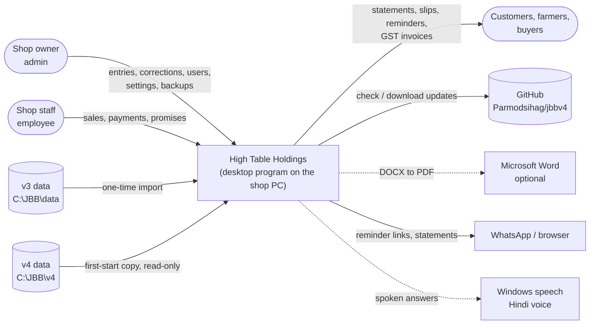
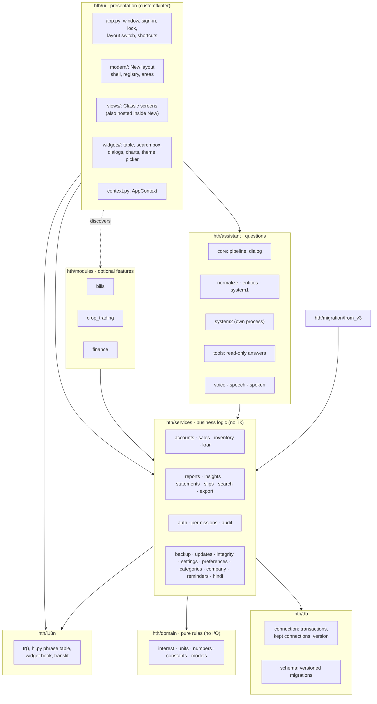
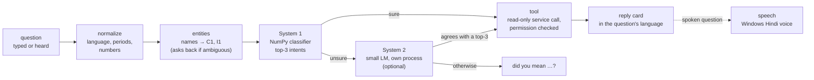
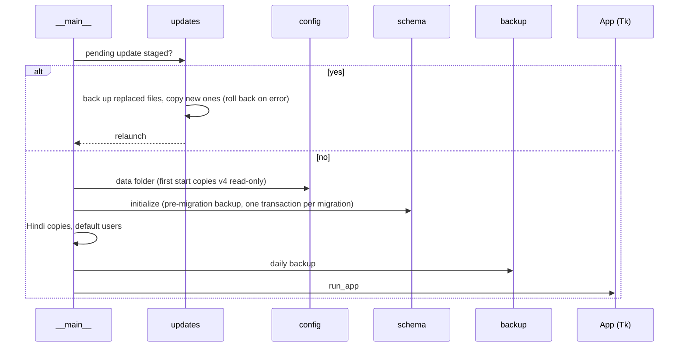
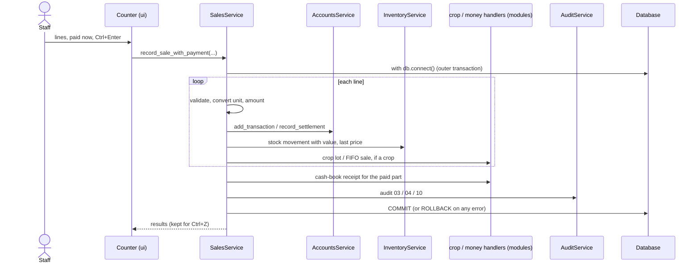
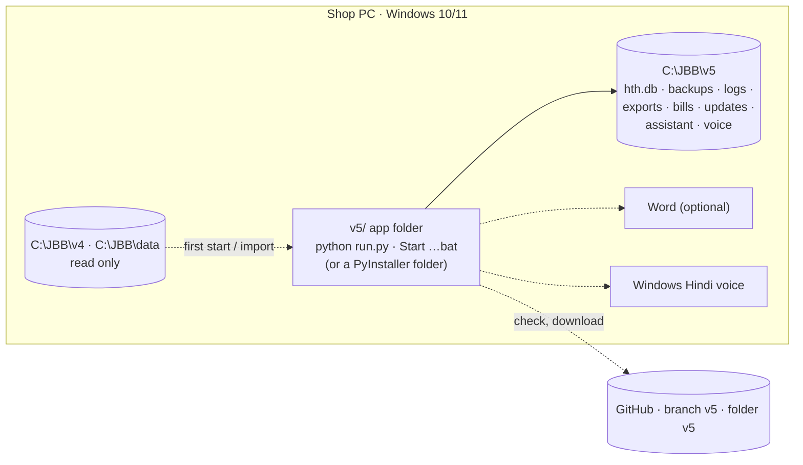

# Architecture

Software design description of High Table Holdings **5.7.0**, laid out after the arc42
template. It says how the program is built and why; the [data dictionary](DATA_DICTIONARY.md)
lists every table, and the [decision records](adr/README.md) give the reasoning behind each
major choice. The assistant and voice have their own design documents:
[AI_CHAT_DESIGN.md](AI_CHAT_DESIGN.md) and [VOICE_DESIGN.md](VOICE_DESIGN.md).

**Contents:** [1 Goals](#1-goals) · [2 Constraints](#2-constraints) · [3 Context](#3-context) ·
[4 Strategy](#4-solution-strategy) · [5 Building blocks](#5-building-blocks) ·
[6 Runtime](#6-runtime-views) · [7 Data](#7-data) · [8 Cross-cutting](#8-cross-cutting-concepts) ·
[9 Deployment](#9-deployment) · [10 Decisions](#10-decisions) · [11 Quality](#11-quality-scenarios) ·
[12 Risks and debt](#12-risks-and-technical-debt)

---

## 1. Goals

High Table Holdings is the shop computer of Jaat Beaj Bhander, an agri-input shop that sells
on credit (*khata*) with interest, tracks promised payments (*karar*), keeps stock in mixed
units, buys crops back from farmers, keeps a cash book and issues GST invoices.

Quality goals, in priority order:

| # | goal | meaning here |
|---|---|---|
| 1 | **Correctness of the books** | Every balance and interest figure equals the original program (v3) and every earlier version, to the paisa. A write is all-or-nothing. |
| 2 | **Safety of the data** | Nothing the shop typed is lost: backups by themselves, a backup before every upgrade or restore, undo, an audit trail of every change. |
| 3 | **Usability at the counter** | Keyboard-first, shop words instead of accounting words, Hindi, works on a small laptop screen. |
| 4 | **Runs offline on a weak PC** | Celeron, 4 GB, Windows, intermittent internet. |
| 5 | **Maintainability** | One developer can change one part without breaking another; tests pin the rules. |

## 2. Constraints

* **Business rules are fixed by the shop**: 24 % a year as a daily rate, compounded on
  31 March; the P/M types and 0/1/2 tags of the paper and v3 ledgers; the three-row
  settlement. Changing one is a code change plus a test change ([ADR 0004](adr/0004-business-rules-pinned-to-v3.md)).
* One shop PC, one user at a time, no server.
* Python 3.10+ with customtkinter (the existing team's toolkit); must run on customtkinter
  5.2 (the shop PC) and 6.0.
* Old data must stay importable: v3's per-customer tables and v4's database.
* No network dependency at run time; nothing about the shop's customers leaves the PC.

## 3. Context

The only outbound network traffic is the update check and download from GitHub (anonymous
HTTPS, at most once a day automatically) and `pip` installing packages an update needs.

## 4. Solution strategy

| problem | approach |
|---|---|
| Numbers must never drift | The interest formula lives in exactly one function (`hth/domain/interest.py`), pinned against v3's code by tests. Every speed-up is tested to give bit-for-bit the same answers. |
| Partial writes | One SQLite file; every unit of work is one transaction; nested service calls join the outer transaction ([ADR 0002](adr/0002-one-sqlite-file-transactional-units.md)). |
| Tangled legacy code | Strict layers: `ui → services → db / domain`. Views never write SQL; services never import Tk ([ADR 0003](adr/0003-layered-architecture.md)). |
| Optional features | Feature modules discovered at start-up through a `ModuleSpec`; the core never imports them ([ADR 0006](adr/0006-feature-modules.md)). |
| Hindi without forking the code | English stays the record of truth; a phrase table and a customtkinter hook translate what is shown ([ADR 0008](adr/0008-english-record-hindi-display.md)). |
| Questions in plain language on a Celeron | A deterministic pipeline plus a tiny NumPy classifier (System 1); an optional small language model only as a tie-breaker (System 2); read-only tools ([ADR 0009](adr/0009-assistant-two-systems-read-only.md)). |
| Getting fixes to the shop | In-app updates from GitHub: hash-checked, staged, applied before the program loads, undoable ([ADR 0011](adr/0011-in-app-updates.md)). |

## 5. Building blocks

### 5.1 Level 1: packages

**Dependency rules** (checked in review; see [CONTRIBUTING.md](../../CONTRIBUTING.md)):

1. `domain` imports nothing from `hth` except other `domain` modules. No I/O.
2. `db` knows SQLite and nothing about the business.
3. `services` use `db` and `domain`, never `tkinter` / `customtkinter`.
4. `ui` calls services; it never runs SQL.
5. Core code never imports a module from `hth/modules/`. Modules plug in through
   `ModuleSpec` and registration functions on the sales service.
6. `assistant/core.py` has no Tk, so a bot or a voice loop could use it.
7. `services/updates.py` uses the standard library only: it runs before anything else loads.

### 5.2 Level 2: services

| service | responsibility |
|---|---|
| `accounts` | customers; ledger entries; balance and interest per customer and for everyone in one ordered pass; ledger with running balance; settlement (three tag-0 rows); days and score |
| `sales` | the one entry point for every counter entry: validation, unit conversion, ledger + stock + cash book + audit in one transaction; several lines at once (`record_lines`); a sale with its payment (`record_sale_with_payment`); `undo`; hooks for crop and money-flow handlers |
| `inventory` | items, stock movements, stock on hand, valuation, unit changes that convert history, low / expiring / dead stock |
| `krar` | promises (one open per customer, rescheduled by adding dates), buckets, settle |
| `reports` | the queries behind the report catalogue; scope by category |
| `insights` | "needs attention": overdue promises, silent debtors, stock running out, expiring, data errors, future dates, stale backup, default passwords |
| `statements`, `slips`, `reminders`, `search`, `export` | HTML statements, 80 mm counter slips, reminder texts and WhatsApp links, all-words search, Excel export (openpyxl loaded on first use) |
| `auth`, `permissions`, `audit` | sign-in with PBKDF2 hashes and lockout; the role → permission matrix; the append-only audit log |
| `backup` | daily and manual backups, inspect and restore |
| `updates` | GitHub update check, staging, apply at start-up, undo; git mode for a checkout |
| `integrity` | the data check |
| `settings`, `preferences`, `company`, `categories`, `hindi` | key-value settings, shop-wide preferences (layout, theme, language, number style…), shop details, categories A–E and re-scoring, Hindi copies of names |

### 5.3 Level 2: the two layouts

Both layouts are built over the same services ([ADR 0012](adr/0012-two-layouts-one-core.md)).
**Classic** (`ui/views/`, v4–v5.4) is a sidebar of screens. **New** (`ui/modern/`, the
default since 5.5) is six areas across the top: Today, Counter, Khata, Stock, Money,
Reports, plus Settings. `ui/modern/registry.py` maps every classic screen key to its place
in an area, so `navigate("karar")` and every Alt-letter work in both. Modules name their
place in the New layout with `ModuleSpec.area` and `tab`.

### 5.4 Level 2: the assistant

Voice: Vosk's small Hindi model recognises with a grammar limited to the shop's own words
(question words, numbers, Hindi copies of customer, village and item names); when that
hearing makes no sense the same audio is decoded with the full dictionary
([ADR 0010](adr/0010-offline-voice-restricted-vocabulary.md)).

## 6. Runtime views

### 6.1 Start-up

Heavy libraries (openpyxl, matplotlib, NumPy) are imported the first time they are needed,
not at start-up.

### 6.2 Recording a sale

Any exception inside the block rolls back every row of every line and the payment.
`SalesService.undo(results)` reverses exactly what those results wrote.

### 6.3 Coming back to a screen

`Database.version` goes up on every committed write. A screen remembers the version and the
date it was filled at (`Freshness` in `ui/modern/widgets.py`); when both are unchanged, coming
back to it reads nothing. Long loads run in a worker thread (`BaseView.run_async`) that never
touches widgets: it hands its result to the Tk thread through a queue polled with `after`.

### 6.4 Installing an update

```mermaid
stateDiagram-v2
    [*] --> Current
    Current --> Checked : Check for updates
    Checked --> Current : nothing newer
    Checked --> Staged : Install (changed files, hash-checked;<br/>new packages installed)
    Staged --> Applying : next start
    Applying --> Current : files replaced,<br/>backup zip kept
    Applying --> Current : on error, old files put back
    Current --> UndoStaged : Undo last update
    UndoStaged --> Applying : next start
```

## 7. Data

One SQLite database, `hth.db`, in WAL mode with foreign keys on. Twenty tables in six
migrations: core (users, customers, ledger, items, stock movements, promises, audit,
settings), bills, crop trading, categories, finance, Hindi names. Details and every column:
[DATA_DICTIONARY.md](DATA_DICTIONARY.md).

* **Derived, never stored**: balances, interest, stock on hand, cash-book balances. They
  are computed from the rows each time, so they cannot disagree with the rows.
* **Forward-only migrations**: `MIGRATIONS` in `hth/db/schema.py`; a shipped migration is
  never edited. `PRAGMA user_version` holds the version ([ADR 0005](adr/0005-forward-only-migrations.md)).
* **English is the record**: Hindi copies of names sit beside the English ones
  (`name_hi`, `hi_manual`).

## 8. Cross-cutting concepts

### Transactions and threads

`Database.connect()` is a context manager. The outermost block on a thread commits or rolls
back; inner blocks reuse its connection. Each thread keeps one open connection between units
of work (opening one cost about 300 times a small query on Windows), and `close()` shuts them
all before the file is copied or replaced ([ADR 0013](adr/0013-kept-connections-and-freshness.md)).
A 10-second busy timeout lets a background read finish instead of failing a write.

### Permissions

One table, `ROLE_PERMISSIONS` in `services/permissions.py`: admin holds every permission,
employee a named subset. Screens hide what the user cannot do; services and assistant tools
check again. An inactive user has no permissions.

### Audit

Every write records the user (`created_by`) and an audit-log row with a two-digit code kept
from v3's daily notes: 01 account, 02 item, 03 sale, 04 receive, 05 modify, 06 delete,
07 promise, 08 login, 09 user / admin, 10 crop, 11 rate, 12 finance, 13 assistant (the tool
and its arguments, never the question text), 14 update.

### Localisation

`hth.i18n.tr(text)` looks English text up in `hi.py` (phrases with `{}` holes for numbers).
`i18n/widgets.py` wraps customtkinter so labels, buttons, tabs, menus and titles are
translated as they are shown, while the values the code reads back stay English. Dates use
Hindi month and day names. Names are transliterated offline (`translit.py`) and can be
corrected by hand.

### Errors and logging

Services raise `ValidationError` / `AuthError` with a message meant for the user; the UI
shows it as a toast. Anything unexpected is logged with its traceback to
`<data>/logs/hth.log` (rotating, 2 MB × 5) and shown as "Something went wrong". A broken
feature module is logged and skipped; it never stops the program.

### Appearance

Seven colour themes, each light and dark, are sets of tokens in `ui/theme.py`. Switching
rewrites the shared colour lists in place, so nothing is rebuilt and nothing typed is lost.
Every theme is tested for WCAG contrast (7:1 body text, 4.5:1 elsewhere). Text size
(90–130 %) scales fonts, row heights and column widths together. Numbers use Indian
grouping (12,34,567.00) by default.

### Testability

Services take a `Database`; tests give them an in-memory one. Time-dependent functions take
an optional `today`. The updater takes a `fetch` function, so tests use a fake GitHub. The
UI tests drive the real window but only when `HTH_UI_TESTS=1`. See [TEST_PLAN.md](TEST_PLAN.md).

## 9. Deployment

The app folder and the data folder are separate on purpose: an update replaces files in the
app folder only, and a backup or a move to a new PC is a copy of the data folder only.

## 10. Decisions

The architecture decision records are in [adr/](adr/README.md):

| # | decision |
|---|---|
| [0001](adr/0001-record-architecture-decisions.md) | Record architecture decisions |
| [0002](adr/0002-one-sqlite-file-transactional-units.md) | One SQLite file; every unit of work one transaction |
| [0003](adr/0003-layered-architecture.md) | Layers: ui → services → db / domain |
| [0004](adr/0004-business-rules-pinned-to-v3.md) | Business rules pinned to v3 by tests; "today" at call time |
| [0005](adr/0005-forward-only-migrations.md) | Forward-only versioned migrations, backed up first |
| [0006](adr/0006-feature-modules.md) | Feature modules discovered through `ModuleSpec` |
| [0007](adr/0007-v5-own-data-folder.md) | v5 keeps its own data folder and copies v4 read-only |
| [0008](adr/0008-english-record-hindi-display.md) | English is the record; Hindi is a display layer |
| [0009](adr/0009-assistant-two-systems-read-only.md) | Assistant: System 1 always, System 2 optional, read-only |
| [0010](adr/0010-offline-voice-restricted-vocabulary.md) | Offline voice with a vocabulary limited to the shop's words |
| [0011](adr/0011-in-app-updates.md) | In-app updates from GitHub, staged and undoable |
| [0012](adr/0012-two-layouts-one-core.md) | Two layouts over one core |
| [0013](adr/0013-kept-connections-and-freshness.md) | Kept connections and version-based screen freshness |

## 11. Quality scenarios

| quality | scenario | response | evidence |
|---|---|---|---|
| Correctness | The same data is opened in v3, v4 and v5 | Every balance, day count, score and the interest summary are identical | `tests/test_interest.py::test_matches_v3`, `tests/test_migration.py`, `tests/test_speed.py`; the 5.0 and 5.6 checks on a copy of the shop's database |
| Reliability | A line of a three-line sale fails validation | Nothing of the sale or its payment is written | `test_record_lines_is_atomic_and_undo_reverses_everything`, `test_sale_is_atomic` |
| Reliability | The power fails during a schema upgrade | The database is as before, plus a pre-migration backup | `test_failed_migration_leaves_database_untouched` |
| Recoverability | An update breaks a file while being applied | The old files are put back before the program loads | `test_a_failure_while_applying_rolls_everything_back` |
| Security | An employee opens an admin-only report by a link | Refused | `test_v5_employee_cannot_open_admin_reports_by_link` |
| Security | Someone guesses passwords | After 5 failures the username waits 30 s, doubling; failures are audited | `test_login_lockout_after_repeated_failures` |
| Performance | Dashboard / account list on 663 accounts, 6,200 entries | 0.1 s (was 4.8 s in v4); returning to an unchanged screen reads nothing | CHANGELOG 5.0.0 and 5.6.0; `test_coming_back_to_an_unchanged_screen_reads_nothing` |
| Usability | Staff read the screen in bright light | High-contrast theme; every theme meets WCAG AA (body text AAA) | `tests/test_themes.py` |
| Privacy | The assistant answers a question | Audit keeps the tool and its arguments, not the question; nothing leaves the PC | `test_answers_are_read_only_and_audited_without_the_question` |

## 12. Risks and technical debt

| item | effect | plan |
|---|---|---|
| Money is stored as SQLite `REAL` and rounded to 2 dp where shown and compared | Matches v3 exactly, which is the first goal; a switch to integer paise would have to prove the same figures | Keep; any change goes through `test_matches_v3` and a bit-for-bit comparison on the shop's data |
| Two layouts | Every screen change may need doing twice | Classic is frozen except for fixes; new work goes to New |
| No continuous integration | Tests run only on the developer's PC | Add a GitHub Actions workflow for the non-UI suite and ruff ([RELEASING.md](RELEASING.md#7-continuous-integration)) |
| UI tests are opt-in and can fail to start Tk on some PCs | UI regressions are found later | Run them before every release ([TEST_PLAN.md](TEST_PLAN.md)) |
| Minimum password length is 4; data folder not encrypted; lockout resets on restart | Weak against someone with access to the PC | Documented in [SECURITY.md](../../SECURITY.md); rely on Windows sign-in and off-PC backups |
| Customer phone numbers live inside the free-text details | WhatsApp needs a 10-digit number found in the text | A phone field is on the list of suggested work (v5 README) |
| matplotlib cannot shape Devanagari | Charts keep Latin text in Hindi mode | Accepted |
| Updates trust whatever is on the `v5` branch of the repository | A bad push reaches the shop at its next check | Release checklist; undo last update; branch protection recommended |
