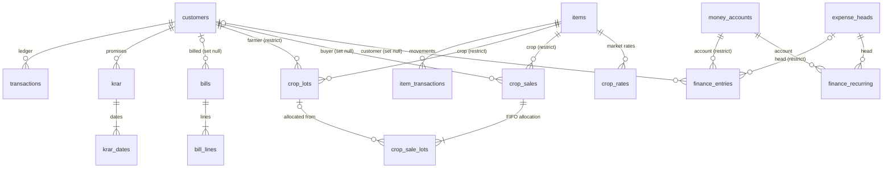

# Data dictionary

Every table and column of `hth.db` at schema version **6** (High Table Holdings 5.0 – 5.7).
The source of truth is `MIGRATIONS` in [`hth/db/schema.py`](../hth/db/schema.py); if this page
and that file disagree, the file is right and this page needs fixing.

Conventions used throughout:

* **Dates** are text `YYYY-MM-DD`; **timestamps** are text `YYYY-MM-DD HH:MM:SS`, local time.
* **Money and quantities** are `REAL`. Quantities are in the item's own stock unit.
  Money is rounded to 2 decimals where it is computed and compared.
* `created_by` holds the username that made the row; `created_at` when.
* `legacy_id` is the row's id in v3, kept by the importer.
* Balances, interest, stock on hand and cash-book balances are **never stored**: they are
  derived from the rows every time.

**Contents:** [Diagram](#diagram) · [Core](#core-migration-1) · [Bills](#bills-migration-2) ·
[Crop trading](#crop-trading-migration-3) · [Categories](#categories-migration-4) ·
[Finance](#finance-migration-5) · [Hindi names](#hindi-names-migration-6) ·
[Migrations](#migration-history) · [Settings keys](#settings-keys) · [Codes](#codes-and-enumerations)

## Diagram

`users`, `audit_log`, `settings` and `bill_month_items` stand alone. Links stored as plain
integers without a foreign key: `crop_lots.tx_id` / `stock_tx_id`, `crop_sales.tx_id` /
`stock_tx_id` and `finance_entries.tx_id` (the ledger or stock row the entry created), and
`bill_month_items.item_id`.

---

## Core (migration 1)

### users

| column | type | rules | meaning |
|---|---|---|---|
| id | INTEGER | PK | |
| username | TEXT | NOT NULL, UNIQUE, case-insensitive | sign-in name |
| full_name | TEXT | default '' | |
| role | TEXT | `admin` or `employee` | see `services/permissions.py` |
| password_hash | TEXT | NOT NULL | PBKDF2-HMAC-SHA256, 200,000 rounds, hex |
| salt | TEXT | NOT NULL | random, hex |
| is_active | INTEGER | default 1 | 0 = cannot sign in, no permissions |
| created_at | TEXT | | |

Seeded on first start: `admin` (admin), `emp1` (employee).

### customers

Every account: customers, farmers, buyers and suppliers alike.

| column | type | rules | meaning |
|---|---|---|---|
| id | INTEGER | PK | the account number shown as `#id` (v3's number after an import) |
| name | TEXT | NOT NULL, indexed | |
| other_details | TEXT | default '' | free text: father's name, village, phone. The WhatsApp number is the first 10-digit mobile number found here. |
| created_at | TEXT | | |
| category, category_locked | | | see [migration 4](#categories-migration-4) |
| name_hi, details_hi, hi_manual | | | see [migration 6](#hindi-names-migration-6) |

### transactions (the ledger)

One ledger for every account (v3 had a table per customer).

| column | type | rules | meaning |
|---|---|---|---|
| id | INTEGER | PK | order of entry; ties on the same date are ordered by id |
| customer_id | INTEGER | FK customers, ON DELETE CASCADE | |
| date | TEXT | NOT NULL | the entry's date (interest runs from here) |
| description | TEXT | default '' | what the counter wrote, e.g. `4 BAG = UREA 45KG NA`, `1 = CASH`, `Settled Amount`, `Discount` |
| amount | REAL | NOT NULL | positive, except derived settlement rows, which may be negative |
| type | TEXT | `P` or `M` | P = debit (the account owes us more), M = credit (paid us / we owe them) |
| tag | TEXT | `0`, `1` or `2` | 1 = earns interest, 2 = no interest, 0 = settlement marker |
| legacy_id | INTEGER | | v3 row id |
| created_by, created_at | TEXT | | |

Index `ix_tx_customer_date (customer_id, date, id)`: one ordered scan gives every balance.

**Balance rule.** Only rows after the account's last tag-0 row count. P adds, M subtracts;
a tag-1 row counts with its interest to today. See [user guide §15](USER_GUIDE.md#15-how-the-numbers-work).

### items

| column | type | rules | meaning |
|---|---|---|---|
| id | INTEGER | PK | |
| name | TEXT | NOT NULL, indexed | |
| stock_value | REAL | default 0 | cost per stock unit |
| last_value | REAL | default 0 | last sale price per stock unit (fills the rate at the counter) |
| unit | TEXT | default `PCS` | stock unit: G, KG, QTL, ML, LTR, PCS, BAG, BOX, PKT, BTL |
| batch | TEXT | default `NA` | |
| expiry_date | TEXT | default `NA` | `YYYY-MM-DD` or `NA` |
| gst_rate | REAL | default 0 | percent |
| item_type | TEXT | default `S` | F fertiliser, P pesticide, S seed, C crop, O other |
| pakka_kacha | TEXT | default `P` | P pakka, K kacha |
| created_at | TEXT | | |
| category, category_locked | | | [migration 4](#categories-migration-4) |
| name_hi, hi_manual | | | [migration 6](#hindi-names-migration-6) |

### item_transactions (stock movements)

| column | type | rules | meaning |
|---|---|---|---|
| id | INTEGER | PK | |
| item_id | INTEGER | FK items, ON DELETE CASCADE | |
| date | TEXT | NOT NULL | |
| received | REAL | default 0 | quantity in (stock unit) |
| sale | REAL | default 0 | quantity out (stock unit) |
| description | TEXT | default '' | usually the account's name |
| tags | TEXT | default '' | free tags shown in the movement list |
| legacy_id | INTEGER | | v3 row id |
| created_by, created_at | TEXT | | |
| value | REAL | default 0 (migration 5) | money value of the movement: price × quantity. 0 for movements imported from v3, which are left out of item profit. |

Index `ix_itx_item_date (item_id, date, id)`. Stock on hand = Σ received − Σ sale.

### krar and krar_dates (promises to pay)

| table.column | type | rules | meaning |
|---|---|---|---|
| krar.id | INTEGER | PK | |
| krar.customer_id | INTEGER | FK customers, CASCADE | at most one open krar per customer |
| krar.is_nill | INTEGER | default 0 | 1 = settled / kept |
| krar.created_at | TEXT | | |
| krar_dates.id | INTEGER | PK | |
| krar_dates.krar_id | INTEGER | FK krar, CASCADE | |
| krar_dates.date | TEXT | NOT NULL | a promised date; a new date on an open krar reschedules it. The latest date decides Late / Today / Upcoming. |

Indexes `ix_krar_customer (customer_id, is_nill)`, `ix_krar_dates (krar_id, date)`.

### audit_log

Append-only. v3's "daily notes" are imported here.

| column | type | rules | meaning |
|---|---|---|---|
| id | INTEGER | PK | |
| ts | TEXT | default now | timestamp |
| date | TEXT | default today, indexed | |
| username | TEXT | default `system` | who |
| code | TEXT | NOT NULL | see [audit codes](#audit-codes) |
| message | TEXT | NOT NULL | what, in words |

### settings

Key–value store for shop-wide settings. Values are text; lists are comma-separated.

| column | type | rules |
|---|---|---|
| key | TEXT | PK |
| value | TEXT | NOT NULL |

Keys are listed [below](#settings-keys).

## Bills (migration 2)

### bills

| column | type | rules | meaning |
|---|---|---|---|
| id | INTEGER | PK | |
| bill_number | INTEGER | NOT NULL, UNIQUE | financial year prefix + serial: 2627001 is the first bill of FY 2026-27 |
| date | TEXT | NOT NULL, indexed | |
| customer_name | TEXT | NOT NULL | as printed |
| customer_address | TEXT | default '' | |
| customer_id | INTEGER | FK customers, ON DELETE SET NULL | when billed to an account |
| taxable, cgst, sgst, grand_total | REAL | default 0 | grand_total = taxable + cgst + sgst |
| source | TEXT | default `manual` | `manual`, or `batch` for the month-end batch |
| docx_path | TEXT | | the rendered file |
| created_by, created_at | TEXT | | |

### bill_lines

| column | type | rules | meaning |
|---|---|---|---|
| id | INTEGER | PK | |
| bill_id | INTEGER | FK bills, CASCADE | |
| name, unit, batch, expiry_date | TEXT | | copied from the item at billing time |
| rate | REAL | NOT NULL | per unit |
| item_type | TEXT | default `O` | decides the GST rate |
| quantity, amount | REAL | NOT NULL | amount = rate × quantity (taxable) |
| gst_rate, cgst, sgst | REAL | default 0 | CGST = SGST = 9 % for P, 2.5 % for F, 0 for S / O |

### bill_month_items

The admin's month-end batch input: each item's total sold in a month.

| column | type | meaning |
|---|---|---|
| id | INTEGER PK | |
| month_year | TEXT, indexed | the month |
| item_id | INTEGER | the item (no foreign key) |
| name, unit, item_type, batch, expiry_date | TEXT | |
| rate | REAL | |
| start_date | TEXT | sell-from date within the month |
| quantity | REAL | total sold in the month |

## Crop trading (migration 3)

A crop is an item of type `C`; farmers and buyers are accounts in `customers`.

### crop_lots (purchases)

| column | type | rules | meaning |
|---|---|---|---|
| id | INTEGER | PK | |
| date | TEXT | NOT NULL | |
| farmer_id | INTEGER | FK customers, ON DELETE RESTRICT | |
| item_id | INTEGER | FK items, ON DELETE RESTRICT | the crop |
| gross_qty | REAL | NOT NULL | weighed |
| deduction_qty | REAL | default 0 | *kaat* |
| qty | REAL | NOT NULL | net = gross − deduction |
| remaining_qty | REAL | NOT NULL | not yet sold (FIFO) |
| rate | REAL | NOT NULL | per stock unit |
| amount | REAL | NOT NULL | net × rate, credited to the farmer |
| quality | TEXT | default '' | A, B, C or MIX |
| notes | TEXT | default '' | |
| tx_id, stock_tx_id | INTEGER | | the ledger row and stock movement it wrote |
| created_by, created_at | TEXT | | |

Indexes on `(item_id, date, id)` and `(farmer_id, date)`. RESTRICT is why a farmer or crop
with lots cannot be deleted.

### crop_sales

| column | type | rules | meaning |
|---|---|---|---|
| id | INTEGER | PK | |
| date | TEXT | NOT NULL | |
| buyer_id | INTEGER | FK customers, ON DELETE SET NULL | null for a cash sale |
| buyer_name | TEXT | default `CASH` | |
| item_id | INTEGER | FK items, RESTRICT | |
| qty, rate, amount | REAL | NOT NULL | |
| cost | REAL | default 0 | FIFO cost of the quantity sold |
| margin | REAL | default 0 | amount − cost |
| short_qty | REAL | default 0 | sold beyond the open lots ("allow selling short"), costed at the last purchase rate |
| notes | TEXT | default '' | |
| tx_id, stock_tx_id | INTEGER | | |
| created_by, created_at | TEXT | | |

### crop_sale_lots (FIFO allocation)

| column | type | rules | meaning |
|---|---|---|---|
| id | INTEGER | PK | |
| sale_id | INTEGER | FK crop_sales, CASCADE | |
| lot_id | INTEGER | FK crop_lots, SET NULL | |
| qty | REAL | NOT NULL | taken from that lot |
| cost_rate, cost | REAL | NOT NULL | the lot's rate; qty × rate |

### crop_rates (market rates)

| column | type | rules | meaning |
|---|---|---|---|
| id | INTEGER | PK | |
| item_id | INTEGER | FK items, CASCADE | |
| date | TEXT | NOT NULL | |
| rate | REAL | NOT NULL | per stock unit |
| source | TEXT | default `manual` | `manual`, `csv`, or a provider |
| created_at | TEXT | | |

UNIQUE `(item_id, date, source)`.

## Categories (migration 4)

| column | on | default | meaning |
|---|---|---|---|
| category | customers, items | `C` | A best … D worst; E = defaulter (customer) / discontinued (item), set by hand only |
| category_locked | customers, items | 0 | 1 = set by hand; re-scoring and auto-categorising skip it |

Indexed on both tables.

## Finance (migration 5)

### money_accounts

| column | type | rules | meaning |
|---|---|---|---|
| id | INTEGER | PK | |
| name | TEXT | NOT NULL, UNIQUE, case-insensitive | `CASH` is created by itself |
| kind | TEXT | `cash`, `bank`, `upi`, `other` | |
| opening_balance | REAL | default 0 | |
| opening_date | TEXT | default today | |
| is_active | INTEGER | default 1 | |
| notes | TEXT | default '' | |

The default account for the counter is the setting `finance.default_account`.

### expense_heads

| column | type | rules | meaning |
|---|---|---|---|
| id | INTEGER | PK | |
| name | TEXT | NOT NULL, UNIQUE, case-insensitive | |
| kind | TEXT | `expense` or `income` | |
| is_active | INTEGER | default 1 | |

Created by themselves: RENT, SALARIES, ELECTRICITY, TRANSPORT, EMI, INTEREST PAID, REPAIRS,
OFFICE & STATIONERY, BANK CHARGES, TAXES & FEES, OTHER EXPENSE (expense); COMMISSION, INTEREST
RECEIVED, OTHER INCOME (income).

### finance_entries (the cash book)

| column | type | rules | meaning |
|---|---|---|---|
| id | INTEGER | PK | |
| date | TEXT | NOT NULL | |
| kind | TEXT | see below | |
| account_id | INTEGER | FK money_accounts, RESTRICT | the account the money moves in or out of |
| counter_account_id | INTEGER | FK money_accounts, RESTRICT | the other account of a transfer |
| head_id | INTEGER | FK expense_heads, RESTRICT | for expense / income |
| customer_id | INTEGER | FK customers, SET NULL | for receipt / payment |
| amount | REAL | NOT NULL | positive |
| description | TEXT | default '' | |
| tx_id | INTEGER | | the ledger row a counter receipt / payment belongs to; editing or deleting that row keeps this one in step |
| created_by, created_at | TEXT | | |

`kind`: `receipt` (customer paid us), `payment` (we paid a customer), `expense`, `income`,
`transfer`, `owner_in` (capital in), `owner_out` (drawings). Indexes on
`(account_id, date, id)`, `date`, `head_id`.

### finance_recurring

| column | type | rules | meaning |
|---|---|---|---|
| id | INTEGER | PK | |
| head_id | INTEGER | FK expense_heads, RESTRICT | |
| account_id | INTEGER | FK money_accounts, RESTRICT | |
| amount | REAL | NOT NULL | |
| day_of_month | INTEGER | default 1 | due day |
| description | TEXT | default '' | |
| is_active | INTEGER | default 1 | |
| start_month | TEXT | NOT NULL | `YYYY-MM`, first month to post |
| last_posted | TEXT | | `YYYY-MM` last posted; posting is idempotent |

## Hindi names (migration 6)

| column | on | default | meaning |
|---|---|---|---|
| name_hi | customers, items | '' | Hindi copy of the name, made by transliteration or typed |
| details_hi | customers | '' | Hindi copy of the details |
| hi_manual | customers, items | 0 | 1 = corrected by hand; never regenerated |

English stays the record of truth for ledgers, bills, search and exports of the data.

## Migration history

| version | release | adds |
|---|---|---|
| 1 | 4.0.0 | users, customers, transactions, items, item_transactions, krar, krar_dates, audit_log, settings |
| 2 | 4.1.0 | bills, bill_lines, bill_month_items |
| 3 | 4.2.0 | crop_lots, crop_sales, crop_sale_lots, crop_rates |
| 4 | 4.4.0 | category, category_locked on customers and items |
| 5 | 4.5.0 | money_accounts, expense_heads, finance_entries, finance_recurring; item_transactions.value |
| 6 | 5.1.0 | name_hi, details_hi, hi_manual on customers; name_hi, hi_manual on items |

`PRAGMA user_version` holds the version. Each migration runs in one transaction together
with its version bump. Before migrating an existing database the program writes
`backups/hth_pre_migration_v<N>_<time>.db`. A shipped migration is never edited; a change is
a new entry at the end ([ADR 0005](adr/0005-forward-only-migrations.md)).

## Settings keys

Stored in the `settings` table. A key that is missing takes its default.

| key | default | meaning |
|---|---|---|
| `ui.layout` | `new` | `new` or `classic`, for the whole shop |
| `ui.language` | `en` | `en` or `hi` |
| `ui.theme` | `dark` | Mode: `light`, `dark`, `system` |
| `ui.color_theme` | `slate` | `slate`, `forest`, `saffron`, `indigo`, `plum`, `paper`, `contrast` |
| `ui.number_style` | `indian` | `indian` (12,34,567.00) or `international` |
| `ui.text_scale` | `1.0` | `0.9`, `1.0`, `1.15`, `1.3` |
| `ui.sidebar_compact` | `0` | Classic: sidebar shows icons only |
| `security.lock_minutes` | `0` | lock after N idle minutes; 0 = never |
| `backup.auto` | `1` | daily backup on |
| `backup.keep` | `14` | automatic backups kept |
| `company.name`, `.tagline`, `.address`, `.phone`, `.gstin`, `.licences`, `.footer` | | shop details |
| `reminder.template`, `reminder.template_hi` | built in | reminder wording, English and Hindi |
| `customer.default_category` | `C` | category of a new customer |
| `customer.report_categories` | `A,B,C,D` | categories reports include |
| `customer.thresholds` | `0.25,0.5,0.75` | score limits for A / B / C / D |
| `customer.exclude_defaulters_from_score` | `1` | keep E out of the score's min / max |
| `item.report_categories` | `A,B,C,D` | |
| `item.velocity_days` | `30,90,180` | days since last sale for item categories A / B / C, else D |
| `finance.default_account` | | the counter's default money account |
| `reports.pinned` | | pinned reports in the catalogue |
| `assistant.speak` | `voice` | speak answers: `voice` (when asked by voice), `always`, `never` |
| `assistant.mic` | '' | recording device; '' = automatic, never a loopback device |
| `update.repo`, `update.branch`, `update.folder` | `Parmodsihag/jbbv4`, `v5`, `v5` | where updates come from |
| `update.last_check`, `update.result_seen` | | bookkeeping for the daily check and the after-update message |
| `upgrade.copied_from`, `upgrade.notice_shown` | | the first-start copy of v4 and its one-time notice |
| `setup.completed` | | the first-run wizard was done or skipped |

## Codes and enumerations

### Audit codes

| code | meaning | since |
|---|---|---|
| 01 | account added | v3 |
| 02 | item added | v3 |
| 03 | sale (debit) | v3 |
| 04 | receive (credit) | v3 |
| 05 | modify | v3 |
| 06 | delete | v3 |
| 07 | promise (krar) | 4.0 |
| 08 | login, logout, failed sign-in | 4.0 |
| 09 | user / admin action (users, restore, setup, import) | 4.0 |
| 10 | crop lot / sale | 4.2 |
| 11 | market rate | 4.2 |
| 12 | finance | 4.5 |
| 13 | assistant answer (tool and arguments, not the question) | 5.2 |
| 14 | update | 5.4 |

### Units

| family | units | conversion |
|---|---|---|
| mass | G, KG, QTL | 1 QTL = 100 KG = 100,000 G |
| volume | ML, LTR | 1 LTR = 1,000 ML |
| count | PCS, BAG, BOX, PKT, BTL | not convertible; a unit change asks for a factor |

Defined in `hth/domain/units.py`.
