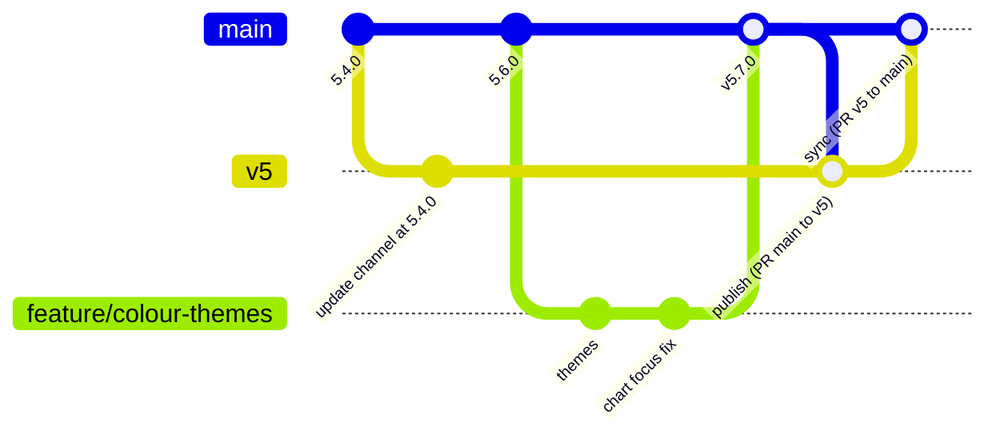

# Releasing

How a change becomes a version the shop installs, how to take it back, and how versions,
branches and the CHANGELOG are kept. This is the project's configuration-management and
release-management procedure.

## 1. Versions

[Semantic versioning](https://semver.org), read from the shop's point of view:

| part | raise it when | examples |
|---|---|---|
| **major** (5 → 6) | the data moves to a new folder or the program is rebuilt; v4 and v5 run side by side | 4.0.0 rewrite; 5.0.0 own data folder |
| **minor** (5.6 → 5.7) | new things the shop can see or use; a database migration | 5.1 Hindi, 5.4 updates, 5.7 colour themes |
| **patch** (5.3.0 → 5.3.1) | fixes only, no new feature, no migration | 5.3.1 microphone fix |

The version lives in **two places**, kept equal:

* `v5/hth/__init__.py`: `__version__` (the updater reads this one);
* `v5/pyproject.toml`: `version`.

The database has its own version (`PRAGMA user_version`), raised only by a migration
([DATA_DICTIONARY.md](DATA_DICTIONARY.md#migration-history)).

## 2. Branches



* Work happens on short branches from `main` and is merged into `main` by pull request
  ([CONTRIBUTING.md](../../CONTRIBUTING.md#workflow)).
* **`v5` is the update channel.** Shop PCs check `Parmodsihag/jbbv4`, branch `v5`, folder
  `v5` at most once a day. Merging into `v5` *is* publishing.
* `main` and `v5` are kept equal after each release.
* Branch protection on `v5` (pull requests only, no force-push) is recommended: a bad push
  there reaches the shop.
* Snapshots worth keeping get a tag (the repository has `v4-snapshot-2026-10-19`). Tag each
  release `v<version>` from now on.

## 3. Release checklist

### Prepare (on a branch, merged into `main`)

- [ ] Raise the version in `hth/__init__.py` and `pyproject.toml`.
- [ ] Add `## <version> — <date>` at the top of `CHANGELOG.md`: what the shop will notice, in
      its words, then *Fixed*, then *Under the hood* if useful. The updater shows this text
      to the shop, so write it for them.
- [ ] New packages are in `requirements.txt` (the updater installs them) and `pyproject.toml`.
- [ ] A migration, if any, is a new entry at the end of `MIGRATIONS`; the data dictionary is
      updated.
- [ ] User and admin guides updated where the shop will see a difference.

### Test (the [test plan](TEST_PLAN.md)'s exit criteria)

- [ ] `pytest` passes.
- [ ] `HTH_UI_TESTS=1 pytest tests/test_ui_smoke.py tests/test_ui_modern.py` passes.
- [ ] `ruff check hth tests tools` and `ruff format --check hth tests tools` are clean.
- [ ] If the books' code changed: every balance, day count, score and the interest summary on
      a copy of the shop's database equal the previous version's.
- [ ] If a migration was added: restore a copy of the shop's backup into a test folder and
      start the new version on it; check the pre-migration backup appears.
- [ ] Write `docs/TEST_REPORT_<version>.md`.

### Publish

- [ ] Pull request `main` → `v5`; merge.
- [ ] Tag the merge `v<version>` and push the tag.
- [ ] On a test copy of the app folder (not a git checkout): Settings › Updates › Check;
      the new version and its notes appear; Install; Restart now; the About section shows
      the new version.
- [ ] Pull request `v5` → `main` if `v5` gained a merge commit, so the two stay equal.

### After the shop installs it

- [ ] Ask the owner to open the program; check `logs/updates.log` says `ok`.
- [ ] Run the acceptance steps that concern the release ([sme/08 §6.4](../../sme/08_Test_Cases.md)).

## 4. Rolling back

| situation | do |
|---|---|
| The update installed but the new version misbehaves | Settings › Updates › **Undo last update**, then restart. The previous files come back. |
| The new version does not start | Unzip the newest `<data>\updates\before-….zip` over the app folder by hand ([ADMIN_GUIDE.md §7](ADMIN_GUIDE.md#7-troubleshooting)). |
| The new version migrated the database and the old version must run again | Restore `backups\hth_pre_migration_v<N>_<time>.db` after undoing the update. Entries made since are lost, so prefer a fix forward. |
| A bad version is on `v5` and not yet installed everywhere | Revert the merge on `v5` (a new commit, never a force-push) and release a patch with a higher version number. The updater only installs a *newer* version, so a revert alone does not reach PCs that already updated. |

## 5. Hotfixes

For an S1 or S2 defect ([TEST_PLAN.md §7](TEST_PLAN.md#7-defect-management)) in a released
version:

1. Branch `fix/<name>` from `v5`.
2. Fix it with its regression test; raise the **patch** number; CHANGELOG entry under
   *Fixed*.
3. Run the full test plan (a hotfix gets no shortcut on tests).
4. Pull request into `v5`, then `v5` → `main`.

## 6. Packaged builds

A PyInstaller folder is built from a tagged commit:

```bash
pyinstaller --noconfirm --windowed --name HighTableHoldings --add-data "bundled;bundled" --collect-all vosk run.py
```

It cannot update itself; a new version is a new folder copied over the old one (the data
folder is separate and untouched).

## 7. Continuous integration

There is no CI yet; the checklist above is run by hand. The suggested first workflow, for
`.github/workflows/tests.yml`:

```yaml
name: tests
on: [push, pull_request]
jobs:
  test:
    runs-on: windows-latest
    defaults: { run: { working-directory: v5 } }
    steps:
      - uses: actions/checkout@v4
      - uses: actions/setup-python@v5
        with: { python-version: "3.10" }
      - run: python -m pip install --upgrade pip
      - run: pip install -r requirements-dev.txt
      - run: ruff check hth tests tools
      - run: ruff format --check hth tests tools
      - run: pytest -rs
```

The UI suites need a desktop session and stay a manual step. Making the workflow a required
check on `main` and `v5` turns the first exit criterion into a rule.
